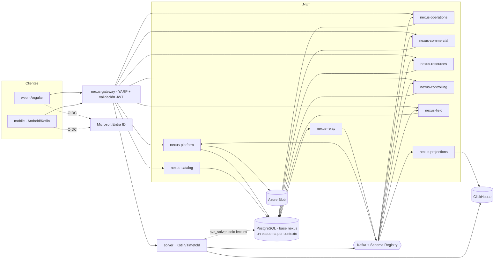

# Arquitectura de implementación

Este documento concreta el stack aprobado (Parte 3) en servicios desplegables, esquemas de base de datos y reglas de comunicación. Las piezas marcadas `[+]` son decisiones de implementación nuevas, recogidas en ADR.

## §1 Vista general

## §2 Servicios desplegables `[+]`

Un servicio desplegable agrupa uno o varios bounded contexts. Cada contexto tiene su propio esquema, así que un contexto puede moverse a otro servicio sin tocar el esquema (ADR-0002).

| Servicio | Carpeta | Contextos (esquemas que posee) | Primer paso |
|---|---|---|---|
| `nexus-gateway` | `src/Gateway` | — (enrutado, JWT, CORS, rate limit) | 0.5 |
| `nexus-platform` | `src/Platform` | `org`, `access`, `workflow`, `docs`, `gdpr` | 0.4 |
| `nexus-catalog` | `src/Catalog` | `uom`, `catalog` | 1.2 |
| `nexus-operations` | `src/Operations` | `project`, `stock`, `logistics` | 2.1 |
| `nexus-commercial` | `src/Commercial` | `commercial`, `billing` | 5.1 |
| `nexus-resources` | `src/Resources` | `hr` | 5.3 |
| `nexus-controlling` | `src/Controlling` | `controlling` | 5.6 |
| `nexus-field` | `src/Field` | `warehouse`, `commissioning`, `field` | 6.1 |
| `nexus-relay` | `src/OutboxRelay` | lee `outbox` | 0.7 |
| `nexus-projections` | `src/Projections` | escribe en ClickHouse | 0.8 |
| `nexus-migration` | `src/Migration` | `migration` (herramienta de Fase 7, no servicio) | 7.2 |
| `solver` | `solver/` | — (solo lectura) | 4.4 |
| `web` | `web/` | — | 0.5 |
| `mobile` | `mobile/` | — | 6.4 |

**Por qué `project`, `stock` y `logistics` comparten servicio:** confirmar una `Transfer` asienta `StockMovement` en el ledger, y una `Reservation` se convierte en movimiento. Las tres cosas tienen que ocurrir en la misma transacción.

## §3 Base de datos: una base, un esquema por contexto `[+]`

Hay una sola base PostgreSQL (`nexus`) con un esquema por contexto. Esto mantiene RLS transaccional en todos los servicios (ADR-0002, ADR-0004).

| Tipo de esquema | Esquemas | Quién escribe | Quién lee |
|---|---|---|---|
| **Referencia** | `org`, `uom`, `catalog` | Solo su servicio propietario | Cualquier servicio, solo lectura (grant `SELECT`) |
| **Seguridad** | `access` | Solo `nexus-platform` | Ningún servicio lee sus tablas; todos ejecutan las funciones `access.visible_*()` |
| **Transaccional** | `workflow`, `docs`, `gdpr`, `project`, `stock`, `logistics`, `commercial`, `billing`, `hr`, `controlling`, `warehouse`, `commissioning`, `field` | Solo su servicio propietario | Solo su servicio propietario |
| **Infraestructura** | `outbox`, `inbox`, `migration` | Todos insertan en `outbox`; `inbox` por consumidor | `nexus-relay` lee `outbox` |

Reglas:
- **ARC-R1:** un servicio solo escribe en sus esquemas. Se garantiza con roles de base de datos (`conventions-database.md §2`).
- **ARC-R2:** las FK entre esquemas solo se permiten hacia esquemas de **referencia** (`org`, `uom`, `catalog`). Entre esquemas transaccionales, la relación es por id sin FK.
- **ARC-R3:** un servicio no lee el esquema transaccional de otro. Si necesita esos datos, consume sus eventos y mantiene una réplica local, o llama a su API de consulta.
- **ARC-R4:** `org` y `access` son los únicos esquemas que intervienen en las políticas RLS.

## §4 Comunicación

| Tipo | Mecanismo | Uso |
|---|---|---|
| Cliente → servicio | HTTPS vía `nexus-gateway` (`/api/<servicio>/...`) | Todo el tráfico de usuario |
| Servicio → servicio (consulta) | HTTP interno, con el token del usuario propagado | Solo lecturas puntuales que no estén en un esquema de referencia |
| Servicio → servicio (cambio) | Evento de dominio por Outbox → Kafka | Siempre. Nunca un comando síncrono que escriba en otro servicio |
| Proyecciones | Kafka → `nexus-projections` → ClickHouse | ATP, P&L, reporting |
| Solver | REST para lanzar y consultar corridas; eventos para publicar resultados | Fase 4 |

## §5 Seguridad en capas

1. **Autenticación:** Microsoft Entra ID (OIDC). El gateway valida el JWT (ADR-0006).
2. **Autorización por acción (RBAC):** cada endpoint exige un `Permission` (`resource_type` + `action`). La comprobación se hace en la aplicación (`conventions-backend.md §5`).
3. **Visibilidad por fila (RLS):** PostgreSQL filtra cada fila según el alcance del usuario. Es la última línea de defensa, nunca la única (`domain/access.md`).
4. **ClickHouse no tiene RLS por usuario.** Toda consulta analítica pasa por un servicio .NET que inyecta el filtro de alcance calculado en PostgreSQL (`conventions-api.md §7`).

## §6 Puertos locales `[+]`

| Componente | Puerto |
|---|---|
| `nexus-gateway` | 8080 |
| `nexus-platform` | 5101 |
| `nexus-catalog` | 5102 |
| `nexus-operations` | 5103 |
| `nexus-commercial` | 5104 |
| `nexus-resources` | 5105 |
| `nexus-controlling` | 5106 |
| `nexus-field` | 5107 |
| `solver` | 5201 |
| `web` (ng serve) | 4200 |
| Prism mock | 4010 + n |
| PostgreSQL | 5432 |
| Kafka | 9092 |
| Schema Registry | 8081 |
| Kafka UI | 8085 |
| ClickHouse HTTP / nativo | 8123 / 9000 |
| Azurite Blob | 10000 |
| Keycloak (IdP de desarrollo, ADR-0006) | 8180 |
| Aspire Dashboard (OTLP gRPC / UI) | 4317 / 18888 |
