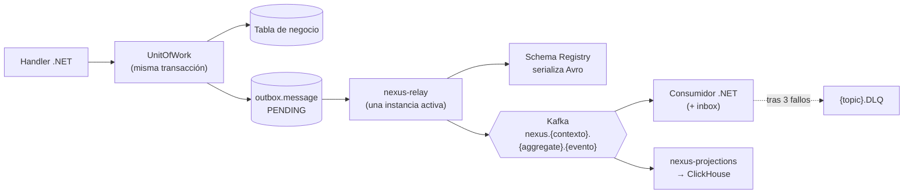

# Eventos: Outbox, Kafka, Avro y consumidores (A7)

Origen: A7 (P7), Parte 3 §16 y §20. Lo marcado `[+]` es concreción de implementación (ADR-0008 para Avro).

## §1 Flujo



## §2 Envoltorio del evento (`DomainEvent`)

El contrato A7 se reparte entre **cabeceras Kafka** (envoltorio) y **valor Avro** (payload) `[+]`. Así el payload de cada evento no repite los campos comunes y cualquier consumidor puede deduplicar u ordenar sin deserializar.

| Campo A7 | Dónde viaja | Tipo |
|---|---|---|
| `event_id` | cabecera `nexus-event-id` | UUIDv7 |
| `event_type` | cabecera `nexus-event-type` | `<contexto>.<aggregate>.<evento>` |
| `aggregate_type` | cabecera `nexus-aggregate-type` | texto |
| `aggregate_id` | cabecera `nexus-aggregate-id` **y clave del mensaje Kafka** | UUID |
| `aggregate_version` `[+]` | cabecera `nexus-aggregate-version` | entero, crece por agregado |
| `occurred_at` | cabecera `nexus-occurred-at` | ISO-8601 UTC |
| `actor_user_id` | cabecera `nexus-actor-user-id` | UUID |
| `schema_version` | cabecera `nexus-schema-version` | entero (`v<n>` del archivo `.avsc`) |
| `correlation_id` | cabecera `nexus-correlation-id` | UUID |
| `causation_id` | cabecera `nexus-causation-id` | UUID del evento o petición que lo causó |
| `legal_entity_id` `[+]` | cabecera `nexus-legal-entity-id` | UUID o vacío. Lo usan las proyecciones para filtrar por alcance |
| `payload` | valor del mensaje | Avro |

## §3 Tabla Outbox

Se crea en el paso **0.3** (junto con `inbox.processed_message` y el `OutboxWriter`), para que 0.4 ya emita eventos; el relay llega en 0.7.

```sql
CREATE SCHEMA outbox;

CREATE TABLE outbox.message (
  id                uuid PRIMARY KEY,                 -- = event_id
  topic             text        NOT NULL,
  aggregate_type    text        NOT NULL,
  aggregate_id      uuid        NOT NULL,
  aggregate_version bigint      NOT NULL,             -- [+]
  event_type        text        NOT NULL,
  schema_version    integer     NOT NULL,
  headers           jsonb       NOT NULL,             -- resto del envoltorio §2
  payload           text        NOT NULL,             -- [+] Avro en codificación JSON; el relay lo pasa a binario.
                                                        -- text, no jsonb (ADR-0013): un decimal Avro (bytes) puede
                                                        -- producir un escape \u0000, que jsonb rechaza.
  created_at        timestamptz NOT NULL,
  published_at      timestamptz NULL,
  status            text        NOT NULL DEFAULT 'PENDING'
                    CHECK (status IN ('PENDING','PUBLISHED','FAILED')),
  attempts          integer     NOT NULL DEFAULT 0,   -- [+]
  last_error        text        NULL                  -- [+]
);
CREATE INDEX ix_outbox_pending ON outbox.message (created_at, id) WHERE status = 'PENDING';
```

- **EV-R1:** el payload se guarda en JSON (codificación JSON de Avro). La transacción de negocio no depende de que el Schema Registry esté disponible.
- **EV-R2:** el `UnitOfWork` valida el payload contra el esquema `.avsc` local antes de insertarlo. Un payload inválido aborta la transacción.
- Un trigger `AFTER INSERT` emite `NOTIFY outbox_new` para despertar al relay.

## §4 Relay (`nexus-relay`)

1. Toma un *advisory lock* de PostgreSQL al arrancar. **Solo una instancia activa**; las demás esperan en espera pasiva.
2. Bucle: espera `NOTIFY outbox_new` o 500 ms, lo que llegue antes.
3. `SELECT ... WHERE status = 'PENDING' ORDER BY created_at, id LIMIT 500 FOR UPDATE SKIP LOCKED`.
4. Por cada mensaje: serializa a Avro con Schema Registry y produce con productor idempotente (`enable.idempotence=true`, `acks=all`). Clave = `aggregate_id`.
5. Marca `PUBLISHED` + `published_at`. En error: `attempts + 1`, `last_error`. Con `attempts >= 10` → `FAILED` y métrica de alerta.
6. Purga diaria: borra filas `PUBLISHED` con más de 7 días. Es la única operación de borrado permitida sobre `outbox.message`.

- **EV-R3:** el orden por agregado se garantiza porque hay un solo relay, procesa por `created_at` y la clave Kafka es `aggregate_id`.
- Escalar a varias instancias activas requiere ADR (reparto por hash de `aggregate_id`).

## §5 Topics

- Nombre: `nexus.{contexto}.{aggregate}.{evento}` en kebab-case. Ejemplos del manual: `nexus.stock.movement.posted`, `nexus.commercial.contract.signed`, `nexus.platform.approval.requested`.
- Contextos válidos: `platform`, `org`, `catalog`, `project`, `stock`, `logistics`, `solver`, `commercial`, `billing`, `hr`, `controlling`, `warehouse`, `commissioning`, `field`. `access`, `workflow`, `docs` y `gdpr` publican como `platform` (como en el manual).
- Los eventos de versionado A10 (`nexus.masterdata.{tabla}.versioned` en el manual) se publican como `nexus.{contexto}.{aggregate}.versioned`, p. ej. `nexus.catalog.price-rule.versioned` `[+]`.
- Verbo en participio pasado: `created`, `updated`, `deactivated`, `posted`, `confirmed`, `versioned`…
- DLQ: `{topic}.DLQ`.
- Registro de topics: `contracts/events/topics.yaml` (nombre, particiones, esquema). Los topics se crean desde ese archivo (script local en 0.7, Terraform en 0.11). `auto.create.topics.enable=false`.

| Parámetro `[+]` | Local | Azure |
|---|---|---|
| Particiones | 1 | 6 (12 para `stock.*`, `warehouse.*`, `field.*`) |
| Réplicas | 1 | 3 |
| Retención topics de dominio | infinita | infinita ⚑ revisar coste en ADR-0011 |
| Retención DLQ | 14 días | 14 días |

La retención infinita permite reconstruir cualquier proyección desde el inicio del topic.

## §6 Esquemas Avro

- Archivo: `contracts/events/<contexto>/<aggregate>.<evento>.v<n>.avsc`.
- Namespace: `ch.nussli.nexus.<contexto>`. Record: `<Aggregate><Evento>` en PascalCase (`AssetTypeCreated`).
- Campos en `camelCase`.
- Subject: `<topic>-value` (TopicNameStrategy). Compatibilidad **BACKWARD** obligatoria (D8).

| Dato | Avro |
|---|---|
| UUID | `{"type":"string","logicalType":"uuid"}` |
| Instante | `{"type":"long","logicalType":"timestamp-micros"}` |
| Fecha | `{"type":"int","logicalType":"date"}` |
| Importe | `{"type":"bytes","logicalType":"decimal","precision":19,"scale":4}` |
| Cantidad | `{"type":"bytes","logicalType":"decimal","precision":18,"scale":4}` |
| Estado / enumeración | `string` (no `enum` de Avro: añadir símbolos rompe a los consumidores antiguos) |
| Opcional | `["null", <tipo>]` con `"default": null` |
| Texto traducible | `{"type":"map","values":"string"}` |

- **EV-R4:** los eventos de **master data** llevan el estado completo del agregado tras el cambio (permiten réplicas locales). Los eventos **transaccionales** llevan el hecho y los ids necesarios.
- **EV-R5:** nunca se publican campos PII en claro salvo en eventos del propio contexto `org`/`hr` que los necesiten; ver `domain/gdpr.md`.
- Un cambio incompatible crea `v<n+1>` en un **topic nuevo** (`...posted.v2`) y se mantiene el antiguo hasta migrar consumidores.

## §7 Consumidores .NET

Base en `BuildingBlocks.Messaging`:

- Grupo de consumo: `<servicio>.<caso-de-uso>` (p. ej. `operations.reserve-on-job-confirmed`).
- `enable.auto.commit=false`; commit tras procesar.
- **Idempotencia:** el efecto y el registro en `inbox.processed_message` van en la misma transacción. Si el `event_id` ya existe, se omite.

```sql
CREATE SCHEMA inbox;
CREATE TABLE inbox.processed_message (
  consumer     text        NOT NULL,
  event_id     uuid        NOT NULL,
  processed_at timestamptz NOT NULL,
  PRIMARY KEY (consumer, event_id)
);
```

- **Reintentos:** 3 inmediatos con backoff (200 ms, 1 s, 5 s). Si sigue fallando → mensaje a `{topic}.DLQ` con cabeceras `nexus-dlq-error`, `nexus-dlq-consumer`, `nexus-dlq-failed-at`, y se continúa.
- **Orden:** un consumidor que necesite orden comprueba `aggregate_version` y descarta versiones anteriores a la ya aplicada.
- El consumidor abre su transacción con `app.current_user_id` = `actor_user_id` del evento si la acción es en nombre del usuario, o SYSTEM si es una reacción del sistema. La ficha del paso indica cuál.

## §8 Proyecciones a ClickHouse (`nexus-projections`)

- Base de datos: `nexus_analytics`.
- Grupo de consumo: `projections.<proyeccion>`.
- Toda tabla lleva `legal_entity_id` (para el filtro de alcance), `_event_id`, `_aggregate_version`, `_ingested_at`.
- Motor por defecto: `ReplacingMergeTree(_aggregate_version)`, con `ORDER BY` que empieza por `legal_entity_id`. Las consultas usan `FINAL` o agregan con `argMax`.
- Idempotencia por `ReplacingMergeTree`: reprocesar un evento no duplica.
- Reconstrucción: `nexus-projections rebuild <proyeccion>` borra la tabla, resetea el offset del grupo y relee el topic desde el inicio.
- Migraciones de ClickHouse: `db/clickhouse/V<ts>__<desc>.sql`, aplicadas por `nexus-projections` al arrancar (tabla de control `_schema_migrations`).

## §9 Eventos de plataforma ya fijados por el manual

| Topic | Origen |
|---|---|
| `nexus.platform.approval.requested` / `.approved` / `.rejected` / `.expired` | A8 |
| `nexus.platform.party.anonymized` | A12 |
| `nexus.platform.role-assignment.changed` | A6/A7 |
| `nexus.stock.movement.posted` | A7 ejemplo |
| `nexus.commercial.contract.signed` | A7 ejemplo |

El resto de eventos se declaran en la sección "Eventos" de cada `docs/domain/<contexto>.md`.
