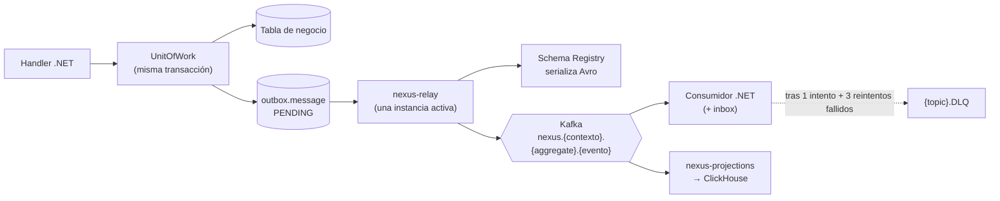

# Eventos: Outbox, Kafka, Avro y consumidores (A7)

Origen: A7 (P7), Parte 3 §16 y §20. Lo marcado `[+]` es concreción de implementación (ADR-0008 para Avro).

## §1 Flujo



## §2 Envoltorio del evento (`DomainEvent`)

El contrato A7 se reparte entre **cabeceras Kafka** (envoltorio) y **valor Avro** (payload) `[+]`. Así el payload de cada evento no repite los campos comunes y cualquier consumidor puede deduplicar u ordenar sin deserializar.

| Campo A7 | Dónde viaja | Tipo |
|---|---|---|
| `event_id` | cabecera `nexus-event-id` | UUIDv7 |
| `event_type` | cabecera `nexus-event-type` | `<contexto>.<aggregate>.<evento>` |
| `aggregate_type` | cabecera `nexus-aggregate-type` | texto |
| `aggregate_id` | cabecera `nexus-aggregate-id` **y clave del mensaje Kafka** | UUID |
| `aggregate_version` `[+]` | cabecera `nexus-aggregate-version` | entero, crece por agregado: número de eventos emitidos por el agregado, persistido en la columna `aggregate_version` de su tabla (`[+]` ADR-0019, `conventions-database.md §4`). El primer evento es 1; en agregados anteriores a ADR-0019 el siguiente evento tras el backfill es 2 |
| `occurred_at` | cabecera `nexus-occurred-at` | ISO-8601 UTC |
| `actor_user_id` | cabecera `nexus-actor-user-id` | UUID |
| `schema_version` | cabecera `nexus-schema-version` | entero (`v<n>` del archivo `.avsc`; `[+]` independiente del número de versión del subject en el Schema Registry, ADR-0018) |
| `correlation_id` | cabecera `nexus-correlation-id` | UUID |
| `causation_id` | cabecera `nexus-causation-id` | UUID del evento o petición que lo causó |
| `legal_entity_id` `[+]` | cabecera `nexus-legal-entity-id` | UUID o vacío. Lo usan las proyecciones para filtrar por alcance |
| `payload` | valor del mensaje | Avro |

## §3 Tabla Outbox

Se crea en el paso **0.3** (junto con `inbox.processed_message` y el `OutboxWriter`), para que 0.4 ya emita eventos; el relay llega en 0.7.

```sql
CREATE SCHEMA outbox;

CREATE TABLE outbox.message (
  id                uuid PRIMARY KEY,                 -- = event_id
  topic             text        NOT NULL,
  aggregate_type    text        NOT NULL,
  aggregate_id      uuid        NOT NULL,
  aggregate_version bigint      NOT NULL,             -- [+]
  event_type        text        NOT NULL,
  schema_version    integer     NOT NULL,
  headers           jsonb       NOT NULL,             -- resto del envoltorio §2
  payload           text        NOT NULL,             -- [+] Avro en codificación JSON; el relay lo pasa a binario.
                                                        -- text, no jsonb (ADR-0013): un decimal Avro (bytes) puede
                                                        -- producir un escape \u0000, que jsonb rechaza.
  created_at        timestamptz NOT NULL,
  published_at      timestamptz NULL,
  status            text        NOT NULL DEFAULT 'PENDING'
                    CHECK (status IN ('PENDING','PUBLISHED','FAILED')),
  attempts          integer     NOT NULL DEFAULT 0,   -- [+]
  last_error        text        NULL                  -- [+]
);
CREATE INDEX ix_outbox_pending ON outbox.message (created_at, id) WHERE status = 'PENDING';
CREATE INDEX ix_outbox_failed_aggregate ON outbox.message (aggregate_id, created_at, id) WHERE status = 'FAILED';  -- [+]
CREATE INDEX ix_outbox_pending_aggregate ON outbox.message (aggregate_id, topic, created_at, id) WHERE status = 'PENDING';  -- [+]
```

- `[+]` `ix_outbox_failed_aggregate` (migración `V202611071600__infra__outbox_failed_index.sql`): índice parcial sobre las filas `FAILED`, que respalda la guarda por agregado del relay (§4 pasos 3 y 5).
- `[+]` `ix_outbox_pending_aggregate` (migración `V202611081000__infra__outbox_pending_aggregate_index.sql`): índice parcial sobre las filas `PENDING`, que respalda la exclusión por topic de la consulta del lote (§4 paso 3 y paso 5, clase «Topic inalcanzable»): el *anti-join* sondea por cada candidata sobre `(aggregate_id, topic, created_at, id)` en lugar de construir un *hash* de todo el conjunto `PENDING` (≈ 50 ms con volcado a disco temporal con 65 000 filas `PENDING` en el plan genérico con lista vacía; ≈ 1 ms con el índice) y resuelve el topic y la comparación `(created_at, id)` dentro del propio índice.

- **EV-R1:** el payload se guarda en JSON (codificación JSON de Avro). La transacción de negocio no depende de que el Schema Registry esté disponible.
- **EV-R2:** el `UnitOfWork` valida el payload contra el esquema `.avsc` local antes de insertarlo. Un payload inválido aborta la transacción.
- Un trigger `AFTER INSERT` emite `NOTIFY outbox_new` para despertar al relay.

## §4 Relay (`nexus-relay`)

1. Toma un *advisory lock* de PostgreSQL al arrancar. **Solo una instancia activa**; las demás esperan en espera pasiva. `[+]` Si el nodo del líder desaparece (corte de red, apagado), PostgreSQL lo detecta con *keepalives* TCP del lado del servidor y `tcp_user_timeout` (≈ 11 s) fijados en la sesión del líder mediante el parámetro de arranque `options`; con el reintento de 5 s de las pasivas, el relevo tarda ≈ 15–16 s. Si muere solo el proceso o se termina la sesión (`pg_terminate_backend`), el relevo tarda menos de 10 s. Un PgBouncer delante de PostgreSQL rechazaría el parámetro `options`: el relay debe conectarse directamente (o la configuración debe revisarse con un ADR).
2. Bucle: espera `NOTIFY outbox_new` o 500 ms, lo que llegue antes.
3. `SELECT ... WHERE status = 'PENDING' [+] AND NOT EXISTS (una fila FAILED anterior del mismo aggregate_id) ORDER BY created_at, id LIMIT 500 FOR UPDATE SKIP LOCKED`. `[+]` Guarda por agregado (EV-R3): una fila `FAILED` bloquea los eventos posteriores de su agregado hasta que un operador la reinicia (`UPDATE status='PENDING', attempts=0`). `[+]` Exclusión de topics inalcanzables (decisión de Luciano, 2026-11-08): la consulta recibe la lista corta de topics inalcanzables y excluye en SQL (a) las filas `PENDING` cuyo propio topic está en la lista (`NOT (m.topic = ANY($topics))`) y (b) las filas `PENDING` cuyo agregado tiene una fila `PENDING` **anterior** (por `(created_at, id)`) en alguno de esos topics (`AND NOT EXISTS (SELECT 1 FROM outbox.message p WHERE p.status = 'PENDING' AND p.aggregate_id = m.aggregate_id AND p.topic = ANY($topics) AND (p.created_at, p.id) < (m.created_at, m.id))`). Así se mantiene EV-R3: un agregado repartido en varios topics espera entero detrás de su primera fila en un topic inalcanzable, mientras que sus filas anteriores en topics sanos sí se publican. `$topics` es un `text[]` no nulo y sin elementos `NULL`, `'{}'` cuando no hay ningún topic retenido (un `NULL` hace que `NOT (topic = ANY(...))` sea `NULL` y el lote vuelva vacío, deteniendo el relay en silencio).
4. Por cada mensaje: serializa a Avro con Schema Registry y produce con productor idempotente (`enable.idempotence=true`, `acks=all`). Clave = `aggregate_id`.
5. Marca `PUBLISHED` + `published_at`. En error: `attempts + 1`, `last_error`. Con `attempts >= 10` → `FAILED` y métrica de alerta. `[+]` Dentro de un lote, un agregado cuya publicación falla se omite durante el resto del lote (EV-R3), para no publicar eventos posteriores por delante del fallido. `[+]` Tres clases de fallo (decisión de Luciano, 2026-11-07):
   - **Infraestructura global**: broker o Schema Registry inalcanzables, timeouts, 5xx, respuestas 401/403/408/429 del Schema Registry y cualquier otro 4xx que no sea un error de esquema de Confluent (ruta desconocida, página de error de un proxy, 405, 400 genérico: una URL mal configurada). Detiene el lote y aplica *back-off* (el log indica la causa); `attempts + 1` y `last_error`, pero **nunca** `FAILED`, dure lo que dure la caída.
   - **Topic inalcanzable**: el topic no existe o el relay no tiene permiso (`TopicAuthorizationFailed`). Se detecta con una consulta de metadatos previa al envío (*preflight*, acotada a 5 s y cacheada por topic: 30 s si existe, 5 s si no), para no esperar los 30 s de `message.timeout.ms` dentro de la transacción del lote. Solo se omite ese agregado durante el resto del lote; los demás siguen. Un intento solo cuenta cuando se pregunta de verdad al cluster (el *preflight* se ejecuta de nuevo al caducar la caché negativa, cada 5 s, o el propio envío devuelve el error): entonces `attempts + 1`, `last_error` con el nombre del topic, un aviso en el log por topic y `nexus_outbox_errors_total{kind="topic"}` + 1. Mientras el topic sigue en la caché negativa, sus agregados se omiten **sin** contar intento, sin `UPDATE`, sin log y sin métrica (decisión del orquestador, 2026-11-07). `[+]` Las retenciones son **por topic** (no hay lista por agregado): la consulta del lote excluye los topics retenidos como se describe en el paso 3 y no hay límite de agregados. Una retención **no caduca mientras el topic siga inalcanzable**: una vez vencida la caché negativa de un topic (hora de sonda), ese topic queda fuera de la lista de exclusión para que se seleccionen sus filas más antiguas y el *preflight* se repita una vez por topic. Cuenta un intento en la primera fila; si el topic sigue inalcanzable, se omite todo su **agregado** durante el resto del lote (EV-R3), y las demás filas del topic, junto con las filas posteriores de sus agregados en topics sanos, se omiten sin intento. El topic permanece fuera de la lista hasta que un lote alcance alguna de sus filas: si sigue inalcanzable, se retiene de nuevo con una nueva hora de sonda; si responde, se libera y sus filas vuelven en orden `created_at, id`. La liberación defensiva (más abajo) también lo libera. Las filas de un topic en caché negativa se omiten sin consultar el lock del líder. El bucle vuelve a drenar sin esperar si el lote intentó (publicó o falló) `BatchSize` filas, o si estaba lleno y retuvo un topic nuevo o volvió a retener un topic que acababa de sondear (avanza por el *backlog*; `[+]` cada nueva retención aplaza la sonda un TTL, así que como mucho hay un drenado extra por topic y TTL; decisión del orquestador, 2026-11-08); si no, espera al siguiente aviso. `[+]` Un solo topic por lote de sonda, en orden LRU (decisión del orquestador, 2026-11-08): como el lote se ordena por `created_at, id`, dejar fuera de la lista varios topics vencidos a la vez haría que el *backlog* más antiguo llenara el lote y que los mismos topics se llevaran siempre la sonda; por eso cada lote de sonda deja fuera de la lista **un único** topic vencido, según una sola clave LRU para todos los vencidos: la hora de su último intento en este vencimiento (intentado sin respuesta: su fila no se alcanzó, p. ej. el lote se cortó por un fallo de infraestructura global o se llenó de filas más antiguas) o, si aún no se ha intentado, su hora de sonda; a igualdad, el nombre del topic en orden ordinal. Sin prioridad para los no intentados: en saturación siempre habría alguno y un topic intentado sin respuesta no volvería a elegirse. Un topic retenido de nuevo recibe una hora de sonda nueva (ahora + TTL negativo) y pasa al final; uno intentado sin respuesta pasa detrás de todos los que vencieron antes de ese intento. `[+]` Regla de equidad: dos lotes de sonda nunca son consecutivos; tras un lote en el que un topic quedó fuera de la lista para sondearse, el lote siguiente excluye **todos** los topics retenidos, aunque su hora de sonda ya haya pasado, de modo que al menos uno de cada dos lotes no sondea y las filas sanas detrás de muchos topics inalcanzables siempre tienen turno. `[+]` Drenado tras el lote de equidad: mientras quede algún topic vencido que aún no se ha intentado, el bucle sigue sin esperar al aviso; uno de cada dos lotes sondea el topic vencido de clave más antigua y cada sonda lo manda detrás de todos los vencidos en ese momento, así que todos se intentan en como mucho N lotes de sonda: estos drenados son como mucho unos 2N lotes por TTL y no hay bucle ocupado con un topic cuyas filas no se alcanzan (cuando todos los vencidos se han intentado, el bucle espera al aviso como el resto). Así, cada topic vencido se sondea, como mucho, en N ciclos sonda/equidad (N = topics retenidos), y sigue contando como mucho un intento por topic y TTL. Con *N × 2 × duración del lote* ≥ el TTL negativo (saturación), el bucle encadena lotes sin pausa (la mitad sondas, la otra mitad filas sanas), acotado a unos 2N lotes por TTL. Contrapartida: con muchos topics inalcanzables, que un topic vuelva a estar disponible se detecta hasta N ciclos después de su hora de sonda en lugar de inmediatamente. Las retenciones son **por instancia del relay**, en memoria, y se vacían cada vez que una instancia adquiere el liderazgo (otro líder pudo publicar entretanto las filas sonda); además, si un lote vuelve con menos de `BatchSize` filas y no contiene ninguna fila del topic que ese lote dejó fuera de la lista para sondearse, ese topic se libera (un lote sin topic en sonda no libera nada). `[+]` Medido con los valores por defecto y por el camino de producción (relay real, Kafka y PostgreSQL reales): 60 000 agregados retenidos (62 045 filas `PENDING`) delante de 30 filas sanas ⇒ publicadas en ≈ 0,16 s (2 lotes); 7 000 ⇒ ≈ 0,1 s; 20 000 ⇒ ≈ 0,2 s; con el topic retenido, cada lote (consulta incluida) tarda ≈ 9–26 ms de mediana según la ejecución (p95 ≤ 35 ms) con 62 000 filas retenidas; 1 intento contado por TTL negativo (5 s); al crear el topic se publican las 62 064 filas en ≈ 29 s sin huecos ni duplicados y en orden por clave. `[+]` Coste residual: no hay límite de agregados retenidos; mientras un topic está retenido, cada lote recorre (vía `ix_outbox_pending`) las filas retenidas que preceden a las sanas, por lo que su coste crece linealmente con el *backlog* retenido (≈ 11 ms con 60 000 filas, ≈ 89 ms con 600 000, medido en PostgreSQL 17.11); nunca bloquea las filas sanas, solo hace más lenta cada pasada. Se vigila con `nexus_outbox_oldest_pending_age_seconds` y `nexus_outbox_held_topics`. Una partición sin líder o un nombre de topic inválido se detectan también en el *preflight* (topic inalcanzable y fallo de fila, respectivamente). Mientras un topic está en la caché negativa, solo el primer agregado que lo encuentra registra `attempts` y `last_error`; los demás de ese topic siguen con `attempts = 0`: para detectarlo, usar `nexus_outbox_oldest_pending_age_seconds` y `nexus_outbox_errors_total{kind="topic"}`. **Nunca** `FAILED`: al crear el topic o conceder el permiso se publica en orden.
   - **Fallo propio de la fila**: el payload no decodifica o no codifica, falta el `.avsc` local, su contenido no está registrado en el subject (40401/40403 con un estado HTTP que no sea de infraestructura) o el Schema Registry responde un error de esquema (`error_code` 409xx incompatible, 422xx esquema o versión inválidos), mensaje demasiado grande, cabeceras inválidas (incluido un `headers` que es JSON válido pero no un objeto), o cualquier excepción inesperada al preparar el mensaje que no sea de E/S. Omite el agregado durante el resto del lote y pasa a `FAILED` con `attempts >= 10` (`terminal = fila && attempts >= MaxAttempts`), bloqueando solo su agregado.

   Tras una caída o un topic ausente, `attempts` puede superar 10; el siguiente fallo propio de la fila lleva la fila a `FAILED` directamente. Métricas `[+]`: `nexus_outbox_pending`, `nexus_outbox_oldest_pending_age_seconds` (antigüedad de la fila `PENDING` más antigua) y `nexus_outbox_held_topics` (nº de topics retenidos), publicadas solo por el líder.
6. Purga diaria: borra filas `PUBLISHED` con más de 7 días. Es la única operación de borrado permitida sobre `outbox.message`. `[+]` Borra por bloques (`PurgeChunkSize`, 5000) y como máximo `PurgeMaxChunksPerPass` (10) bloques por pasada del bucle; si queda más, continúa en la pasada siguiente, tras el lote, para no detener la publicación.

- **EV-R3:** el orden por agregado se garantiza porque hay un solo relay, procesa por `created_at` y la clave Kafka es `aggregate_id`.
- Escalar a varias instancias activas requiere ADR (reparto por hash de `aggregate_id`).

## §5 Topics

- Nombre: `nexus.{contexto}.{aggregate}.{evento}` en kebab-case. Ejemplos del manual: `nexus.stock.movement.posted`, `nexus.commercial.contract.signed`, `nexus.platform.approval.requested`.
- Contextos válidos: `platform`, `org`, `catalog`, `project`, `stock`, `logistics`, `solver`, `commercial`, `billing`, `hr`, `controlling`, `warehouse`, `commissioning`, `field`. `access`, `workflow`, `docs` y `gdpr` publican como `platform` (como en el manual).
- Los eventos de versionado A10 (`nexus.masterdata.{tabla}.versioned` en el manual) se publican como `nexus.{contexto}.{aggregate}.versioned`, p. ej. `nexus.catalog.price-rule.versioned` `[+]`.
- Verbo en participio pasado: `created`, `updated`, `deactivated`, `posted`, `confirmed`, `versioned`…
- DLQ: `{topic}.DLQ`.
- Registro de topics: `contracts/events/topics.yaml` (nombre, particiones, esquema). Los topics se crean desde ese archivo (script local en 0.7, Terraform en 0.11). `auto.create.topics.enable=false`.

| Parámetro `[+]` | Local | Azure |
|---|---|---|
| Particiones | 1 | 6 (12 para `stock.*`, `warehouse.*`, `field.*`) |
| Réplicas | 1 | 3 |
| Retención topics de dominio | infinita | infinita ⚑ revisar coste en ADR-0011 |
| Retención DLQ | 14 días | 14 días |

La retención infinita permite reconstruir cualquier proyección desde el inicio del topic.

## §6 Esquemas Avro

- Archivo: `contracts/events/<contexto>/<aggregate>.<evento>.v<n>.avsc`.
- Namespace: `ch.nussli.nexus.<contexto>`. Record: `<Aggregate><Evento>` en PascalCase (`AssetTypeCreated`).
- Campos en `camelCase`.
- Subject: `<topic>-value` (TopicNameStrategy). Compatibilidad **BACKWARD** obligatoria (D8).

| Dato | Avro |
|---|---|
| UUID | `{"type":"string","logicalType":"uuid"}` |
| Instante | `{"type":"long","logicalType":"timestamp-micros"}` |
| Fecha | `{"type":"int","logicalType":"date"}` |
| Importe | `{"type":"bytes","logicalType":"decimal","precision":19,"scale":4}` |
| Cantidad | `{"type":"bytes","logicalType":"decimal","precision":18,"scale":4}` |
| Estado / enumeración | `string` (no `enum` de Avro: añadir símbolos rompe a los consumidores antiguos) |
| Opcional | `["null", <tipo>]` con `"default": null` |
| Texto traducible | `{"type":"map","values":"string"}` |

- **EV-R4:** los eventos de **master data** llevan el estado completo del agregado tras el cambio (permiten réplicas locales). Los eventos **transaccionales** llevan el hecho y los ids necesarios.
- **EV-R5:** nunca se publican campos PII en claro salvo en eventos del propio contexto `org`/`hr` que los necesiten; ver `domain/gdpr.md`.
- Con `BACKWARD`, **quitar** un campo es compatible y **añadir** un campo obligatorio sin `default` no lo es (el Schema Registry responde 409). Por eso todo campo nuevo debe llevar `default`. `[+]`
- Un cambio incompatible crea `v<n+1>` en un **topic nuevo** (`...posted.v2`) y se mantiene el antiguo hasta migrar consumidores.
- El relay resuelve el esquema de escritura **por contenido**, no por número de versión del subject: carga el `.avsc` local indicado por `schema_version` (el mismo que validó el `UnitOfWork`, EV-R2) y obtiene su id con `POST /subjects/<topic>-value` (ADR-0018). `[+]`
- Por eso el relay lleva consigo `contracts/events` (imagen y compose). Una fila cuyo `schema_version` no tiene `.avsc`, o cuyo esquema no está registrado en el subject, falla por fila con un error explícito. `[+]`
- **Orden de despliegue** `[+]`: un `.avsc` nuevo o modificado se registra con `tools/register-schemas.sh` **antes** de desplegar los servicios y el relay que lo usan. Si no, la primera fila de cada agregado afectado falla por fila en cada intento, pasa a `FAILED` en segundos y bloquea su agregado hasta que un operador la reinicie (`UPDATE status='PENDING', attempts=0`) tras registrar el esquema.

## §7 Consumidores .NET

Base en `BuildingBlocks.Messaging`:

- Grupo de consumo: `<servicio>.<caso-de-uso>` (p. ej. `operations.reserve-on-job-confirmed`).
- `enable.auto.commit=false`; commit tras procesar.
- **Idempotencia:** el efecto y el registro en `inbox.processed_message` van en la misma transacción. Si el `event_id` ya existe, se omite.

```sql
CREATE SCHEMA inbox;
CREATE TABLE inbox.processed_message (
  consumer     text        NOT NULL,
  event_id     uuid        NOT NULL,
  processed_at timestamptz NOT NULL,
  PRIMARY KEY (consumer, event_id)
);
```

- **Reintentos:** 1 intento + 3 reintentos con backoff (200 ms, 1 s, 5 s), es decir, 4 intentos en total `[+]`. Si el 4.º también falla → mensaje a `{topic}.DLQ` con cabeceras `nexus-dlq-error`, `nexus-dlq-consumer`, `nexus-dlq-failed-at`, y se continúa. `[+]` Si la propia publicación en la DLQ falla, el consumidor pausa sus particiones (sin confirmar el offset), reintenta la publicación con backoff exponencial (tope ~30 s), se informa `Unhealthy` y reanuda cuando lo consigue: el mensaje nunca se pierde ni se salta.
- **Orden:** un consumidor que necesite orden comprueba `aggregate_version` y descarta versiones anteriores a la ya aplicada. `[+]` La serie puede tener huecos (filas sembradas por SQL sin evento empiezan en 0; el backfill de ADR-0019 deja el siguiente evento en 2), así que solo se compara con `>`; nunca se espera `+1`.
- El consumidor abre su transacción con `app.current_user_id` = `actor_user_id` del evento si la acción es en nombre del usuario, o SYSTEM si es una reacción del sistema. La ficha del paso indica cuál.

## §8 Proyecciones a ClickHouse (`nexus-projections`)

- Base de datos: `nexus_analytics`.
- Grupo de consumo: `projections.<proyeccion>`.
- Toda tabla lleva `legal_entity_id` (para el filtro de alcance), `_event_id`, `_aggregate_version`, `_ingested_at`.
- Motor por defecto: `ReplacingMergeTree(_aggregate_version)`, con `ORDER BY` que empieza por `legal_entity_id`. Las consultas usan `FINAL` o agregan con `argMax`.
- Idempotencia por `ReplacingMergeTree`: reprocesar un evento no duplica.
- `[+]` `_aggregate_version` puede tener huecos (filas sembradas por SQL sin evento, backfill de ADR-0019): `ReplacingMergeTree`/`argMax` se quedan con la mayor, y ninguna proyección espera versiones consecutivas.
- `[+]` **Excepción `event_log`** (paso 0.8): sus columnas se llaman `event_id` y `aggregate_version` (sin `_`), el motor es `ReplacingMergeTree(_ingested_at)` y el `ORDER BY` empieza por el agregado (`aggregate_type, aggregate_id, aggregate_version, event_id`), porque su acceso es siempre por agregado y no por Mandant. El filtro de alcance se sigue aplicando en la consulta: `legal_entity_id IN (...)` con las legal entities donde el actor tiene `AUDIT:READ` (`access.has_permission`, no `visible_legal_entities()`); las filas con `legal_entity_id` NULL solo son visibles con `AUDIT:READ` en una asignación `GLOBAL`.
- `[+]` Los topics con `pii: true` en `topics.yaml` guardan en `event_log` solo las cabeceras (`payload_json = ''`), según EV-R5; el endpoint de auditoría devuelve `payload` y `previousPayload` a `null` para ellos.
- Reconstrucción: `nexus-projections rebuild <proyeccion>` borra la tabla, resetea el offset del grupo y relee el topic desde el inicio.
- Migraciones de ClickHouse: `db/clickhouse/V<ts>__<desc>.sql`, aplicadas por `nexus-projections` al arrancar (tabla de control `_schema_migrations`).

## §9 Eventos de plataforma ya fijados por el manual

| Topic | Origen |
|---|---|
| `nexus.platform.approval.requested` / `.approved` / `.rejected` / `.expired` | A8 |
| `nexus.platform.party.anonymized` | A12 |
| `nexus.platform.role-assignment.changed` | A6/A7 |
| `nexus.stock.movement.posted` | A7 ejemplo |
| `nexus.commercial.contract.signed` | A7 ejemplo |

El resto de eventos se declaran en la sección "Eventos" de cada `docs/domain/<contexto>.md`.
