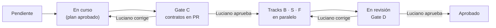

# Proceso de entrega: pasos, tracks y gates `[+]`

## §1 Ciclo de vida de un paso



| Momento | Qué entrega el agente | Qué decide Luciano |
|---|---|---|
| Inicio | Plan del paso: lista de archivos a crear o tocar, por track | Aprueba el plan o lo ajusta |
| Gate C | PR `step/<id>-contract` con DDL, OpenAPI y Avro, más un resumen de 10 líneas | Aprueba el contrato. Desde aquí es inmutable en el paso |
| Gate D | PRs de cada track en verde + evidencia de la sección "Verificación de Luciano" | Aprueba el paso y lo marca `Aprobado` en `STATUS.md` |

## §2 Ramas y worktrees

| Rama | Contenido | Base |
|---|---|---|
| `step/<id>-contract` | Solo `contracts/` y `db/migrations/` del paso | `main` |
| `step/<id>-backend` | `src/<Servicio>/` y tests | `main` tras merge del contrato |
| `step/<id>-services` | Consumidores, proyecciones, jobs | `main` tras merge del contrato |
| `step/<id>-web` | `web/` | `main` tras merge del contrato |
| `spec/<tema>` | Cambios a `docs/` | `main` |

**Paralelismo real:** cada track se abre en su propio git worktree con su propia sesión de Claude Code. Como los tres parten del mismo contrato fusionado, no se pisan:

```bash
git worktree add ../nexus-1.3-backend step/1.3-backend
git worktree add ../nexus-1.3-web     step/1.3-web
```

Las migraciones SQL van en el PR de contrato porque son contrato. El track B no añade migraciones; si necesita una, el contrato estaba incompleto y vuelve a Gate C.

## §3 Plantilla de PR

```markdown
## Paso <id> · Track <C|B|S|F>

### Qué hace
<3–5 líneas>

### Reglas implementadas
- CAT-R1, CAT-R2 … (cada una con su test)

### Cómo verificarlo
<comandos exactos copiados de la ficha, con su salida esperada>

### Fuera de alcance (deliberadamente)
<lista>

### Desviaciones o huecos encontrados
<ninguno | enlace al ADR o a la pregunta abierta>
```

## §4 Qué verifica Luciano en cada gate

**Gate C (contrato):**
- Nombres de tablas y columnas coherentes con `docs/domain/<contexto>.md`.
- Toda tabla multi-Mandant tiene `legal_entity_id` y política RLS.
- Las tablas append-only tienen revocados `UPDATE`/`DELETE`.
- Los endpoints tienen permiso declarado (`x-permission`) y paginación cuando listan.
- Los eventos siguen la convención de topic y tienen versión.

**Gate D (entrega):**
- Los tests citan las reglas (`Rule XXX-Rn`) y todas las de la ficha están cubiertas.
- La demo de la ficha funciona tal como está descrita.
- No hay cambios fuera del alcance del paso.

## §5 Cambios a la especificación

- Un cambio en `docs/domain` o `docs/00-foundation` va en su propio PR `spec/<tema>`.
- Si el cambio afecta a un paso `Aprobado`, el agente lista los pasos afectados en el PR.
- Las decisiones nuevas van como ADR en `Propuesto`; Luciano las pasa a `Aceptado` o `Rechazado`.

## §6 Sesiones de Claude Code

- Una sesión = un paso y un track. Al empezar, el agente lee `CLAUDE.md` y la ficha.
- Al terminar un track, el agente escribe en el PR lo que haría falta saber a la siguiente sesión. **No** deja notas en `docs/`.
- Si una sesión se interrumpe, la siguiente retoma desde el PR abierto y su descripción.

## §7 Cómo lanzar un paso `[+]`

**1. Contrato** (una sesión, en `main`):

```text
Ejecuta el paso 1.3, track C. Lee CLAUDE.md y docs/steps/F1/1.3-taxonomia-asset-type.md.
Empieza en plan mode y espera mi aprobación antes de escribir.
```

Revisa el PR con la lista de §4 (Gate C), fusiónalo y marca el paso `Gate C` → aprobado.

**2. Tracks en paralelo** (una sesión por track, cada una en su worktree):

```bash
git fetch && git worktree add ../nexus-1.3-backend  -b step/1.3-backend  origin/main
git worktree add ../nexus-1.3-services -b step/1.3-services origin/main
git worktree add ../nexus-1.3-web      -b step/1.3-web      origin/main
```

En cada carpeta, una sesión de Claude Code:

```text
Ejecuta el paso 1.3, track B (backend). El contrato ya está en main.
Lee CLAUDE.md y la ficha; sigue solo la sección "Leer" de tu track. Plan mode primero.
```

(Igual con `track S` y `track F`.) Las tres sesiones no se pisan: tocan carpetas distintas (`src/<Servicio>`, `src/Projections` o consumidores, `web/`) y ninguna modifica `contracts/` ni `db/migrations/`.

**3. Integración** (una sesión, cuando los tres PR estén fusionados):

```text
Ejecuta la integración del paso 1.3: escenarios e2e de la sección "Integración (Gate D)"
y comprueba make rule-coverage STEP=1.3. Actualiza STATUS.md a "En revisión".
```

**4. Gate D:** sigue la sección "Verificación de Luciano" de la ficha y, si todo cuadra, marca `Aprobado` con la fecha en `STATUS.md`.

**Pasos en paralelo:** la columna "Paralelo con" de `STATUS.md` indica qué pasos pueden avanzar a la vez en otras sesiones (p. ej. 1.1 y 1.2). Cada paso sigue su propio ciclo C → tracks → Gate D.
