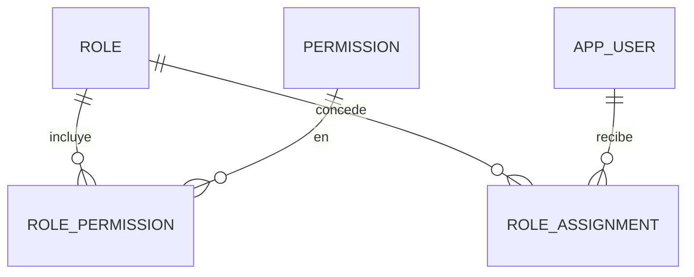

# Dominio · Autorización multi-entidad (RBAC + RLS)

- **Origen:** A6 (P6), A10 (Role/Permission versionables), ADR-0004 (alcance por sentencia)
- **Esquema:** `access` (seguridad) · **Servicio:** `nexus-platform`
- **Pasos:** 0.3 (roles de BD), 0.6 (todo lo demás), 5.4 (auto-provisión `FIELD_CAPTURE`)

## §1 Principio

Dos capas complementarias:

- **RBAC** decide qué **acciones** puede hacer un usuario (`Permission` = recurso + acción), dentro de un **alcance** (`RoleAssignment.scope_type`).
- **RLS** de PostgreSQL decide qué **filas** ve. Es la última línea de defensa.

Un `RoleAssignment` con alcance `GROUP` cascada hacia abajo (`LegalEntity` → `BusinessUnit` → `Warehouse`). Uno con alcance `PROJECT` **no cascada**: aplica solo a ese proyecto, lo que permite equipos matriciales entre entidades.

## §2 Modelo



## §3 DDL (paso 0.6)

Sin RLS en este esquema. Solo `svc_platform` tiene DML; los demás servicios solo ejecutan las funciones de §4.

```sql
CREATE SCHEMA access;

CREATE TABLE access.permission (
  id            uuid PRIMARY KEY,
  code          text NOT NULL UNIQUE,                 -- [+] '<RESOURCE>:<ACTION>', p. ej. 'ASSET_TYPE:CREATE'
  resource_type text NOT NULL,
  action        text NOT NULL CHECK (action IN ('CREATE','READ','UPDATE','DELETE','APPROVE','EXPORT')),
  caption_i18n  jsonb NOT NULL,                       -- [+]
  CHECK (code = resource_type || ':' || action)
  -- + std
);

CREATE TABLE access.role (
  id           uuid PRIMARY KEY,
  code         text NOT NULL UNIQUE,
  caption_i18n jsonb NOT NULL,
  description  text NULL,
  is_system    boolean NOT NULL DEFAULT false,        -- [+] roles sembrados; no se borran
  is_active    boolean NOT NULL DEFAULT true
  -- + std
);

-- Temporal (A10, prioridad media): permite saber qué permisos tenía un rol en una fecha
CREATE TABLE access.role_permission (
  id            uuid PRIMARY KEY,                      -- [+] la PK compuesta del manual pasa a id por ser temporal
  role_id       uuid NOT NULL REFERENCES access.role(id),
  permission_id uuid NOT NULL REFERENCES access.permission(id),
  valid_from    timestamptz NOT NULL,                  -- [+] A10
  valid_to      timestamptz NULL,                      -- [+] A10
  granted_by    uuid NOT NULL,                         -- [+]
  EXCLUDE USING gist (role_id WITH =, permission_id WITH =,
                      tstzrange(valid_from, coalesce(valid_to,'infinity')) WITH &&)
);

CREATE TABLE access.role_assignment (
  id              uuid PRIMARY KEY,
  user_id         uuid NOT NULL REFERENCES org.app_user(id),
  role_id         uuid NOT NULL REFERENCES access.role(id),
  scope_type      text NOT NULL CHECK (scope_type IN
                    ('GROUP','LEGAL_ENTITY','BUSINESS_UNIT','WAREHOUSE','PROJECT','GLOBAL')),
  scope_entity_id uuid NULL,                           -- polimórfico; NULL solo si GLOBAL
  valid_from      timestamptz NOT NULL,
  valid_to        timestamptz NULL,
  granted_by      uuid NOT NULL,
  source          text NOT NULL DEFAULT 'MANUAL'
                  CHECK (source IN ('MANUAL','RESOURCE_ASSIGNMENT','SEED')),   -- [+] P6
  source_ref_id   uuid NULL,                           -- [+] id del ResourceAssignment si source = RESOURCE_ASSIGNMENT
  revoked_by      uuid NULL,                           -- [+]
  -- + std
  CHECK ((scope_type = 'GLOBAL') = (scope_entity_id IS NULL)),
  CHECK (valid_to IS NULL OR valid_to > valid_from),
  CHECK ((source = 'RESOURCE_ASSIGNMENT') = (source_ref_id IS NOT NULL))
);
CREATE INDEX ix_ra_user_active ON access.role_assignment (user_id, valid_from, valid_to);
CREATE INDEX ix_ra_source_ref  ON access.role_assignment (source_ref_id) WHERE source_ref_id IS NOT NULL;
```

## §4 Funciones de alcance (`R__access__scope_functions.sql`)

Todas `STABLE SECURITY DEFINER`, propiedad de `nexus_owner`, con `search_path` fijo. `EXECUTE` concedido a todos los `svc_*`. Se evalúan en el instante de la sentencia (ADR-0004).

```sql
CREATE OR REPLACE FUNCTION access.current_user_id() RETURNS uuid
LANGUAGE sql STABLE AS $$
  SELECT nullif(current_setting('app.current_user_id', true), '')::uuid
$$;

-- Asignaciones vigentes del usuario actual (usuario activo, rol activo, ventana vigente)
CREATE OR REPLACE FUNCTION access.active_assignments()
RETURNS TABLE (assignment_id uuid, role_id uuid, scope_type text, scope_entity_id uuid)
LANGUAGE sql STABLE SECURITY DEFINER SET search_path = access, org, pg_temp AS $$
  SELECT ra.id, ra.role_id, ra.scope_type, ra.scope_entity_id
  FROM access.role_assignment ra
  JOIN org.app_user u ON u.id = ra.user_id AND u.is_active
  JOIN access.role r  ON r.id = ra.role_id AND r.is_active
  WHERE ra.user_id = access.current_user_id()
    AND ra.valid_from <= now()
    AND (ra.valid_to IS NULL OR ra.valid_to > now())
$$;

CREATE OR REPLACE FUNCTION access.visible_legal_entities() RETURNS uuid[]
LANGUAGE sql STABLE SECURITY DEFINER SET search_path = access, org, pg_temp AS $$
  WITH a AS (SELECT * FROM access.active_assignments())
  SELECT coalesce(array_agg(le.id), '{}')
  FROM org.legal_entity le
  WHERE EXISTS (SELECT 1 FROM a WHERE a.scope_type = 'GLOBAL')
     OR le.group_id IN (SELECT scope_entity_id FROM a WHERE scope_type = 'GROUP')
     OR le.id       IN (SELECT scope_entity_id FROM a WHERE scope_type = 'LEGAL_ENTITY')
$$;

CREATE OR REPLACE FUNCTION access.visible_business_units() RETURNS uuid[]
LANGUAGE sql STABLE SECURITY DEFINER SET search_path = access, org, pg_temp AS $$
  WITH a AS (SELECT * FROM access.active_assignments())
  SELECT coalesce(array_agg(bu.id), '{}')
  FROM org.business_unit bu
  WHERE bu.legal_entity_id = ANY (access.visible_legal_entities())
     OR bu.id IN (SELECT scope_entity_id FROM a WHERE scope_type = 'BUSINESS_UNIT')
$$;

CREATE OR REPLACE FUNCTION access.visible_warehouses() RETURNS uuid[]
LANGUAGE sql STABLE SECURITY DEFINER SET search_path = access, org, pg_temp AS $$
  WITH a AS (SELECT * FROM access.active_assignments())
  SELECT coalesce(array_agg(w.id), '{}')
  FROM org.warehouse w
  WHERE w.legal_entity_id = ANY (access.visible_legal_entities())
     OR w.business_unit_id IN (SELECT scope_entity_id FROM a WHERE scope_type = 'BUSINESS_UNIT')
     OR w.id IN (SELECT scope_entity_id FROM a WHERE scope_type = 'WAREHOUSE')
$$;

-- PROJECT no cascada: solo los proyectos concedidos explícitamente.
-- Los proyectos de las LE visibles ya entran por la dimensión LE de la política.
CREATE OR REPLACE FUNCTION access.visible_projects() RETURNS uuid[]
LANGUAGE sql STABLE SECURITY DEFINER SET search_path = access, org, pg_temp AS $$
  SELECT coalesce(array_agg(scope_entity_id), '{}')
  FROM access.active_assignments() WHERE scope_type = 'PROJECT'
$$;

-- RBAC. Sin parámetros de alcance = "¿tiene este permiso en algún alcance?" (solo para listados, ACC-R10).
CREATE OR REPLACE FUNCTION access.has_permission(
  p_permission      text,
  p_legal_entity_id uuid DEFAULT NULL,
  p_business_unit_id uuid DEFAULT NULL,
  p_warehouse_id    uuid DEFAULT NULL,
  p_project_id      uuid DEFAULT NULL)
RETURNS boolean
LANGUAGE sql STABLE SECURITY DEFINER SET search_path = access, org, pg_temp AS $$
  WITH a AS (
    SELECT a.* FROM access.active_assignments() a
    JOIN access.role_permission rp ON rp.role_id = a.role_id
         AND rp.valid_from <= now() AND (rp.valid_to IS NULL OR rp.valid_to > now())
    JOIN access.permission p ON p.id = rp.permission_id AND p.code = p_permission
  ), target AS (
    SELECT p_legal_entity_id AS le,
           (SELECT group_id FROM org.legal_entity WHERE id = p_legal_entity_id) AS grp,
           coalesce(p_business_unit_id,
                    (SELECT business_unit_id FROM org.warehouse WHERE id = p_warehouse_id)) AS bu,
           p_warehouse_id AS wh, p_project_id AS prj
  )
  SELECT EXISTS (
    SELECT 1 FROM a, target t
    WHERE a.scope_type = 'GLOBAL'
       OR (t.le IS NULL AND t.bu IS NULL AND t.wh IS NULL AND t.prj IS NULL)
       OR (a.scope_type = 'GROUP'         AND a.scope_entity_id = t.grp)
       OR (a.scope_type = 'LEGAL_ENTITY'  AND a.scope_entity_id = t.le)
       OR (a.scope_type = 'BUSINESS_UNIT' AND a.scope_entity_id = t.bu)
       OR (a.scope_type = 'WAREHOUSE'     AND a.scope_entity_id = t.wh)
       OR (a.scope_type = 'PROJECT'       AND a.scope_entity_id = t.prj))
$$;

-- Vista NO materializada para inspección del usuario actual (ADR-0004)
CREATE OR REPLACE VIEW access.effective_access_scope AS
  SELECT 'LEGAL_ENTITY'  AS dimension, unnest(access.visible_legal_entities()) AS entity_id
  UNION ALL SELECT 'BUSINESS_UNIT', unnest(access.visible_business_units())
  UNION ALL SELECT 'WAREHOUSE',     unnest(access.visible_warehouses())
  UNION ALL SELECT 'PROJECT',       unnest(access.visible_projects());
```

Para la pantalla "¿qué ve este usuario?", `nexus-platform` abre una transacción con `SET LOCAL app.current_user_id = '<usuario consultado>'` y lee la vista. Solo con permiso `ROLE_ASSIGNMENT:READ` y en una transacción de solo lectura.

## §5 Roles de base de datos (paso 0.3)

Definidos en `conventions-database.md §2`. Lo propio de A6:

```sql
CREATE ROLE svc_solver LOGIN BYPASSRLS;   -- P6: solo lectura, solo el pool del Solver
-- Cada paso que crea uno de estos esquemas añade su bloque (0.4 org, 1.2 uom, 1.3 catalog, 2.1 project, 3.1 stock, 4.1 logistics)
GRANT USAGE ON SCHEMA org, uom, catalog, project, stock, logistics TO svc_solver;
GRANT SELECT ON ALL TABLES IN SCHEMA org, uom, catalog, project, stock, logistics TO svc_solver;
ALTER DEFAULT PRIVILEGES FOR ROLE nexus_owner IN SCHEMA org, uom, catalog, project, stock, logistics
  GRANT SELECT ON TABLES TO svc_solver;
```

El Solver registra en su log de aplicación qué `legal_entity_id` toca cada corrida (P6).

## §6 Reglas

| Id | Regla | Origen |
|---|---|---|
| ACC-R1 | `scope_type = GLOBAL` si y solo si `scope_entity_id` es `NULL` | A6 |
| ACC-R2 | `scope_entity_id` existe en la tabla que indica `scope_type`. `PROJECT` se valida contra la réplica local de proyectos de `nexus-platform` (desde 2.1); antes de 2.1, `PROJECT` se rechaza | [+] |
| ACC-R3 | Una revocación fija `valid_to = now()` y `revoked_by`. Las asignaciones nunca se borran | A6, A10 |
| ACC-R4 | Para conceder un rol en un alcance, el que concede necesita `ROLE_ASSIGNMENT:CREATE` en un alcance que cubra al de destino | [+] |
| ACC-R5 | Nadie modifica sus propias asignaciones | [+] |
| ACC-R6 | La asignación SEED `GLOBAL` de SYSTEM y la del primer administrador no se pueden revocar desde la API | [+] |
| ACC-R7 | Cambiar los permisos de un rol cierra filas de `role_permission` (`valid_to`) y abre otras nuevas; nunca hay `UPDATE` de `permission_id` | A10 |
| ACC-R8 | **Auto-provisión (P6):** al crearse un `ResourceAssignment(worker, job/project)`, se crea `RoleAssignment(FIELD_CAPTURE, PROJECT, project_id, valid_from = inicio, valid_to = fin, granted_by = SYSTEM, source = RESOURCE_ASSIGNMENT, source_ref_id = id)` para el `app_user` del `Worker`. Si cambian las fechas, se cierra y se crea otra. Si se cancela, `valid_to = now()`. Si el `Worker` no tiene `app_user`, no se crea nada y se registra un aviso | P6 |
| ACC-R9 | Un rol con `is_system = true` no se desactiva | [+] |
| ACC-R10 | `has_permission` sin alcance solo se usa en endpoints de listado; los de detalle y escritura pasan siempre el `legal_entity_id` de la fila | [+] |

## §7 Roles y permisos sembrados (`db/seed/common`)

**Roles iniciales** `[+]` (administrables después): `SYSTEM_ADMIN`, `ORG_ADMIN`, `SECURITY_ADMIN`, `CATALOG_ADMIN`, `WAREHOUSE_OPERATOR`, `PROJECT_MANAGER`, `SALES`, `CONTROLLER`, `HR_ADMIN`, `FIELD_CAPTURE`, `VIEWER`.

**Permisos:** el catálogo vive en `contracts/permissions.yaml` (código, recurso, acción, roles por defecto). Cada paso añade los suyos ahí y en `db/seed/common/V..__permissions_<paso>.sql`. CI comprueba que cada `x-permission` del OpenAPI existe en `permissions.yaml`.

## §8 API (`platform.yaml`)

| Método y ruta | Permiso |
|---|---|
| `GET /v1/permissions` | `ROLE:READ` |
| `GET/POST /v1/roles`, `GET/PUT /v1/roles/{id}`, `POST /v1/roles/{id}/deactivate` | `ROLE:READ/CREATE/UPDATE` |
| `PUT /v1/roles/{id}/permissions` (lista completa; el servidor calcula altas y cierres) | `ROLE:UPDATE` |
| `GET /v1/roles/{id}/permissions?asOf=` | `ROLE:READ` |
| `GET /v1/role-assignments?userId=&roleId=&scopeType=&activeOn=` | `ROLE_ASSIGNMENT:READ` |
| `POST /v1/role-assignments` | `ROLE_ASSIGNMENT:CREATE` |
| `POST /v1/role-assignments/{id}/revoke` | `ROLE_ASSIGNMENT:UPDATE` |
| `GET /v1/users/{id}/effective-scope` | `ROLE_ASSIGNMENT:READ` |
| `GET /v1/me` (incluye permisos y alcances) | autenticado |

## §9 Eventos

| Topic | Cuándo |
|---|---|
| `nexus.platform.role-assignment.changed` | Alta, revocación o cambio de ventana. Payload: estado completo + `changeKind` (`GRANTED`, `REVOKED`, `WINDOW_CHANGED`) |
| `nexus.platform.role.updated` | Alta, cambio, baja de rol, o cambio de sus permisos |

**Consumidos** (paso 5.4): `nexus.hr.resource-assignment.created` / `.updated` / `.cancelled` → ACC-R8. Consumidor `platform.field-capture-provisioning`, actúa como SYSTEM.

**Consumidos** (paso 2.1): `nexus.project.project.created` / `.updated` → réplica local `access.project_ref (id, legal_entity_id, code, is_active)` para ACC-R2.

## §10 Pantallas (`features/access`)

| Pantalla | Contenido |
|---|---|
| Roles | Lista; detalle con matriz de permisos (recurso × acción) y pestaña "Historial de permisos" (`asOf`) |
| Asignaciones de un usuario | Pestaña en el detalle de usuario: lista con alcance, ventana, origen; alta y revocación |
| ¿Qué ve este usuario? | Árbol de LE → BU → Almacén con lo visible marcado, y lista de proyectos concedidos |
