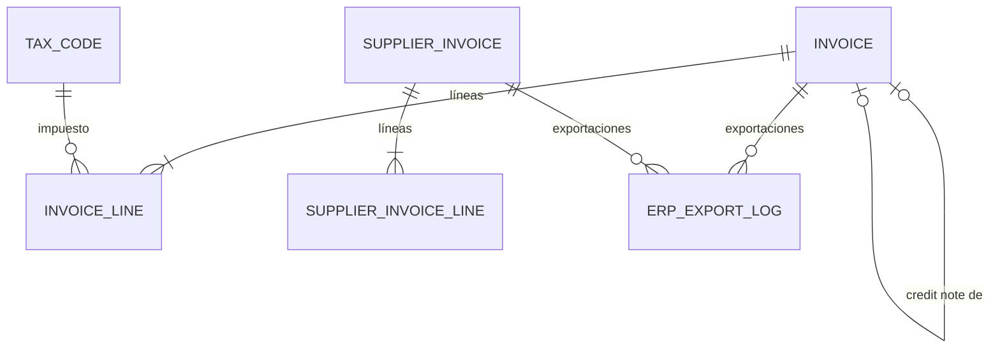

# Dominio · Facturación y exportación ERP (Capa 5)

- **Origen:** Manual §8 (Capa 5: `Invoice`, `SupplierInvoice`, `ERPExportLog`), D11 (`EJSyncMap` no es de runtime: ver `migration.md`), A1 (alquiler interno facturable), A5 (ingresos y costes del P&L)
- **Esquema:** `billing` (transaccional) · **Servicio:** `nexus-commercial` (lee `commercial` del mismo servicio)
- **Pasos:** 5.5

## §1 Principio

La Capa 5 se define **al final**, cuando ya existen todas las entidades transaccionales (placement deliberado del manual). Factura lo que el pipeline comercial congeló (VR2): una línea de factura copia el precio de la línea de oferta o de la transferencia, nunca lo recalcula desde la tarifa maestra.

`ERPExportLog` evita exportar dos veces y diagnostica los rechazos del ERP. NEXUS no lleva contabilidad: exporta documentos al ERP de cada entidad (Abacus, DATEV, Dynamics).

`EJSyncMap` **no** vive aquí: con el modelo greenfield (D11) es una tabla de trazas del ETL (`migration.md`).

**Lectura de `commercial` `[+]`:** `billing` y `commercial` pertenecen al mismo servicio, así que `nexus-commercial` lee contratos y ofertas directamente (ARC-R3 solo prohíbe leer esquemas de **otros** servicios). Aun así no hay FK entre los dos esquemas (ARC-R2): así podrían separarse en el futuro.

## §2 Modelo



## §3 DDL (paso 5.5)

```sql
CREATE SCHEMA billing;
CREATE TABLE billing.number_sequence (scope_key text PRIMARY KEY, next_value bigint NOT NULL DEFAULT 1);

-- [+] GLOBAL. Tipos impositivos con vigencia
CREATE TABLE billing.tax_code (
  id            uuid PRIMARY KEY,
  code          text NOT NULL,                       -- 'CH_VAT_STD', 'DE_VAT_STD', 'EXEMPT_EXPORT'…
  country_code  char(2) NOT NULL,
  caption_i18n  jsonb NOT NULL,
  rate          numeric(7,4) NOT NULL CHECK (rate >= 0 AND rate < 1),
  valid_from    date NOT NULL,
  valid_to      date NULL,
  -- + std
  UNIQUE (code, valid_from),
  CHECK (valid_to IS NULL OR valid_to > valid_from)
);

-- [+] Configuración ERP por entidad legal. RLS: LE
CREATE TABLE billing.erp_config (
  legal_entity_id   uuid PRIMARY KEY REFERENCES org.legal_entity(id),
  erp_system        text NOT NULL CHECK (erp_system IN ('ABACUS','DATEV','DYNAMICS')),
  export_mode       text NOT NULL DEFAULT 'FILE' CHECK (export_mode IN ('FILE')),   -- API: ADR posterior
  file_format       text NOT NULL CHECK (file_format IN ('CSV','XML')),
  account_mapping   jsonb NOT NULL,                  -- cuentas de ingreso por line_type, de gasto por purchase_type, códigos IVA ⚑ BIL-Q1
  default_tax_code  text NOT NULL,
  is_active         boolean NOT NULL DEFAULT true
  -- + std
);

-- RLS: LE+PRJ
CREATE TABLE billing.invoice (
  id                     uuid PRIMARY KEY,
  invoice_no             text NULL UNIQUE,           -- se asigna al emitir (BIL-R3): 'INV-<LE>-<YYYY>-<NNNNNN>' / 'CN-…' / 'IC-…'
  invoice_type           text NOT NULL CHECK (invoice_type IN ('INVOICE','CREDIT_NOTE','INTERCOMPANY')),
  legal_entity_id        uuid NOT NULL REFERENCES org.legal_entity(id),        -- emisor
  customer_party_id      uuid NOT NULL REFERENCES org.party(id),
  counterparty_legal_entity_id uuid NULL REFERENCES org.legal_entity(id),      -- [+] INTERCOMPANY: receptor del grupo
  bill_to_location_id    uuid NULL REFERENCES org.location(id),
  contract_id            uuid NULL,                  -- commercial.contract: mismo servicio, sin FK (ARC-R2)
  project_id             uuid NULL,
  status                 text NOT NULL DEFAULT 'DRAFT' CHECK (status IN ('DRAFT','ISSUED','CANCELLED')),
  payment_status         text NOT NULL DEFAULT 'OPEN' CHECK (payment_status IN ('OPEN','PAID','PARTIALLY_PAID')),  -- ⚑ BIL-Q2
  invoice_date           date NULL,
  service_period_from    date NULL,
  service_period_to      date NULL,
  payment_terms_id       uuid NULL,                  -- commercial.payment_terms, sin FK (ARC-R2)
  due_date               date NULL,
  currency_code          char(3) NOT NULL REFERENCES org.currency(code),
  total_net              numeric(19,4) NOT NULL DEFAULT 0,
  total_tax              numeric(19,4) NOT NULL DEFAULT 0,
  total_gross            numeric(19,4) NOT NULL DEFAULT 0,
  credited_invoice_id    uuid NULL REFERENCES billing.invoice(id),
  issued_at              timestamptz NULL,
  issued_by              uuid NULL,
  pdf_document_id        uuid NULL,                  -- docs.document INVOICE_PDF
  -- + std
  CHECK ((status = 'ISSUED') = (invoice_no IS NOT NULL AND invoice_date IS NOT NULL AND issued_at IS NOT NULL)),
  CHECK ((invoice_type = 'CREDIT_NOTE') = (credited_invoice_id IS NOT NULL)),
  CHECK ((invoice_type = 'INTERCOMPANY') = (counterparty_legal_entity_id IS NOT NULL))
);
CREATE INDEX ix_inv_le_status ON billing.invoice(legal_entity_id, status);
CREATE INDEX ix_inv_project ON billing.invoice(project_id);

CREATE TABLE billing.invoice_line (
  id                 uuid PRIMARY KEY,
  invoice_id         uuid NOT NULL REFERENCES billing.invoice(id),
  line_no            integer NOT NULL,
  source_type        text NOT NULL CHECK (source_type IN
                       ('QUOTE_LINE','CONTRACT_AMENDMENT','TRANSFER_LINE','FIELD_RECONCILIATION_LINE','MANUAL')),
  source_id          uuid NULL,
  asset_type_id      uuid NULL REFERENCES catalog.asset_type(id),
  description        text NOT NULL,
  qty                numeric(18,4) NOT NULL,           -- negativa en abonos
  uom_id             uuid NULL REFERENCES uom.unit_of_measure(id),
  unit_price         numeric(19,4) NOT NULL CHECK (unit_price >= 0),
  chargeable_units   numeric(18,4) NOT NULL DEFAULT 1,
  discount_pct       numeric(7,4) NOT NULL DEFAULT 0,
  line_net           numeric(19,4) NOT NULL,
  tax_code_id        uuid NOT NULL REFERENCES billing.tax_code(id),
  tax_rate           numeric(7,4) NOT NULL,            -- snapshot
  tax_amount         numeric(19,4) NOT NULL,
  project_id         uuid NULL,
  period_from        date NULL,
  period_to          date NULL,
  legal_entity_id    uuid NOT NULL,
  -- + std
  UNIQUE (invoice_id, line_no),
  CHECK ((source_type = 'MANUAL') = (source_id IS NULL))
);
CREATE INDEX ix_invl_source ON billing.invoice_line(source_type, source_id);

-- RLS: LE+PRJ
CREATE TABLE billing.supplier_invoice (
  id                  uuid PRIMARY KEY,
  internal_no         text NOT NULL UNIQUE,            -- 'SI-<LE>-<YYYY>-<NNNNN>'
  legal_entity_id     uuid NOT NULL REFERENCES org.legal_entity(id),
  supplier_party_id   uuid NOT NULL REFERENCES org.party(id),
  supplier_invoice_ref text NOT NULL,                  -- número del proveedor
  purchase_order_id   uuid NULL,                       -- stock.purchase_order (otro servicio: réplica §3 po_ref)
  invoice_date        date NOT NULL,
  due_date            date NULL,
  currency_code       char(3) NOT NULL REFERENCES org.currency(code),
  total_net           numeric(19,4) NOT NULL DEFAULT 0,
  total_tax           numeric(19,4) NOT NULL DEFAULT 0,
  total_gross         numeric(19,4) NOT NULL DEFAULT 0,
  status              text NOT NULL DEFAULT 'DRAFT' CHECK (status IN ('DRAFT','POSTED','CANCELLED')),
  posted_at           timestamptz NULL,
  scan_document_id    uuid NULL,                       -- docs.document SUPPLIER_INVOICE_SCAN
  -- + std
  UNIQUE (supplier_party_id, supplier_invoice_ref),    -- BIL-R9
  CHECK ((status = 'POSTED') = (posted_at IS NOT NULL))
);

CREATE TABLE billing.supplier_invoice_line (
  id                     uuid PRIMARY KEY,
  supplier_invoice_id    uuid NOT NULL REFERENCES billing.supplier_invoice(id),
  line_no                integer NOT NULL,
  purchase_order_line_id uuid NULL,
  purchase_type          text NOT NULL CHECK (purchase_type IN ('STOCK','CONSUMABLE','SUBHIRE','SERVICE')),  -- copiado del PO o manual
  activity_phase         text NULL CHECK (activity_phase IN ('SETUP','EVENT','TEARDOWN')),
  asset_type_id          uuid NULL REFERENCES catalog.asset_type(id),
  description            text NOT NULL,
  qty                    numeric(18,4) NOT NULL CHECK (qty > 0),
  unit_price             numeric(19,4) NOT NULL CHECK (unit_price >= 0),
  line_net               numeric(19,4) NOT NULL,
  tax_code_id            uuid NOT NULL REFERENCES billing.tax_code(id),
  tax_rate               numeric(7,4) NOT NULL,
  tax_amount             numeric(19,4) NOT NULL,
  project_id             uuid NULL,
  legal_entity_id        uuid NOT NULL,
  -- + std
  UNIQUE (supplier_invoice_id, line_no),
  CHECK (purchase_type NOT IN ('SUBHIRE','SERVICE') OR project_id IS NOT NULL)
);

-- [+] Réplicas locales (ARC-R3), alimentadas por eventos
CREATE TABLE billing.purchase_order_ref (
  id uuid PRIMARY KEY, po_no text NOT NULL, legal_entity_id uuid NOT NULL, supplier_party_id uuid NOT NULL,
  purchase_type text NOT NULL, project_id uuid NULL, status text NOT NULL, currency_code char(3) NOT NULL,
  lines jsonb NOT NULL, aggregate_version bigint NOT NULL, updated_at timestamptz NOT NULL
);
CREATE TABLE billing.transfer_ref (                   -- solo INTERNAL_RENTAL
  id uuid PRIMARY KEY, transfer_no text NOT NULL, from_legal_entity_id uuid NOT NULL, to_legal_entity_id uuid NOT NULL,
  status text NOT NULL, shipped_at timestamptz NULL, received_at timestamptz NULL, return_transfer_id uuid NULL,
  lines jsonb NOT NULL,                                -- con internal_unit_price, basis, currency, qty_shipped
  aggregate_version bigint NOT NULL, updated_at timestamptz NOT NULL
);
-- RLS de réplicas: LE (purchase_order_ref) y especial from/to LE (transfer_ref)

-- RLS: LE
CREATE TABLE billing.erp_export_log (
  id              uuid PRIMARY KEY,
  legal_entity_id uuid NOT NULL REFERENCES org.legal_entity(id),
  erp_system      text NOT NULL,
  document_type   text NOT NULL CHECK (document_type IN ('INVOICE','CREDIT_NOTE','INTERCOMPANY','SUPPLIER_INVOICE')),
  document_id     uuid NOT NULL,
  export_batch_id uuid NOT NULL,                       -- [+] un fichero puede llevar varios documentos
  status          text NOT NULL DEFAULT 'PENDING' CHECK (status IN ('PENDING','SENT','ACCEPTED','REJECTED')),
  payload_sha256  char(64) NOT NULL,
  file_uri        text NULL,                           -- blob del fichero exportado
  attempt         integer NOT NULL DEFAULT 1,
  sent_at         timestamptz NULL,
  response_at     timestamptz NULL,
  error_code      text NULL,
  error_message   text NULL,
  -- + std
  CHECK ((status = 'REJECTED') = (error_code IS NOT NULL))
);
-- Manual §8: "evita exportar dos veces"
CREATE UNIQUE INDEX uq_erp_once ON billing.erp_export_log(document_type, document_id)
  WHERE status IN ('PENDING','SENT','ACCEPTED');
```

## §4 Reglas

| Id | Regla | Origen |
|---|---|---|
| BIL-R1 | Una línea con `source_type = QUOTE_LINE` copia `unit_price`, `chargeable_units`, `discount_pct` y descripción de la línea de oferta del contrato (VR2). Nunca se recalcula desde la tarifa | A10 VR2 |
| BIL-R2 | Σ facturado (neto de abonos) por línea de oferta ≤ su `line_net` (+ enmiendas aprobadas). "Borrador desde contrato" propone lo pendiente | [+] |
| BIL-R3 | `invoice_no` se asigna solo al **emitir**, con el contador de `conventions-database.md §11` en la misma transacción (sin huecos, DB-R5), por `(tipo, LE, año de invoice_date)` | [+] |
| BIL-R4 | Una factura `ISSUED` es inmutable. Se corrige solo con un `CREDIT_NOTE` (total o parcial) que la referencia; `cancel` solo en `DRAFT` | [+] |
| BIL-R5 | `due_date = invoice_date + payment_terms.net_days`. `payment_terms_id` por defecto = el del contrato | P4 |
| BIL-R6 | `tax_rate` = tasa del `tax_code` vigente en `invoice_date`; `tax_amount = round(line_net × tax_rate, 2)`; totales = Σ líneas. Redondeo comercial a 0,05 en CHF solo en `total_gross` ⚑ BIL-Q3 | [+] |
| BIL-R7 | **Intercompañía (A1):** al cerrar la vuelta de un `INTERNAL_RENTAL` (réplica `transfer_ref` con `return_transfer_id` cerrado), se propone una factura `INTERCOMPANY` del propietario al custodio: por línea, `qty_shipped × internal_unit_price × días` (de `shipped_at` de la ida a `received_at` de la vuelta, por arriba) | A1, LOG-Q3 |
| BIL-R8 | Emitir publica `invoice.issued` con las líneas y sus `source_type/source_id`; operations marca `has_downstream_effects` en las transferencias referenciadas (LOG-R10) | [+] |
| BIL-R9 | `(supplier_party_id, supplier_invoice_ref)` es único: la misma factura de proveedor no se registra dos veces | [+] |
| BIL-R10 | Una línea de factura de proveedor con `purchase_order_line_id` copia `purchase_type`, `activity_phase` y `project_id` de la réplica del PO. Precio por encima del PO > 5 % → aviso ⚑ | [+] |
| BIL-R11 | Postear una factura de proveedor publica `supplier-invoice.posted`; controlling genera los `CostPosting` (5.7) | A5 |
| BIL-R12 | **Exportación ERP:** un documento `ISSUED`/`POSTED` se exporta una sola vez (`uq_erp_once`). Un `REJECTED` se puede reintentar: nueva fila con `attempt + 1` | Manual §8 |
| BIL-R13 | El fichero de exportación se genera por lote (LE, sistema, día) y se guarda en Blob (`erp-exports/<le>/<fecha>/<batch>.csv|xml`). El estado `ACCEPTED`/`REJECTED` se registra a mano o por fichero de respuesta del ERP ⚑ BIL-Q1 | [+] |
| BIL-R14 | Una factura `FIELD_RECONCILIATION_LINE` (cargo al cliente por material perdido o dañado, 6.3) valora con `replacement_value` del tipo salvo precio manual | [+] |

## §5 Estados

**Invoice:** `DRAFT → ISSUED`; `DRAFT → CANCELLED`. `payment_status` lo actualiza la respuesta del ERP o un usuario con `INVOICE:UPDATE` ⚑ BIL-Q2.
**SupplierInvoice:** `DRAFT → POSTED`; `DRAFT → CANCELLED`. Un `POSTED` erróneo se corrige con otra factura de proveedor negativa (abono del proveedor) ⚑.
**ErpExportLog:** `PENDING → SENT → ACCEPTED | REJECTED`.

## §6 API (`commercial.yaml`, prefijo de recursos de billing)

| Método y ruta | Permiso |
|---|---|
| `GET/POST /v1/tax-codes`, `PUT /{id}` | `TAX_CODE:*` (GLOBAL) |
| `GET/PUT /v1/erp-configs/{legalEntityId}` | `ERP_CONFIG:READ/UPDATE` |
| `GET /v1/invoices?status=&type=&customerPartyId=&projectId=&from=&to=&q=` | `INVOICE:READ` |
| `POST /v1/invoices` (manual), `GET/PUT /v1/invoices/{id}` (solo `DRAFT`) | `INVOICE:CREATE/UPDATE` |
| `POST /v1/invoices/draft-from-contract/{contractId}` | `INVOICE:CREATE` |
| `GET /v1/invoices/intercompany-proposals` · `POST /v1/invoices/draft-intercompany/{transferId}` | `INVOICE:CREATE` |
| `POST /v1/invoices/{id}/issue` · `/cancel` · `/create-credit-note` | `INVOICE:UPDATE` |
| `GET /v1/invoices/{id}/pdf` | `INVOICE:READ` (comparte la decisión de COM-Q3) |
| `GET /v1/supplier-invoices?…`, `POST`, `GET/PUT /{id}`, `POST /{id}/post` · `/cancel` | `SUPPLIER_INVOICE:*` |
| `POST /v1/supplier-invoices/from-po/{purchaseOrderId}` | `SUPPLIER_INVOICE:CREATE` |
| `POST /v1/erp-exports` (cuerpo: `legalEntityId`, `documentType`, `upTo`) → lote | `ERP_EXPORT:EXPORT` |
| `GET /v1/erp-exports?legalEntityId=&status=` · `GET /v1/erp-exports/{batchId}/file` | `ERP_EXPORT:READ` |
| `POST /v1/erp-exports/{logId}/mark-accepted` · `/mark-rejected` (cuerpo: `errorCode`, `errorMessage`) | `ERP_EXPORT:UPDATE` |

## §7 Eventos

Contexto `billing`.

| Topic | Payload | Consumidores |
|---|---|---|
| `nexus.billing.invoice.issued` | cabecera + líneas con `sourceType/sourceId`, `projectId`, importes en moneda de factura | operations (LOG-R10), proyecciones (ingresos del P&L, 5.7) |
| `nexus.billing.invoice.payment-status-changed` | | proyecciones |
| `nexus.billing.supplier-invoice.posted` | cabecera + líneas (`purchaseType`, `activityPhase`, `projectId`) | controlling (5.7) |
| `nexus.billing.erp-export.status-changed` | | — |

**Consumidos** (réplicas, actúan como SYSTEM): `nexus.stock.purchase-order.changed` → `purchase_order_ref`; `nexus.logistics.transfer.*` (solo `INTERNAL_RENTAL` y sus vueltas) → `transfer_ref`; `nexus.field.reconciliation.posted` (6.3) → propuesta de cargo al cliente (BIL-R14).

## §8 Pantallas (`features/billing`)

| Pantalla | Contenido |
|---|---|
| Facturas: lista; detalle con líneas, totales del servidor, emisión, abono, PDF, estado ERP | |
| Borrador desde contrato (pendiente por línea de oferta) | |
| Propuestas intercompañía (alquileres internos cerrados sin facturar) | |
| Facturas de proveedor: registro desde PO o libre, con escaneo adjunto (`nx-document-panel`) | |
| Exportaciones ERP: lotes por LE, descarga del fichero, marcar aceptado/rechazado, reintentar | |
| Configuración: tipos impositivos; configuración ERP por LE | |

## §9 Abiertos ⚑

- **BIL-Q1:** formato de exportación y plan de cuentas por ERP (Abacus, DATEV, Dynamics). Sin las especificaciones de cada ERP solo se implementa el formato CSV genérico con `account_mapping`. Requiere a Finanzas antes de 5.5.
- **BIL-Q2:** ¿el estado de cobro vuelve del ERP a NEXUS? Propuesta: sí, por fichero de respuesta; mientras tanto, manual.
- **BIL-Q3:** redondeo a 0,05 CHF y QR-factura suiza. Propuesta: redondeo sí; QR-factura en el PDF en un paso posterior.
- **BIL-Q4:** facturación parcial por hitos (anticipo `ADVANCE_50`). Propuesta v1: "borrador desde contrato" admite un porcentaje sobre el pendiente.
