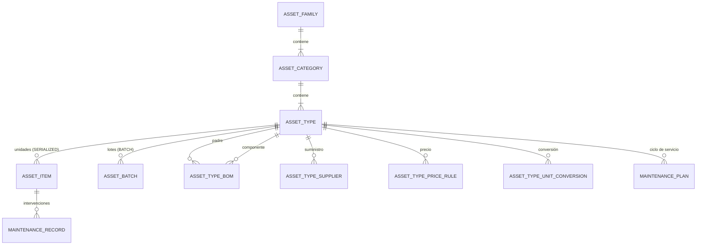
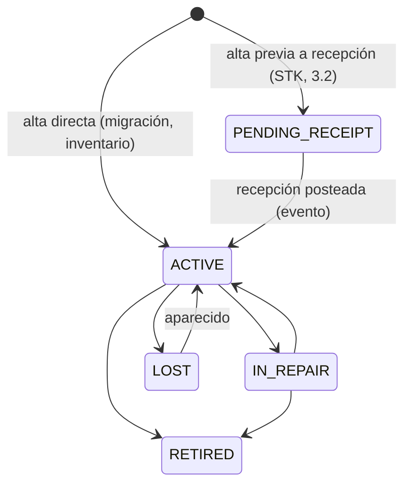

# Dominio · Catálogo de activos (Capa 2)

- **Origen:** Manual §4 (bloques A–G), §5 (`tracking_mode`), A5 (`is_consumable`), A10 (VR1), A11 (UoM)
- **Esquema:** `catalog` (referencia) · **Servicio:** `nexus-catalog`
- **Pasos:** 1.3 (taxonomía, `AssetType`, conversión por tipo), 1.4 (BOM y precios versionados), 1.5 (`AssetItem`, lotes, proveedores), 1.6 (mantenimiento)

## §1 Principio

El catálogo describe **qué existe**, no dónde está ni en qué proyecto se usa. La ubicación se deriva del ledger (`stock.md`).

Cada `AssetType` declara **un único** `tracking_mode`, excluyente. Esto elimina por diseño la doble contabilidad de EasyJob (cantidades en `StockType` y filas en `StockItem` que se desincronizan):

| Modo | Qué se gestiona | Identidad física |
|---|---|---|
| `BULK` | Solo cantidad agregada | Ninguna |
| `BATCH` | Cantidad por lote | `asset_batch` |
| `SERIALIZED` | Cada unidad | `asset_item`, 1 fila por unidad |

**Catálogo de grupo, propiedad por Mandant `[+]`:** la taxonomía, los tipos, el BOM y las conversiones son comunes al grupo (sin RLS). Lo que pertenece a una entidad legal lleva `legal_entity_id` y RLS: la propiedad de cada `AssetItem` y las tarifas (`AssetTypePriceRule`). Esto es lo que permite el alquiler interno entre entidades sobre un mismo catálogo (A1).

## §2 Modelo



## §3 DDL

```sql
CREATE SCHEMA catalog;

-- ===== Paso 1.3 · Bloque A: taxonomía (GLOBAL) =====
CREATE TABLE catalog.asset_family (
  id           uuid PRIMARY KEY,
  code         text NOT NULL UNIQUE,
  caption_i18n jsonb NOT NULL,
  sort_order   integer NOT NULL DEFAULT 0,
  is_active    boolean NOT NULL DEFAULT true
  -- + std
);

CREATE TABLE catalog.asset_category (
  id           uuid PRIMARY KEY,
  family_id    uuid NOT NULL REFERENCES catalog.asset_family(id),
  code         text NOT NULL UNIQUE,
  caption_i18n jsonb NOT NULL,
  sort_order   integer NOT NULL DEFAULT 0,
  is_active    boolean NOT NULL DEFAULT true
  -- + std
);
CREATE INDEX ix_cat_family ON catalog.asset_category(family_id);

-- ===== Paso 1.3 · Bloque B: núcleo (GLOBAL) =====
CREATE TABLE catalog.asset_type (
  id                uuid PRIMARY KEY,
  category_id       uuid NOT NULL REFERENCES catalog.asset_category(id),
  code              text NOT NULL UNIQUE,
  caption_i18n      jsonb NOT NULL,
  description_i18n  jsonb NULL,                                       -- [+]
  tracking_mode     text NOT NULL CHECK (tracking_mode IN ('BULK','BATCH','SERIALIZED')),
  lifecycle_status  text NOT NULL DEFAULT 'DRAFT'
                    CHECK (lifecycle_status IN ('DRAFT','ACTIVE','DISCONTINUED')),   -- [+] CAT-R2
  stock_uom_id      uuid NULL REFERENCES uom.unit_of_measure(id),     -- A11/P11: NULL = unidad implícita
  sales_uom_id      uuid NULL REFERENCES uom.unit_of_measure(id),     -- A11/P11
  is_consumable     boolean NOT NULL DEFAULT false,                   -- A5/P5
  kit_mode          text NOT NULL DEFAULT 'NONE'
                    CHECK (kit_mode IN ('NONE','VIRTUAL','ASSEMBLY')), -- [+] ⚑ CAT-Q1
  unit_weight_kg    numeric(12,3) NULL CHECK (unit_weight_kg >= 0),   -- [+] input de transporte del Solver
  unit_volume_m3    numeric(12,4) NULL CHECK (unit_volume_m3 >= 0),   -- [+]
  replacement_value numeric(19,4) NULL,                               -- [+] valor de reposición (pérdidas, seguro)
  replacement_currency_code char(3) NULL REFERENCES org.currency(code),
  ej_stock_type_ref text NULL,                                        -- [+] trazabilidad ETL (7.3); solo lectura
  -- + std
  CHECK ((replacement_value IS NULL) = (replacement_currency_code IS NULL)),
  CHECK ((stock_uom_id IS NULL) = (sales_uom_id IS NULL))             -- P11: o las dos o ninguna
);
CREATE INDEX ix_at_category ON catalog.asset_type(category_id);
CREATE INDEX ix_at_caption_trgm ON catalog.asset_type USING gin ((caption_i18n->>'de') gin_trgm_ops);

-- ===== Paso 1.3 · A11 específico (GLOBAL) =====
CREATE TABLE catalog.asset_type_unit_conversion (
  id            uuid PRIMARY KEY,                                     -- [+]
  asset_type_id uuid NOT NULL REFERENCES catalog.asset_type(id),
  from_unit_id  uuid NOT NULL REFERENCES uom.unit_of_measure(id),
  to_unit_id    uuid NOT NULL REFERENCES uom.unit_of_measure(id),
  factor        numeric(28,12) NOT NULL CHECK (factor > 0),           -- 1 from = factor × to
  -- + std
  CHECK (from_unit_id <> to_unit_id)
);
CREATE UNIQUE INDEX uq_atuc_pair ON catalog.asset_type_unit_conversion
  (asset_type_id, least(from_unit_id, to_unit_id), greatest(from_unit_id, to_unit_id));

-- ===== Paso 1.4 · Bloque D: composición (GLOBAL, VR1) =====
CREATE TABLE catalog.asset_type_bom (
  id                       uuid PRIMARY KEY,
  business_key             text NOT NULL,          -- '<parent_asset_type_id>:<component_asset_type_id>'
  version_no               integer NOT NULL CHECK (version_no >= 1),
  valid_from               timestamptz NOT NULL,
  valid_to                 timestamptz NULL,
  superseded_by_id         uuid NULL REFERENCES catalog.asset_type_bom(id),
  parent_asset_type_id     uuid NOT NULL REFERENCES catalog.asset_type(id),
  component_asset_type_id  uuid NOT NULL REFERENCES catalog.asset_type(id),
  qty                      numeric(18,4) NOT NULL CHECK (qty > 0),
  uom_id                   uuid NULL REFERENCES uom.unit_of_measure(id),   -- A11/P11
  is_optional              boolean NOT NULL DEFAULT false,                 -- [+]
  sort_order               integer NOT NULL DEFAULT 0,                     -- [+]
  -- + std-append  (la fila no cambia salvo el cierre; ver versioning.md §3)
  CHECK (parent_asset_type_id <> component_asset_type_id),
  CHECK (business_key = parent_asset_type_id::text || ':' || component_asset_type_id::text),
  CONSTRAINT uq_bom_version UNIQUE (business_key, version_no),
  CONSTRAINT ck_bom_window CHECK (valid_to IS NULL OR valid_to > valid_from),
  CONSTRAINT ex_bom_overlap EXCLUDE USING gist (business_key WITH =,
      tstzrange(valid_from, coalesce(valid_to,'infinity')) WITH &&)
);
CREATE UNIQUE INDEX uq_bom_current ON catalog.asset_type_bom(business_key) WHERE valid_to IS NULL;
CREATE INDEX ix_bom_parent ON catalog.asset_type_bom(parent_asset_type_id, valid_from);

-- ===== Paso 1.4 · Bloque F: precio (RLS: LE, VR1) =====
CREATE TABLE catalog.asset_type_price_rule (
  id                 uuid PRIMARY KEY,
  business_key       text NOT NULL,         -- '<asset_type_id>:<legal_entity_id>:<price_rule_code>'
  version_no         integer NOT NULL CHECK (version_no >= 1),
  valid_from         timestamptz NOT NULL,
  valid_to           timestamptz NULL,
  superseded_by_id   uuid NULL REFERENCES catalog.asset_type_price_rule(id),
  asset_type_id      uuid NOT NULL REFERENCES catalog.asset_type(id),
  legal_entity_id    uuid NOT NULL REFERENCES org.legal_entity(id),
  price_rule_code    text NOT NULL,         -- 'STANDARD', 'INTERNAL' (alquiler interno A1) … [+]
  price_basis        text NOT NULL CHECK (price_basis IN ('PER_DAY','PER_WEEK','PER_EVENT','SALE')),  -- [+]
  unit_price         numeric(19,4) NOT NULL CHECK (unit_price >= 0),
  currency_code      char(3) NOT NULL REFERENCES org.currency(code),
  uom_id             uuid NULL REFERENCES uom.unit_of_measure(id),   -- precio por unidad de venta; P11
  min_charge_days    integer NULL CHECK (min_charge_days > 0),       -- [+]
  -- + std-append
  CHECK (business_key = asset_type_id::text || ':' || legal_entity_id::text || ':' || price_rule_code),
  CONSTRAINT uq_pr_version UNIQUE (business_key, version_no),
  CONSTRAINT ck_pr_window CHECK (valid_to IS NULL OR valid_to > valid_from),
  CONSTRAINT ex_pr_overlap EXCLUDE USING gist (business_key WITH =,
      tstzrange(valid_from, coalesce(valid_to,'infinity')) WITH &&)
);
CREATE UNIQUE INDEX uq_pr_current ON catalog.asset_type_price_rule(business_key) WHERE valid_to IS NULL;
CREATE INDEX ix_pr_type_le ON catalog.asset_type_price_rule(asset_type_id, legal_entity_id);

-- ===== Paso 1.5 · Bloque C: unidad física (RLS: LE = propietario) =====
CREATE TABLE catalog.asset_batch (                                   -- [+] lote de un tipo BATCH. GLOBAL
  id            uuid PRIMARY KEY,
  asset_type_id uuid NOT NULL REFERENCES catalog.asset_type(id),
  batch_code    text NOT NULL,
  produced_on   date NULL,
  expires_on    date NULL,
  -- + std
  UNIQUE (asset_type_id, batch_code)
);

CREATE TABLE catalog.asset_item (
  id                 uuid PRIMARY KEY,
  asset_type_id      uuid NOT NULL REFERENCES catalog.asset_type(id),
  serial_number      text NOT NULL,
  legal_entity_id    uuid NOT NULL REFERENCES org.legal_entity(id),   -- propietario. [+] nombre estándar para RLS
  home_warehouse_id  uuid NULL REFERENCES org.warehouse(id),          -- [+] almacén base
  status             text NOT NULL DEFAULT 'ACTIVE'
                     CHECK (status IN ('PENDING_RECEIPT','ACTIVE','IN_REPAIR','RETIRED','LOST')),  -- [+]
  acquired_on        date NULL,
  acquisition_cost   numeric(19,4) NULL,
  acquisition_currency_code char(3) NULL REFERENCES org.currency(code),
  retired_on         date NULL,
  ej_stock_item_ref  text NULL,                                       -- [+] trazabilidad ETL
  -- + std
  UNIQUE (asset_type_id, serial_number),
  CHECK ((status IN ('RETIRED','LOST')) = (retired_on IS NOT NULL))
);
CREATE INDEX ix_ai_type ON catalog.asset_item(asset_type_id);
CREATE INDEX ix_ai_le   ON catalog.asset_item(legal_entity_id);
CREATE INDEX ix_ai_home ON catalog.asset_item(home_warehouse_id);
-- RLS perfil LE+WH (home_warehouse_id hace de warehouse_id: columna renombrable en la política)

-- ===== Paso 1.5 · Bloque E: suministro (RLS: LE opcional) =====
CREATE TABLE catalog.asset_type_supplier (
  id                 uuid PRIMARY KEY,
  asset_type_id      uuid NOT NULL REFERENCES catalog.asset_type(id),
  supplier_party_id  uuid NOT NULL REFERENCES org.party(id),
  legal_entity_id    uuid NULL REFERENCES org.legal_entity(id),      -- [+] NULL = válido para todo el grupo
  supply_mode        text NOT NULL CHECK (supply_mode IN ('PURCHASE','SUBHIRE')),   -- [+] input de déficits del Solver
  supplier_item_code text NULL,
  lead_time_days     integer NULL CHECK (lead_time_days >= 0),
  min_order_qty      numeric(18,4) NULL CHECK (min_order_qty > 0),
  unit_cost          numeric(19,4) NULL CHECK (unit_cost >= 0),      -- compra: por unidad; subhire: por día
  currency_code      char(3) NULL REFERENCES org.currency(code),
  uom_id             uuid NULL REFERENCES uom.unit_of_measure(id),
  is_preferred       boolean NOT NULL DEFAULT false,
  is_active          boolean NOT NULL DEFAULT true,
  -- + std
  CHECK ((unit_cost IS NULL) = (currency_code IS NULL))
);
CREATE INDEX ix_ats_type ON catalog.asset_type_supplier(asset_type_id);
-- RLS política especial: legal_entity_id IS NULL OR <término LE>

-- ===== Paso 1.6 · Bloque G: operación =====
CREATE TABLE catalog.maintenance_plan (                              -- GLOBAL
  id                 uuid PRIMARY KEY,
  asset_type_id      uuid NOT NULL REFERENCES catalog.asset_type(id),
  code               text NOT NULL,
  caption_i18n       jsonb NOT NULL,
  interval_days      integer NULL CHECK (interval_days > 0),
  interval_uses      integer NULL CHECK (interval_uses > 0),          -- [+] cada N salidas a proyecto
  checklist_i18n     jsonb NULL,                                      -- [+] lista de comprobaciones
  requires_certificate boolean NOT NULL DEFAULT false,                -- [+] enlaza con documentos A9
  is_active          boolean NOT NULL DEFAULT true,
  -- + std
  UNIQUE (asset_type_id, code),
  CHECK (interval_days IS NOT NULL OR interval_uses IS NOT NULL)
);

CREATE TABLE catalog.maintenance_record (                            -- append-only. RLS: LE
  id                  uuid PRIMARY KEY,
  asset_item_id       uuid NULL REFERENCES catalog.asset_item(id),
  asset_type_id       uuid NOT NULL REFERENCES catalog.asset_type(id),
  batch_id            uuid NULL REFERENCES catalog.asset_batch(id),
  maintenance_plan_id uuid NULL REFERENCES catalog.maintenance_plan(id),
  legal_entity_id     uuid NOT NULL REFERENCES org.legal_entity(id),
  performed_at        timestamptz NOT NULL,
  performed_by        uuid NOT NULL,
  result              text NOT NULL CHECK (result IN ('PASSED','FAILED','REPAIRED')),
  notes               text NULL,
  next_due_on         date NULL,
  certificate_document_id uuid NULL,                                  -- docs.document (sin FK: otro servicio)
  -- + std-append
  CHECK (asset_item_id IS NOT NULL OR batch_id IS NOT NULL)
);
CREATE INDEX ix_mr_item ON catalog.maintenance_record(asset_item_id, performed_at);
```

### Explosión de BOM (paso 1.4, `R__catalog__explode_bom.sql`)

```sql
-- Explosión recursiva "as of" (P10). Devuelve componentes hoja y kits intermedios con su nivel.
-- qty_per_parent ya multiplicado por p_qty y convertido a la stock_uom del componente.
CREATE OR REPLACE FUNCTION catalog.explode_bom(p_asset_type_id uuid, p_qty numeric, p_as_of timestamptz)
RETURNS TABLE (level int, parent_asset_type_id uuid, component_asset_type_id uuid,
               qty_stock_uom numeric(18,4), is_optional boolean, path uuid[])
LANGUAGE sql STABLE …;   -- WITH RECURSIVE; corta en profundidad 10 (CAT-R9)
```

La usan commissioning (6.2), la reserva de kits `VIRTUAL` (4.2) y el Solver.

## §4 Reglas

### Integridad de `tracking_mode` (R1–R4 del diseño original, reconstruidas) `[+]` ⚑ verificar numeración

| Id | Regla | Origen |
|---|---|---|
| CAT-R1 | Un `AssetType` tiene exactamente un `tracking_mode` (`BULK`, `BATCH` o `SERIALIZED`) | §5 (R1) |
| CAT-R2 | `tracking_mode` solo cambia mientras `lifecycle_status = DRAFT`. Al pasar a `ACTIVE` queda fijo. Solo un tipo `ACTIVE` admite ítems, lotes, precios, movimientos y reservas | §5 (R2) |
| CAT-R3 | `AssetItem` solo existe para tipos `SERIALIZED`; `AssetBatch` solo para `BATCH` | §4-C, §5 (R3) |
| CAT-R4 | Coherencia con el ledger: movimiento de `SERIALIZED` lleva `asset_item_id` y `qty = 1`; de `BATCH`, `batch_id`; de `BULK`, ninguno de los dos. Se aplica en `stock.md` (STK-R3) | §5 (R4) |

### Resto

| Id | Regla | Origen |
|---|---|---|
| CAT-R5 | `code` de familia, categoría y tipo es inmutable tras la creación | [+] |
| CAT-R6 | Un tipo `DISCONTINUED` no admite nuevas reservas, líneas de oferta ni pedidos de compra; sí movimientos de su stock existente | [+] |
| CAT-R7 | `stock_uom_id` y `sales_uom_id` son ambos `NULL` o ambos no `NULL` (P11). Si `sales_uom_id ≠ stock_uom_id`, debe existir camino de conversión entre ellas al activar el tipo | A11 |
| CAT-R8 | Un tipo `SERIALIZED` tiene `stock_uom_id` `NULL` o de dimensión `COUNT` | [+] |
| CAT-R9 | El BOM no tiene ciclos y su profundidad máxima es 10 | [+] |
| CAT-R10 | El BOM y las tarifas siguen VR1 (`versioning.md`): nunca `UPDATE` de campos versionados | A10 |
| CAT-R11 | Un `AssetType` con `kit_mode ≠ NONE` necesita al menos una línea de BOM vigente para pasar a `ACTIVE`; con `kit_mode = NONE` no puede tener BOM | [+] |
| CAT-R12 | `serial_number` es único por tipo. No se reutiliza aunque el ítem se retire | [+] |
| CAT-R13 | `asset_item.legal_entity_id` (propietario) no cambia por un alquiler interno (A1: custodia sin cambio de propiedad). Solo cambia con una venta intercompañía explícita (fuera de alcance v1) | A1 |
| CAT-R14 | El estado de un `AssetItem` sigue §5; `RETIRED` y `LOST` son terminales salvo `LOST → ACTIVE` (aparecido) | [+] |
| CAT-R15 | Una tarifa `INTERNAL` es la que se usa para valorar alquileres internos entre entidades (A1) | [+] ⚑ CAT-Q3 |
| CAT-R16 | `maintenance_record` es append-only; una corrección es un registro nuevo | [+] |
| CAT-R17 | `next_due_on` se calcula: `performed_at + interval_days` del plan si lo hay | [+] |

## §5 Estados

**`AssetType.lifecycle_status`:** `DRAFT → ACTIVE → DISCONTINUED`, y `DISCONTINUED → ACTIVE` (reactivar). Transiciones: `POST /activate`, `/discontinue`.

**`AssetItem.status`:**



## §6 API (`catalog.yaml`)

| Método y ruta | Permiso | Paso |
|---|---|---|
| `GET/POST /v1/asset-families`, `GET/PUT /{id}`, `POST /{id}/deactivate` | `ASSET_TAXONOMY:*` | 1.3 |
| `GET/POST /v1/asset-categories`, `GET/PUT /{id}`, `POST /{id}/deactivate` | `ASSET_TAXONOMY:*` | 1.3 |
| `GET /v1/asset-taxonomy/tree` | `ASSET_TAXONOMY:READ` | 1.3 |
| `GET /v1/asset-types?categoryId=&familyId=&trackingMode=&lifecycleStatus=&kitMode=&q=` | `ASSET_TYPE:READ` | 1.3 |
| `POST /v1/asset-types`, `GET/PUT /v1/asset-types/{id}` | `ASSET_TYPE:CREATE/UPDATE` | 1.3 |
| `POST /v1/asset-types/{id}/activate` · `/discontinue` · `/reactivate` | `ASSET_TYPE:UPDATE` | 1.3 |
| `GET/POST /v1/asset-types/{id}/unit-conversions`, `PUT/DELETE …/{convId}` | `ASSET_TYPE:UPDATE` | 1.3 |
| `GET /v1/asset-types/{id}/bom?asOf=` · `GET …/bom/explode?qty=&asOf=` | `ASSET_TYPE:READ` | 1.4 |
| `PUT /v1/asset-types/{id}/bom` (lista completa; el servidor versiona cada línea) | `ASSET_TYPE:UPDATE` | 1.4 |
| `GET /v1/asset-types/{id}/bom/versions` | `ASSET_TYPE:READ` | 1.4 |
| `GET /v1/price-rules?assetTypeId=&legalEntityId=&priceRuleCode=&asOf=` | `PRICE_RULE:READ` | 1.4 |
| `POST /v1/price-rules` (alta, versión 1) | `PRICE_RULE:CREATE` (alcance `body.legalEntityId`) | 1.4 |
| Patrón versionado `versioning.md §6` sobre `/v1/price-rules/{businessKey}` | `PRICE_RULE:*` | 1.4 |
| `GET /v1/price-rules/resolve?assetTypeId=&legalEntityId=&priceRuleCode=STANDARD&asOf=` | `PRICE_RULE:READ` | 1.4 |
| `GET/POST /v1/asset-items`, `GET/PUT /{id}`, `POST /{id}/send-to-repair` · `/return-from-repair` · `/mark-lost` · `/mark-found` · `/retire` | `ASSET_ITEM:*` | 1.5 |
| `POST /v1/asset-items/bulk` (alta masiva por lista de series, estado `PENDING_RECEIPT` o `ACTIVE`) | `ASSET_ITEM:CREATE` | 1.5 |
| `GET/POST /v1/asset-batches`, `GET/PUT /{id}` | `ASSET_ITEM:*` | 1.5 |
| `GET/POST /v1/asset-types/{id}/suppliers`, `PUT …/{supplierId}`, `POST …/deactivate` | `ASSET_TYPE:UPDATE` | 1.5 |
| `GET/POST /v1/maintenance-plans`, `GET/PUT /{id}` | `MAINTENANCE:READ/CREATE/UPDATE` | 1.6 |
| `GET/POST /v1/maintenance-records?assetItemId=` | `MAINTENANCE:READ/CREATE` | 1.6 |
| `GET /v1/maintenance/due?withinDays=&warehouseId=` | `MAINTENANCE:READ` | 1.6 |

## §7 Eventos

Contexto `catalog`. Master data con estado completo (EV-R4).

| Topic | Paso |
|---|---|
| `nexus.catalog.asset-family.created/.updated` · `nexus.catalog.asset-category.created/.updated` | 1.3 |
| `nexus.catalog.asset-type.created` / `.updated` / `.activated` / `.discontinued` | 1.3 |
| `nexus.catalog.asset-type-uom-conversion.changed` | 1.3 |
| `nexus.catalog.bom.versioned` (una por línea; payload incluye `parentAssetTypeId`) | 1.4 |
| `nexus.catalog.price-rule.versioned` | 1.4 |
| `nexus.catalog.asset-item.created` / `.updated` / `.status-changed` | 1.5 |
| `nexus.catalog.asset-batch.created` | 1.5 |
| `nexus.catalog.asset-type-supplier.changed` | 1.5 |
| `nexus.catalog.maintenance.recorded` · `nexus.catalog.maintenance.due` `[+]` (job diario) | 1.6 |

**Consumidos:** `nexus.stock.goods-receipt.posted` (3.2) → ítems `PENDING_RECEIPT` incluidos pasan a `ACTIVE`. Consumidor `catalog.activate-received-items`, actúa como SYSTEM.

**Proyecciones (S):** `dim_asset_type` en ClickHouse desde `asset-type.*` (1.3), para ATP y P&L.

## §8 Pantallas (`features/catalog`)

| Pantalla | Paso |
|---|---|
| Árbol de taxonomía (familia → categoría) con alta y edición en línea | 1.3 |
| Lista de tipos (filtros: categoría, modo, estado, kit) y detalle: General (modo, unidades, peso/volumen, consumible), Conversiones, BOM, Precios, Proveedores, Ítems, Mantenimiento, Documentos | 1.3–1.6 |
| Editor de BOM con vista de árbol explotado y selector "as of" | 1.4 |
| Tarifas por tipo y LE, con `nx-version-history` | 1.4 |
| Ítems serializados: lista por tipo/LE/almacén base/estado; alta masiva pegando series | 1.5 |
| Lotes por tipo | 1.5 |
| Mantenimiento: planes por tipo; registros por ítem; lista de vencimientos | 1.6 |

## §9 Abiertos ⚑

- **CAT-Q1 (bloquea 1.4):** semántica de kits. Propuesta: `VIRTUAL` = el kit no tiene stock propio; al reservarlo se reservan sus componentes (4.2). `ASSEMBLY` = el kit se almacena montado como un tipo con stock propio; el BOM solo sirve para el checklist (6.2) y para montarlo. ¿Existen los dos casos en Nüssli? ¿Cómo lo hace hoy EasyJob con sus "Sets"?
- **CAT-Q2:** escalas de precio por duración (factores por día en alquiler). `price_basis` + `min_charge_days` cubre lo básico. Si hay tablas de factores, añadir `day_factor_table jsonb` en una versión de la tarifa.
- **CAT-Q3:** valoración del alquiler interno. Propuesta: tarifa `INTERNAL` del propietario. Alternativa: margen fijo sobre `STANDARD` definido en `transfer_rule` (`projects.md`).
- **CAT-Q4:** `asset_batch` es una tabla nueva `[+]`: el manual dice "BATCH → por lote" sin entidad. Confirmar que un lote no es un `AssetItem`.
