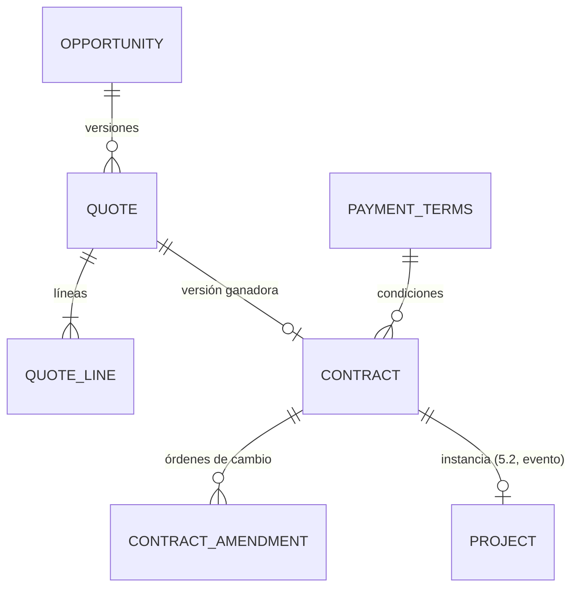
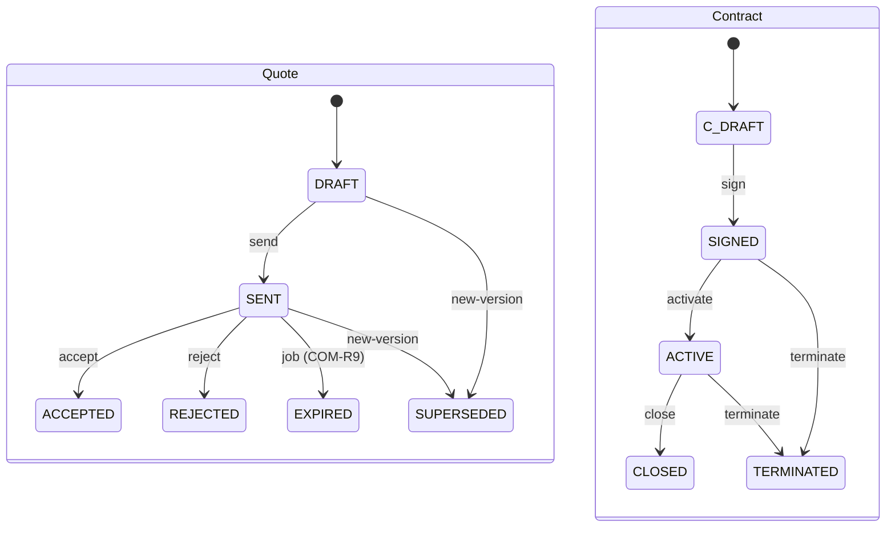

# Dominio · Capa comercial: CRM → Oferta → Contrato (A4)

- **Origen:** A4 (P4), A10 (VR2: precio congelado), A11 (`QuoteLine.uom_id`), A8 (`ContractAmendment`), A2 (reservas de oferta)
- **Esquema:** `commercial` (transaccional) · **Servicio:** `nexus-commercial` (comparte servicio con `billing`)
- **Pasos:** 5.1 (`PaymentTerms`, `Opportunity`, `Quote`, `QuoteLine`), 5.2 (`Contract`, `ContractAmendment`, instanciación de `Project`)

## §1 Principio

Corrige que EasyJob solo tenga el flag `Job.Opportunity`. El pipeline comercial va **antes** del Job:

`Opportunity` (OPEN → WON/LOST) → `Quote` (DRAFT → SENT → ACCEPTED) → `Contract` (DRAFT → SIGNED → ACTIVE) → `Project` (Capa 3).

Las líneas de oferta consumen `AssetTypePriceRule` (Capa 2): aquí nace el precio, que viaja **congelado** hasta la factura (VR2). Un `Contract` `ACTIVE` instancia exactamente un `Project`.

## §2 Modelo



## §3 DDL

```sql
CREATE SCHEMA commercial;
CREATE TABLE commercial.number_sequence (scope_key text PRIMARY KEY, next_value bigint NOT NULL DEFAULT 1);

-- ===== Paso 5.1 · PaymentTerms (P4). GLOBAL, administrable =====
CREATE TABLE commercial.payment_terms (
  id           uuid PRIMARY KEY,
  code         text NOT NULL UNIQUE,                 -- NET_15, NET_30, NET_60, ADVANCE_50
  caption_i18n jsonb NOT NULL,
  net_days     integer NOT NULL CHECK (net_days >= 0),
  advance_pct  numeric(7,4) NULL CHECK (advance_pct > 0 AND advance_pct <= 1),   -- [+] ADVANCE_50 = 0.5
  is_active    boolean NOT NULL DEFAULT true
  -- + std
);

-- ===== Paso 5.1 · Opportunity. RLS: LE+BU =====
CREATE TABLE commercial.opportunity (
  id                  uuid PRIMARY KEY,
  opportunity_no      text NOT NULL UNIQUE,            -- 'OPP-<LE>-<YYYY>-<NNNNN>' [+]
  name                text NOT NULL,                   -- [+]
  party_id            uuid NOT NULL REFERENCES org.party(id),     -- prospecto / cliente
  legal_entity_id     uuid NOT NULL REFERENCES org.legal_entity(id),   -- [+]
  business_unit_id    uuid NULL REFERENCES org.business_unit(id),      -- [+]
  stage               text NOT NULL DEFAULT 'QUALIFICATION'
                      CHECK (stage IN ('QUALIFICATION','NEEDS_ANALYSIS','PROPOSAL','NEGOTIATION','CLOSING')),  -- [+] valores
  status              text NOT NULL DEFAULT 'OPEN' CHECK (status IN ('OPEN','WON','LOST')),
  probability         numeric(7,4) NOT NULL CHECK (probability >= 0 AND probability <= 1),
  expected_close_date date NULL,
  expected_event_from date NULL,                       -- [+]
  expected_event_to   date NULL,                       -- [+]
  venue_location_id   uuid NULL REFERENCES org.location(id),       -- [+]
  owner_user_id       uuid NOT NULL REFERENCES org.app_user(id),
  lost_reason         text NULL CHECK (lost_reason IN ('PRICE','AVAILABILITY','COMPETITOR','CANCELLED_EVENT','OTHER')),  -- [+]
  closed_at           timestamptz NULL,
  -- + std
  CHECK ((status = 'OPEN') = (closed_at IS NULL)),
  CHECK ((status = 'LOST') = (lost_reason IS NOT NULL)),
  CHECK (expected_event_to IS NULL OR expected_event_from IS NULL OR expected_event_to >= expected_event_from)
);
CREATE INDEX ix_opp_le ON commercial.opportunity(legal_entity_id, status);
CREATE INDEX ix_opp_party ON commercial.opportunity(party_id);

-- ===== Paso 5.1 · Quote. RLS: LE+BU =====
CREATE TABLE commercial.quote (
  id               uuid PRIMARY KEY,
  quote_no         text NOT NULL,                      -- 'Q-<LE>-<YYYY>-<NNNNN>' (igual en todas las versiones)
  version          integer NOT NULL CHECK (version >= 1),
  opportunity_id   uuid NOT NULL REFERENCES commercial.opportunity(id),
  status           text NOT NULL DEFAULT 'DRAFT'
                   CHECK (status IN ('DRAFT','SENT','ACCEPTED','REJECTED','EXPIRED','SUPERSEDED')),
  valid_until      date NOT NULL,
  currency_code    char(3) NOT NULL REFERENCES org.currency(code),
  legal_entity_id  uuid NOT NULL REFERENCES org.legal_entity(id),
  business_unit_id uuid NULL REFERENCES org.business_unit(id),
  customer_party_id uuid NOT NULL REFERENCES org.party(id),          -- [+] = opportunity.party_id al crear
  price_as_of      timestamptz NOT NULL,                -- [+] instante de congelación de precios (VR2)
  payment_terms_id uuid NULL REFERENCES commercial.payment_terms(id), -- [+] propuesta; pasa al contrato
  total_net        numeric(19,4) NOT NULL DEFAULT 0,   -- [+] calculado por el dominio
  sent_at          timestamptz NULL,
  decided_at       timestamptz NULL,
  notes            text NULL,
  -- + std
  UNIQUE (quote_no, version)
);
CREATE INDEX ix_quote_opp ON commercial.quote(opportunity_id);
-- Como mucho una versión "viva" por oportunidad
CREATE UNIQUE INDEX uq_quote_live ON commercial.quote(opportunity_id) WHERE status IN ('DRAFT','SENT');

CREATE TABLE commercial.quote_line (
  id                uuid PRIMARY KEY,
  quote_id          uuid NOT NULL REFERENCES commercial.quote(id),
  line_no           integer NOT NULL,
  line_type         text NOT NULL CHECK (line_type IN ('RENTAL','SALE','SERVICE')),    -- [+]
  asset_type_id     uuid NULL REFERENCES catalog.asset_type(id),
  description       text NOT NULL,
  qty               numeric(18,4) NOT NULL CHECK (qty > 0),
  uom_id            uuid NULL REFERENCES uom.unit_of_measure(id),   -- A11: por defecto sales_uom_id; P11
  qty_stock_uom     numeric(18,4) NULL,                            -- [+] UR1 en el borde
  rental_start      timestamptz NULL,
  rental_end        timestamptz NULL,
  price_rule_id     uuid NULL REFERENCES catalog.asset_type_price_rule(id),   -- VER-R6: versión usada
  price_basis       text NULL CHECK (price_basis IN ('PER_DAY','PER_WEEK','PER_EVENT','SALE','MANUAL')),
  unit_price        numeric(19,4) NOT NULL CHECK (unit_price >= 0),          -- congelado (VR2)
  chargeable_units  numeric(18,4) NOT NULL DEFAULT 1 CHECK (chargeable_units > 0),  -- [+] días/semanas/1
  discount_pct      numeric(7,4) NOT NULL DEFAULT 0 CHECK (discount_pct >= 0 AND discount_pct <= 1),
  line_net          numeric(19,4) NOT NULL,                          -- [+] COM-R6
  legal_entity_id   uuid NOT NULL,
  -- + std
  UNIQUE (quote_id, line_no),
  CHECK ((line_type IN ('RENTAL','SALE')) = (asset_type_id IS NOT NULL)),
  CHECK ((line_type = 'RENTAL') = (rental_start IS NOT NULL AND rental_end IS NOT NULL)),
  CHECK (rental_end IS NULL OR rental_end > rental_start),
  CHECK ((asset_type_id IS NULL) = (qty_stock_uom IS NULL))
);
CREATE INDEX ix_ql_quote ON commercial.quote_line(quote_id);

-- ===== Paso 5.2 · Contract. RLS: LE+BU =====
CREATE TABLE commercial.contract (
  id                        uuid PRIMARY KEY,
  contract_no               text NOT NULL UNIQUE,      -- 'C-<LE>-<YYYY>-<NNNNN>'
  quote_id                  uuid NOT NULL UNIQUE REFERENCES commercial.quote(id),   -- versión ganadora
  party_id                  uuid NOT NULL REFERENCES org.party(id),
  legal_entity_id           uuid NOT NULL REFERENCES org.legal_entity(id),
  business_unit_id          uuid NULL REFERENCES org.business_unit(id),
  status                    text NOT NULL DEFAULT 'DRAFT'
                            CHECK (status IN ('DRAFT','SIGNED','ACTIVE','CLOSED','TERMINATED')),
  signed_date               date NULL,
  valid_from                date NOT NULL,
  valid_to                  date NOT NULL,
  payment_terms_id          uuid NOT NULL REFERENCES commercial.payment_terms(id),   -- P4
  cancellation_policy_text  text NOT NULL,              -- P4: lo que se firma
  cancellation_notice_days  integer NOT NULL CHECK (cancellation_notice_days >= 0),  -- P4: lo que se computa
  currency_code             char(3) NOT NULL REFERENCES org.currency(code),
  contract_value_net        numeric(19,4) NOT NULL,     -- [+] = total de la oferta + enmiendas aprobadas
  project_id                uuid NULL UNIQUE,           -- lo informa el evento project.created (sin FK)
  signed_document_id        uuid NULL,                  -- [+] docs.document (CONTRACT_SIGNED)
  terminated_at             timestamptz NULL,
  termination_reason        text NULL,
  -- + std
  CHECK (valid_to >= valid_from),
  CHECK ((status IN ('SIGNED','ACTIVE','CLOSED','TERMINATED')) = (signed_date IS NOT NULL)),
  CHECK ((status = 'TERMINATED') = (terminated_at IS NOT NULL))
);

-- ===== Paso 5.2 · ContractAmendment. RLS: LE =====
CREATE TABLE commercial.contract_amendment (
  id               uuid PRIMARY KEY,
  contract_id      uuid NOT NULL REFERENCES commercial.contract(id),
  amendment_no     integer NOT NULL CHECK (amendment_no >= 1),
  reason           text NOT NULL,
  delta_lines      jsonb NOT NULL,      -- P4: [{op, assetTypeId, description, qtyDelta, uomId, newUnitPrice, rentalStart, rentalEnd}]
  delta_value_net  numeric(19,4) NOT NULL,              -- [+] calculado
  status           text NOT NULL DEFAULT 'DRAFT'
                   CHECK (status IN ('DRAFT','PENDING_APPROVAL','APPROVED','REJECTED','APPLIED','WITHDRAWN')),  -- [+]
  legal_entity_id  uuid NOT NULL,
  -- + std
  UNIQUE (contract_id, amendment_no),
  CHECK (jsonb_typeof(delta_lines) = 'array' AND jsonb_array_length(delta_lines) > 0)
  -- Sin approved_by (A4/A8, WF-R15): se deriva de la última APPROVE de la solicitud
);
```

`delta_lines` se valida contra un JSON Schema en `contracts/schemas/contract-amendment-delta.v1.json` (EV-R2 aplicado a JSON) `[+]`.

## §4 Reglas

| Id | Regla | Origen |
|---|---|---|
| COM-R1 | Una `Opportunity` `WON` exige una `Quote` `ACCEPTED`; pasar a `LOST` exige `lost_reason` y rechaza/expira la versión viva | A4, [+] |
| COM-R2 | Una sola versión viva (`DRAFT`/`SENT`) por oportunidad. "Nueva versión" copia líneas, sube `version` y pasa la anterior viva a `SUPERSEDED` | A4 |
| COM-R3 | **Precio congelado (VR2):** al crear o editar una línea `RENTAL`/`SALE` se resuelve la tarifa `STANDARD` de la LE "as of" `quote.price_as_of` (`/price-rules/resolve`), se copia `unit_price`, `price_basis` y el `price_rule_id` de la versión (VER-R6). Un cambio posterior de la tarifa maestra no toca la oferta | A4, A10 |
| COM-R4 | `unit_price` manual (`price_basis = MANUAL`) exige permiso `QUOTE:OVERRIDE_PRICE` `[+]` | [+] |
| COM-R5 | `uom_id` por defecto = `sales_uom_id` del tipo (P11: `NULL` si el tipo no tiene unidades). `qty_stock_uom = catalog.to_stock_uom(...)` | A11 |
| COM-R6 | `chargeable_units`: `PER_DAY` = días naturales de `[rental_start, rental_end)` redondeados hacia arriba, con mínimo `min_charge_days` de la tarifa; `PER_WEEK` = semanas hacia arriba; `PER_EVENT`/`SALE`/`MANUAL` = 1. `line_net = round(qty × unit_price × chargeable_units × (1 − discount_pct), 2)` | [+] |
| COM-R7 | `total_net` = Σ `line_net`. Se recalcula en el dominio en cada cambio de líneas | [+] |
| COM-R8 | Solo se editan ofertas `DRAFT`. `send` exige al menos una línea y `valid_until ≥ hoy` | A4 |
| COM-R9 | Un job diario pasa a `EXPIRED` las ofertas `SENT` con `valid_until < hoy` | [+] |
| COM-R10 | Las líneas de tipos `DISCONTINUED` no se añaden (CAT-R6) | [+] |
| COM-R11 | `accept` solo desde `SENT`; marca la oportunidad `WON` (COM-R1) en la misma transacción | A4 |
| COM-R12 | Un `Contract` nace de una `Quote` `ACCEPTED` (una sola vez). Copia parte, LE, BU, moneda y `payment_terms_id` (obligatorio) | A4, P4 |
| COM-R13 | `sign` exige `signed_date` y, si la LE lo configura, un documento `CONTRACT_SIGNED` adjunto ⚑ COM-Q2 | [+] |
| COM-R14 | `activate` solo desde `SIGNED` y publica `contract.activated` con las líneas de la oferta: `nexus-operations` crea el `Project` y un `Job` `DRAFT` con sus líneas (projects.md §7) | A4 |
| COM-R15 | Un `Contract` `ACTIVE` instancia exactamente un `Project`: `project_id` se fija al consumir `project.created` con `contractId`; un segundo evento para el mismo contrato se ignora y se registra | A4 |
| COM-R16 | **Cancelación:** `terminate` antes de `valid_from − cancellation_notice_days` es libre; después exige permiso `CONTRACT:TERMINATE_LATE` y registra `termination_reason` | P4 |
| COM-R17 | Una `ContractAmendment` solo sobre contratos `SIGNED` o `ACTIVE`. `submit` → `PENDING_APPROVAL` + `approval-request.submitted` (`CONTRACT_AMENDMENT`) en la misma transacción | A4, A8 |
| COM-R18 | Al consumir `approval.approved`: `APPROVED`, `contract_value_net += delta_value_net`, y publica `contract-amendment.approved` con `delta_lines`. Al consumir el acuse de operations → `APPLIED` | A8, [+] |
| COM-R19 | `delta_lines` usa la misma resolución de precio que COM-R3 con `price_as_of = now()` de la enmienda, salvo `newUnitPrice` explícito (con COM-R4) | [+] |
| COM-R20 | Reservas de oferta (A2): `quote.sent` crea reservas `SOFT` con `weight = opportunity.probability` (mínimo 0.05) para las líneas `RENTAL`; `rejected`/`expired`/`superseded` las libera. Las crea `nexus-operations` (`logistics.md`, LOG-R21 variante `QUOTE_LINE`) | A2, PRJ-Q1 |

## §5 Estados



**ContractAmendment:** `DRAFT → PENDING_APPROVAL → APPROVED → APPLIED`; `PENDING_APPROVAL → REJECTED`; `DRAFT|REJECTED → WITHDRAWN`. Una solicitud `EXPIRED` deja la enmienda en `PENDING_APPROVAL` (workflow.md §5).

## §6 API (`commercial.yaml`)

| Método y ruta | Permiso | Paso |
|---|---|---|
| `GET/POST /v1/payment-terms`, `PUT /{id}`, `POST /{id}/deactivate` | `PAYMENT_TERMS:*` (GLOBAL) | 5.1 |
| `GET /v1/opportunities?status=&stage=&ownerUserId=&partyId=&q=` | `OPPORTUNITY:READ` | 5.1 |
| `POST /v1/opportunities`, `GET/PUT /{id}`, `POST /{id}/mark-lost` (cuerpo: `lostReason`) | `OPPORTUNITY:CREATE/UPDATE` | 5.1 |
| `GET /v1/opportunities/{id}/quotes` | `QUOTE:READ` | 5.1 |
| `POST /v1/opportunities/{id}/quotes` (crea v1 o nueva versión) | `QUOTE:CREATE` | 5.1 |
| `GET/PUT /v1/quotes/{id}` (cabecera + líneas completas, solo `DRAFT`) | `QUOTE:READ/UPDATE` | 5.1 |
| `POST /v1/quotes/{id}/send` · `/accept` · `/reject` | `QUOTE:UPDATE` | 5.1 |
| `POST /v1/quotes/{id}/price-preview` (cuerpo: líneas sin guardar → precios resueltos y totales) | `QUOTE:READ` | 5.1 |
| `GET /v1/quotes/{id}/pdf` (genera PDF; lo guarda como documento `QUOTE_PDF`) | `QUOTE:READ` ⚑ COM-Q3 | 5.1 |
| `POST /v1/quotes/{id}/create-contract` | `CONTRACT:CREATE` | 5.2 |
| `GET /v1/contracts?status=&partyId=&q=`, `GET/PUT /v1/contracts/{id}` | `CONTRACT:READ/UPDATE` | 5.2 |
| `POST /v1/contracts/{id}/sign` · `/activate` · `/close` · `/terminate` | `CONTRACT:UPDATE` (+ COM-R16) | 5.2 |
| `GET/POST /v1/contracts/{id}/amendments`, `PUT …/{amId}`, `POST …/{amId}/submit` · `/withdraw` | `CONTRACT_AMENDMENT:CREATE/UPDATE` | 5.2 |

## §7 Eventos

Contexto `commercial`.

| Topic | Paso | Payload | Consumidores |
|---|---|---|---|
| `nexus.commercial.opportunity.changed` | 5.1 | estado completo | proyecciones (pipeline) |
| `nexus.commercial.quote.sent` / `.accepted` / `.rejected` / `.expired` / `.superseded` | 5.1 | cabecera + líneas (`assetTypeId`, `qtyStockUom`, `rentalStart/End`) + `probability` | operations (reservas de oferta, COM-R20), proyecciones |
| `nexus.commercial.contract.signed` | 5.2 | estado completo (nombre fijado por A7) | proyecciones |
| `nexus.commercial.contract.activated` | 5.2 | contrato + líneas de la oferta ganadora | operations (crea `Project` + `Job`) |
| `nexus.commercial.contract.closed` / `.terminated` | 5.2 | | operations (aviso), controlling |
| `nexus.commercial.contract-amendment.approved` | 5.2 | contrato, `deltaLines`, `deltaValueNet` | operations (aplica deltas) |

**Consumidos:**

| Topic | Consumidor | Paso |
|---|---|---|
| `nexus.project.project.created` (con `contractId`) | `commercial.link-project` (COM-R15) | 5.2 |
| `nexus.platform.approval.*` (`CONTRACT_AMENDMENT`) | `commercial.amendment-approval` | 5.2 |
| `nexus.project.contract-amendment.applied` `[+]` (acuse de operations) | `commercial.amendment-applied` | 5.2 |

**Aplicación de deltas en operations `[+]`:** el consumidor `operations.apply-contract-amendment` crea un `Job` `DRAFT` "Amendment <n>" en el proyecto con las líneas de `qtyDelta > 0`. Las de `qtyDelta < 0` se listan en el Job como avisos para revisión manual (no se reducen líneas automáticamente). Publica `nexus.project.contract-amendment.applied`. ⚑ COM-Q1.

## §8 Pantallas (`features/commercial`)

| Pantalla | Paso |
|---|---|
| Pipeline: lista y tablero por `stage` (columnas), filtros por propietario, LE, estado | 5.1 |
| Oportunidad: cabecera, versiones de oferta, documentos | 5.1 |
| Editor de oferta: líneas con selector de tipo, `nx-quantity`, fechas de alquiler, precio resuelto (con enlace a la versión de tarifa), descuento, totales del servidor (`price-preview`), botones por estado; comprobación de disponibilidad orientativa (4.3) | 5.1 |
| Condiciones de pago (administración) | 5.1 |
| Contratos: lista y detalle (condiciones, firma, activación, proyecto enlazado, documentos, enmiendas con `nx-approval-panel`) | 5.2 |

## §9 Abiertos ⚑

- **COM-Q1:** aplicación de enmiendas con reducción de cantidades. Propuesta v1: solo aviso; el responsable reduce las líneas a mano.
- **COM-Q2:** ¿es obligatorio adjuntar el contrato firmado para `sign`? Propuesta: configurable por LE; por defecto no.
- **COM-Q3:** generación de PDF de oferta (plantilla y librería). Propuesta: plantilla HTML + `QuestPDF` (licencia Community: comprobar umbral de facturación de Nüssli) o render en un contenedor con Chromium headless. Requiere ADR antes de 5.1 si se incluye.
- **COM-Q4:** valores de `stage`. Los propuestos son genéricos de CRM.
