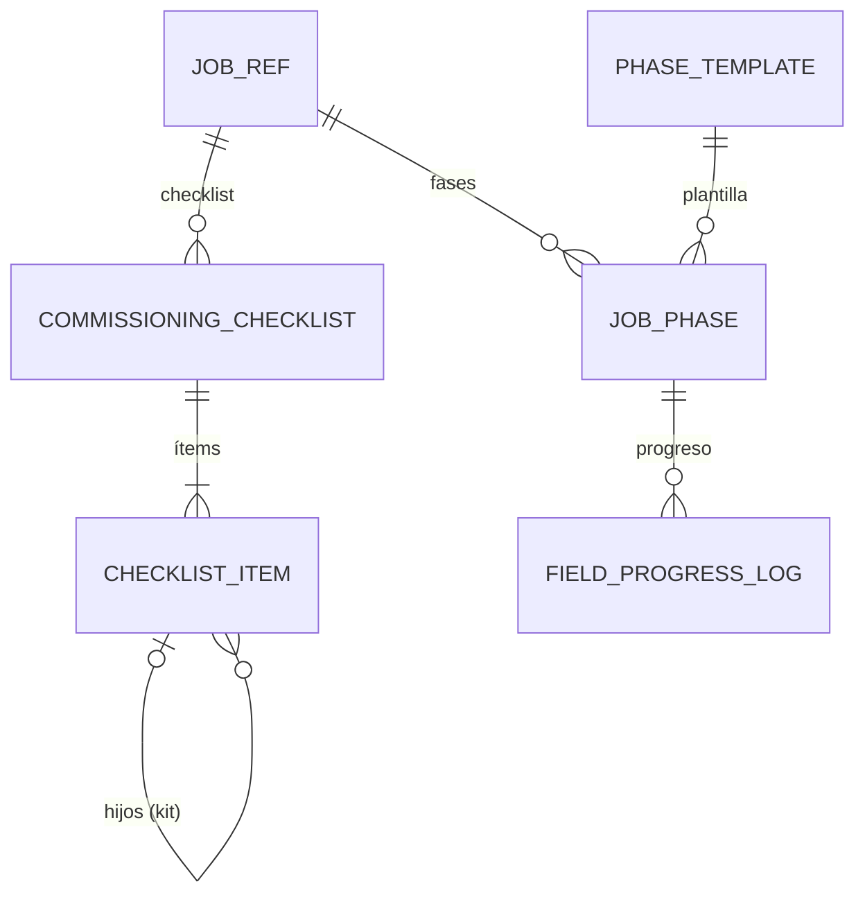

# Dominio · Commissioning: fases, checklists y progreso (§11)

- **Origen:** Manual §11 (`JobPhase`, `CommissioningChecklist`, `ChecklistItem`, `FieldProgressLog`), A10/P10 (BOM "as of"), A9 (fotos y certificados), adunic `837_MontagePhase`
- **Esquema:** `commissioning` (transaccional) · **Servicio:** `nexus-field`
- **Pasos:** 6.2

## §1 Principio

Las **fases son filas, no columnas** (EasyJob y adunic las tienen como columnas o tablas sueltas). El checklist de preparación se **genera por explosión del BOM** de las líneas del Job, "as of" la fecha de uso (P10), así que un kit se prepara tal como estaba definido cuando se contrató. El progreso en obra es **append-only**.

## §2 Modelo



## §3 DDL (paso 6.2)

```sql
CREATE SCHEMA commissioning;

-- [+] Réplicas (ARC-R3), desde nexus.project.job.* y nexus.project.job-line.* / delivery-part.changed
CREATE TABLE commissioning.job_ref (
  id uuid PRIMARY KEY, project_id uuid NOT NULL, code text NOT NULL, name text NOT NULL,
  legal_entity_id uuid NOT NULL, state_code text NOT NULL, state_category text NOT NULL,
  planned_dispatch_at timestamptz NOT NULL, event_start_at timestamptz NOT NULL,
  event_end_at timestamptz NOT NULL, planned_return_at timestamptz NOT NULL,
  aggregate_version bigint NOT NULL, updated_at timestamptz NOT NULL
);
CREATE TABLE commissioning.job_line_ref (
  id uuid PRIMARY KEY, job_id uuid NOT NULL, line_no integer NOT NULL, asset_type_id uuid NOT NULL,
  qty_stock_uom numeric(18,4) NOT NULL, usage_from timestamptz NOT NULL, is_cancelled boolean NOT NULL,
  delivery_part_ids uuid[] NOT NULL DEFAULT '{}', legal_entity_id uuid NOT NULL, project_id uuid NOT NULL,
  aggregate_version bigint NOT NULL, updated_at timestamptz NOT NULL
);

-- [+] GLOBAL
CREATE TABLE commissioning.phase_template (
  id                 uuid PRIMARY KEY,
  phase_code         text NOT NULL UNIQUE,     -- PREPARATION, LOADING, TRANSPORT_OUT, SETUP, EVENT, TEARDOWN, TRANSPORT_RETURN, RETURN_CHECK
  caption_i18n       jsonb NOT NULL,
  seq                integer NOT NULL,
  anchor             text NOT NULL CHECK (anchor IN ('DISPATCH','EVENT_START','EVENT_END','RETURN')),
  start_offset_hours integer NOT NULL,         -- respecto al ancla
  duration_hours     integer NOT NULL CHECK (duration_hours > 0),
  is_active          boolean NOT NULL DEFAULT true
  -- + std
);

-- RLS: LE+PRJ
CREATE TABLE commissioning.job_phase (
  id                  uuid PRIMARY KEY,
  job_id              uuid NOT NULL,
  phase_code          text NOT NULL,
  seq                 integer NOT NULL,
  planned_start_at    timestamptz NOT NULL,
  planned_end_at      timestamptz NOT NULL,
  actual_start_at     timestamptz NULL,
  actual_end_at       timestamptz NULL,
  status              text NOT NULL DEFAULT 'PLANNED'
                      CHECK (status IN ('PLANNED','IN_PROGRESS','DONE','SKIPPED')),
  progress_pct        numeric(7,4) NOT NULL DEFAULT 0 CHECK (progress_pct BETWEEN 0 AND 1),   -- último del log
  responsible_user_id uuid NULL REFERENCES org.app_user(id),
  legal_entity_id     uuid NOT NULL,
  project_id          uuid NOT NULL,
  ej_montage_phase_ref text NULL,                -- [+] ETL desde 837_MontagePhase
  -- + std
  UNIQUE (job_id, phase_code),
  CHECK (planned_end_at > planned_start_at),
  CHECK (actual_end_at IS NULL OR actual_start_at IS NOT NULL)
);

-- RLS: LE+PRJ
CREATE TABLE commissioning.commissioning_checklist (
  id               uuid PRIMARY KEY,
  job_id           uuid NOT NULL,
  delivery_part_id uuid NULL,                    -- NULL = todo el Job
  bom_as_of        timestamptz NOT NULL,         -- P10: instante de la explosión
  status           text NOT NULL DEFAULT 'OPEN' CHECK (status IN ('OPEN','IN_PROGRESS','COMPLETED','SUPERSEDED')),
  generated_at     timestamptz NOT NULL,
  generated_from_line_versions jsonb NOT NULL,   -- [+] {jobLineId: aggregateVersion} para detectar cambios (CMS-R5)
  legal_entity_id  uuid NOT NULL,
  project_id       uuid NOT NULL
  -- + std
);
CREATE UNIQUE INDEX uq_cc_live ON commissioning.commissioning_checklist(job_id, coalesce(delivery_part_id,'00000000-0000-0000-0000-000000000000'))
  WHERE status <> 'SUPERSEDED';

CREATE TABLE commissioning.checklist_item (
  id                uuid PRIMARY KEY,
  checklist_id      uuid NOT NULL REFERENCES commissioning.commissioning_checklist(id),
  parent_item_id    uuid NULL REFERENCES commissioning.checklist_item(id),
  job_line_id       uuid NULL,                   -- solo en nivel 0
  level             integer NOT NULL CHECK (level BETWEEN 0 AND 10),
  asset_type_id     uuid NOT NULL REFERENCES catalog.asset_type(id),
  required_qty      numeric(18,4) NOT NULL CHECK (required_qty > 0),
  picked_qty        numeric(18,4) NOT NULL DEFAULT 0 CHECK (picked_qty >= 0),
  is_optional       boolean NOT NULL DEFAULT false,
  is_kit_header     boolean NOT NULL DEFAULT false,   -- kit VIRTUAL: no se recoge, se recogen sus hijos
  status            text NOT NULL DEFAULT 'OPEN' CHECK (status IN ('OPEN','PARTIAL','DONE','MISSING','WAIVED')),
  note              text NULL,
  legal_entity_id   uuid NOT NULL,
  project_id        uuid NOT NULL
  -- + std
);
CREATE INDEX ix_ci_checklist ON commissioning.checklist_item(checklist_id, level);

-- Append-only. RLS: LE+PRJ
CREATE TABLE commissioning.field_progress_log (
  id                 uuid PRIMARY KEY,           -- UUIDv7 del cliente (móvil)
  job_phase_id       uuid NOT NULL REFERENCES commissioning.job_phase(id),
  job_id             uuid NOT NULL,
  progress_pct       numeric(7,4) NOT NULL CHECK (progress_pct BETWEEN 0 AND 1),
  note               text NULL,
  photo_document_ids uuid[] NOT NULL DEFAULT '{}',   -- docs.document (SITE_PHOTO)
  logged_by          uuid NOT NULL,
  logged_at          timestamptz NOT NULL,       -- reloj del dispositivo
  received_at        timestamptz NOT NULL,
  latitude           numeric(9,6) NULL,
  longitude          numeric(9,6) NULL,
  legal_entity_id    uuid NOT NULL,
  project_id         uuid NOT NULL
  -- + std-append
);
CREATE INDEX ix_fpl_phase ON commissioning.field_progress_log(job_phase_id, logged_at);
```

**Semilla común `[+]`** de `phase_template`:

| Código | Ancla | Desfase (h) | Duración (h) |
|---|---|---|---|
| `PREPARATION` | DISPATCH | −48 | 40 |
| `LOADING` | DISPATCH | −8 | 8 |
| `TRANSPORT_OUT` | DISPATCH | 0 | 8 |
| `SETUP` | EVENT_START | −72 | 72 |
| `EVENT` | EVENT_START | 0 | = duración del evento (CMS-R2) |
| `TEARDOWN` | EVENT_END | 0 | 48 |
| `TRANSPORT_RETURN` | RETURN | −8 | 8 |
| `RETURN_CHECK` | RETURN | 0 | 24 |

## §4 Reglas

| Id | Regla | Origen |
|---|---|---|
| CMS-R1 | Al entrar un Job (réplica) en categoría `CONFIRMED` por primera vez, se crean sus fases desde las plantillas activas. Ya existentes → no se tocan | §11, [+] |
| CMS-R2 | `planned_start_at = ancla + start_offset_hours`; `planned_end_at = planned_start_at + duration_hours`; `EVENT` dura `event_end_at − event_start_at`. Si cambian las fechas del Job, se recalculan solo las fases `PLANNED` | [+] |
| CMS-R3 | Fases: `PLANNED → IN_PROGRESS → DONE`; `PLANNED → SKIPPED`. `actual_start_at` al empezar, `actual_end_at` al terminar | §11 |
| CMS-R4 | **Explosión:** el checklist de un Job (o parte de entrega) tiene un ítem nivel 0 por línea `MATERIAL` no cancelada (o por su cantidad en la parte) y sus componentes por `catalog.explode_bom(asset_type_id, qty, bom_as_of)` con `bom_as_of = usage_from` de la línea (P10). Kits `VIRTUAL` → `is_kit_header`; kits `ASSEMBLY` → un ítem sin hijos | §11, P10 |
| CMS-R5 | Si las líneas del Job cambian (versión distinta de `generated_from_line_versions`), el checklist abierto se marca "desactualizado" y "Regenerar" crea uno nuevo y pasa el anterior a `SUPERSEDED`, conservando `picked_qty` por tipo cuando coincide | [+] |
| CMS-R6 | `picked_qty` se actualiza al aplicarse una sesión `LOAD` de la parte de entrega (`logistics.load-session.applied`): por tipo, se reparte en los ítems del checklist no kit. Recogida manual permitida con `CHECKLIST:UPDATE` | [+] |
| CMS-R7 | Estado de ítem: `DONE` si `picked ≥ required`; `PARTIAL` si `0 < picked < required`; `MISSING` lo marca el usuario; `WAIVED` (opcional no llevado) solo si `is_optional`. Un kit header es `DONE` cuando todos sus hijos no opcionales lo son | [+] |
| CMS-R8 | El checklist pasa a `COMPLETED` cuando todos los ítems nivel ≥ 0 no opcionales están `DONE` o `WAIVED` | [+] |
| CMS-R9 | `field_progress_log` es append-only; `job_phase.progress_pct` = el `progress_pct` del log más reciente por `logged_at` (no por llegada) | §11 |
| CMS-R10 | Las fotos se suben antes al módulo documental (`SITE_PHOTO`, `resource_type = JOB_PHASE`) y el log solo guarda sus ids | A9 |

## §5 Estados

`JobPhase` (CMS-R3) · `CommissioningChecklist`: `OPEN → IN_PROGRESS → COMPLETED`; `* → SUPERSEDED` · `ChecklistItem` (CMS-R7).

## §6 API (`field.yaml`)

| Método y ruta | Permiso |
|---|---|
| `GET/POST /v1/phase-templates`, `PUT /{id}` | `JOB_PHASE_CONFIG:*` (GLOBAL) |
| `GET /v1/jobs/{jobId}/phases` · `PUT /v1/job-phases/{id}` (fechas, responsable) | `JOB_PHASE:READ/UPDATE` |
| `POST /v1/job-phases/{id}/start` · `/complete` · `/skip` | `JOB_PHASE:UPDATE` |
| `GET /v1/job-phases/{id}/progress` · `POST /v1/job-phases/{id}/progress` (con `id` de cliente) | `JOB_PHASE:READ/UPDATE` |
| `GET /v1/jobs/{jobId}/checklists` · `POST /v1/jobs/{jobId}/checklists` (cuerpo: `deliveryPartId?`) | `CHECKLIST:READ/CREATE` |
| `GET /v1/checklists/{id}` (árbol) · `POST /v1/checklists/{id}/regenerate` | `CHECKLIST:READ/CREATE` |
| `PUT /v1/checklist-items/{id}` (`pickedQty`, `status` `MISSING`/`WAIVED`, `note`) | `CHECKLIST:UPDATE` |
| `GET /v1/checklists/{id}/print` (PDF de preparación) ⚑ comparte COM-Q3 | `CHECKLIST:READ` |

## §7 Eventos

| Topic | Consumidores |
|---|---|
| `nexus.commissioning.job-phase.changed` | proyecciones (planificación) |
| `nexus.commissioning.checklist.completed` | proyecciones |
| `nexus.commissioning.progress.logged` | proyecciones |

**Consumidos:** `nexus.project.job.created/.updated/.state-changed` → `job_ref` + CMS-R1/R2; `nexus.project.job-line.*`, `nexus.project.delivery-part.changed` → `job_line_ref` + CMS-R5; `nexus.logistics.load-session.applied` → CMS-R6. Consumidores `field.*`, actúan como SYSTEM.

## §8 Pantallas (`features/commissioning`)

| Pantalla | Contenido |
|---|---|
| Job · pestaña Fases: tabla y Gantt de fases (plan vs real), responsable, progreso con fotos | |
| Job · pestaña Preparación: checklist en árbol con recogido/requerido, filtros (pendiente, faltante), regenerar, imprimir | |
| Plantillas de fase (administración) | |

## §9 Abiertos ⚑

- **CMS-Q1:** desfases y duraciones de la plantilla son de partida; confirmar con operaciones (adunic `837_MontagePhase`).
- **CMS-Q2:** ¿plantillas distintas por tipo de proyecto (tribunas vs escenarios)? Propuesta v1: una plantilla global.
