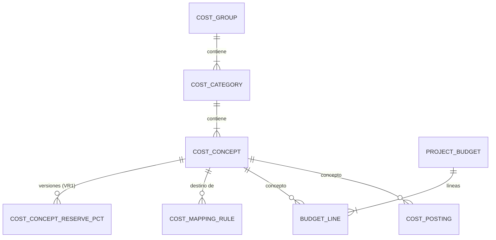

# Dominio · Controlling / Kalkulation y catálogo de costes (A5)

- **Origen:** A5 (P5), A8 (`ProjectBudget` aprobado), A7 (`ProjectPnL` en ClickHouse), A10 (`default_reserve_pct` versionado)
- **Esquema:** `controlling` (transaccional) · **Servicio:** `nexus-controlling` · **Proyección:** ClickHouse `nexus_analytics`
- **Pasos:** 5.6 (catálogo de costes, reglas de imputación, `ProjectBudget`), 5.7 (`CostPosting`, `ProjectPnL`)

## §1 Principio

Une los ingredientes del coste que en EasyJob están sueltos (transporte, subalquiler, horas, gastos, consumibles) bajo un **catálogo de conceptos de coste** de tres niveles. Es el concepto más crítico para NRP (adunic `180_Kalk`: Kalkulation, Forecast, Controlling).

- El **precálculo** (`ProjectBudget`) **se almacena**: es un compromiso formal aprobado (A8).
- El **coste real** (`CostPosting`) es **append-only** y polimórfico hacia su origen.
- El **margen nunca se almacena**: `ProjectPnL` = Σ ingresos (facturas) − Σ costes reales, frente al presupuesto. Vive en ClickHouse (A7).

## §2 Modelo



## §3 DDL

```sql
CREATE SCHEMA controlling;

-- ===== Paso 5.6 · catálogo (GLOBAL) =====
CREATE TABLE controlling.cost_group (
  id           uuid PRIMARY KEY,
  code         text NOT NULL UNIQUE CHECK (code IN ('EXTERNO','INTERNO')),   -- fijo (A5)
  caption_i18n jsonb NOT NULL
  -- + std
);

CREATE TABLE controlling.cost_category (
  id           uuid PRIMARY KEY,
  group_id     uuid NOT NULL REFERENCES controlling.cost_group(id),
  code         text NOT NULL UNIQUE,
  caption_i18n jsonb NOT NULL,
  sort_order   integer NOT NULL DEFAULT 0,
  is_active    boolean NOT NULL DEFAULT true
  -- + std
);

CREATE TABLE controlling.cost_concept (
  id              uuid PRIMARY KEY,
  category_id     uuid NOT NULL REFERENCES controlling.cost_category(id),
  code            text NOT NULL UNIQUE,
  caption_i18n    jsonb NOT NULL,
  is_intercompany boolean NOT NULL DEFAULT false,
  sort_order      integer NOT NULL DEFAULT 0,
  is_active       boolean NOT NULL DEFAULT true
  -- + std
  -- default_reserve_pct vive en la tabla hija versionada (versioning.md §2)
);

CREATE TABLE controlling.cost_concept_reserve_pct (   -- VR1 [+]
  id               uuid PRIMARY KEY,
  business_key     text NOT NULL,                     -- = cost_concept_id::text
  version_no       integer NOT NULL CHECK (version_no >= 1),
  valid_from       timestamptz NOT NULL,
  valid_to         timestamptz NULL,
  superseded_by_id uuid NULL REFERENCES controlling.cost_concept_reserve_pct(id),
  cost_concept_id  uuid NOT NULL REFERENCES controlling.cost_concept(id),
  reserve_pct      numeric(7,4) NOT NULL CHECK (reserve_pct >= 0 AND reserve_pct <= 1),
  -- + std-append
  CHECK (business_key = cost_concept_id::text),
  CONSTRAINT uq_crp_version UNIQUE (business_key, version_no),
  CONSTRAINT ck_crp_window CHECK (valid_to IS NULL OR valid_to > valid_from),
  CONSTRAINT ex_crp_overlap EXCLUDE USING gist (business_key WITH =,
      tstzrange(valid_from, coalesce(valid_to,'infinity')) WITH &&)
);
CREATE UNIQUE INDEX uq_crp_current ON controlling.cost_concept_reserve_pct(business_key) WHERE valid_to IS NULL;

-- [+] Reglas de imputación: hacen datos la tabla "Origen del coste real, por categoría" de A5
CREATE TABLE controlling.cost_mapping_rule (
  id                   uuid PRIMARY KEY,
  source_kind          text NOT NULL CHECK (source_kind IN
                         ('JOB_TRANSPORT','SUPPLIER_INVOICE_LINE','TIME_ENTRY','EXPENSE','STOCK_CONSUMPTION')),
  fleet_type           text NULL CHECK (fleet_type IN ('OWN','THIRD_PARTY')),
  is_intercompany      boolean NULL,               -- JOB_TRANSPORT con carrier_legal_entity_id
  direction            text NULL CHECK (direction IN ('OUTBOUND','RETURN')),
  purchase_type        text NULL CHECK (purchase_type IN ('STOCK','CONSUMABLE','SUBHIRE','SERVICE')),
  activity_phase       text NULL CHECK (activity_phase IN ('SETUP','EVENT','TEARDOWN')),
  worker_class         text NULL CHECK (worker_class IN ('OWN','EXTERNAL')),   -- INTERNAL → OWN; EXTERNAL/FREELANCE → EXTERNAL
  expense_type         text NULL CHECK (expense_type IN ('DIET','OTHER')),
  has_worker           boolean NULL,
  cost_concept_id      uuid NOT NULL REFERENCES controlling.cost_concept(id),
  priority             integer NOT NULL DEFAULT 100,
  is_active            boolean NOT NULL DEFAULT true
  -- + std
);

-- ===== Réplica (ARC-R3) =====
CREATE TABLE controlling.project_ref (               -- [+] desde nexus.project.project.*
  id uuid PRIMARY KEY, code text NOT NULL, name text NOT NULL, legal_entity_id uuid NOT NULL,
  business_unit_id uuid NULL, currency_code char(3) NOT NULL, status text NOT NULL,
  aggregate_version bigint NOT NULL, updated_at timestamptz NOT NULL
);

-- ===== Paso 5.6 · Kalkulation. RLS: LE+BU+PRJ =====
CREATE TABLE controlling.project_budget (
  id               uuid PRIMARY KEY,
  project_id       uuid NOT NULL,
  version          integer NOT NULL CHECK (version >= 1),
  status           text NOT NULL DEFAULT 'DRAFT'
                   CHECK (status IN ('DRAFT','PENDING_APPROVAL','APPROVED','SUPERSEDED','REJECTED')),  -- REJECTED [+]
  currency_code    char(3) NOT NULL REFERENCES org.currency(code),   -- = moneda del proyecto
  total_planned    numeric(19,4) NOT NULL DEFAULT 0,
  total_reserved   numeric(19,4) NOT NULL DEFAULT 0,
  approved_by      uuid NULL,              -- A5: del evento approval.approved (último aprobador)
  approved_date    timestamptz NULL,
  notes            text NULL,
  legal_entity_id  uuid NOT NULL,
  business_unit_id uuid NULL,
  -- + std
  UNIQUE (project_id, version),
  CHECK ((status IN ('APPROVED','SUPERSEDED')) = (approved_date IS NOT NULL))
);
CREATE UNIQUE INDEX uq_pb_approved ON controlling.project_budget(project_id) WHERE status = 'APPROVED';
CREATE UNIQUE INDEX uq_pb_open ON controlling.project_budget(project_id) WHERE status IN ('DRAFT','PENDING_APPROVAL');

CREATE TABLE controlling.budget_line (
  id                     uuid PRIMARY KEY,
  budget_id              uuid NOT NULL REFERENCES controlling.project_budget(id),
  cost_concept_id        uuid NOT NULL REFERENCES controlling.cost_concept(id),
  planned_qty            numeric(18,4) NOT NULL CHECK (planned_qty >= 0),
  planned_unit_cost      numeric(19,4) NOT NULL CHECK (planned_unit_cost >= 0),   -- VR2 snapshot
  planned_total          numeric(19,4) NOT NULL,                                   -- = qty × unit_cost
  reserve_pct            numeric(7,4) NOT NULL CHECK (reserve_pct >= 0 AND reserve_pct <= 1),  -- default del concepto, sobreescribible
  reserve_pct_version_id uuid NULL REFERENCES controlling.cost_concept_reserve_pct(id),        -- VER-R6; NULL si se sobreescribió
  reserved_amount        numeric(19,4) NOT NULL,                                   -- = planned_total × reserve_pct
  notes                  text NULL,
  legal_entity_id        uuid NOT NULL,
  project_id             uuid NOT NULL,
  -- + std
  UNIQUE (budget_id, cost_concept_id)
);

-- ===== Paso 5.7 · coste real. Append-only. RLS: LE+PRJ =====
CREATE TABLE controlling.cost_posting (
  id                   uuid PRIMARY KEY,
  project_id           uuid NOT NULL,
  cost_concept_id      uuid NOT NULL REFERENCES controlling.cost_concept(id),
  amount               numeric(19,4) NOT NULL,           -- en currency_code; negativo en reversas
  currency_code        char(3) NOT NULL REFERENCES org.currency(code),
  amount_project_ccy   numeric(19,4) NOT NULL,           -- [+] convertido a la moneda del proyecto
  fx_rate              numeric(19,10) NOT NULL,          -- [+] 1 si misma moneda
  posted_date          date NOT NULL,
  source_entity_type   text NOT NULL CHECK (source_entity_type IN
                         ('JOB_TRANSPORT','SUPPLIER_INVOICE_LINE','TIME_ENTRY','EXPENSE','STOCK_MOVEMENT','MANUAL')),
  source_entity_id     uuid NOT NULL,
  source_event_id      uuid NOT NULL,                    -- [+] trazabilidad
  mapping_rule_id      uuid NULL REFERENCES controlling.cost_mapping_rule(id),   -- [+]
  reverses_posting_id  uuid NULL UNIQUE REFERENCES controlling.cost_posting(id),
  note                 text NULL,
  legal_entity_id      uuid NOT NULL
  -- + std-append
);
-- [+] idempotencia: un origen genera como mucho un asiento original por concepto
CREATE UNIQUE INDEX uq_cp_source ON controlling.cost_posting(source_entity_type, source_entity_id, cost_concept_id)
  WHERE reverses_posting_id IS NULL;
CREATE INDEX ix_cp_project ON controlling.cost_posting(project_id, posted_date);

-- [+] Bandeja de costes sin imputar (CTL-R8, CTL-R10, CTL-R12). RLS: LE+PRJ
CREATE TABLE controlling.unmapped_cost (
  id                 uuid PRIMARY KEY,
  source_entity_type text NOT NULL,
  source_entity_id   uuid NOT NULL,
  source_event_id    uuid NOT NULL,
  project_id         uuid NOT NULL,
  reason             text NOT NULL CHECK (reason IN ('NO_MAPPING_RULE','NO_FX_RATE','NO_UNIT_COST')),
  attributes         jsonb NOT NULL,          -- atributos del origen usados para resolver la regla
  amount             numeric(19,4) NULL,
  currency_code      char(3) NULL,
  status             text NOT NULL DEFAULT 'OPEN' CHECK (status IN ('OPEN','RESOLVED')),
  resolved_posting_id uuid NULL REFERENCES controlling.cost_posting(id),
  legal_entity_id    uuid NOT NULL,
  -- + std
  UNIQUE (source_entity_type, source_entity_id)
);
```

### Semilla común: catálogo completo (22 conceptos, 8 categorías, A5)

| Grupo | Categoría (`code`) | Conceptos (`code`) |
|---|---|---|
| EXTERNO | `TRANSPORT` | `TRANSPORT_OUT`, `TRANSPORT_RETURN`, `TRANSPORT_IC_OUT` (IC), `TRANSPORT_IC_RETURN` (IC) |
| EXTERNO | `MACHINERY` | `MACHINERY_SETUP`, `MACHINERY_TEARDOWN` |
| EXTERNO | `EXT_STAFF_SETUP` | `EXT_STAFF_SETUP`, `EXT_STAFF_SETUP_DIET`, `EXT_STAFF_SETUP_OTHER` |
| EXTERNO | `EXT_STAFF_TEARDOWN` | `EXT_STAFF_TEARDOWN`, `EXT_STAFF_TEARDOWN_DIET`, `EXT_STAFF_TEARDOWN_OTHER` |
| EXTERNO | `CONSUMABLES` | `CONSUMABLES` |
| EXTERNO | `MISC` | `MISC_EXPENSES` |
| INTERNO | `OWN_STAFF_SETUP` | `OWN_STAFF_SETUP`, `OWN_STAFF_SETUP_DIET`, `OWN_STAFF_SETUP_OTHER`, `OWN_VEHICLE_SETUP` |
| INTERNO | `OWN_STAFF_TEARDOWN` | `OWN_STAFF_TEARDOWN`, `OWN_STAFF_TEARDOWN_DIET`, `OWN_STAFF_TEARDOWN_OTHER`, `OWN_VEHICLE_TEARDOWN` |

`caption_i18n.es` con los textos de A5 ("Transportes ida", "Transporte vehículo propio desmontaje" corregido, etc.) y `de` como obligatorio (traducción a confirmar ⚑ CTL-Q4). `default reserve_pct` inicial = 0 en todos; lo ajusta el usuario (A5: "configurable").

### Semilla común: reglas de imputación `[+]` (de la tabla de A5)

| `source_kind` | Condición | Concepto |
|---|---|---|
| `JOB_TRANSPORT` | `THIRD_PARTY`, no IC, `OUTBOUND` / `RETURN` | `TRANSPORT_OUT` / `TRANSPORT_RETURN` |
| `JOB_TRANSPORT` | `THIRD_PARTY`, IC, `OUTBOUND` / `RETURN` | `TRANSPORT_IC_OUT` / `TRANSPORT_IC_RETURN` |
| `JOB_TRANSPORT` | `OWN`, `OUTBOUND` / `RETURN` | `OWN_VEHICLE_SETUP` / `OWN_VEHICLE_TEARDOWN` |
| `SUPPLIER_INVOICE_LINE` | `SUBHIRE`, `SETUP` o `EVENT` / `TEARDOWN` | `MACHINERY_SETUP` / `MACHINERY_TEARDOWN` ⚑ CTL-Q1 |
| `SUPPLIER_INVOICE_LINE` | `CONSUMABLE` | `CONSUMABLES` |
| `SUPPLIER_INVOICE_LINE` | `SERVICE` | `MISC_EXPENSES` ⚑ |
| `STOCK_CONSUMPTION` | — | `CONSUMABLES` |
| `TIME_ENTRY` | `OWN`, `SETUP`/`EVENT` · `TEARDOWN` | `OWN_STAFF_SETUP` · `OWN_STAFF_TEARDOWN` |
| `TIME_ENTRY` | `EXTERNAL`, `SETUP`/`EVENT` · `TEARDOWN` | `EXT_STAFF_SETUP` · `EXT_STAFF_TEARDOWN` |
| `EXPENSE` | con trabajador `OWN`/`EXTERNAL`, `DIET`/`OTHER`, fase | `*_STAFF_<FASE>_DIET` / `*_STAFF_<FASE>_OTHER` (8 reglas) |
| `EXPENSE` | sin trabajador | `MISC_EXPENSES` |

`EVENT` se imputa a montaje (`SETUP`) en v1 ⚑ CTL-Q1. `STOCK` en factura de proveedor no imputa a proyecto (es inventario).

## §4 Reglas

| Id | Regla | Origen |
|---|---|---|
| CTL-R1 | `cost_group` solo tiene `EXTERNO` e `INTERNO` | A5 |
| CTL-R2 | `reserve_pct` de una línea de presupuesto = versión vigente de `cost_concept_reserve_pct` al crear la línea (se guarda `reserve_pct_version_id`); el usuario puede sobreescribirla (entonces `reserve_pct_version_id = NULL`) | A5, A10 |
| CTL-R3 | `planned_total = round(planned_qty × planned_unit_cost, 2)`; `reserved_amount = round(planned_total × reserve_pct, 2)`; totales de cabecera = Σ líneas | A5 |
| CTL-R4 | Solo se edita un presupuesto `DRAFT`. "Nueva versión" copia la última (cualquier estado) a `DRAFT` con `version + 1` | [+] |
| CTL-R5 | `submit`: `DRAFT → PENDING_APPROVAL` + `approval-request.submitted` (`PROJECT_BUDGET`, 2 pasos `PROJECT_MANAGER` → `CONTROLLER`) en la misma transacción | A8 |
| CTL-R6 | Al consumir `approval.approved`: `APPROVED`, `approved_by` = `approvedBy` del evento, `approved_date`; el anterior `APPROVED` del proyecto pasa a `SUPERSEDED` en la misma transacción | A5, A8 |
| CTL-R7 | `approval.rejected` → `REJECTED` (se puede crear versión nueva). `expired` → sigue `PENDING_APPROVAL` (workflow.md §5) | [+] |
| CTL-R8 | **Imputación:** cada evento de origen se convierte en `CostPosting` con la regla activa más específica (más condiciones no nulas que casan; empate → menor `priority`). Sin regla → no se asienta; se registra en la bandeja "Costes sin imputar" (métrica + lista) | A5, [+] |
| CTL-R9 | Idempotencia: `uq_cp_source`. Reprocesar el mismo origen no duplica | [+] |
| CTL-R10 | `amount_project_ccy = round(amount × fx_rate, 2)` con el último `org.exchange_rate` ≤ `posted_date`; sin tipo → no se asienta y va a "sin imputar" | [+] |
| CTL-R11 | Un coste no se corrige: una reversa con `reverses_posting_id` e importe opuesto, y un asiento nuevo si procede. Ajuste `MANUAL` con permiso `COST_POSTING:CREATE` y nota | A5 |
| CTL-R12 | **Consumo de stock:** un movimiento `CONSUMPTION` con `project_id` de un tipo `is_consumable` se valora `qty × unit_cost` del proveedor `PURCHASE` preferido del tipo; sin coste → "sin imputar" ⚑ CTL-Q2 | A5 |
| CTL-R13 | `ProjectPnL` no se almacena en PostgreSQL. Es una consulta sobre ClickHouse (§6) | A5, A7 |
| CTL-R14 | Transporte IC: el concepto IC se usa cuando `carrier_legal_entity_id` es del mismo grupo; en consolidación se elimina según `group.consolidation_method` (lo hace el reporting consolidado, fuera de v1 ⚑ CTL-Q3) | A5 |

## §5 Estados

**ProjectBudget:** `DRAFT → PENDING_APPROVAL → APPROVED → SUPERSEDED`; `PENDING_APPROVAL → REJECTED`.

## §6 `ProjectPnL` (ClickHouse, paso 5.7)

```sql
CREATE TABLE nexus_analytics.pnl_revenue (          -- desde nexus.billing.invoice.issued (una fila por línea)
  legal_entity_id UUID, project_id UUID, invoice_id UUID, invoice_line_id UUID, invoice_type LowCardinality(String),
  invoice_date Date, amount Decimal(19,4), currency_code FixedString(3),
  amount_project_ccy Decimal(19,4),                    -- convertido por el consumidor con el tipo del día
  _event_id UUID, _aggregate_version UInt64, _ingested_at DateTime64(3,'UTC')
) ENGINE = ReplacingMergeTree(_aggregate_version) ORDER BY (legal_entity_id, project_id, invoice_line_id);

CREATE TABLE nexus_analytics.pnl_cost (             -- desde nexus.controlling.cost-posting.posted
  legal_entity_id UUID, project_id UUID, cost_posting_id UUID, cost_concept_code LowCardinality(String),
  cost_category_code LowCardinality(String), cost_group_code LowCardinality(String),
  posted_date Date, amount_project_ccy Decimal(19,4),
  _event_id UUID, _aggregate_version UInt64, _ingested_at DateTime64(3,'UTC')
) ENGINE = ReplacingMergeTree(_aggregate_version) ORDER BY (legal_entity_id, project_id, cost_posting_id);

CREATE TABLE nexus_analytics.pnl_budget (           -- desde nexus.controlling.budget.approved (líneas)
  legal_entity_id UUID, project_id UUID, budget_id UUID, budget_version UInt32, cost_concept_code LowCardinality(String),
  planned_total Decimal(19,4), reserved_amount Decimal(19,4), is_current UInt8,
  _event_id UUID, _aggregate_version UInt64, _ingested_at DateTime64(3,'UTC')
) ENGINE = ReplacingMergeTree(_aggregate_version) ORDER BY (legal_entity_id, project_id, budget_id, cost_concept_code);
```

Consulta de `ProjectPnL` por proyecto y concepto: ingresos (Σ `pnl_revenue`), coste real (Σ `pnl_cost`), plan (Σ `pnl_budget` con `is_current = 1`), reserva, margen = ingresos − coste real, desviación = coste real − plan. Endpoint en `nexus-controlling`, con filtro de alcance de `BuildingBlocks.Analytics`.

## §7 API (`controlling.yaml`)

| Método y ruta | Permiso | Paso |
|---|---|---|
| `GET /v1/cost-catalog/tree` · `GET/POST /v1/cost-categories`, `PUT /{id}` · `GET/POST /v1/cost-concepts`, `PUT /{id}` | `COST_CATALOG:*` (GLOBAL) | 5.6 |
| Patrón versionado sobre `/v1/cost-concepts/{id}/reserve-pct` (`versioning.md §6`) | `COST_CATALOG:UPDATE` | 5.6 |
| `GET/POST /v1/cost-mapping-rules`, `PUT /{id}`, `POST /v1/cost-mapping-rules/resolve` (prueba: cuerpo con atributos → concepto) | `COST_CATALOG:*` | 5.6 |
| `GET /v1/projects/{projectId}/budgets` · `POST` (versión nueva) | `PROJECT_BUDGET:READ/CREATE` | 5.6 |
| `GET/PUT /v1/budgets/{id}` (cabecera + líneas, solo `DRAFT`), `POST /{id}/submit` | `PROJECT_BUDGET:UPDATE` | 5.6 |
| `GET /v1/cost-postings?projectId=&costConceptId=&from=&to=&cursor=` | `COST_POSTING:READ` | 5.7 |
| `POST /v1/cost-postings` (manual) · `POST /v1/cost-postings/{id}/reverse` | `COST_POSTING:CREATE` | 5.7 |
| `GET /v1/unmapped-costs` · `POST /v1/unmapped-costs/{id}/retry` | `COST_POSTING:READ/CREATE` | 5.7 |
| `GET /v1/projects/{projectId}/pnl?groupBy=concept\|category\|group` · `GET /v1/pnl/portfolio?legalEntityId=&from=&to=` | `PNL:READ` | 5.7 |

## §8 Eventos

Contexto `controlling`.

| Topic | Paso | Consumidores |
|---|---|---|
| `nexus.controlling.budget.approved` (con líneas) · `.superseded` | 5.6 | proyecciones (`pnl_budget`) |
| `nexus.controlling.cost-posting.posted` | 5.7 | proyecciones (`pnl_cost`) |
| `nexus.controlling.cost-catalog.changed` | 5.6 | proyecciones (dimensiones) |

**Consumidos:**

| Topic | Consumidor | Paso |
|---|---|---|
| `nexus.project.project.*` | `controlling.project-replica` | 5.6 |
| `nexus.platform.approval.*` (`PROJECT_BUDGET`) | `controlling.budget-approval` | 5.6 |
| `nexus.project.job-transport.completed` | `controlling.post-transport-cost` | 5.7 |
| `nexus.billing.supplier-invoice.posted` | `controlling.post-supplier-invoice` | 5.7 |
| `nexus.hr.time-entry.approved` · `nexus.hr.expense.approved` | `controlling.post-labour-cost` | 5.7 |
| `nexus.stock.movement.posted` (`CONSUMPTION` con `projectId`) | `controlling.post-consumption` | 5.7 |

Todos actúan como SYSTEM. Los ingresos (`billing.invoice.issued`) los consume directamente `nexus-projections` → `pnl_revenue`.

## §9 Pantallas (`features/controlling`)

| Pantalla | Paso |
|---|---|
| Catálogo de costes: árbol grupo → categoría → concepto, con `% reserva` vigente e historial (`nx-version-history`) | 5.6 |
| Reglas de imputación: tabla editable + probador (`resolve`) | 5.6 |
| Kalkulation de un proyecto (pestaña en Proyecto): versiones, editor de líneas por concepto (agrupadas por categoría), totales del servidor, envío a aprobación (`nx-approval-panel`) | 5.6 |
| Costes reales de un proyecto: lista por concepto, origen enlazado, reversa, ajuste manual | 5.7 |
| P&L de proyecto: plan vs real vs facturado por concepto/categoría/grupo, margen y desviación | 5.7 |
| Cartera: P&L por proyecto de una LE en un periodo | 5.7 |
| Costes sin imputar (bandeja) | 5.7 |

## §10 Abiertos ⚑

- **CTL-Q1:** imputación de la fase `EVENT` (el catálogo de A5 solo distingue montaje/desmontaje). Propuesta: a montaje.
- **CTL-Q2:** valoración de consumibles de stock (CTL-R12). Alternativa: coste medio de las recepciones (requeriría valoración de inventario, fuera de A5).
- **CTL-Q3:** eliminación intercompañía en consolidación: reporting consolidado de grupo fuera de v1.
- **CTL-Q4:** textos `de`/`fr`/`it`/`en` del catálogo de costes.
