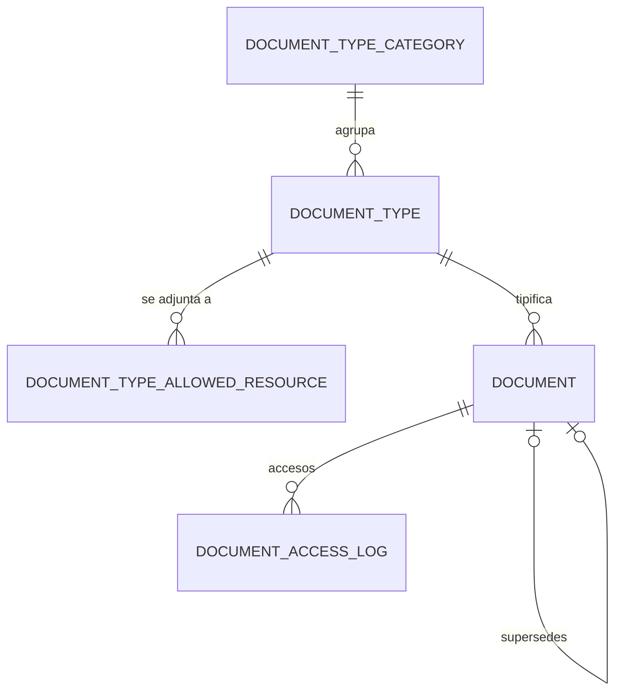

# Dominio · Gestión documental

- **Origen:** A9 (P9), A8 (`requires_approval`), A6 (gobierno del catálogo)
- **Esquema:** `docs` (transaccional) · **Servicio:** `nexus-platform` · **Blob:** Azure Blob Storage (Azurite en local)
- **Pasos:** 0.10

## §1 Principio

Contratos, albaranes, certificados y fotos tienen un único hogar. El catálogo de tipos de documento **no es un enum**: es master data que administran los administradores sin tocar el esquema. `DocumentTypeAllowedResource` gobierna dónde puede adjuntarse cada tipo.

Un `Document` se adjunta a cualquier recurso por `resource_type` + `resource_id` (polimórfico). Las versiones se encadenan con `supersedes_document_id`; nunca se sobrescribe un fichero.

## §2 Modelo



## §3 DDL (paso 0.10)

```sql
CREATE SCHEMA docs;

-- GLOBAL
CREATE TABLE docs.document_type_category (
  id           uuid PRIMARY KEY,
  code         text NOT NULL UNIQUE,
  caption_i18n jsonb NOT NULL,
  sort_order   integer NOT NULL DEFAULT 0,          -- [+]
  is_active    boolean NOT NULL DEFAULT true        -- [+]
  -- + std
);

-- GLOBAL
CREATE TABLE docs.document_type (
  id                    uuid PRIMARY KEY,
  category_id           uuid NOT NULL REFERENCES docs.document_type_category(id),
  code                  text NOT NULL UNIQUE,
  caption_i18n          jsonb NOT NULL,
  requires_expiry       boolean NOT NULL DEFAULT false,
  requires_approval     boolean NOT NULL DEFAULT false,
  allowed_mime_types    text[] NOT NULL DEFAULT '{application/pdf,image/jpeg,image/png}',  -- [+]
  max_size_mb           integer NOT NULL DEFAULT 50 CHECK (max_size_mb BETWEEN 1 AND 500),   -- [+]
  expiry_warning_days   integer NULL CHECK (expiry_warning_days > 0),                        -- [+]
  is_active             boolean NOT NULL DEFAULT true
  -- + std
);
CREATE INDEX ix_dt_category ON docs.document_type(category_id);

-- GLOBAL
CREATE TABLE docs.document_type_allowed_resource (
  document_type_id uuid NOT NULL REFERENCES docs.document_type(id),
  resource_type    text NOT NULL CHECK (resource_type ~ '^[A-Z_]{3,40}$'),
  PRIMARY KEY (document_type_id, resource_type)
);

-- RLS: perfil especial LE?+PRJ (ver nota)
CREATE TABLE docs.document (
  id                     uuid PRIMARY KEY,
  document_type_id       uuid NOT NULL REFERENCES docs.document_type(id),
  resource_type          text NOT NULL,
  resource_id            uuid NOT NULL,
  legal_entity_id        uuid NULL REFERENCES org.legal_entity(id),  -- [+] NULL = recurso de grupo (p. ej. AssetType)
  project_id             uuid NULL,                                  -- [+]
  file_name              text NOT NULL,
  mime_type              text NOT NULL,
  size_bytes             bigint NOT NULL CHECK (size_bytes > 0),     -- [+]
  sha256                 char(64) NOT NULL,                          -- [+] integridad
  storage_uri            text NOT NULL UNIQUE,
  version                integer NOT NULL DEFAULT 1 CHECK (version >= 1),
  supersedes_document_id uuid NULL UNIQUE REFERENCES docs.document(id),   -- P9: cadena lineal
  uploaded_by            uuid NOT NULL,
  uploaded_at            timestamptz NOT NULL,
  expiry_date            date NULL,
  approval_status        text NOT NULL DEFAULT 'NOT_REQUIRED'
                         CHECK (approval_status IN ('NOT_REQUIRED','PENDING','APPROVED','REJECTED')),  -- [+]
  is_current             boolean NOT NULL DEFAULT true,              -- [+] false cuando otra versión la sustituye
  is_withdrawn           boolean NOT NULL DEFAULT false,             -- [+] retirada lógica; el blob se conserva
  -- + std
  CHECK ((version = 1) = (supersedes_document_id IS NULL))
);
CREATE INDEX ix_doc_resource ON docs.document(resource_type, resource_id) WHERE is_current;
CREATE INDEX ix_doc_type     ON docs.document(document_type_id);
CREATE INDEX ix_doc_expiry   ON docs.document(expiry_date) WHERE expiry_date IS NOT NULL AND is_current AND NOT is_withdrawn;

-- Append-only. RLS: igual que document (desnormalizado)
CREATE TABLE docs.document_access_log (
  id              uuid PRIMARY KEY,
  document_id     uuid NOT NULL REFERENCES docs.document(id),
  accessed_by     uuid NOT NULL,
  accessed_at     timestamptz NOT NULL,
  action          text NOT NULL CHECK (action IN ('VIEW','DOWNLOAD')),
  legal_entity_id uuid NULL,                                         -- [+]
  project_id      uuid NULL                                          -- [+]
  -- + std-append
);
CREATE INDEX ix_dal_document ON docs.document_access_log(document_id, accessed_at);
```

**Nota RLS `[+]`:** `document` y `document_access_log` usan una política propia porque un documento de recurso de grupo no tiene Mandant:

```sql
USING (legal_entity_id IS NULL
       OR legal_entity_id = ANY ((SELECT access.visible_legal_entities()))
       OR project_id      = ANY ((SELECT access.visible_projects())))
```

El job `db` de CI admite esta política para `docs.*` como excepción documentada a DB-R4.

**Blob:** contenedor `documents`, ruta `<resource_type>/<resource_id>/<document_id>/<file_name>`. Escritura solo desde `nexus-platform` (identidad de servicio). Lectura del cliente con URL SAS de 5 minutos, solo lectura, generada al pedir el contenido `[+]`.

## §4 Reglas

| Id | Regla | Origen |
|---|---|---|
| DOC-R1 | Solo se adjunta un documento si existe `document_type_allowed_resource(document_type_id, resource_type)` | A9 |
| DOC-R2 | `requires_expiry = true` exige `expiry_date` | A9 |
| DOC-R3 | `mime_type` ∈ `allowed_mime_types` y tamaño ≤ `max_size_mb`. Se comprueba el tipo real del fichero (firma), no solo la extensión | [+] |
| DOC-R4 | Una versión nueva (`supersedes_document_id`) mantiene `document_type_id`, `resource_type` y `resource_id`; `version = anterior + 1`; la anterior pasa a `is_current = false`. Solo la versión vigente puede sustituirse | P9 |
| DOC-R5 | `requires_approval = true` → `approval_status = PENDING` y se envía `approval-request.submitted` (`resource_type = DOCUMENT`) en la misma transacción. Al recibir `approved`/`rejected` → `APPROVED`/`REJECTED` | A9, A8 |
| DOC-R6 | Cada petición de contenido registra una fila en `document_access_log` (`VIEW` si `disposition=inline`, `DOWNLOAD` si `attachment`) en la misma transacción que genera la URL SAS | A9 |
| DOC-R7 | No se borra ningún documento ni blob desde la API. Retirar = `is_withdrawn = true` (el blob se conserva por auditoría) | [+] |
| DOC-R8 | Administrar el catálogo (tipos, categorías, recursos permitidos) exige `DOCUMENT_TYPE:CREATE/UPDATE` con alcance `GLOBAL` | A9 |
| DOC-R9 | `legal_entity_id` y `project_id` del documento los fija quien sube y deben estar dentro de su alcance (`has_permission('DOCUMENT','CREATE', le, …, prj)`). `NULL` en ambos solo con alcance `GLOBAL` | [+] |
| DOC-R10 | `sha256` se calcula en servidor durante la subida; una descarga verifica el hash en los tests de integración | [+] |

## §5 Estados

`approval_status`: `NOT_REQUIRED` (terminal) · `PENDING` → `APPROVED` | `REJECTED`. Un documento `REJECTED` no se vuelve a enviar: se sube una versión nueva.

## §6 API (`platform.yaml`)

| Método y ruta | Permiso | Notas |
|---|---|---|
| `GET/POST /v1/document-type-categories`, `PUT /{id}` | `DOCUMENT_TYPE:READ/CREATE/UPDATE` | |
| `GET/POST /v1/document-types`, `GET/PUT /{id}`, `POST /{id}/deactivate` | `DOCUMENT_TYPE:*` | Incluye `allowedResourceTypes[]` |
| `GET /v1/documents?resourceType=&resourceId=&includeHistory=false` | `DOCUMENT:READ` | Vigentes por defecto |
| `POST /v1/documents` | `DOCUMENT:CREATE` | `multipart/form-data`: `metadata` (JSON: `documentTypeId`, `resourceType`, `resourceId`, `legalEntityId?`, `projectId?`, `expiryDate?`) + `file`. 201 |
| `POST /v1/documents/{id}/versions` | `DOCUMENT:CREATE` | Igual, sin `resourceType/Id`. Crea la versión siguiente |
| `GET /v1/documents/{id}` | `DOCUMENT:READ` | Metadatos. No registra acceso |
| `GET /v1/documents/{id}/content?disposition=inline\|attachment` | `DOCUMENT:READ` | 302 a URL SAS + registro DOC-R6 |
| `POST /v1/documents/{id}/withdraw` | `DOCUMENT:UPDATE` | DOC-R7 |
| `GET /v1/documents/{id}/access-log` | `DOCUMENT:EXPORT` ⚑ | Auditoría |
| `GET /v1/documents/expiring?withinDays=30` | `DOCUMENT:READ` | Para el panel de vencimientos |

Límite de cuerpo en gateway y servicio: 500 MB. Subidas > 50 MB por streaming directo a Blob sin cargar en memoria.

## §7 Eventos

| Topic | Cuándo |
|---|---|
| `nexus.platform.document.uploaded` | Alta o nueva versión. Payload: metadatos sin URL |
| `nexus.platform.document.withdrawn` | Retirada |
| `nexus.platform.document.approval-changed` | Cambio de `approval_status` |
| `nexus.platform.document.expiring` `[+]` | Job diario: vigentes con `expiry_date` dentro de `expiry_warning_days` (una vez por documento y umbral) |
| `nexus.platform.document.expired` `[+]` | Job diario: `expiry_date` < hoy (una vez) |

Consumidos: `nexus.platform.approval.approved/.rejected` con `resourceType = DOCUMENT` (DOC-R5). Consumidor `platform.document-approval`.

## §8 Pantallas

| Pantalla | Contenido |
|---|---|
| `nx-document-panel` (`shared/platform`) | Entrada `resourceType`, `resourceId`, `legalEntityId?`, `projectId?`. Lista vigentes con tipo, versión, vencimiento y estado de aprobación; subir (arrastrar y soltar, selector de tipo filtrado por recurso), nueva versión, ver, descargar, historial de versiones, retirar |
| Catálogo de tipos de documento | Árbol categoría → tipo; detalle con flags, MIME permitidos, tamaño máximo, recursos permitidos (multiselección) |
| Vencimientos | Lista de documentos que vencen en N días, filtro por tipo y recurso |

Para probar el panel en 0.10 sin recursos reales, la página de detalle de `LegalEntity` (0.4) incluye la pestaña Documentos (`resource_type = LEGAL_ENTITY`).

## §9 Abiertos ⚑

- **DOC-Q1:** no se verifica que el recurso exista (está en otro esquema y ARC-R3 lo impide). Se confía en el permiso del que sube. Alternativa: cada servicio publica sus altas de recursos y platform mantiene un índice. Se propone no hacerlo salvo que aparezca un problema real.
- **DOC-Q2:** antivirus en subidas (Defender for Storage en Azure). Se decide en 0.11.
- **DOC-Q3:** retención de blobs de documentos retirados. Pendiente de A12 (7.1).

### Semilla común `[+]`

| Categoría | Tipos |
|---|---|
| `CONTRACTUAL` | `CONTRACT_SIGNED`, `CONTRACT_AMENDMENT`, `QUOTE_PDF` |
| `LOGISTICS` | `DELIVERY_NOTE`, `PACKING_LIST`, `CMR` |
| `CERTIFICATION` | `STRUCTURAL_CALC_CERT` (`requires_expiry`), `FIRE_CERT` (`requires_expiry`), `ELECTRICAL_CERT` (`requires_expiry`) — certificaciones como datos, no esquema (A9) |
| `FIELD` | `SITE_PHOTO`, `DAMAGE_PHOTO` |
| `HR` | `QUALIFICATION_CERT` (`requires_expiry`), `EXPENSE_RECEIPT` |
| `FINANCE` | `SUPPLIER_INVOICE_SCAN`, `INVOICE_PDF` |

Los recursos permitidos se siembran en el paso que crea cada recurso.
