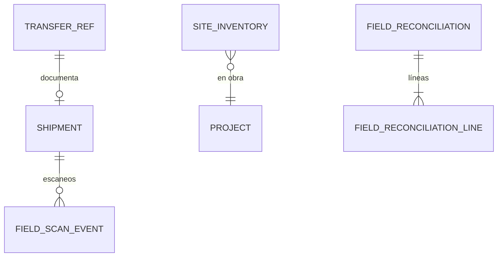

# Dominio · Trazabilidad en campo (§12)

- **Origen:** Manual §12 (`Shipment`, `SiteInventory`, `FieldScanEvent`, `FieldReconciliation`), A1 (`PROJECT_SITE`), A3 (captura edge)
- **Esquema:** `field` (transaccional) · **Servicio:** `nexus-field` (lee `warehouse` del mismo servicio)
- **Pasos:** 6.3 (backend y web), 6.5 (flujos móviles)

## §1 Principio

Llena el **punto ciego** de EasyJob: descarga en obra, instalación y carga de retorno no existen en EJ. En NEXUS son un módulo de primera clase.

- Una obra es una `StockLocation` `PROJECT_SITE` (A1). Lo que hay en obra se deriva del ledger: `SiteInventory` es una **réplica derivada y reconstruible** en este esquema, alimentada por `stock.movement.posted`, nunca fuente de verdad.
- `FieldScanEvent` es **append-only** y cubre todos los escaneos en obra. Los de descarga y carga de retorno pertenecen a una `LoadSession` en obra (`warehouse-ops.md`), que mueve el stock vía operations.
- `FieldReconciliation` compara **enviado vs devuelto** por proyecto y decide qué pasa con la diferencia (pérdida, daño, cargo al cliente, sigue en obra).

## §2 Modelo



## §3 DDL (paso 6.3)

```sql
CREATE SCHEMA field;
CREATE TABLE field.number_sequence (scope_key text PRIMARY KEY, next_value bigint NOT NULL DEFAULT 1);

-- [+] Réplica de proyectos (ARC-R3)
CREATE TABLE field.project_ref (
  id uuid PRIMARY KEY, code text NOT NULL, name text NOT NULL, legal_entity_id uuid NOT NULL,
  venue_location_id uuid NULL, status text NOT NULL, aggregate_version bigint NOT NULL, updated_at timestamptz NOT NULL
);

-- RLS: LE+PRJ. Se crea al consumir transfer.confirmed de PROJECT_DISPATCH / PROJECT_RETURN / SITE_TO_SITE
CREATE TABLE field.shipment (
  id                 uuid PRIMARY KEY,
  shipment_no        text NOT NULL UNIQUE,            -- = transfer_no
  transfer_id        uuid NOT NULL UNIQUE,            -- warehouse.transfer_ref (mismo servicio)
  direction          text NOT NULL CHECK (direction IN ('OUTBOUND','RETURN','SITE_TO_SITE')),
  project_id         uuid NOT NULL,
  job_id             uuid NULL,
  delivery_part_id   uuid NULL,
  job_transport_id   uuid NULL,                       -- [+] si se informa (réplica de project.job-transport.changed)
  status             text NOT NULL DEFAULT 'PLANNED'
                     CHECK (status IN ('PLANNED','DISPATCHED','ARRIVED','UNLOADED','CLOSED','CANCELLED')),
  dispatched_at      timestamptz NULL,
  arrived_at         timestamptz NULL,                -- lo marca el equipo de campo
  unloaded_at        timestamptz NULL,                -- sesión UNLOAD aplicada
  legal_entity_id    uuid NOT NULL,
  -- + std
  CHECK (arrived_at IS NULL OR dispatched_at IS NOT NULL)
);

-- Réplica derivada (FLD-R1). RLS: LE+PRJ
CREATE TABLE field.site_inventory (
  project_id            uuid NOT NULL,
  stock_location_id     uuid NOT NULL,
  asset_type_id         uuid NOT NULL REFERENCES catalog.asset_type(id),
  owner_legal_entity_id uuid NOT NULL,
  batch_id              uuid NULL,
  asset_item_id         uuid NULL,
  qty                   numeric(18,4) NOT NULL,
  last_movement_id      uuid NOT NULL,
  last_movement_no      bigint NOT NULL,             -- para descartar eventos antiguos
  legal_entity_id       uuid NOT NULL,               -- custodio (LE del proyecto)
  updated_at            timestamptz NOT NULL,
  CONSTRAINT uq_si_key UNIQUE NULLS NOT DISTINCT (stock_location_id, asset_type_id, owner_legal_entity_id, batch_id, asset_item_id)
);
CREATE INDEX ix_si_project ON field.site_inventory(project_id);

-- Append-only. RLS: LE+PRJ
CREATE TABLE field.field_scan_event (
  id                  uuid PRIMARY KEY,               -- UUIDv7 del dispositivo
  project_id          uuid NOT NULL,
  scan_kind           text NOT NULL CHECK (scan_kind IN
                        ('UNLOAD_AT_SITE','LOAD_FOR_RETURN','INSTALLED','DISMANTLED','SITE_COUNT','DAMAGE_REPORT','MISSING_REPORT','LOOKUP')),
  action              text NOT NULL DEFAULT 'ADD' CHECK (action IN ('ADD','REMOVE')),
  load_session_id     uuid NULL,                      -- warehouse.load_session (mismo servicio, sin FK: ARC-R2). Solo UNLOAD_AT_SITE / LOAD_FOR_RETURN
  shipment_id         uuid NULL REFERENCES field.shipment(id),
  job_phase_id        uuid NULL,                      -- commissioning.job_phase (mismo servicio)
  identifier_type     text NOT NULL CHECK (identifier_type IN ('QR','RFID_EPC','BARCODE','MANUAL')),
  raw_value           text NOT NULL,
  asset_identifier_id uuid NULL,                      -- warehouse.asset_identifier (sin FK: ARC-R2)
  asset_type_id       uuid NULL REFERENCES catalog.asset_type(id),
  asset_item_id       uuid NULL REFERENCES catalog.asset_item(id),
  batch_id            uuid NULL REFERENCES catalog.asset_batch(id),
  qty                 numeric(18,4) NOT NULL CHECK (qty > 0),
  result              text NOT NULL CHECK (result IN
                        ('ACCEPTED','UNKNOWN_IDENTIFIER','NOT_EXPECTED','DUPLICATE','OVER_QTY','SESSION_CLOSED','NOT_ON_SITE')),
  note                text NULL,
  photo_document_id   uuid NULL,
  latitude            numeric(9,6) NULL,
  longitude           numeric(9,6) NULL,
  scanned_at          timestamptz NOT NULL,
  received_at         timestamptz NOT NULL,
  device_id           uuid NULL,
  user_id             uuid NOT NULL,
  legal_entity_id     uuid NOT NULL,
  -- + std-append
  CHECK ((scan_kind IN ('UNLOAD_AT_SITE','LOAD_FOR_RETURN')) = (load_session_id IS NOT NULL))
);
CREATE INDEX ix_fse_project ON field.field_scan_event(project_id, scanned_at);

-- RLS: LE+PRJ
CREATE TABLE field.field_reconciliation (
  id               uuid PRIMARY KEY,
  reconciliation_no text NOT NULL UNIQUE,            -- 'FR-<project_code>-<NN>'
  project_id       uuid NOT NULL,
  job_id           uuid NULL,
  status           text NOT NULL DEFAULT 'OPEN' CHECK (status IN ('OPEN','IN_REVIEW','POSTED','CANCELLED')),
  opened_at        timestamptz NOT NULL,
  posted_at        timestamptz NULL,
  posted_by        uuid NULL,
  legal_entity_id  uuid NOT NULL,
  -- + std
  CHECK ((status = 'POSTED') = (posted_at IS NOT NULL))
);

CREATE TABLE field.field_reconciliation_line (
  id                    uuid PRIMARY KEY,
  reconciliation_id     uuid NOT NULL REFERENCES field.field_reconciliation(id),
  asset_type_id         uuid NOT NULL REFERENCES catalog.asset_type(id),
  owner_legal_entity_id uuid NOT NULL,
  batch_id              uuid NULL,
  asset_item_id         uuid NULL,
  shipped_qty           numeric(18,4) NOT NULL,      -- Σ recibido en obra (ledger)
  returned_qty          numeric(18,4) NOT NULL,      -- Σ expedido desde obra (ledger)
  on_site_qty           numeric(18,4) NOT NULL,      -- site_inventory al generar
  reported_damaged_qty  numeric(18,4) NOT NULL DEFAULT 0,
  reported_missing_qty  numeric(18,4) NOT NULL DEFAULT 0,
  resolution            text NOT NULL DEFAULT 'NONE' CHECK (resolution IN
                          ('NONE','LOSS','DAMAGE_SCRAP','CHARGE_CUSTOMER','STILL_ON_SITE','FOUND_LATER')),
  resolution_qty        numeric(18,4) NOT NULL DEFAULT 0 CHECK (resolution_qty >= 0),
  chargeable            boolean NOT NULL DEFAULT false,
  note                  text NULL,
  legal_entity_id       uuid NOT NULL,
  project_id            uuid NOT NULL,
  -- + std
  CHECK (resolution_qty <= on_site_qty),
  CHECK (asset_item_id IS NULL OR resolution_qty <= 1)
);
```

## §4 Reglas

| Id | Regla | Origen |
|---|---|---|
| FLD-R1 | `site_inventory` se mantiene consumiendo `stock.movement.posted` cuyo origen o destino es una ubicación `PROJECT_SITE`: +qty al destino, −qty al origen; ignora eventos con `movement_no ≤ last_movement_no` de la fila. Es reconstruible (`rebuild` desde el topic) y nunca se edita a mano | §12, A1 |
| FLD-R2 | Un `Shipment` se crea al consumir `transfer.confirmed` de tipo `PROJECT_DISPATCH` (`OUTBOUND`), `PROJECT_RETURN` (`RETURN`) o `SITE_TO_SITE`; `shipped` → `DISPATCHED`; sesión `UNLOAD` aplicada → `UNLOADED`; `transfer.closed` → `CLOSED`; `cancelled` → `CANCELLED` | §12 |
| FLD-R3 | `arrive` (llegada a obra) lo marca un usuario con `FIELD_CAPTURE` o `SHIPMENT:UPDATE` en el proyecto; no mueve stock | §12 |
| FLD-R4 | Escaneos `UNLOAD_AT_SITE`/`LOAD_FOR_RETURN` siguen WHS-R6…R11 con la sesión en obra | A3 |
| FLD-R5 | `INSTALLED`/`DISMANTLED`/`SITE_COUNT`: el material escaneado debe estar en `site_inventory` del proyecto; si no → `NOT_ON_SITE` (se registra igual) | [+] |
| FLD-R6 | `DAMAGE_REPORT`/`MISSING_REPORT` exigen nota o foto; alimentan `reported_damaged_qty`/`reported_missing_qty` de la conciliación | §12, [+] |
| FLD-R7 | **Generar conciliación** (al pasar el Job a `RETURNED`, o a mano): una línea por clave de `site_inventory` con `qty ≠ 0` y por clave con informes de daño/falta; `shipped_qty`/`returned_qty` desde el ledger del proyecto (réplica) | §12 |
| FLD-R8 | Resoluciones: `LOSS` → salida a `ADJUSTMENT` del propietario; `DAMAGE_SCRAP` → `SCRAP`; `CHARGE_CUSTOMER` → `LOSS` + `chargeable = true`; `STILL_ON_SITE` y `FOUND_LATER` → sin movimiento. Toda línea con `on_site_qty > 0` necesita resolución distinta de `NONE` para postear | §12, [+] |
| FLD-R9 | **Postear** publica `field.reconciliation.posted` con las líneas resueltas. `nexus-operations` asienta los movimientos (`source_type = FIELD_RECONCILIATION_LINE`) y `nexus-catalog` marca `LOST` los ítems serializados con `LOSS`/`CHARGE_CUSTOMER` (CAT-R14). `nexus-commercial` propone el cargo (BIL-R14) | §12 |
| FLD-R10 | Una conciliación `POSTED` no se edita. Material que aparece después: nueva transferencia de vuelta y, en catálogo, `LOST → ACTIVE` | [+] |

## §5 Estados

**Shipment** (FLD-R2) · **FieldReconciliation:** `OPEN → IN_REVIEW → POSTED`; `OPEN|IN_REVIEW → CANCELLED`.

## §6 API (`field.yaml`)

| Método y ruta | Permiso |
|---|---|
| `GET /v1/shipments?projectId=&status=&direction=` · `GET /v1/shipments/{id}` | `SHIPMENT:READ` |
| `POST /v1/shipments/{id}/arrive` | `SHIPMENT:UPDATE` |
| `GET /v1/projects/{projectId}/site-inventory?assetTypeId=` | `SITE_INVENTORY:READ` |
| `POST /v1/projects/{projectId}/field-scans` (uno o lote, con `id` de cliente) | `FIELD_SCAN:CREATE` |
| `GET /v1/projects/{projectId}/field-scans?kind=&from=&to=&cursor=` | `FIELD_SCAN:READ` |
| `GET /v1/projects/{projectId}/reconciliations` · `POST` (generar) | `FIELD_RECONCILIATION:READ/CREATE` |
| `GET /v1/reconciliations/{id}` · `PUT /v1/reconciliations/{id}/lines` · `POST /{id}/submit-review` · `/post` · `/cancel` | `FIELD_RECONCILIATION:*` |

## §7 Eventos

| Topic | Consumidores |
|---|---|
| `nexus.field.shipment.changed` | proyecciones |
| `nexus.field.scan.recorded` | proyecciones |
| `nexus.field.reconciliation.posted` | operations (movimientos), catalog (`LOST`), commercial (cargo, BIL-R14) |

**Consumidos:** `nexus.stock.movement.posted` (FLD-R1, `field.site-inventory`); `nexus.logistics.transfer.*` (FLD-R2); `nexus.project.project.*` (`project_ref`); `nexus.project.job.state-changed` a `RETURNED` (FLD-R7 automática); `nexus.logistics.load-session.applied` (`UNLOADED`).

## §8 Pantallas (`features/field`)

| Pantalla | Contenido |
|---|---|
| Proyecto · pestaña Obra: inventario en obra por tipo/ítem, envíos (ida y vuelta) con estado, escaneos recientes | |
| Envío: detalle, llegada, sesión de descarga | |
| Conciliación: líneas enviado / devuelto / en obra / daños / faltas; resolución por línea; postear | |

## §9 Abiertos ⚑

- **FLD-Q1:** ¿la conciliación se genera automáticamente al pasar a `RETURNED` o solo a mano? Propuesta: automática, en `OPEN`.
- **FLD-Q2:** custodio en obra = LE del proyecto (LOG-R12). Para material de otra LE en alquiler interno la propiedad no cambia; la pérdida se asienta contra el propietario y el cargo intercompañía lo decide finanzas.
