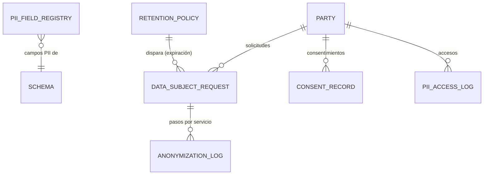

# Dominio · GDPR / retención de PII (A12)

- **Origen:** A12 (P12), GR1 (anonimizar, no destruir), A8 (aprobación del borrado), A6 (rol), A7 (`nexus.platform.party.anonymized`)
- **Esquema:** `gdpr` (transaccional) · **Servicio:** `nexus-platform` · Afecta a `org.party` y a todo esquema con PII registrada
- **Pasos:** 7.1 (antes del corte, D12)

## §1 Principio

El "derecho al olvido" choca con el ledger append-only y con la retención fiscal de facturas. GDPR art. 17(3) prevé la excepción. La solución es **anonimizar en sitio** (GR1): los campos PII se sobrescriben con marcadores anónimos, la fila se conserva y todo lo que la referencia (facturas, movimientos) queda intacto.

Los cuatro pilares de plataforma trabajan juntos: una solicitud de borrado (`DataSubjectRequest` `ERASURE`) pasa por aprobación (A8), solo la resuelve quien tiene el rol (A6) y, al completarse, `nexus.platform.party.anonymized` (A7) hace que cada servicio purgue su propia copia.

## §2 Modelo



## §3 DDL (paso 7.1)

```sql
CREATE SCHEMA gdpr;

ALTER TABLE org.party ADD COLUMN is_anonymized boolean NOT NULL DEFAULT false;   -- A12
ALTER TABLE org.party ADD COLUMN anonymized_at timestamptz NULL;                 -- A12
ALTER TABLE org.party ADD CONSTRAINT ck_party_anon CHECK (is_anonymized = (anonymized_at IS NOT NULL));

-- GLOBAL. Dato maestro ampliable (como A9)
CREATE TABLE gdpr.pii_field_registry (
  id              uuid PRIMARY KEY,                    -- [+]
  schema_name     text NOT NULL,                       -- [+] el manual dice table_name; con esquemas por contexto hace falta
  table_name      text NOT NULL,
  column_name     text NOT NULL,
  pii_category    text NOT NULL CHECK (pii_category IN ('BASIC_IDENTITY','CONTACT','FINANCIAL','SPECIAL_CATEGORY')),
  owning_service  text NOT NULL,                       -- [+] quién anonimiza: 'platform','resources',…
  party_key_column text NOT NULL,                      -- [+] columna que lleva al party_id (o la propia 'id' en org.party)
  anonymize_with  text NOT NULL CHECK (anonymize_with IN ('NULL','FIXED_TEXT','HASH','REDACTED_EMAIL')),   -- [+]
  is_active       boolean NOT NULL DEFAULT true,
  -- + std
  UNIQUE (schema_name, table_name, column_name)
);

-- GLOBAL
CREATE TABLE gdpr.retention_policy (
  id                      uuid PRIMARY KEY,
  resource_type           text NOT NULL,               -- 'PARTY_CUSTOMER','PARTY_CONTACT','WORKER','PROSPECT'…
  legal_basis             text NOT NULL CHECK (legal_basis IN ('CONSENT','CONTRACT','LEGAL_OBLIGATION','LEGITIMATE_INTEREST')),
  retention_period        interval NOT NULL,
  retention_trigger_event text NOT NULL,               -- 'LAST_CONTRACT_END','LAST_INVOICE_DATE','WORKER_DEACTIVATED','OPPORTUNITY_LOST','CONSENT_WITHDRAWN'
  action_on_expiry        text NOT NULL CHECK (action_on_expiry IN ('ANONYMIZE','DELETE','REVIEW')),
  is_active               boolean NOT NULL DEFAULT true,
  -- + std
  UNIQUE (resource_type, legal_basis)
);

-- RLS: GLOBAL de lectura restringida (solo svc_platform; permiso GDPR:READ en la API)
CREATE TABLE gdpr.consent_record (
  id           uuid PRIMARY KEY,
  party_id     uuid NOT NULL REFERENCES org.party(id),
  purpose      text NOT NULL CHECK (purpose IN ('MARKETING','NEWSLETTER','EVENT_PHOTOS','OTHER')),   -- [+] valores
  granted_at   timestamptz NOT NULL,
  withdrawn_at timestamptz NULL,
  evidence     text NULL,                              -- [+] origen del consentimiento
  -- + std
  CHECK (withdrawn_at IS NULL OR withdrawn_at > granted_at)
);

CREATE TABLE gdpr.data_subject_request (
  id                  uuid PRIMARY KEY,
  request_no          text NOT NULL UNIQUE,           -- 'DSR-<YYYY>-<NNNNN>' [+]
  party_id            uuid NOT NULL REFERENCES org.party(id),
  request_type        text NOT NULL CHECK (request_type IN ('ACCESS','PORTABILITY','ERASURE','RECTIFICATION','RETENTION_EXPIRY')),  -- RETENTION_EXPIRY [+]
  status              text NOT NULL DEFAULT 'PENDING' CHECK (status IN
                        ('PENDING','PENDING_APPROVAL','IN_PROGRESS','PARTIALLY_COMPLETED','COMPLETED','REJECTED')),  -- [+] estados intermedios
  requested_at        timestamptz NOT NULL,
  due_at              timestamptz NOT NULL,           -- [+] requested_at + 30 días (art. 12.3)
  completed_at        timestamptz NULL,
  handled_by          uuid NULL,
  retention_policy_id uuid NULL REFERENCES gdpr.retention_policy(id),
  blocked_until       timestamptz NULL,               -- [+] GR1: retención legal activa en algún recurso
  outcome_note        text NULL,
  export_document_id  uuid NULL,                      -- [+] ACCESS/PORTABILITY: fichero generado
  -- + std
  CHECK ((status = 'COMPLETED') = (completed_at IS NOT NULL))
);

-- Append-only. Un registro por servicio y paso de anonimización [+]
CREATE TABLE gdpr.anonymization_log (
  id                 uuid PRIMARY KEY,
  request_id         uuid NOT NULL REFERENCES gdpr.data_subject_request(id),
  party_id           uuid NOT NULL,
  owning_service     text NOT NULL,
  status             text NOT NULL CHECK (status IN ('APPLIED','DEFERRED','FAILED')),
  tables_touched     text[] NOT NULL DEFAULT '{}',
  rows_affected      integer NOT NULL DEFAULT 0,
  deferred_until     timestamptz NULL,
  detail             text NULL,
  reported_at        timestamptz NOT NULL
  -- + std-append
);

-- Append-only
CREATE TABLE gdpr.pii_access_log (
  id            uuid PRIMARY KEY,
  party_id      uuid NOT NULL,
  accessed_by   uuid NOT NULL,
  accessed_at   timestamptz NOT NULL,
  resource_type text NOT NULL,                        -- 'PARTY','WORKER','CONTACT_EXPORT'…
  access_kind   text NOT NULL DEFAULT 'VIEW' CHECK (access_kind IN ('VIEW','EXPORT')),   -- [+]
  correlation_id uuid NOT NULL
  -- + std-append
);
CREATE INDEX ix_pal_party ON gdpr.pii_access_log(party_id, accessed_at);
```

**Semilla de `pii_field_registry` `[+]`** (se completa en 7.1 revisando todos los esquemas):

| Esquema.tabla | Columnas | Categoría | Servicio |
|---|---|---|---|
| `org.party` (`party_type = PERSON`) | `legal_name`, `display_name`, `tax_id` | BASIC_IDENTITY | platform |
| `org.app_user` | `email` | CONTACT | platform |
| `org.party_relationship` | (sin PII propia; enlaza) | — | — |
| `hr.worker_availability` | `note` | SPECIAL_CATEGORY (riesgo, HR-R9) | resources |
| `field.field_scan_event`, `commissioning.field_progress_log` | `latitude`, `longitude`, `note` | BASIC_IDENTITY ⚑ | field |
| `commercial.opportunity` | `notes` libres | CONTACT ⚑ | commercial |

## §4 Reglas

| Id | Regla | Origen |
|---|---|---|
| GDP-R1 | **GR1:** no se borran filas con PII referenciadas por registros con retención legal; se anonimizan en sitio y `org.party.is_anonymized = true`, `anonymized_at` | A12 |
| GDP-R2 | Una `ERASURE` pasa por A8 (`DATA_SUBJECT_ERASURE`, `QUORUM` 2, rol `SYSTEM_ADMIN` ⚑) antes de ejecutarse | A12, A8 |
| GDP-R3 | Si alguna `RetentionPolicy` `LEGAL_OBLIGATION` aún cubre un recurso que referencia al `Party` (p. ej. facturas < 10 años ⚑), se anonimiza lo posible ya (contacto, notas) y la identidad queda `DEFERRED` con `blocked_until`; un job reevalúa al cerrar esa ventana | A12 |
| GDP-R4 | Ejecución: platform anonimiza `org.*` según el registro y publica `nexus.platform.party.anonymized`; cada servicio con columnas registradas (`owning_service`) anonimiza las suyas y publica `nexus.<contexto>.party-pii.anonymized` con `requestId`, tablas y filas; platform lo registra en `anonymization_log`. La solicitud pasa a `COMPLETED` cuando todos los servicios con columnas activas han informado `APPLIED` | A12, A7 |
| GDP-R5 | `anonymize_with`: `NULL`; `FIXED_TEXT` = `'ANONYMIZED'`; `HASH` = `sha256(valor + sal secreta)` (mantiene unicidad sin revelar); `REDACTED_EMAIL` = `anon+<party_id>@invalid` | [+] |
| GDP-R6 | **Retención:** un job diario evalúa cada política activa y crea `RETENTION_EXPIRY` para los `Party` cuyo disparador más el periodo ya pasó: `ANONYMIZE` se ejecuta sin aprobación; `REVIEW` queda `PENDING` para un humano; `DELETE` solo para `Party` sin ninguna referencia (prospectos) | A12 |
| GDP-R7 | `ACCESS`/`PORTABILITY`: se genera un JSON con todos los datos registrados del `Party` en todos los servicios (cada servicio expone `GET /v1/internal/pii-export/{partyId}`, solo con identidad de servicio) y se guarda como documento con acceso restringido | A12 |
| GDP-R8 | Consultar el detalle de un `Party` `PERSON` o de un `Worker` registra `pii_access_log` (`VIEW`); exportar listados con PII, `EXPORT` | A12 |
| GDP-R9 | Un `Party` anonimizado no se puede editar ni volver a usar en documentos nuevos (422 `GDP-R9`) | [+] |
| GDP-R10 | `consent_record`: retirar un consentimiento (`withdrawn_at`) puede disparar `CONSENT_WITHDRAWN` (GDP-R6) | A12 |
| GDP-R11 | Los logs de aplicación nunca contienen valores PII (conventions-backend §8); un test de humo busca patrones de email en los logs de los tests de integración | [+] |

## §5 Estados

**DataSubjectRequest:** `PENDING → PENDING_APPROVAL` (solo `ERASURE`) `→ IN_PROGRESS → COMPLETED | PARTIALLY_COMPLETED`; `PENDING|PENDING_APPROVAL → REJECTED`. `PARTIALLY_COMPLETED` = algún servicio `DEFERRED` (GDP-R3).

## §6 API (`platform.yaml`)

| Método y ruta | Permiso |
|---|---|
| `GET/POST /v1/gdpr/pii-fields`, `PUT /{id}` | `GDPR_CONFIG:*` (GLOBAL) |
| `GET/POST /v1/gdpr/retention-policies`, `PUT /{id}` | `GDPR_CONFIG:*` |
| `GET/POST /v1/gdpr/consents?partyId=`, `POST /{id}/withdraw` | `GDPR:READ/UPDATE` |
| `GET /v1/gdpr/requests?status=&type=` · `POST /v1/gdpr/requests` · `GET /{id}` (con `anonymization_log`) | `GDPR:READ/CREATE` |
| `POST /v1/gdpr/requests/{id}/submit` (ERASURE → A8) · `/execute` (ACCESS/PORTABILITY/RECTIFICATION) · `/reject` | `GDPR:UPDATE` |
| `GET /v1/gdpr/pii-access-log?partyId=&from=&to=` | `GDPR:EXPORT` |
| `GET /v1/internal/pii-export/{partyId}` (en **cada** servicio con PII) | identidad de servicio (no usuario) ⚑ GDP-Q3 |

## §7 Eventos

| Topic | Consumidores |
|---|---|
| `nexus.platform.party.anonymized` (nombre fijado por A12) | todos los servicios con columnas en `pii_field_registry`; proyecciones (purgan copias en ClickHouse) |
| `nexus.<contexto>.party-pii.anonymized` `[+]` | platform (`anonymization_log`) |
| `nexus.platform.data-subject-request.changed` | — |

**Consumidos:** `nexus.platform.approval.*` (`DATA_SUBJECT_ERASURE`). Disparadores de retención por réplicas o consultas: fin de contrato (`commercial.contract.closed`), baja de trabajador (`hr.worker.changed`), oportunidad perdida.

## §8 Pantallas (`features/gdpr`)

| Pantalla | Contenido |
|---|---|
| Registro de campos PII; políticas de retención | |
| Solicitudes: lista con vencimiento (30 días), detalle con pasos por servicio (`anonymization_log`), aprobación (`nx-approval-panel`), descarga del export | |
| Consentimientos (pestaña en Party) | |
| Registro de accesos a PII por persona | |

## §9 Abiertos ⚑

- **GDP-Q1:** periodos de retención por país (CH: 10 años para documentos contables; DE: 10/6 años). Requiere a Legal antes de 7.1.
- **GDP-Q2:** rol aprobador del borrado (propuesta `SYSTEM_ADMIN` con quórum 2; mejor un rol `DPO` si existe).
- **GDP-Q3:** identidad de servicio para `pii-export` (Workload Identity / client credentials en Entra ID).
- **GDP-Q4:** ClickHouse y topics de Kafka con retención infinita pueden contener PII en eventos `org`/`hr` (EV-R5): la anonimización en Kafka requiere *tombstones* o cifrado por clave de sujeto (*crypto-shredding*). Decidir antes de 7.1.
