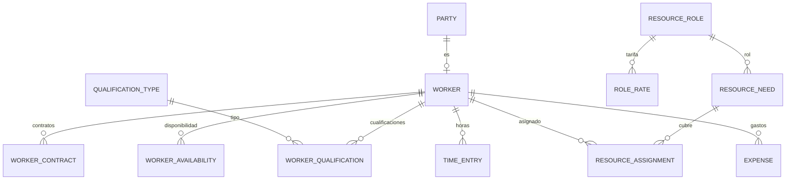

# Dominio · RR.HH. y recursos (Capa 6)

- **Origen:** Manual §9 (Capa 6), A5 (`worker_type` distingue personal propio/ajeno), P6 (auto-provisión `FIELD_CAPTURE`), A12 (PII)
- **Esquema:** `hr` (transaccional) · **Servicio:** `nexus-resources`
- **Pasos:** 5.3 (`Worker`, contratos, cualificaciones, disponibilidad, roles), 5.4 (tarifas, necesidades, asignaciones, horas, gastos)

## §1 Principio

Unificar la persona, que EasyJob fragmenta en **tres** tablas (`Address`, `TimeCardUser`, `Freelancer`). Un `Worker` es siempre un `Party` `PERSON`: los datos de identidad (nombre, contacto) viven **solo** en `org.party` y aquí no se copian (minimización, A12).

`worker_type` es la clave que el catálogo de costes usa para separar "Personal propio" (`INTERNAL`) de "Personal ajeno" (`EXTERNAL`, `FREELANCE`) (A5).

Una `ResourceAssignment` (trabajador ↔ Job/proyecto) dispara la auto-provisión de un `RoleAssignment` `FIELD_CAPTURE` con alcance `PROJECT` para la app móvil (P6, ACC-R8). Lo hace `nexus-platform` consumiendo los eventos de este contexto.

## §2 Modelo



## §3 DDL

```sql
CREATE SCHEMA hr;
CREATE TABLE hr.number_sequence (scope_key text PRIMARY KEY, next_value bigint NOT NULL DEFAULT 1);

-- ===== Paso 5.3 · catálogos (GLOBAL) =====
CREATE TABLE hr.qualification_type (                 -- [+]
  id                  uuid PRIMARY KEY,
  code                text NOT NULL UNIQUE,           -- 'FORKLIFT', 'CRANE_OP', 'WORK_AT_HEIGHT', 'ELECTRICIAN'…
  caption_i18n        jsonb NOT NULL,
  requires_expiry     boolean NOT NULL DEFAULT true,
  document_type_code  text NULL,                      -- docs.document_type.code para el certificado (QUALIFICATION_CERT)
  is_active           boolean NOT NULL DEFAULT true
  -- + std
);

CREATE TABLE hr.resource_role (                      -- manual: ResourceRole
  id           uuid PRIMARY KEY,
  code         text NOT NULL UNIQUE,                  -- 'MONTEUR', 'SUPERVISOR', 'DRIVER'…
  caption_i18n jsonb NOT NULL,
  is_active    boolean NOT NULL DEFAULT true
  -- + std
);

CREATE TABLE hr.resource_role_qualification (        -- [+] cualificaciones exigidas por rol
  resource_role_id      uuid NOT NULL REFERENCES hr.resource_role(id),
  qualification_type_id uuid NOT NULL REFERENCES hr.qualification_type(id),
  PRIMARY KEY (resource_role_id, qualification_type_id)
);

-- ===== Paso 5.3 · Worker. RLS: LE =====
CREATE TABLE hr.worker (
  id                     uuid PRIMARY KEY,
  worker_no              text NOT NULL UNIQUE,         -- 'W-<NNNNNN>' [+]
  party_id               uuid NOT NULL UNIQUE REFERENCES org.party(id),   -- PERSON (HR-R1)
  worker_type            text NOT NULL CHECK (worker_type IN ('INTERNAL','EXTERNAL','FREELANCE')),
  legal_entity_id        uuid NOT NULL REFERENCES org.legal_entity(id),   -- [+] INTERNAL: empleadora; otros: LE que contrata
  agency_party_id        uuid NULL REFERENCES org.party(id),              -- [+] EXTERNAL a través de agencia
  home_location_id       uuid NULL REFERENCES org.location(id),           -- [+] para dietas y desplazamiento
  app_user_id            uuid NULL UNIQUE REFERENCES org.app_user(id),    -- [+] necesario para FIELD_CAPTURE (ACC-R8)
  is_active              boolean NOT NULL DEFAULT true,
  ej_ref                 text NULL,                    -- [+] ETL: 'Address:<id>' | 'TimeCardUser:<id>' | 'Freelancer:<id>'
  -- + std
  CHECK (worker_type = 'EXTERNAL' OR agency_party_id IS NULL)
);
CREATE INDEX ix_worker_le ON hr.worker(legal_entity_id);

CREATE TABLE hr.worker_contract (                    -- RLS: LE
  id              uuid PRIMARY KEY,
  worker_id       uuid NOT NULL REFERENCES hr.worker(id),
  contract_type   text NOT NULL CHECK (contract_type IN ('EMPLOYMENT','FREELANCE','AGENCY')),   -- [+]
  valid_from      date NOT NULL,
  valid_to        date NULL,
  weekly_hours    numeric(5,2) NULL CHECK (weekly_hours > 0 AND weekly_hours <= 60),
  legal_entity_id uuid NOT NULL,
  -- + std
  CHECK (valid_to IS NULL OR valid_to >= valid_from),
  EXCLUDE USING gist (worker_id WITH =, daterange(valid_from, valid_to, '[]') WITH &&)
  -- Sin salario: el coste se valora con role_rate (minimización A12) [+]
);

CREATE TABLE hr.worker_qualification (               -- RLS: LE
  id                    uuid PRIMARY KEY,
  worker_id             uuid NOT NULL REFERENCES hr.worker(id),
  qualification_type_id uuid NOT NULL REFERENCES hr.qualification_type(id),
  valid_from            date NOT NULL,
  valid_to              date NULL,
  certificate_document_id uuid NULL,                  -- docs.document
  legal_entity_id       uuid NOT NULL,
  -- + std
  CHECK (valid_to IS NULL OR valid_to >= valid_from)
);

CREATE TABLE hr.worker_availability (                -- RLS: LE
  id                uuid PRIMARY KEY,
  worker_id         uuid NOT NULL REFERENCES hr.worker(id),
  availability_type text NOT NULL CHECK (availability_type IN ('AVAILABLE','UNAVAILABLE')),
  period            tstzrange NOT NULL,
  note              text NULL,                        -- HR-R9: nunca el motivo médico
  legal_entity_id   uuid NOT NULL,
  -- + std
  EXCLUDE USING gist (worker_id WITH =, availability_type WITH =, period WITH &&)
);

-- ===== Paso 5.4 · tarifas (VR1, RLS: LE) =====
CREATE TABLE hr.role_rate (                          -- manual: RoleRate; VR1 [+] (versioning.md §2)
  id                uuid PRIMARY KEY,
  business_key      text NOT NULL,                    -- '<resource_role_id>:<legal_entity_id>:<worker_type>'
  version_no        integer NOT NULL CHECK (version_no >= 1),
  valid_from        timestamptz NOT NULL,
  valid_to          timestamptz NULL,
  superseded_by_id  uuid NULL REFERENCES hr.role_rate(id),
  resource_role_id  uuid NOT NULL REFERENCES hr.resource_role(id),
  legal_entity_id   uuid NOT NULL REFERENCES org.legal_entity(id),
  worker_type       text NOT NULL CHECK (worker_type IN ('INTERNAL','EXTERNAL','FREELANCE')),
  hourly_cost       numeric(19,4) NOT NULL CHECK (hourly_cost >= 0),
  currency_code     char(3) NOT NULL REFERENCES org.currency(code),
  -- + std-append
  CHECK (business_key = resource_role_id::text || ':' || legal_entity_id::text || ':' || worker_type),
  CONSTRAINT uq_rr_version UNIQUE (business_key, version_no),
  CONSTRAINT ck_rr_window CHECK (valid_to IS NULL OR valid_to > valid_from),
  CONSTRAINT ex_rr_overlap EXCLUDE USING gist (business_key WITH =,
      tstzrange(valid_from, coalesce(valid_to,'infinity')) WITH &&)
);
CREATE UNIQUE INDEX uq_rr_current ON hr.role_rate(business_key) WHERE valid_to IS NULL;

-- ===== Paso 5.4 · réplicas (ARC-R3) =====
CREATE TABLE hr.project_ref (                        -- [+] desde nexus.project.project.*
  id uuid PRIMARY KEY, code text NOT NULL, name text NOT NULL, legal_entity_id uuid NOT NULL,
  business_unit_id uuid NULL, status text NOT NULL, aggregate_version bigint NOT NULL, updated_at timestamptz NOT NULL
);
CREATE TABLE hr.job_ref (                            -- [+] desde nexus.project.job.*
  id uuid PRIMARY KEY, project_id uuid NOT NULL, code text NOT NULL, name text NOT NULL, legal_entity_id uuid NOT NULL,
  state_category text NOT NULL, planned_dispatch_at timestamptz NOT NULL, planned_return_at timestamptz NOT NULL,
  aggregate_version bigint NOT NULL, updated_at timestamptz NOT NULL
);

-- ===== Paso 5.4 · necesidades y asignaciones. RLS: LE+PRJ =====
CREATE TABLE hr.resource_need (
  id               uuid PRIMARY KEY,
  project_id       uuid NOT NULL,
  job_id           uuid NULL,
  resource_role_id uuid NOT NULL REFERENCES hr.resource_role(id),
  activity_phase   text NOT NULL CHECK (activity_phase IN ('SETUP','EVENT','TEARDOWN')),   -- [+] montaje/desmontaje (A5)
  headcount        integer NOT NULL CHECK (headcount >= 1),
  start_at         timestamptz NOT NULL,
  end_at           timestamptz NOT NULL,
  status           text NOT NULL DEFAULT 'OPEN' CHECK (status IN ('OPEN','FILLED','CANCELLED')),
  legal_entity_id  uuid NOT NULL,
  -- + std
  CHECK (end_at > start_at)
);

CREATE TABLE hr.resource_assignment (
  id               uuid PRIMARY KEY,
  resource_need_id uuid NOT NULL REFERENCES hr.resource_need(id),
  worker_id        uuid NOT NULL REFERENCES hr.worker(id),
  start_at         timestamptz NOT NULL,
  end_at           timestamptz NOT NULL,
  status           text NOT NULL DEFAULT 'PLANNED' CHECK (status IN ('PLANNED','CONFIRMED','CANCELLED')),
  project_id       uuid NOT NULL,
  job_id           uuid NULL,
  legal_entity_id  uuid NOT NULL,
  -- + std
  CHECK (end_at > start_at),
  EXCLUDE USING gist (worker_id WITH =, tstzrange(start_at, end_at) WITH &&) WHERE (status <> 'CANCELLED')   -- HR-R4
);

-- ===== Paso 5.4 · horas y gastos. RLS: LE+PRJ =====
CREATE TABLE hr.time_entry (
  id                     uuid PRIMARY KEY,
  worker_id              uuid NOT NULL REFERENCES hr.worker(id),
  project_id             uuid NOT NULL,
  job_id                 uuid NULL,
  resource_assignment_id uuid NULL REFERENCES hr.resource_assignment(id),
  resource_role_id       uuid NOT NULL REFERENCES hr.resource_role(id),
  activity_phase         text NOT NULL CHECK (activity_phase IN ('SETUP','EVENT','TEARDOWN')),
  work_date              date NOT NULL,
  hours                  numeric(5,2) NOT NULL CHECK (hours > 0 AND hours <= 24),
  status                 text NOT NULL DEFAULT 'DRAFT' CHECK (status IN ('DRAFT','SUBMITTED','APPROVED','REJECTED')),
  role_rate_id           uuid NULL REFERENCES hr.role_rate(id),     -- VER-R6, fijado al aprobar
  hourly_cost            numeric(19,4) NULL,                        -- snapshot VR2
  cost_amount            numeric(19,4) NULL,
  currency_code          char(3) NULL,
  decided_by             uuid NULL,
  decided_at             timestamptz NULL,
  rejection_reason       text NULL,
  legal_entity_id        uuid NOT NULL,
  -- + std
  CHECK ((status = 'APPROVED') = (role_rate_id IS NOT NULL AND cost_amount IS NOT NULL)),
  CHECK ((status = 'REJECTED') = (rejection_reason IS NOT NULL))
);
CREATE INDEX ix_te_worker_date ON hr.time_entry(worker_id, work_date);
CREATE INDEX ix_te_project ON hr.time_entry(project_id, status);

CREATE TABLE hr.expense (
  id                  uuid PRIMARY KEY,
  worker_id           uuid NULL REFERENCES hr.worker(id),          -- NULL = gasto del proyecto sin trabajador ("Gastos diversos")
  project_id          uuid NOT NULL,
  job_id              uuid NULL,
  expense_type        text NOT NULL CHECK (expense_type IN ('DIET','OTHER')),   -- A5: dietas / otros costes
  activity_phase      text NULL CHECK (activity_phase IN ('SETUP','EVENT','TEARDOWN')),
  expense_date        date NOT NULL,
  description         text NOT NULL,
  amount              numeric(19,4) NOT NULL CHECK (amount > 0),
  currency_code       char(3) NOT NULL REFERENCES org.currency(code),
  receipt_document_id uuid NULL,                                   -- docs.document EXPENSE_RECEIPT
  status              text NOT NULL DEFAULT 'DRAFT' CHECK (status IN ('DRAFT','SUBMITTED','APPROVED','REJECTED')),
  decided_by          uuid NULL,
  decided_at          timestamptz NULL,
  rejection_reason    text NULL,
  legal_entity_id     uuid NOT NULL,
  -- + std
  CHECK (worker_id IS NULL OR activity_phase IS NOT NULL)
);
```

## §4 Reglas

| Id | Regla | Origen |
|---|---|---|
| HR-R1 | `worker.party_id` apunta a un `Party` `PERSON`. Un `Party` es como mucho un `Worker` | §9 |
| HR-R2 | `INTERNAL` exige un `worker_contract` `EMPLOYMENT` vigente para asignarse; `FREELANCE` uno `FREELANCE`; `EXTERNAL` uno `AGENCY` o `agency_party_id` | [+] |
| HR-R3 | Asignar exige que el trabajador tenga vigentes, en todo `[start_at, end_at)`, las cualificaciones del rol (`resource_role_qualification`). Si no → 422 `HR-R3` con las que faltan | [+] |
| HR-R4 | Un trabajador no tiene dos asignaciones no canceladas que se solapen (`EXCLUDE`) | [+] |
| HR-R5 | Asignar sobre un periodo `UNAVAILABLE` del trabajador → 422 `HR-R5` (o aviso para `FREELANCE` sin periodo `AVAILABLE` que lo cubra ⚑) | [+] |
| HR-R6 | La asignación cae dentro de `[start_at, end_at)` de su necesidad. Una necesidad pasa a `FILLED` cuando tiene `headcount` asignaciones no canceladas | [+] |
| HR-R7 | **P6/ACC-R8:** crear, cambiar fechas o cancelar una asignación publica `resource-assignment.created/.updated/.cancelled` con `appUserId` (del `worker`), `projectId`, `startAt`, `endAt`. `nexus-platform` provisiona o revoca `FIELD_CAPTURE` | P6 |
| HR-R8 | Cancelar un Job (réplica `job_ref` en categoría `CANCELLED`) cancela sus necesidades y asignaciones abiertas | [+] |
| HR-R9 | `worker_availability.note` y los textos libres no recogen motivos de salud (categoría especial, A12). La UI lo advierte; la ausencia es solo `UNAVAILABLE` | A12 |
| HR-R10 | Horas: suma por trabajador y día ≤ 24; solo sobre proyectos visibles; `work_date` dentro de una asignación del trabajador en ese proyecto (si la hay, se enlaza) o aviso | [+] |
| HR-R11 | **Aprobación de horas** (`TIME_ENTRY:APPROVE` en el proyecto, no A8 ⚑ HR-Q1): fija `role_rate_id` = versión vigente de `(rol, LE del proyecto, worker_type)` en `work_date` (VER-R5), `hourly_cost` y `cost_amount = round(hours × hourly_cost, 2)` (VR2). Sin tarifa → 422 `HR-R11` | A5, A10 |
| HR-R12 | Una hora o gasto `APPROVED` es inmutable. Una corrección es una entrada negativa enlazada ⚑ o un rechazo antes de aprobar | [+] |
| HR-R13 | Aprobar horas publica `time-entry.approved` con `workerType`, `activityPhase`, `costAmount`, `currency`, `projectId`; aprobar un gasto, `expense.approved`. Controlling los convierte en `CostPosting` (5.7) | A5 |
| HR-R14 | Un gasto `DIET`/`OTHER` con trabajador exige `activity_phase`; sin trabajador es "Gastos diversos" (A5) | A5 |
| HR-R15 | Un trabajador no aprueba sus propias horas ni gastos | [+] |

## §5 Estados

**ResourceAssignment:** `PLANNED → CONFIRMED`; `PLANNED|CONFIRMED → CANCELLED`.
**TimeEntry / Expense:** `DRAFT → SUBMITTED → APPROVED | REJECTED`; `REJECTED → DRAFT` (corregir y reenviar).
**ResourceNeed:** `OPEN ⇄ FILLED` (calculado); `OPEN|FILLED → CANCELLED`.

## §6 API (`resources.yaml`)

| Método y ruta | Permiso | Paso |
|---|---|---|
| `GET/POST /v1/qualification-types`, `PUT /{id}` · `GET/POST /v1/resource-roles`, `PUT /{id}` (con cualificaciones exigidas) | `HR_CONFIG:*` (GLOBAL) | 5.3 |
| `GET /v1/workers?workerType=&legalEntityId=&qualificationTypeId=&availableFrom=&availableTo=&q=` | `WORKER:READ` | 5.3 |
| `POST /v1/workers` (con `partyId` existente o datos de persona nueva → crea el `Party` vía platform ⚑ HR-Q2), `GET/PUT /{id}`, `POST /{id}/deactivate` | `WORKER:CREATE/UPDATE` | 5.3 |
| `GET/POST /v1/workers/{id}/contracts`, `…/qualifications`, `…/availability`, `PUT/DELETE` de cada uno | `WORKER:UPDATE` | 5.3 |
| `GET/POST /v1/role-rates` (versión 1) + patrón versionado (`versioning.md §6`) en `/v1/role-rates/{businessKey}` | `ROLE_RATE:*` | 5.4 |
| `GET /v1/resource-needs?projectId=&jobId=&status=`, `POST`, `PUT /{id}`, `POST /{id}/cancel` | `RESOURCE_PLANNING:*` | 5.4 |
| `GET /v1/resource-needs/{id}/candidates` (trabajadores con cualificación y disponibilidad) | `RESOURCE_PLANNING:READ` | 5.4 |
| `GET/POST /v1/resource-assignments`, `PUT /{id}`, `POST /{id}/confirm` · `/cancel` | `RESOURCE_PLANNING:*` | 5.4 |
| `GET/POST /v1/time-entries`, `PUT /{id}`, `POST /{id}/submit` · `/approve` · `/reject` | `TIME_ENTRY:READ/CREATE/UPDATE/APPROVE` | 5.4 |
| `GET/POST /v1/expenses`, `PUT /{id}`, `POST /{id}/submit` · `/approve` · `/reject` | `EXPENSE:READ/CREATE/UPDATE/APPROVE` | 5.4 |
| `GET /v1/me/assignments` · `GET/POST /v1/me/time-entries` (autoservicio, también desde móvil) | autenticado + `worker.app_user_id` | 5.4 |

## §7 Eventos

Contexto `hr`. **EV-R5:** ningún payload lleva nombre, email ni teléfono; solo `partyId`.

| Topic | Paso | Consumidores |
|---|---|---|
| `nexus.hr.worker.changed` | 5.3 | proyecciones |
| `nexus.hr.resource-assignment.created` / `.updated` / `.cancelled` | 5.4 | platform (ACC-R8, consumidor `platform.field-capture-provisioning`) |
| `nexus.hr.time-entry.approved` | 5.4 | controlling (5.7) |
| `nexus.hr.expense.approved` | 5.4 | controlling (5.7) |

**Consumidos:** `nexus.project.project.*` → `project_ref`; `nexus.project.job.created/.updated/.state-changed` → `job_ref` y HR-R8. Consumidores `resources.project-replica`, `resources.job-replica`, actúan como SYSTEM.

## §8 Pantallas (`features/resources`)

| Pantalla | Paso |
|---|---|
| Trabajadores: lista con filtros (tipo, LE, cualificación, disponible en fechas); detalle con pestañas Contratos, Cualificaciones (con certificado y vencimiento), Disponibilidad (calendario), Documentos | 5.3 |
| Configuración: roles de recurso con cualificaciones exigidas; tipos de cualificación | 5.3 |
| Tarifas por rol, LE y tipo de trabajador, con `nx-version-history` | 5.4 |
| Planificación de personal de un Job (pestaña en Job): necesidades por fase, candidatos, asignación | 5.4 |
| Calendario de asignaciones por trabajador (Gantt simple) | 5.4 |
| Horas: captura semanal propia (`/me`), bandeja de aprobación por proyecto | 5.4 |
| Gastos: captura con recibo, bandeja de aprobación | 5.4 |

## §9 Abiertos ⚑

- **HR-Q1:** aprobación de horas y gastos con permiso directo (HR-R11) en vez del motor A8. Propuesta: directo, por volumen. Si se quiere doble aprobación, `resource_type = TIME_SHEET` semanal en A8.
- **HR-Q2:** alta de un `Worker` con persona nueva: `nexus-resources` no escribe en `org`. Propuesta: la UI crea primero el `Party` en platform (`POST /api/platform/v1/parties`) y luego el `Worker` con su id.
- **HR-Q3:** integración con nómina y control horario existentes. Fuera de alcance v1.
- **HR-Q4:** ¿los freelancers tienen cuenta (B2B) para usar la app? Depende de ADR-0006 ⚑.
