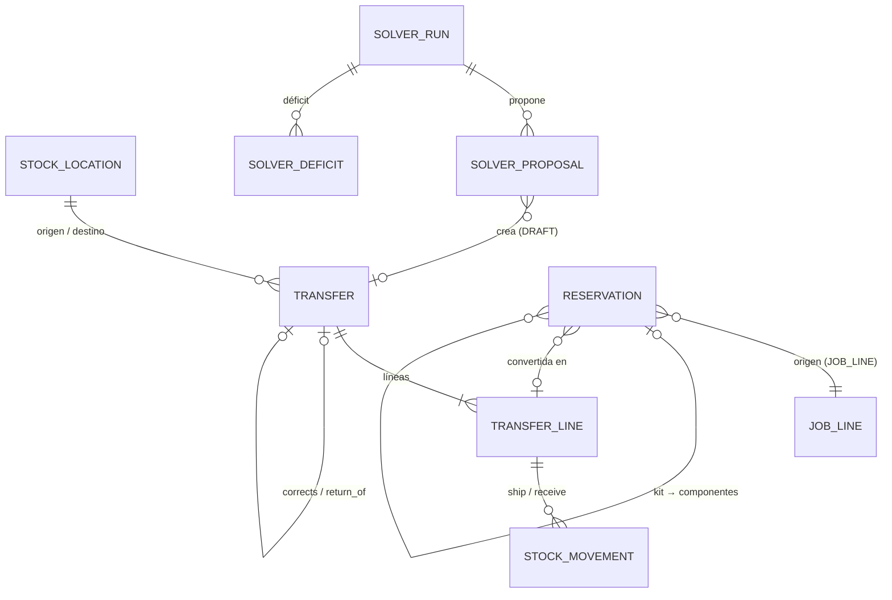
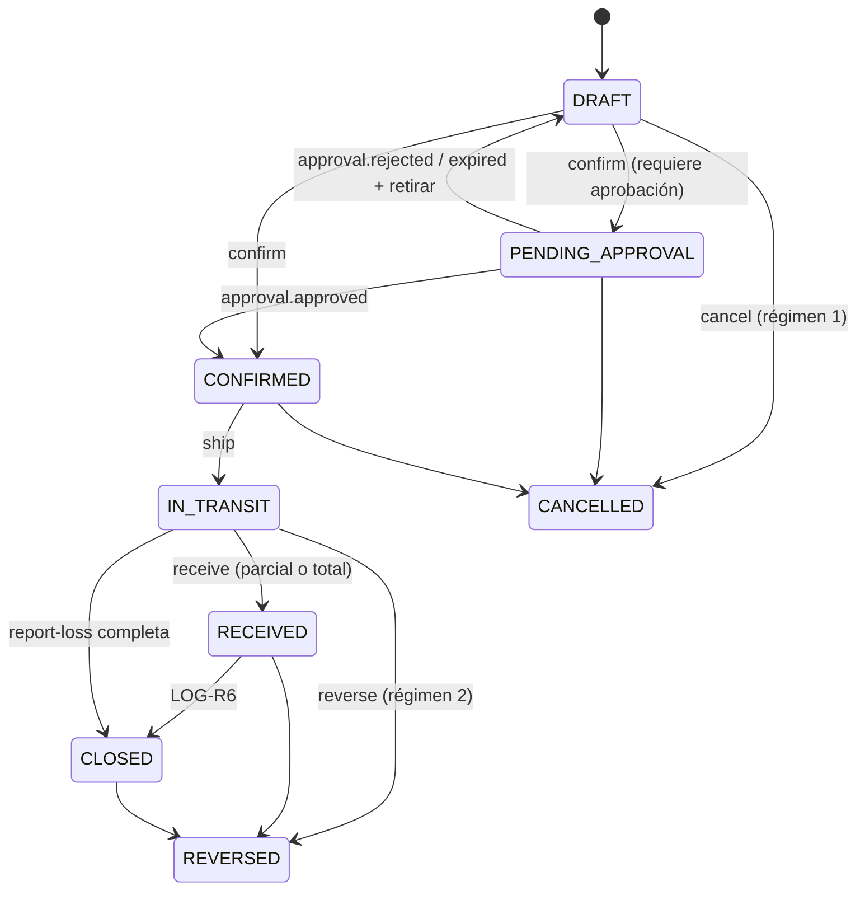

# Dominio · Transferencias, reservas y disponibilidad (A1, A2)

- **Origen:** A1 (P1), A2 (P2), A7 (dónde vive `AvailabilityProjection`), ADR-0012 (salida del Solver)
- **Esquema:** `logistics` (transaccional) · **Servicio:** `nexus-operations` · **Proyección:** ClickHouse `nexus_analytics`
- **Pasos:** 4.1 (`StockLocation` ampliada, `Transfer`, `OperationLog`), 4.2 (`Reservation`), 4.3 (ATP), 4.5 (propuestas del Solver → `Transfer`)

## §1 Principio

**A1 · Transferencias.** `StockLocation` generaliza `Warehouse`: una obra de proyecto (`PROJECT_SITE`) y "en tránsito" (`IN_TRANSIT`) son ubicaciones de stock. Un alquiler interno es una **transferencia de custodia sin cambio de propiedad** (`Transfer` / `TransferLine`), que sustituye al par `Subrental` + `Subjob` de EasyJob. Toda operación queda en `OperationLog`. Los deshacer siguen **tres regímenes**:

| Régimen | Cuándo | Cómo |
|---|---|---|
| 1 · Revertir borrador | Aún no hay movimientos (`DRAFT`, `PENDING_APPROVAL`, `CONFIRMED`) | Cancelar el documento |
| 2 · Reversa de ledger | Ya hay movimientos y no hay consecuencias posteriores | Movimientos de reversa (`reverses_movement_id`) |
| 3 · Corrección hacia adelante | Hay consecuencias posteriores (p. ej. ya se facturó) | Nueva transferencia en sentido contrario, enlazada (`corrects_transfer_id`) |

**A2 · Reservas.** `Reservation` es una entidad de primera clase que separa el **compromiso con fechas** (`SOFT → FIRM → CONVERTED/RELEASED`) del movimiento físico. `AvailabilityProjection` (ATP) es **derivada**: mínimo, en una ventana, de *existencias + entradas previstas − reservas ponderadas*. Vive materializada en ClickHouse (A7) y se reconstruye desde Kafka; nunca es fuente de verdad (RC5).

## §2 Modelo



## §3 DDL

```sql
CREATE SCHEMA logistics;
CREATE TABLE logistics.number_sequence (scope_key text PRIMARY KEY, next_value bigint NOT NULL DEFAULT 1);

-- ===== Paso 4.1 · ampliación de stock.stock_location =====
ALTER TABLE stock.stock_location DROP CONSTRAINT stock_location_location_type_check;
ALTER TABLE stock.stock_location ADD CONSTRAINT stock_location_location_type_check CHECK (location_type IN
  ('WAREHOUSE','SUPPLIER','CUSTOMER','ADJUSTMENT','OPENING','SCRAP','CONSUMPTION','PROJECT_SITE','IN_TRANSIT'));
ALTER TABLE stock.stock_location ADD CONSTRAINT ck_sl_project CHECK ((location_type = 'PROJECT_SITE') = (project_id IS NOT NULL));
ALTER TABLE stock.stock_location ADD CONSTRAINT ck_sl_transit CHECK ((location_type = 'IN_TRANSIT') = (transfer_id IS NOT NULL));
CREATE UNIQUE INDEX uq_sl_project ON stock.stock_location(project_id) WHERE location_type = 'PROJECT_SITE';
CREATE UNIQUE INDEX uq_sl_transit ON stock.stock_location(transfer_id) WHERE location_type = 'IN_TRANSIT';

ALTER TABLE stock.stock_movement DROP CONSTRAINT stock_movement_movement_type_check;
ALTER TABLE stock.stock_movement ADD CONSTRAINT stock_movement_movement_type_check CHECK (movement_type IN
  ('RECEIPT','RETURN_TO_SUPPLIER','ADJUSTMENT_IN','ADJUSTMENT_OUT','OPENING_BALANCE','SCRAP','CONSUMPTION',
   'TRANSFER_SHIP','TRANSFER_RECEIVE','TRANSIT_LOSS'));

-- ===== Paso 4.1 · Transfer. RLS especial: from/to LE + PRJ =====
CREATE TABLE logistics.transfer (
  id                     uuid PRIMARY KEY,
  transfer_no            text NOT NULL UNIQUE,           -- 'TR-<LE origen>-<YYYY>-<NNNNN>'
  transfer_type          text NOT NULL CHECK (transfer_type IN
                           ('INTERNAL_MOVE','INTERNAL_RENTAL','PROJECT_DISPATCH','PROJECT_RETURN','SITE_TO_SITE')),  -- [+]
  origin                 text NOT NULL DEFAULT 'MANUAL'
                         CHECK (origin IN ('MANUAL','JOB_DISPATCH','SOLVER','RETURN_PLAN','CORRECTION','MIGRATION')),  -- [+]
  from_location_id       uuid NOT NULL,                  -- stock.stock_location (mismo servicio, sin FK entre esquemas)
  to_location_id         uuid NOT NULL,
  from_legal_entity_id   uuid NOT NULL REFERENCES org.legal_entity(id),   -- custodio origen
  to_legal_entity_id     uuid NOT NULL REFERENCES org.legal_entity(id),   -- custodio destino
  from_warehouse_id      uuid NULL REFERENCES org.warehouse(id),
  to_warehouse_id        uuid NULL REFERENCES org.warehouse(id),
  project_id             uuid NULL,
  job_id                 uuid NULL,
  delivery_part_id       uuid NULL,
  status                 text NOT NULL DEFAULT 'DRAFT' CHECK (status IN
                           ('DRAFT','PENDING_APPROVAL','CONFIRMED','IN_TRANSIT','RECEIVED','CLOSED','CANCELLED','REVERSED')),
  planned_ship_at        timestamptz NOT NULL,
  planned_receive_at     timestamptz NOT NULL,
  shipped_at             timestamptz NULL,
  received_at            timestamptz NULL,
  transit_location_id    uuid NULL,                      -- se crea al expedir
  return_transfer_id     uuid NULL UNIQUE,               -- [+] la vuelta planificada (despacho / alquiler interno)
  corrects_transfer_id   uuid NULL,                      -- régimen 3
  has_downstream_effects boolean NOT NULL DEFAULT false, -- [+] true si ya hay facturación o coste asociado
  requires_approval      boolean NOT NULL DEFAULT false, -- copiado de transfer_rule al crear
  solver_run_id          uuid NULL,
  notes                  text NULL,
  -- + std
  CHECK (from_location_id <> to_location_id),
  CHECK (planned_receive_at >= planned_ship_at),
  CHECK ((transfer_type = 'INTERNAL_RENTAL') = (from_legal_entity_id <> to_legal_entity_id AND project_id IS NULL)
         OR transfer_type IN ('PROJECT_DISPATCH','PROJECT_RETURN','SITE_TO_SITE'))
);
CREATE INDEX ix_tr_status ON logistics.transfer(status, planned_ship_at);
CREATE INDEX ix_tr_project ON logistics.transfer(project_id);

CREATE TABLE logistics.transfer_line (
  id                     uuid PRIMARY KEY,
  transfer_id            uuid NOT NULL REFERENCES logistics.transfer(id),
  line_no                integer NOT NULL,
  asset_type_id          uuid NOT NULL REFERENCES catalog.asset_type(id),
  asset_item_id          uuid NULL REFERENCES catalog.asset_item(id),
  batch_id               uuid NULL REFERENCES catalog.asset_batch(id),
  owner_legal_entity_id  uuid NOT NULL REFERENCES org.legal_entity(id),
  qty_planned            numeric(18,4) NOT NULL CHECK (qty_planned > 0),
  qty_shipped            numeric(18,4) NOT NULL DEFAULT 0 CHECK (qty_shipped >= 0),
  qty_received           numeric(18,4) NOT NULL DEFAULT 0 CHECK (qty_received >= 0),
  qty_lost               numeric(18,4) NOT NULL DEFAULT 0 CHECK (qty_lost >= 0),
  reservation_id         uuid NULL,                      -- 4.2
  job_line_id            uuid NULL,
  internal_unit_price    numeric(19,4) NULL,             -- [+] VR2 snapshot (INTERNAL_RENTAL)
  internal_price_rule_id uuid NULL REFERENCES catalog.asset_type_price_rule(id),   -- VER-R6
  internal_price_basis   text NULL,
  internal_currency_code char(3) NULL REFERENCES org.currency(code),
  from_legal_entity_id   uuid NOT NULL,                  -- desnormalizado para RLS
  to_legal_entity_id     uuid NOT NULL,
  project_id             uuid NULL,
  -- + std
  UNIQUE (transfer_id, line_no),
  CHECK (qty_received + qty_lost <= qty_shipped),
  CHECK (asset_item_id IS NULL OR qty_planned = 1)
);
CREATE INDEX ix_trl_transfer ON logistics.transfer_line(transfer_id);
CREATE INDEX ix_trl_reservation ON logistics.transfer_line(reservation_id);

-- ===== Paso 4.1 · OperationLog (A1). Append-only. RLS: LE+PRJ =====
CREATE TABLE logistics.operation_log (
  id              uuid PRIMARY KEY,
  occurred_at     timestamptz NOT NULL,
  actor_user_id   uuid NOT NULL,
  operation       text NOT NULL,          -- '<AGGREGATE>.<ACTION>', p. ej. 'TRANSFER.SHIP', 'STOCK.ADJUST'
  aggregate_type  text NOT NULL,
  aggregate_id    uuid NOT NULL,
  legal_entity_id uuid NOT NULL,
  project_id      uuid NULL,
  undo_regime     smallint NULL CHECK (undo_regime IN (1,2,3)),   -- si la operación es un deshacer
  undoes_operation_id uuid NULL REFERENCES logistics.operation_log(id),
  correlation_id  uuid NOT NULL,
  details         jsonb NOT NULL          -- entrada del comando, sin PII
  -- + std-append
);
CREATE INDEX ix_ol_aggregate ON logistics.operation_log(aggregate_type, aggregate_id, occurred_at);

-- ===== Paso 4.2 · Reservation. RLS: LE (demanda) + WH (origen) + PRJ =====
CREATE TABLE logistics.reservation (
  id                       uuid PRIMARY KEY,
  source_type              text NOT NULL CHECK (source_type IN ('JOB_LINE','QUOTE_LINE','MANUAL')),   -- QUOTE_LINE desde 5.1
  source_id                uuid NULL,
  parent_reservation_id    uuid NULL REFERENCES logistics.reservation(id),   -- [+] componente de kit VIRTUAL
  legal_entity_id          uuid NOT NULL REFERENCES org.legal_entity(id),    -- LE de la demanda
  project_id               uuid NULL,
  job_id                   uuid NULL,
  asset_type_id            uuid NOT NULL REFERENCES catalog.asset_type(id),
  asset_item_id            uuid NULL REFERENCES catalog.asset_item(id),
  qty_stock_uom            numeric(18,4) NOT NULL CHECK (qty_stock_uom > 0),
  converted_qty            numeric(18,4) NOT NULL DEFAULT 0 CHECK (converted_qty >= 0),
  source_stock_location_id uuid NULL,             -- origen elegido; NULL = sin asignar (lo propone el Solver)
  warehouse_id             uuid NULL REFERENCES org.warehouse(id),   -- desnormalizado del origen
  destination_location_id  uuid NULL REFERENCES org.location(id),    -- recinto (project.venue_location_id)
  usage_from               timestamptz NOT NULL,  -- de la línea
  usage_to                 timestamptz NOT NULL,
  period_start             timestamptz NOT NULL,  -- usage_from − prep_buffer (rental_rule)
  period_end               timestamptz NOT NULL,  -- usage_to + return_buffer
  status                   text NOT NULL CHECK (status IN ('SOFT','FIRM','CONVERTED','RELEASED')),
  weight                   numeric(7,4) NOT NULL CHECK (weight > 0 AND weight <= 1),
  released_at              timestamptz NULL,
  release_reason           text NULL CHECK (release_reason IN
                             ('JOB_CANCELLED','LINE_CANCELLED','LINE_REDUCED','JOB_COMPLETED','QUOTE_REJECTED','MANUAL','SUPERSEDED')),
  -- + std
  CHECK (period_end > period_start),
  CHECK (converted_qty <= qty_stock_uom),
  CHECK ((status = 'FIRM' OR status = 'CONVERTED') = (weight = 1) OR status IN ('SOFT','RELEASED')),
  CHECK ((status = 'RELEASED') = (released_at IS NOT NULL))
);
CREATE INDEX ix_res_source ON logistics.reservation(source_type, source_id);
CREATE INDEX ix_res_type_period ON logistics.reservation(asset_type_id, period_start, period_end) WHERE status IN ('SOFT','FIRM');
CREATE INDEX ix_res_job ON logistics.reservation(job_id);

-- ===== Paso 4.5 · historial del Solver (escrito por operations, ADR-0012). RLS: LE (array) =====
CREATE TABLE logistics.solver_run (
  id                 uuid PRIMARY KEY,          -- = runId del Solver
  requested_by       uuid NOT NULL,
  requested_at       timestamptz NOT NULL,
  legal_entity_ids   uuid[] NOT NULL,           -- alcance de la corrida
  horizon_from       timestamptz NOT NULL,
  horizon_to         timestamptz NOT NULL,
  status             text NOT NULL CHECK (status IN ('COMPLETED','FAILED','CANCELLED')),
  score              text NULL,                 -- '0hard/-120medium/-45000soft'
  proposals_count    integer NOT NULL DEFAULT 0,
  deficits_count     integer NOT NULL DEFAULT 0,
  finished_at        timestamptz NOT NULL,
  error              text NULL,
  legal_entity_id    uuid NOT NULL              -- LE del solicitante, para RLS simple
  -- + std-append
);

CREATE TABLE logistics.solver_proposal (
  id                       uuid PRIMARY KEY,
  solver_run_id            uuid NOT NULL REFERENCES logistics.solver_run(id),
  reservation_id           uuid NULL,
  asset_type_id            uuid NOT NULL REFERENCES catalog.asset_type(id),
  owner_legal_entity_id    uuid NOT NULL,
  qty_stock_uom            numeric(18,4) NOT NULL,
  source_stock_location_id uuid NOT NULL,
  destination_location_id  uuid NOT NULL,       -- stock.stock_location (obra) o almacén
  ship_by                  timestamptz NOT NULL,
  estimated_cost           numeric(19,4) NULL,
  currency_code            char(3) NULL,
  is_intercompany          boolean NOT NULL,
  status                   text NOT NULL DEFAULT 'PROPOSED' CHECK (status IN ('PROPOSED','IN_DRAFT_TRANSFER','DISCARDED')),
  transfer_id              uuid NULL,
  legal_entity_id          uuid NOT NULL
  -- + std
);

CREATE TABLE logistics.solver_deficit (
  id                   uuid PRIMARY KEY,
  solver_run_id        uuid NOT NULL REFERENCES logistics.solver_run(id),
  asset_type_id        uuid NOT NULL REFERENCES catalog.asset_type(id),
  project_id           uuid NULL,
  reservation_id       uuid NULL,
  period_start         timestamptz NOT NULL,
  period_end           timestamptz NOT NULL,
  shortage_qty         numeric(18,4) NOT NULL CHECK (shortage_qty > 0),
  suggested_action     text NOT NULL CHECK (suggested_action IN ('PURCHASE','SUBHIRE','NONE')),
  suggested_supplier_party_id uuid NULL REFERENCES org.party(id),
  estimated_cost       numeric(19,4) NULL,
  currency_code        char(3) NULL,
  legal_entity_id      uuid NOT NULL
  -- + std-append
);
```

Append-only: `operation_log`, `solver_run`, `solver_deficit`.

## §4 Reglas

### Transferencias (A1)

| Id | Regla | Origen |
|---|---|---|
| LOG-R1 | Una transferencia solo se confirma si la `transfer_rule` aplicable (PRJ-R14) la permite. Si `requires_approval` → `PENDING_APPROVAL` y A8 (`resource_type = TRANSFER`) | A1, [+] |
| LOG-R2 | `INTERNAL_RENTAL`: custodios distintos y misma propiedad. La propiedad de las líneas no cambia (STK-R10). Cada línea copia la tarifa `INTERNAL` del propietario vigente al confirmar (VR2, VER-R6) | A1 |
| LOG-R3 | **Expedir (`ship`):** crea la ubicación `IN_TRANSIT` de la transferencia (custodio = origen) y asienta `TRANSFER_SHIP` origen → tránsito por línea con `qty_shipped`. `qty_shipped ≤ qty_planned` | A1 |
| LOG-R4 | **Recibir (`receive`):** asienta `TRANSFER_RECEIVE` tránsito → destino con `qty_received` por línea. Lo no recibido sigue en tránsito | A1 |
| LOG-R5 | **Pérdida en tránsito:** `report-loss` asienta `TRANSIT_LOSS` tránsito → `ADJUSTMENT` de la LE origen y suma `qty_lost` | [+] |
| LOG-R6 | La transferencia pasa a `CLOSED` cuando, en todas las líneas, `qty_shipped = qty_received + qty_lost` | [+] |
| LOG-R7 | **Régimen 1:** `cancel` solo en `DRAFT`, `PENDING_APPROVAL` o `CONFIRMED`. No crea movimientos | A1 |
| LOG-R8 | **Régimen 2:** `reverse` en `IN_TRANSIT`, `RECEIVED` o `CLOSED` y `has_downstream_effects = false`: revierte todos los movimientos de la transferencia (STK-R8) en orden inverso y la deja en `REVERSED`. Falla si el destino ya no tiene el material (STK-R5) | A1 |
| LOG-R9 | **Régimen 3:** si `has_downstream_effects = true`, `reverse` se rechaza (422 `LOG-R9`) y la API ofrece `create-correction`: transferencia nueva inversa con `origin = CORRECTION` y `corrects_transfer_id` | A1 |
| LOG-R10 | `has_downstream_effects` pasa a `true` al consumir una factura o un coste que referencia la transferencia (5.5, 5.7). No vuelve a `false` | [+] |
| LOG-R11 | Al **expedir** un `PROJECT_DISPATCH` o `INTERNAL_RENTAL`, se crea su vuelta (`PROJECT_RETURN` / `INTERNAL_RENTAL` inversa) en `CONFIRMED`, `origin = RETURN_PLAN`, con las mismas líneas y `planned_receive_at` = `job.planned_return_at` (o el fin del alquiler). Así el ATP ve la vuelta como entrada prevista | [+] |
| LOG-R12 | La ubicación `PROJECT_SITE` de un proyecto se crea la primera vez que se le envía material; custodio = LE del proyecto | A1 |
| LOG-R13 | Toda operación de transferencia, reserva o ajuste deja fila en `operation_log` en la misma transacción. Un deshacer indica `undo_regime` y `undoes_operation_id` | A1 |
| LOG-R14 | Si `planned_ship_at < now() + min_lead_time_hours` (PRJ-R14), confirmar avisa pero no bloquea | [+] |

### Reservas (A2)

| Id | Regla | Origen |
|---|---|---|
| LOG-R20 | Ciclo: `SOFT → FIRM → CONVERTED`; `SOFT|FIRM → RELEASED`; `FIRM → SOFT` solo si el Job vuelve a un estado `SOFT` | A2 |
| LOG-R21 | Las reservas de una `JOB_LINE` las crea y mantiene un consumidor de eventos del Job: efecto `SOFT` → `SOFT` con `weight = soft_weight`; `FIRM` → `FIRM`, `weight = 1`; categoría `CANCELLED` → `RELEASED (JOB_CANCELLED)`; `COMPLETED` → lo no convertido `RELEASED (JOB_COMPLETED)` | A2, [+] |
| LOG-R22 | Cambiar cantidad o fechas de la línea ajusta la reserva no convertida. Cancelar la línea la libera (`LINE_CANCELLED`) | [+] |
| LOG-R23 | `period_start = usage_from − prep_buffer_hours`, `period_end = usage_to + return_buffer_hours` de la `rental_rule` aplicable (PRJ-R13) | [+] |
| LOG-R24 | Origen por defecto: `job_line.source_warehouse_id`, si no `job.warehouse_id`; si ninguno, `NULL` (sin asignar) | [+] |
| LOG-R25 | Tipo con `kit_mode = VIRTUAL`: se crea la reserva del kit (sin peso en ATP) y una reserva hija por componente con la cantidad de `catalog.explode_bom` "as of" `usage_from`. El ATP solo cuenta las hijas | CAT-Q1 [+] |
| LOG-R26 | **Conversión:** al expedir una línea de transferencia con `reservation_id`, `converted_qty += qty_shipped`. Si llega a `qty_stock_uom` → `CONVERTED` | A2 |
| LOG-R27 | Una reserva `SERIALIZED` puede fijar `asset_item_id`; dos reservas activas del mismo ítem no pueden solaparse en `[period_start, period_end)` | [+] |
| LOG-R28 | Reservar no bloquea por falta de disponibilidad: se reserva igual y el ATP queda negativo, visible como conflicto. La resolución es humana o del Solver | [+] ⚑ |

### ATP (A2, A7)

| Id | Regla | Origen |
|---|---|---|
| LOG-R40 | `ATP(L, T, [a,b]) = min_{t ∈ breakpoints ∩ [a,b]} (OnHand(L,T) + Inbound(L,T,≤t) − Σ open_qty × weight de reservas activas en t con origen L)`. Breakpoints: `a`, inicios de reserva y fechas de entrada dentro de la ventana | A2 |
| LOG-R41 | `OnHand` = saldo actual (Σ `stock_delta` hasta ahora). No se proyectan salidas futuras que no sean reservas | A2 |
| LOG-R42 | `Inbound`: líneas de PO abiertas (`STOCK`, `CONSUMABLE`) por `expected_date`; líneas de transferencias `CONFIRMED`/`IN_TRANSIT` hacia L por `planned_receive_at` (incluidas las vueltas de LOG-R11) | A2 |
| LOG-R43 | Las reservas sin origen (`source_stock_location_id IS NULL`) no restan de ningún almacén; se informan aparte como "demanda sin asignar" | [+] |
| LOG-R44 | El ATP se consulta por ubicación y tipo, con filtro opcional de propietario. Por defecto suma todos los propietarios custodiados en L | [+] |
| LOG-R45 | Latencia objetivo de la proyección: < 5 s p95 entre el `COMMIT` y la consulta. La API devuelve `asOf` (último evento aplicado) | A7 |

### Solver (4.5)

| Id | Regla | Origen |
|---|---|---|
| LOG-R60 | Al consumir `nexus.solver.run.completed`, se guardan `solver_run`, propuestas y déficits, y se crean transferencias `DRAFT` (`origin = SOLVER`) agrupando propuestas por (origen, destino, `ship_by` del mismo día) | ADR-0012 |
| LOG-R61 | Una transferencia del Solver nunca se confirma sola. Al confirmarla, cada línea fija `source_stock_location_id` en su reserva | ADR-0012 |
| LOG-R62 | Si una reserva incluida cambió después del `requestedAt` de la corrida, su propuesta se marca `DISCARDED` y no genera borrador | [+] |

## §5 Estados

**Transfer:**



**Reservation:** ver LOG-R20.

## §6 API (`operations.yaml`)

| Método y ruta | Permiso | Paso |
|---|---|---|
| `GET /v1/transfers?status=&type=&fromWarehouseId=&toWarehouseId=&projectId=&from=&to=` | `TRANSFER:READ` | 4.1 |
| `POST /v1/transfers`, `GET/PUT /v1/transfers/{id}` (líneas en el cuerpo, solo en `DRAFT`) | `TRANSFER:CREATE/UPDATE` | 4.1 |
| `POST /v1/transfers/from-delivery-part/{deliveryPartId}` (borrador `PROJECT_DISPATCH` con lo reservado) | `TRANSFER:CREATE` | 4.1 |
| `POST /v1/transfers/{id}/confirm` · `/cancel` | `TRANSFER:UPDATE` | 4.1 |
| `POST /v1/transfers/{id}/ship` (cuerpo: cantidades por línea; opcional = todo) | `TRANSFER:UPDATE` (alcance `from_warehouse_id`) | 4.1 |
| `POST /v1/transfers/{id}/receive` (cuerpo: cantidades por línea) | `TRANSFER:UPDATE` (alcance `to_warehouse_id` o proyecto) | 4.1 |
| `POST /v1/transfers/{id}/report-loss` · `/reverse` · `/create-correction` | `TRANSFER:UPDATE` | 4.1 |
| `GET /v1/operation-log?aggregateType=&aggregateId=&from=&to=&cursor=` | `OPERATION_LOG:READ` | 4.1 |
| `GET /v1/reservations?jobId=&projectId=&assetTypeId=&status=&warehouseId=` | `RESERVATION:READ` | 4.2 |
| `POST /v1/reservations` (manual) · `POST /v1/reservations/{id}/release` · `/assign-source` (cuerpo: `stockLocationId`) | `RESERVATION:CREATE/UPDATE` | 4.2 |
| `GET /v1/availability?assetTypeId=&stockLocationId=\|warehouseId=&from=&to=&ownerLegalEntityId=` | `AVAILABILITY:READ` | 4.3 |
| `GET /v1/availability/timeline?assetTypeId=&from=&to=&granularity=DAY&warehouseIds=` | `AVAILABILITY:READ` | 4.3 |
| `POST /v1/availability/check-job/{jobId}` (ATP por línea con semáforo) | `AVAILABILITY:READ` | 4.3 |
| `GET /v1/solver-runs`, `GET /v1/solver-runs/{id}` (propuestas, déficits, transferencias creadas) | `SOLVER:READ` | 4.5 |

Lanzar una corrida se hace contra el Solver (`solver.md §6`), vía gateway.

## §7 Eventos

Contexto `logistics`.

| Topic | Paso | Consumidores |
|---|---|---|
| `nexus.logistics.transfer.created` / `.confirmed` / `.shipped` / `.received` / `.closed` / `.cancelled` / `.reversed` | 4.1 | proyecciones (entradas previstas), field (envíos, 6.3), billing (alquiler interno, 5.5) |
| `nexus.logistics.reservation.changed` (estado completo, incluye `openQty = qty − converted`) | 4.2 | proyecciones (ATP), Solver (no: lee PG) |
| `nexus.logistics.solver-run.recorded` | 4.5 | — |

**Consumidos:**

| Topic | Consumidor | Paso | Actúa como |
|---|---|---|---|
| `nexus.project.job.state-changed`, `nexus.project.job-line.*` | `operations.sync-reservations` | 4.2 | SYSTEM |
| `nexus.platform.approval.*` (`TRANSFER`) | `operations.transfer-approval` | 4.1 | SYSTEM |
| `nexus.solver.run.completed` | `operations.solver-results` | 4.5 | el `requestedBy` |
| `nexus.billing.invoice.issued` (líneas con `sourceType = TRANSFER_LINE`) | `operations.transfer-downstream` | 5.5 | SYSTEM |
| `nexus.commercial.quote.sent/.accepted/.rejected/.expired` | `operations.sync-quote-reservations` | 5.1 | SYSTEM |

## §8 Proyección ATP (ClickHouse, paso 4.3; `stock_delta` nace en 3.1)

```sql
CREATE TABLE nexus_analytics.stock_delta (
  legal_entity_id       UUID,                  -- custodio de la ubicación
  stock_location_id     UUID,
  warehouse_id          Nullable(UUID),
  project_id            Nullable(UUID),
  asset_type_id         UUID,
  owner_legal_entity_id UUID,
  ts                    DateTime64(6,'UTC'),
  side                  Int8,                  -- -1 origen, +1 destino
  delta                 Decimal(18,4),
  movement_id           UUID,
  _event_id UUID, _aggregate_version UInt64, _ingested_at DateTime64(3,'UTC')
) ENGINE = ReplacingMergeTree(_aggregate_version)
ORDER BY (legal_entity_id, stock_location_id, asset_type_id, ts, movement_id, side);

CREATE TABLE nexus_analytics.inbound_expected (
  legal_entity_id UUID, stock_location_id UUID, asset_type_id UUID, owner_legal_entity_id UUID,
  source_type LowCardinality(String),           -- 'PO_LINE' | 'TRANSFER_LINE'
  source_id UUID, expected_at DateTime64(6,'UTC'), open_qty Decimal(18,4),
  is_deleted UInt8,
  _event_id UUID, _aggregate_version UInt64, _ingested_at DateTime64(3,'UTC')
) ENGINE = ReplacingMergeTree(_aggregate_version, is_deleted)
ORDER BY (legal_entity_id, source_type, source_id);

CREATE TABLE nexus_analytics.reservation_state (
  legal_entity_id UUID, reservation_id UUID, asset_type_id UUID,
  stock_location_id Nullable(UUID), project_id Nullable(UUID),
  period_start DateTime64(6,'UTC'), period_end DateTime64(6,'UTC'),
  open_qty Decimal(18,4), weight Decimal(7,4), status LowCardinality(String),
  counts_for_atp UInt8,                          -- 0 para la reserva padre de un kit VIRTUAL
  is_deleted UInt8,
  _event_id UUID, _aggregate_version UInt64, _ingested_at DateTime64(3,'UTC')
) ENGINE = ReplacingMergeTree(_aggregate_version, is_deleted)
ORDER BY (legal_entity_id, reservation_id);
```

`is_deleted = 1` cuando la línea de entrada se completa o la reserva deja de estar `SOFT`/`FIRM`. La consulta de LOG-R40 está en `src/Operations/.../Availability/AtpQuery.sql` (paso 4.3) y usa `FINAL`. El filtro de alcance lo inyecta `BuildingBlocks.Analytics` (`conventions-api.md §7`); ojo: la reserva se filtra por la LE de la **demanda**, la existencia por la del **custodio**, así que el filtro de la consulta ATP es "LE visibles del usuario ∪ LE custodias de la ubicación consultada si el usuario tiene `AVAILABILITY:READ` sobre ese almacén" `[+]`.

## §9 Pantallas (`features/logistics`)

| Pantalla | Paso |
|---|---|
| Transferencias: lista con filtros; detalle con líneas (planificado / expedido / recibido / perdido), botones por estado, aprobación, log de operaciones | 4.1 |
| Nueva transferencia: tipo, origen, destino, líneas (selector de tipo/ítem/lote con saldo disponible en origen) | 4.1 |
| Despacho desde Job: botón en la pestaña Entregas del Job (`from-delivery-part`) | 4.1 |
| Reservas de un Job (pestaña en Job) y lista global con conflictos (ATP < 0) | 4.2 |
| Disponibilidad: consulta por tipo y ventana; línea temporal por almacén (gráfico de área: existencias, entradas, reservado, ATP) | 4.3 |
| Comprobación de disponibilidad de un Job (semáforo por línea) | 4.3 |
| Planificación: lanzar corrida del Solver (horizonte, LE, Jobs), ver resultado, déficits con sugerencias, ir a las transferencias en borrador | 4.5 |

## §10 Abiertos ⚑

- **LOG-Q1:** LOG-R28 (reservar sin bloquear). Alternativa: bloquear `FIRM` si ATP < 0 salvo permiso `RESERVATION:OVERRIDE`.
- **LOG-Q2:** custodio durante el tránsito = origen (LOG-R3). Relevante para seguros y para quién ve el material en tránsito.
- **LOG-Q3:** valoración de la vuelta de un alquiler interno en facturación intercompañía: días × tarifa `INTERNAL` × cantidad, facturado al cerrar la vuelta. Se cierra en 5.5.
