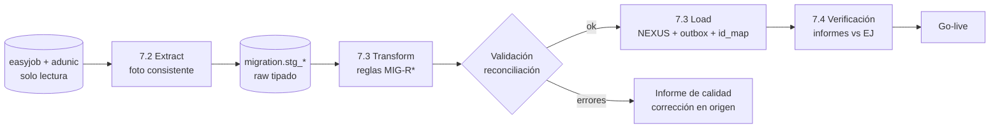

# Dominio · Migración: ETL one-shot y big-bang cutover

- **Origen:** D11, D12, Parte 3 §14, Parte 4 §31, RC1 (`EJSyncMap` = traza del ETL, sin `conflict_rule`), Apéndice B (defectos EJ corregidos)
- **Esquema:** `migration` (infraestructura; solo existe hasta el cutover + periodo de auditoría) · **Herramienta:** `src/Migration/Nexus.Migration` (consola .NET, no servicio)
- **Fuente:** EasyJob y adunic en SQL Server `NUS-SQL-001\NRP` (bases `easyjob` y `adunic`), **solo lectura**
- **Pasos:** 7.2 (extracción y staging), 7.3 (transformación, carga y mapa de ids), 7.4 (ensayos, piloto opcional y runbook)

## §1 Principio

NEXUS no convive con EasyJob. EasyJob es el origen de **una sola pasada** offline de extracción, transformación y carga, seguida de un corte coordinado: EasyJob se congela, se migra, se valida y NEXUS entra en producción.

- La carga escribe en las tablas de NEXUS **y** en `outbox.message` (eventos `.created` y `movement.posted`) para que réplicas y proyecciones se construyan por el camino normal `[+]`.
- `EJSyncMap` (en `docs/` se llama `migration.id_map`) es **unidireccional** (EJ → NEXUS) y solo traza el ETL. No hay `conflict_rule` ni sincronización.
- La migración **corrige** los defectos de EasyJob (Apéndice B) en la transformación; no los traslada.

## §2 Etapas



## §3 DDL (pasos 7.2–7.3)

```sql
CREATE SCHEMA migration;   -- sin RLS; solo svc_migration (BYPASSRLS) y lectura para auditoría

CREATE TABLE migration.run (
  id            uuid PRIMARY KEY,
  run_kind      text NOT NULL CHECK (run_kind IN ('DRY_RUN','REHEARSAL','PILOT','CUTOVER')),
  scope         jsonb NOT NULL,                  -- LE / almacenes incluidos (piloto)
  source_snapshot_at timestamptz NOT NULL,       -- instante de la foto de EJ
  started_at    timestamptz NOT NULL,
  finished_at   timestamptz NULL,
  status        text NOT NULL CHECK (status IN ('RUNNING','SUCCEEDED','FAILED','ROLLED_BACK')),
  started_by    text NOT NULL
);

-- Append-only: una fila por etapa y entidad
CREATE TABLE migration.run_log (
  id          uuid PRIMARY KEY,
  run_id      uuid NOT NULL REFERENCES migration.run(id),
  stage       text NOT NULL CHECK (stage IN ('EXTRACT','TRANSFORM','VALIDATE','LOAD','RECONCILE')),
  entity      text NOT NULL,
  rows_in     bigint NOT NULL,
  rows_out    bigint NOT NULL,
  rows_rejected bigint NOT NULL,
  duration_ms bigint NOT NULL,
  logged_at   timestamptz NOT NULL,
  detail      jsonb NULL
);

-- "EJSyncMap" (RC1): traza unidireccional EJ → NEXUS
CREATE TABLE migration.id_map (
  source_system text NOT NULL CHECK (source_system IN ('EASYJOB','ADUNIC')),
  source_table  text NOT NULL,
  source_key    text NOT NULL,                   -- clave de EJ como texto (compuestas con '|')
  target_table  text NOT NULL,                   -- '<schema>.<tabla>'
  target_id     uuid NOT NULL,
  run_id        uuid NOT NULL REFERENCES migration.run(id),
  PRIMARY KEY (source_system, source_table, source_key, target_table)
);
CREATE INDEX ix_idmap_target ON migration.id_map(target_table, target_id);

-- Problemas de calidad detectados en transformación
CREATE TABLE migration.data_issue (
  id          uuid PRIMARY KEY,
  run_id      uuid NOT NULL REFERENCES migration.run(id),
  severity    text NOT NULL CHECK (severity IN ('BLOCKER','ERROR','WARNING')),
  rule_id     text NOT NULL,                     -- MIG-Rn
  source_table text NOT NULL,
  source_key  text NOT NULL,
  message     text NOT NULL,
  resolution  text NULL CHECK (resolution IN ('FIXED_AT_SOURCE','MAPPED','WAIVED')),
  resolved_by text NULL
);

-- Staging: una tabla por tabla de origen, con las columnas usadas y tipos de PostgreSQL.
-- Nombre: migration.stg_<db>_<tabla> (p. ej. migration.stg_ej_stocktype). La lista exacta la fija 7.2.
```

## §4 Mapeo de entidades

Las tablas y columnas exactas de EasyJob y adunic se toman de las skills `ej-crud-tables`, `ej-crud-views`, `ej-job-states` y `nrp-adunic` en el paso 7.2 (no se copian aquí).

| Orden | Origen (EJ / adunic) | Destino NEXUS | Reglas clave |
|---|---|---|---|
| 1 | Empresas propias (Mandanten EJ) | `org.party` + `org."group"` / `legal_entity` / `business_unit` | MIG-R1 |
| 2 | `Stock` (almacenes EJ) | `org.location` + `org.warehouse` → `stock.stock_location` (evento) | MIG-R2 |
| 3 | `Address` (empresas, contactos, direcciones) + `601_Partner` | `org.party` (ORGANIZATION/PERSON), `party_location`, `party_relationship` | MIG-R3, MIG-R4 |
| 4 | Usuarios EJ | `org.app_user` (sin `external_subject`; se vincula al primer login ⚑) + `access.role_assignment` | MIG-R5 |
| 5 | Unidades implícitas | — (P11: `stock_uom_id` `NULL`) | MIG-R6 |
| 6 | Grupos/categorías de `StockType` | `catalog.asset_family` / `asset_category` | MIG-R7 |
| 7 | `StockType` | `catalog.asset_type` (`ej_stock_type_ref`) | MIG-R8, MIG-R9 |
| 8 | Composición de sets/kits EJ | `catalog.asset_type_bom` (versión 1, `valid_from = snapshot`) | MIG-R10 |
| 9 | Precios EJ | `catalog.asset_type_price_rule` (versión 1) | MIG-R11 |
| 10 | `StockItem` | `catalog.asset_item` (`ej_stock_item_ref`) + `warehouse.asset_identifier` (códigos/RFID) | MIG-R12 |
| 11 | Proyectos / `Job` / `StockType2Job` | `project.project`, `project.job`, `project.job_line` (solo vivos, MIG-R13) | MIG-R13, MIG-R14 |
| 12 | Existencias actuales | `stock.stock_movement` `OPENING_BALANCE` desde `OPENING` (`source_type = MIGRATION`) | MIG-R15, MIG-R16 |
| 13 | `Subrental` + `Subjob` abiertos | `logistics.transfer` (`INTERNAL_RENTAL`, `origin = MIGRATION`) en el estado equivalente | MIG-R17 |
| 14 | `TimeCardUser`, `Freelancer`, personas de `Address`, `081_Personal` | `hr.worker` (+ `Party` PERSON único) | MIG-R18 |
| 15 | `837_MontagePhase` | `commissioning.job_phase` (Jobs vivos) | — |
| 16 | Pedidos de compra abiertos | `stock.purchase_order` (estado equivalente) | MIG-R19 |
| 17 | Facturas abiertas (`406_Rechnungen`, `023_Debitoren`) | Ninguna como documento NEXUS; saldo abierto solo como referencia en el ERP ⚑ MIG-Q2 | MIG-R20 |

## §5 Reglas

| Id | Regla | Origen |
|---|---|---|
| MIG-R1 | Las entidades internas se crean como `Party` `ORGANIZATION` con `is_internal = true` (ORG-R1). Sus códigos (`LE-…`) se fijan en una tabla de correspondencia aprobada por Luciano antes de 7.3 | §3 |
| MIG-R2 | Cada almacén EJ → un `Warehouse` con su `Location`; almacenes lógicos de EJ que no son físicos se listan como `data_issue` para decidir | [+] |
| MIG-R3 | `Address` se divide: organizaciones → `Party` ORGANIZATION; personas → `Party` PERSON + `CONTACT_OF`; direcciones → `Location` + `party_location`. Duplicados por `tax_id` o nombre normalizado + país → `WARNING` con propuesta de fusión | Apéndice B |
| MIG-R4 | `601_Partner` (adunic) se cruza con `Address` por el identificador común si existe; si no, por `tax_id`. Un partner sin cruce se crea aparte y se marca `WARNING` | §3 |
| MIG-R5 | Los permisos de EJ **no** se traducen automáticamente: cada usuario recibe roles de una tabla de correspondencia aprobada (rol EJ → rol NEXUS + alcance) | A6 |
| MIG-R6 | Ningún `AssetType` migrado lleva unidades (P11). Se asignan después tipo a tipo | P11 |
| MIG-R7 | Los grupos de EJ se mapean a familia/categoría con una tabla de correspondencia aprobada | [+] |
| MIG-R8 | **`tracking_mode`** (corrige la doble contabilidad, §5): un `StockType` con `StockItem` serializados activos → `SERIALIZED`; sin ellos → `BULK`; `BATCH` solo por lista explícita. Un `StockType` con `StockItem` **y** cantidad a granel distinta del número de ítems → `BLOCKER` hasta decidir | §5, Apéndice B |
| MIG-R9 | Los tipos migrados entran `ACTIVE` (CAT-R2) salvo los marcados obsoletos en EJ → `DISCONTINUED` | [+] |
| MIG-R10 | Sets EJ → `kit_mode` según CAT-Q1 (debe estar cerrado antes de 7.3) | CAT-Q1 |
| MIG-R11 | Precios vigentes → versión 1 `STANDARD` por LE; sin histórico (A10 empieza en el corte) | A10 |
| MIG-R12 | `StockItem` → `AssetItem` con su propietario (LE) y estado; los RFID/códigos de EJ → `asset_identifier` normalizados (WHS-R1). Series duplicadas por tipo → `BLOCKER` | §10 |
| MIG-R13 | Solo se migran proyectos y Jobs **vivos** (no cerrados ni cancelados) a la fecha de corte; el histórico queda en EasyJob en solo lectura ⚑ MIG-Q1 | D12 |
| MIG-R14 | El estado de cada Job se traduce de `IdJobState` (skill `ej-job-states`) a `project.job_state` con una tabla aprobada; las reservas se crean después por el camino normal (eventos `job.state-changed`, LOG-R21) | A2 |
| MIG-R15 | **Saldo de apertura:** por almacén, tipo y propietario. `SERIALIZED`: un movimiento por ítem en su almacén actual; `BULK`: la cantidad de EJ por almacén. Material que EJ sitúa en un Job en curso → ubicación `PROJECT_SITE` del proyecto migrado | §7, A1 |
| MIG-R16 | Después de cargar: Σ saldos NEXUS por (almacén, tipo) = cantidades EJ de la foto, o diferencia documentada en `data_issue` | [+] |
| MIG-R17 | Alquileres internos abiertos de EJ (`Subrental`+`Subjob`) → `Transfer` `INTERNAL_RENTAL` con su vuelta (LOG-R11), en `IN_TRANSIT`/`RECEIVED` según EJ | A1 |
| MIG-R18 | Una persona que aparece en `Address`, `TimeCardUser` y `Freelancer` se unifica en **un** `Party` + **un** `Worker` (§9); el criterio de identidad se valida con un informe de posibles duplicados | §9 |
| MIG-R19 | POs abiertos → `purchase_order` con líneas pendientes; lo ya recibido no se migra como recepción (ya está en el saldo de apertura) | [+] |
| MIG-R20 | No se migran facturas como documentos NEXUS: viven en el ERP. El P&L de proyectos vivos arranca en el corte ⚑ MIG-Q2 | [+] |
| MIG-R21 | Un `BLOCKER` abierto impide la etapa `LOAD`. `ERROR` exige resolución o `WAIVED` firmado | [+] |
| MIG-R22 | La carga es **idempotente por ejecución**: se hace sobre una base limpia (ensayo) o en una única transacción por entidad; volver a ejecutar un `CUTOVER` fallido parte de una restauración de la base | [+] |
| MIG-R23 | `svc_migration` (`BYPASSRLS`) solo existe en la ventana de migración y se elimina tras el corte (`conventions-database.md §2`) | [+] |

## §6 Reconciliación (informes de 7.3/7.4)

| Informe | Comparación | Tolerancia |
|---|---|---|
| R1 Conteos | filas por entidad EJ vs NEXUS (+ rechazadas) | 0 sin justificar |
| R2 Stock | Σ por almacén × tipo (MIG-R16) | 0 |
| R3 Serializados | ítems por estado y almacén | 0 |
| R4 Proyectos vivos | número de Jobs por estado mapeado; líneas por Job | 0 |
| R5 Reservas | ATP de una muestra de 50 tipos en 5 fechas vs disponibilidad de EJ (`GetAvbl2Stocks`) | diferencias explicadas |
| R6 Personas | `Worker` creados vs personas origen; duplicados fusionados | lista revisada |

Los informes se generan como CSV + resumen Markdown en `migration-reports/<run_id>/`.

## §7 Runbook de cutover (7.4)

| T | Acción | Responsable |
|---|---|---|
| T−14 d | Último ensayo completo (`REHEARSAL`) con tiempos medidos; R1–R6 en verde | Luciano |
| T−7 d | Comunicación; congelación de master data en EJ | Operaciones |
| T−1 d | Copia de seguridad de NEXUS producción vacía + verificación de restauración | IT |
| T0 | EasyJob en solo lectura; foto (`source_snapshot_at`) | IT |
| T0 + 0–Xh | Extract → Transform → Validate → Load (`CUTOVER`) | Luciano |
| T0 + X | Informes R1–R6; decisión go/no-go | Luciano + responsables |
| Go | Usuarios vinculados (`external_subject`), roles activos, NEXUS abierto | IT |
| No-go | Restaurar copia, EJ vuelve a lectura-escritura, análisis | Luciano |
| T+30 d | Eliminar `svc_migration`; archivar `migration.*`; EJ en solo lectura de archivo ⚑ | IT |

**Piloto opcional** (D12): un `REHEARSAL` sobre una copia de producción con usuarios reales de una LE durante una o dos semanas, **sin** operar en real. No hay operación real en paralelo (D11) ⚑ MIG-Q3.

## §8 Abiertos ⚑

- **MIG-Q1:** ¿se migra histórico (proyectos cerrados, movimientos pasados) para reporting? Propuesta: no al OLTP; si hace falta, carga directa a ClickHouse en tablas `hist_*` separadas.
- **MIG-Q2:** facturas abiertas y P&L de proyectos en curso en el momento del corte.
- **MIG-Q3:** alcance del piloto (D12 dice "subconjunto controlado de Mandant/almacenes"). Operar una LE en NEXUS mientras otras siguen en EJ sería coexistencia (D11). Propuesta: piloto sin operación real.
- **MIG-Q4:** vinculación de usuarios a Entra ID: por email en el primer login o pre-cargado desde el directorio.
