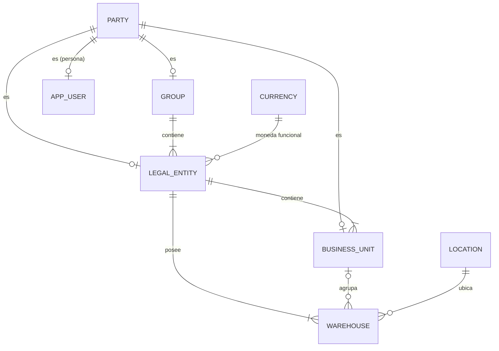

# Dominio · Estructura organizativa (Capa 1)

- **Origen:** Manual §3 (Capa 1 v2), ADR-0003 (núcleo en 0.4)
- **Esquema:** `org` (referencia) · **Servicio:** `nexus-platform`
- **Pasos:** 0.4 (núcleo), 1.1 (completa)

## §1 Principio

`Party` es el **directorio universal**. Toda entidad interna del grupo (`Group`, `LegalEntity`, `BusinessUnit`) es un `Party` con `party_type = ORGANIZATION`. Los contactos y proveedores externos también viven en `Party`. Todas las entidades transaccionales de las Capas 2–6 referencian esta capa.

## §2 Modelo



## §3 DDL

La columna "Paso" indica cuándo se crea cada tabla o columna. Perfil RLS: `GLOBAL` para toda la estructura (`conventions-database.md §7`).

```sql
CREATE SCHEMA org;

-- Paso 0.4
CREATE TABLE org.currency (
  code         char(3)  PRIMARY KEY CHECK (code ~ '^[A-Z]{3}$'),
  caption_i18n jsonb    NOT NULL,                       -- [+]
  minor_units  smallint NOT NULL DEFAULT 2,             -- [+]
  is_active    boolean  NOT NULL DEFAULT true
  -- + std
);

-- Paso 0.4
CREATE TABLE org.party (
  id               uuid PRIMARY KEY,
  party_type       text NOT NULL CHECK (party_type IN ('ORGANIZATION','PERSON')),
  legal_name       text NOT NULL,
  display_name     text NULL,                           -- [+] nombre corto para UI
  tax_id           text NULL,
  erp_company_code text NULL,                           -- manual (reconstrucción, Apéndice C)
  is_internal      boolean NOT NULL DEFAULT false,      -- [+] true = entidad del grupo
  is_active        boolean NOT NULL DEFAULT true
  -- + std
  -- 7.1 añade: is_anonymized, anonymized_at (domain/gdpr.md)
);
CREATE INDEX ix_party_legal_name_trgm ON org.party USING gin (legal_name gin_trgm_ops);

-- Paso 0.4
CREATE TABLE org."group" (
  id                      uuid PRIMARY KEY,
  party_id                uuid NOT NULL UNIQUE REFERENCES org.party(id),
  code                    text NOT NULL UNIQUE,
  consolidation_method    text NOT NULL DEFAULT 'FULL'
                          CHECK (consolidation_method IN ('FULL','PROPORTIONAL','EQUITY')), -- manual ⚑ valores [+]
  reporting_currency_code char(3) NOT NULL REFERENCES org.currency(code)                 -- [+]
  -- + std
);

-- Paso 0.4
CREATE TABLE org.legal_entity (
  id            uuid PRIMARY KEY,
  party_id      uuid NOT NULL UNIQUE REFERENCES org.party(id),
  group_id      uuid NOT NULL REFERENCES org."group"(id),
  code          text NOT NULL UNIQUE,
  currency_code char(3) NOT NULL REFERENCES org.currency(code),  -- manual: currency_id → Currency.code
  country_code  char(2) NOT NULL,                                -- [+] ISO 3166-1
  is_active     boolean NOT NULL DEFAULT true
  -- + std
);
CREATE INDEX ix_legal_entity_group ON org.legal_entity(group_id);

-- Paso 0.4
CREATE TABLE org.business_unit (
  id               uuid PRIMARY KEY,
  party_id         uuid NOT NULL UNIQUE REFERENCES org.party(id),     -- §3: BU también es Party
  legal_entity_id  uuid NOT NULL REFERENCES org.legal_entity(id),
  code             text NOT NULL,
  caption_i18n     jsonb NOT NULL,                                     -- [+]
  cost_center_code text NULL,       -- manual: cost_center_id; no existe entidad CostCenter → código ⚑
  is_active        boolean NOT NULL DEFAULT true,
  -- + std
  UNIQUE (legal_entity_id, code)
);
CREATE INDEX ix_business_unit_le ON org.business_unit(legal_entity_id);

-- Paso 0.4 (mínimo) / 1.1 (geo)
CREATE TABLE org.location (
  id            uuid PRIMARY KEY,
  code          text NULL UNIQUE,                       -- [+]
  name          text NOT NULL,                          -- [+]
  street        text NULL,                              -- manual: address → desglosado [+]
  postal_code   text NULL,
  city          text NULL,
  region        text NULL,
  country_code  char(2) NOT NULL,
  latitude      numeric(9,6) NULL,                      -- 1.1, manual: geo
  longitude     numeric(9,6) NULL,                      -- 1.1
  is_active     boolean NOT NULL DEFAULT true
  -- + std
);

-- Paso 0.4
CREATE TABLE org.warehouse (
  id               uuid PRIMARY KEY,
  location_id      uuid NOT NULL REFERENCES org.location(id),
  legal_entity_id  uuid NOT NULL REFERENCES org.legal_entity(id),
  business_unit_id uuid NULL REFERENCES org.business_unit(id),  -- [+] necesario para la cascada BU → Warehouse de A6
  code             text NOT NULL UNIQUE,
  caption_i18n     jsonb NOT NULL,                               -- [+]
  is_active        boolean NOT NULL DEFAULT true
  -- + std
);
CREATE INDEX ix_warehouse_le ON org.warehouse(legal_entity_id);
CREATE INDEX ix_warehouse_bu ON org.warehouse(business_unit_id);

-- Paso 0.4. "user" es palabra reservada → app_user
CREATE TABLE org.app_user (
  id                 uuid PRIMARY KEY,
  party_id           uuid NOT NULL UNIQUE REFERENCES org.party(id),
  business_unit_id   uuid NULL REFERENCES org.business_unit(id),  -- manual; NULL para SYSTEM
  external_subject   text NULL UNIQUE,              -- [+] claim oid de Entra ID (ADR-0006); NULL = no puede iniciar sesión
  email              text NULL,                     -- [+]
  preferred_language char(2) NOT NULL DEFAULT 'de' CHECK (preferred_language IN ('de','en','fr','it','es')), -- [+]
  is_active          boolean NOT NULL DEFAULT true
  -- + std
);

-- Paso 1.1 [+] el manual dice "Currency: code · rate"; los tipos van en tabla propia
CREATE TABLE org.exchange_rate (
  id            uuid PRIMARY KEY,
  from_currency char(3) NOT NULL REFERENCES org.currency(code),
  to_currency   char(3) NOT NULL REFERENCES org.currency(code),
  rate          numeric(19,10) NOT NULL CHECK (rate > 0),
  valid_on      date NOT NULL,
  source        text NOT NULL DEFAULT 'MANUAL',
  -- + std-append
  UNIQUE (from_currency, to_currency, valid_on),
  CHECK (from_currency <> to_currency)
);

-- Paso 1.1 [+] relaciones del directorio
CREATE TABLE org.party_location (
  party_id    uuid NOT NULL REFERENCES org.party(id),
  location_id uuid NOT NULL REFERENCES org.location(id),
  role        text NOT NULL CHECK (role IN ('HEADQUARTERS','BILLING','SHIPPING','SITE')),
  PRIMARY KEY (party_id, location_id, role)
);

CREATE TABLE org.party_relationship (
  id                uuid PRIMARY KEY,
  from_party_id     uuid NOT NULL REFERENCES org.party(id),   -- persona
  to_party_id       uuid NOT NULL REFERENCES org.party(id),   -- organización
  relationship_type text NOT NULL CHECK (relationship_type IN ('CONTACT_OF','EMPLOYEE_OF')),
  valid_from        date NULL,
  valid_to          date NULL
  -- + std
);
```

**Función de conversión (paso 1.1, `R__org__fx.sql`) `[+]`:** `org.convert_amount(p_amount, p_from, p_to, p_on) RETURNS numeric(19,4)`: misma moneda → igual; si no, último `exchange_rate` con `valid_on ≤ p_on` en sentido directo o inverso (`1/rate`); sin tipo → `RAISE 'ORG-R10'`. `STABLE`; `EXECUTE` a todos los `svc_*` y a `svc_solver`.

**Semilla común (0.4):** monedas `CHF`, `EUR`, `USD`, `GBP`; `Party` + `app_user` SYSTEM (`id = 00000000-0000-7000-8000-000000000001`, `external_subject = NULL`).

**Semilla dev (0.4):** grupo `NUSSLI`; entidades `LE-CH` (CHF, CH) y `LE-DE` (EUR, DE); una BU y un almacén por entidad; los usuarios de `OrgFixture` (`conventions-testing.md §4`).

**`external_subject` obligatorio en el alta (decidido 2026-10-24):** aunque la columna admite `NULL` para cualquier usuario (no solo SYSTEM — "no puede iniciar sesión"), la API (`POST /v1/users`, `contracts/openapi/platform.yaml`) exige `oid` siempre al crear. No se permite precrear una cuenta sin vincular su `oid` real todavía. Decisión de Luciano, conservadora; revisar si en el futuro hace falta precrear usuarios antes de que existan en el IdP.

## §4 Reglas

| Id | Regla | Origen |
|---|---|---|
| ORG-R1 | `Group`, `LegalEntity` y `BusinessUnit` apuntan a un `Party` con `party_type = ORGANIZATION` e `is_internal = true` | §3 |
| ORG-R2 | `party_type` no cambia tras la creación | [+] |
| ORG-R3 | Un `Warehouse` con `business_unit_id` exige que la BU pertenezca a la misma `legal_entity_id` | [+] |
| ORG-R4 | `app_user.party_id` apunta a un `Party` `PERSON` | [+] |
| ORG-R5 | Una `LegalEntity` solo se desactiva si no tiene `BusinessUnit` ni `Warehouse` activos | [+] |
| ORG-R6 | El usuario SYSTEM no se desactiva, no se edita y no tiene `external_subject` | [+] |
| ORG-R7 | `legal_entity.currency_code` y `group.reporting_currency_code` apuntan a monedas activas | [+] |
| ORG-R8 | Un tipo de cambio por par de monedas y día; no se edita, se publica uno nuevo para otro día | [+] |
| ORG-R9 | El `email` de `app_user` es único entre usuarios activos | [+] |
| ORG-R10 | Una conversión de moneda sin tipo aplicable (`org.convert_amount`) falla; nunca se asume 1 | [+] |

## §5 API (`contracts/openapi/platform.yaml`)

| Método y ruta | Permiso | Paso |
|---|---|---|
| `GET/POST /v1/parties`, `GET/PUT /v1/parties/{id}`, `POST /v1/parties/{id}/deactivate` | `PARTY:READ/CREATE/UPDATE` | 0.4 |
| `GET/POST /v1/groups`, `GET/PUT /v1/groups/{id}` | `ORG_STRUCTURE:READ/CREATE/UPDATE` | 0.4 |
| `GET/POST /v1/legal-entities`, `GET/PUT /v1/legal-entities/{id}`, `POST .../deactivate` | `ORG_STRUCTURE:*` | 0.4 |
| `GET/POST /v1/business-units`, `GET/PUT /v1/business-units/{id}`, `POST .../deactivate` | `ORG_STRUCTURE:*` | 0.4 |
| `GET/POST /v1/locations`, `GET/PUT /v1/locations/{id}` | `ORG_STRUCTURE:*` | 0.4 |
| `GET/POST /v1/warehouses`, `GET/PUT /v1/warehouses/{id}`, `POST .../deactivate` | `ORG_STRUCTURE:*` | 0.4 |
| `GET/POST /v1/users`, `GET/PUT /v1/users/{id}`, `POST .../deactivate` | `USER:READ/CREATE/UPDATE` | 0.4 |
| `GET /v1/me` | autenticado | 0.5 |
| `GET /v1/currencies`, `PUT /v1/currencies/{code}` | `CURRENCY:READ/UPDATE` | 0.4 |
| `GET/POST /v1/exchange-rates` (`GET` con `from`, `to`, `on` devuelve el aplicable) | `CURRENCY:READ/CREATE` | 1.1 |
| `POST /v1/currencies/convert` | `CURRENCY:READ` | 1.1 |
| `GET/POST/DELETE /v1/parties/{id}/locations` | `PARTY:UPDATE` | 1.1 |
| `GET/POST /v1/parties/{id}/relationships` | `PARTY:UPDATE` | 1.1 |

Listados: `GET /v1/warehouses?legalEntityId=&businessUnitId=&isActive=&q=`, `GET /v1/parties?partyType=&isInternal=&q=`.

## §6 Eventos

Todos de master data, con estado completo (EV-R4). Contexto `org`.

| Topic | Cuándo |
|---|---|
| `nexus.org.party.created` / `.updated` / `.deactivated` | Alta, cambio, baja de `Party` |
| `nexus.org.group.created` / `.updated` | |
| `nexus.org.legal-entity.created` / `.updated` / `.deactivated` | |
| `nexus.org.business-unit.created` / `.updated` / `.deactivated` | |
| `nexus.org.location.created` / `.updated` | |
| `nexus.org.warehouse.created` / `.updated` / `.deactivated` | |
| `nexus.org.user.created` / `.updated` / `.deactivated` | Sin email en el payload (EV-R5) |
| `nexus.org.exchange-rate.published` | 1.1 |

## §7 Pantallas (`web/src/app/features/org`)

| Pantalla | Paso |
|---|---|
| Árbol de estructura (Grupo → LE → BU → Almacén), solo lectura | 0.4 |
| Lista y detalle de Legal Entity, Business Unit, Warehouse, Location | 0.4 |
| Lista y detalle de usuarios (alta con `oid`, idioma, BU) | 0.4 |
| Directorio de Parties (búsqueda por nombre, tipo, interno/externo) | 0.4 |
| Monedas y tipos de cambio | 1.1 |
| Party: pestañas "Direcciones" y "Contactos" | 1.1 |

## §8 Abiertos ⚑

- **ORG-Q1 (decidido 2026-10-24):** visibilidad del directorio `Party` = **`GLOBAL`** (directorio compartido por todo el grupo, sin columna de alcance ni RLS — coincide con la DDL de `org.party` de `§3`, que no lleva `legal_entity_id`). Decisión de Luciano antes del paso 0.4.
- **ORG-Q2:** no hay entidad `CostCenter`; se guarda `cost_center_code` como texto hasta que exista un plan de cuentas.
- **ORG-Q3:** valores de `consolidation_method`. Propuesta: `FULL`, `PROPORTIONAL`, `EQUITY`.
