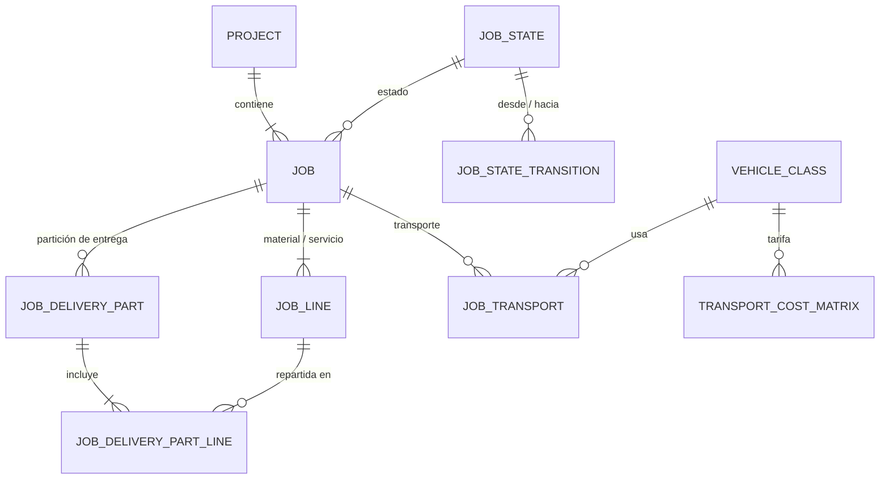
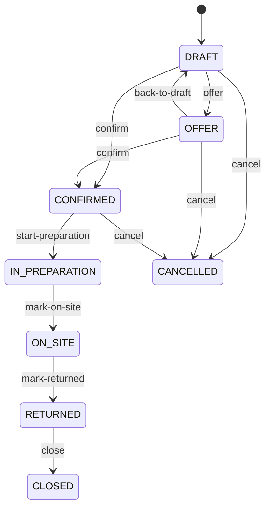

# Dominio · Proyectos, Jobs y configuración operacional (Capa 3)

- **Origen:** Manual §6 (Capa 3), §1 (Capa MD 3 = restricciones del Solver), A5 (`JobTransport.fleet_type`), A4 (`Contract → Project`)
- **Esquema:** `project` (transaccional) · **Servicio:** `nexus-operations`
- **Pasos:** 2.1 (`Project`, `Job`, máquina de estados), 2.2 (`JobLine`, `JobDeliveryPart`), 2.3 (`JobTransport`, clases de vehículo, matrices de coste), 2.4 (reglas de alquiler y transferencia; editor de la máquina de estados). 5.2 conecta el origen comercial

## §1 Principio

El **proyecto** es el contenedor comercial y operativo (cliente, fechas, entidad). El **Job** es la unidad ejecutable de alquiler/montaje, con máquina de estados. Las líneas de Job dicen **qué** material o servicio y **cuándo**; las particiones de entrega dicen **qué sale junto**.

La **configuración operacional** (máquinas de estado, reglas de alquiler y transferencia, matrices de coste de transporte) es la Capa MD 3 del manual: **es el conjunto de restricciones del Solver**. Al cerrar el paso 2.4, las tres capas de master data están completas (S5).

Un `Project` puede crearse a mano desde 2.1. En 5.2 se añade el origen normal: un `Contract` que pasa a `ACTIVE` crea su `Project` (A4).

## §2 Modelo



## §3 DDL

```sql
CREATE SCHEMA project;

-- ===== Paso 2.1 · máquina de estados configurable (GLOBAL) =====
CREATE TABLE project.job_state (
  id                      uuid PRIMARY KEY,
  code                    text NOT NULL UNIQUE,
  caption_i18n            jsonb NOT NULL,
  category                text NOT NULL CHECK (category IN
                            ('DRAFT','OFFER','CONFIRMED','IN_EXECUTION','COMPLETED','CANCELLED')),  -- [+]
  reservation_effect      text NOT NULL CHECK (reservation_effect IN ('NONE','SOFT','FIRM')),     -- [+] puente con A2
  soft_weight             numeric(7,4) NULL CHECK (soft_weight > 0 AND soft_weight <= 1),          -- [+] peso ATP si SOFT
  is_initial              boolean NOT NULL DEFAULT false,
  is_terminal             boolean NOT NULL DEFAULT false,
  allows_line_changes     boolean NOT NULL DEFAULT true,                                           -- [+]
  sort_order              integer NOT NULL DEFAULT 0,
  is_active               boolean NOT NULL DEFAULT true,
  -- + std
  CHECK ((reservation_effect = 'SOFT') = (soft_weight IS NOT NULL))
);
CREATE UNIQUE INDEX uq_job_state_initial ON project.job_state(is_initial) WHERE is_initial;

CREATE TABLE project.job_state_transition (
  id                   uuid PRIMARY KEY,
  from_state_id        uuid NOT NULL REFERENCES project.job_state(id),
  to_state_id          uuid NOT NULL REFERENCES project.job_state(id),
  action_code          text NOT NULL,                     -- [+] verbo de la API: 'confirm', 'cancel'…
  required_permission  text NOT NULL DEFAULT 'JOB:UPDATE',-- [+]
  -- + std
  UNIQUE (from_state_id, to_state_id),
  UNIQUE (from_state_id, action_code),
  CHECK (from_state_id <> to_state_id)
);

-- Numeración de documentos (conventions-database.md §11)
CREATE TABLE project.number_sequence (
  scope_key  text PRIMARY KEY,          -- 'PROJECT:<le_code>:<yyyy>', 'JOB:<project_code>'
  next_value bigint NOT NULL DEFAULT 1
);

-- ===== Paso 2.1 · Project. RLS: LE+BU+PRJ(id) =====
CREATE TABLE project.project (
  id                     uuid PRIMARY KEY,
  code                   text NOT NULL UNIQUE,            -- 'P-<LE>-<YYYY>-<NNNN>' [+]
  name                   text NOT NULL,
  customer_party_id      uuid NOT NULL REFERENCES org.party(id),
  legal_entity_id        uuid NOT NULL REFERENCES org.legal_entity(id),
  business_unit_id       uuid NULL REFERENCES org.business_unit(id),
  venue_location_id      uuid NULL REFERENCES org.location(id),       -- [+] obra / recinto
  start_date             date NOT NULL,
  end_date               date NOT NULL,
  budget_amount          numeric(19,4) NULL,              -- manual: "presupuesto" (orientativo). El formal es A5
  currency_code          char(3) NOT NULL REFERENCES org.currency(code),
  status                 text NOT NULL DEFAULT 'PLANNED'
                         CHECK (status IN ('PLANNED','ACTIVE','CLOSED','CANCELLED')),   -- [+]
  project_manager_user_id uuid NULL REFERENCES org.app_user(id),       -- [+]
  contract_id            uuid NULL UNIQUE,                -- 5.2 (commercial.contract, sin FK)
  ej_project_ref         text NULL,                       -- [+] ETL
  -- + std
  CHECK (end_date >= start_date)
);
CREATE INDEX ix_project_le ON project.project(legal_entity_id);
CREATE INDEX ix_project_customer ON project.project(customer_party_id);

-- ===== Paso 2.1 · Job. RLS: LE+WH+PRJ =====
CREATE TABLE project.job (
  id                   uuid PRIMARY KEY,
  project_id           uuid NOT NULL REFERENCES project.project(id),
  code                 text NOT NULL UNIQUE,              -- '<project_code>-J<NN>' [+]
  name                 text NOT NULL,
  job_state_id         uuid NOT NULL REFERENCES project.job_state(id),
  legal_entity_id      uuid NOT NULL REFERENCES org.legal_entity(id),   -- = el del proyecto
  warehouse_id         uuid NULL REFERENCES org.warehouse(id),          -- [+] almacén de salida por defecto
  planned_dispatch_at  timestamptz NOT NULL,              -- [+] salida del almacén
  event_start_at       timestamptz NOT NULL,              -- [+]
  event_end_at         timestamptz NOT NULL,              -- [+]
  planned_return_at    timestamptz NOT NULL,              -- [+] vuelta al almacén
  notes                text NULL,
  ej_job_ref           text NULL,                         -- [+] ETL
  -- + std
  CHECK (planned_dispatch_at <= event_start_at AND event_start_at <= event_end_at
         AND event_end_at <= planned_return_at)
);
CREATE INDEX ix_job_project ON project.job(project_id);
CREATE INDEX ix_job_state ON project.job(job_state_id);
CREATE INDEX ix_job_dates ON project.job(planned_dispatch_at, planned_return_at);

-- [+] historial de estados (append-only)
CREATE TABLE project.job_state_history (
  id              uuid PRIMARY KEY,
  job_id          uuid NOT NULL REFERENCES project.job(id),
  from_state_id   uuid NULL REFERENCES project.job_state(id),
  to_state_id     uuid NOT NULL REFERENCES project.job_state(id),
  changed_at      timestamptz NOT NULL,
  reason          text NULL,
  legal_entity_id uuid NOT NULL,
  project_id      uuid NOT NULL
  -- + std-append
);

-- ===== Paso 2.2 · JobLine. RLS: LE+PRJ =====
CREATE TABLE project.job_line (
  id                 uuid PRIMARY KEY,
  job_id             uuid NOT NULL REFERENCES project.job(id),
  line_no            integer NOT NULL,
  line_type          text NOT NULL CHECK (line_type IN ('MATERIAL','SERVICE')),
  asset_type_id      uuid NULL REFERENCES catalog.asset_type(id),
  description        text NULL,
  qty                numeric(18,4) NOT NULL CHECK (qty > 0),
  uom_id             uuid NULL REFERENCES uom.unit_of_measure(id),   -- P11
  qty_stock_uom      numeric(18,4) NOT NULL CHECK (qty_stock_uom > 0),   -- [+] UR1: convertido en el borde
  usage_from         timestamptz NOT NULL,              -- [+] por defecto job.planned_dispatch_at
  usage_to           timestamptz NOT NULL,              -- [+] por defecto job.planned_return_at
  source_warehouse_id uuid NULL REFERENCES org.warehouse(id),        -- [+] override del job
  source_quote_line_id uuid NULL,                       -- 5.2 (commercial.quote_line, sin FK)
  legal_entity_id    uuid NOT NULL,
  project_id         uuid NOT NULL,
  is_cancelled       boolean NOT NULL DEFAULT false,    -- [+] baja lógica (la reserva se libera)
  -- + std
  UNIQUE (job_id, line_no),
  CHECK ((line_type = 'MATERIAL') = (asset_type_id IS NOT NULL)),
  CHECK (usage_to > usage_from)
);
CREATE INDEX ix_jl_job ON project.job_line(job_id);
CREATE INDEX ix_jl_type ON project.job_line(asset_type_id);

-- ===== Paso 2.2 · JobDeliveryPart. RLS: LE+PRJ =====
CREATE TABLE project.job_delivery_part (
  id                      uuid PRIMARY KEY,
  job_id                  uuid NOT NULL REFERENCES project.job(id),
  part_no                 integer NOT NULL,
  name                    text NOT NULL,
  planned_dispatch_at     timestamptz NOT NULL,
  planned_return_at       timestamptz NOT NULL,
  source_warehouse_id     uuid NULL REFERENCES org.warehouse(id),
  destination_location_id uuid NULL REFERENCES org.location(id),
  status                  text NOT NULL DEFAULT 'PLANNED'
                          CHECK (status IN ('PLANNED','DISPATCHED','RETURNED','CANCELLED')),   -- [+]
  legal_entity_id         uuid NOT NULL,
  project_id              uuid NOT NULL,
  -- + std
  UNIQUE (job_id, part_no),
  CHECK (planned_return_at > planned_dispatch_at)
);

CREATE TABLE project.job_delivery_part_line (       -- [+] "qué sale" de cada partición
  id               uuid PRIMARY KEY,
  delivery_part_id uuid NOT NULL REFERENCES project.job_delivery_part(id),
  job_line_id      uuid NOT NULL REFERENCES project.job_line(id),
  qty_stock_uom    numeric(18,4) NOT NULL CHECK (qty_stock_uom > 0),
  legal_entity_id  uuid NOT NULL,
  project_id       uuid NOT NULL,
  -- + std
  UNIQUE (delivery_part_id, job_line_id)
);

-- ===== Paso 2.3 · transporte =====
CREATE TABLE project.vehicle_class (                -- [+] GLOBAL
  id                uuid PRIMARY KEY,
  code              text NOT NULL UNIQUE,
  caption_i18n      jsonb NOT NULL,
  max_payload_kg    numeric(12,3) NOT NULL CHECK (max_payload_kg > 0),
  max_volume_m3     numeric(12,4) NOT NULL CHECK (max_volume_m3 > 0),
  is_active         boolean NOT NULL DEFAULT true
  -- + std
);

-- RLS: LE+PRJ
CREATE TABLE project.job_transport (               -- manual ⚑ (reconstrucción) salvo fleet_type
  id                     uuid PRIMARY KEY,
  job_id                 uuid NOT NULL REFERENCES project.job(id),
  delivery_part_id       uuid NULL REFERENCES project.job_delivery_part(id),
  direction              text NOT NULL CHECK (direction IN ('OUTBOUND','RETURN')),   -- ida / vuelta (A5)
  fleet_type             text NOT NULL CHECK (fleet_type IN ('OWN','THIRD_PARTY')),  -- confirmado (§6, A5)
  carrier_party_id       uuid NULL REFERENCES org.party(id),                         -- THIRD_PARTY
  carrier_legal_entity_id uuid NULL REFERENCES org.legal_entity(id),                -- [+] IC: transportista del grupo
  vehicle_class_id       uuid NOT NULL REFERENCES project.vehicle_class(id),
  vehicle_count          integer NOT NULL DEFAULT 1 CHECK (vehicle_count >= 1),      -- [+]
  from_location_id       uuid NOT NULL REFERENCES org.location(id),
  to_location_id         uuid NOT NULL REFERENCES org.location(id),
  planned_departure_at   timestamptz NOT NULL,
  planned_arrival_at     timestamptz NOT NULL,
  distance_km            numeric(10,2) NULL,
  planned_cost           numeric(19,4) NULL,       -- [+] de la matriz al planificar
  actual_cost            numeric(19,4) NULL,       -- [+] al completar
  currency_code          char(3) NOT NULL REFERENCES org.currency(code),
  status                 text NOT NULL DEFAULT 'PLANNED'
                         CHECK (status IN ('PLANNED','BOOKED','IN_TRANSIT','COMPLETED','CANCELLED')),
  completed_at           timestamptz NULL,
  legal_entity_id        uuid NOT NULL,
  project_id             uuid NOT NULL,
  -- + std
  CHECK (planned_arrival_at > planned_departure_at),
  CHECK (fleet_type = 'THIRD_PARTY' OR (carrier_party_id IS NULL AND carrier_legal_entity_id IS NULL)),
  CHECK ((status = 'COMPLETED') = (completed_at IS NOT NULL AND actual_cost IS NOT NULL))
);
CREATE INDEX ix_jt_job ON project.job_transport(job_id);

-- GLOBAL. Capa MD 3: entrada directa del Solver
CREATE TABLE project.transport_cost_matrix (
  id               uuid PRIMARY KEY,
  from_location_id uuid NOT NULL REFERENCES org.location(id),
  to_location_id   uuid NOT NULL REFERENCES org.location(id),
  vehicle_class_id uuid NOT NULL REFERENCES project.vehicle_class(id),
  fleet_type       text NOT NULL CHECK (fleet_type IN ('OWN','THIRD_PARTY')),
  distance_km      numeric(10,2) NOT NULL CHECK (distance_km >= 0),
  duration_minutes integer NOT NULL CHECK (duration_minutes >= 0),
  cost_per_trip    numeric(19,4) NOT NULL CHECK (cost_per_trip >= 0),
  currency_code    char(3) NOT NULL REFERENCES org.currency(code),
  is_symmetric     boolean NOT NULL DEFAULT true,          -- [+] vale también en sentido inverso
  valid_from       date NOT NULL,
  valid_to         date NULL,
  -- + std
  CHECK (from_location_id <> to_location_id),
  CHECK (valid_to IS NULL OR valid_to > valid_from),
  EXCLUDE USING gist (from_location_id WITH =, to_location_id WITH =, vehicle_class_id WITH =,
                      fleet_type WITH =, daterange(valid_from, valid_to) WITH &&)
);

-- ===== Paso 2.4 · reglas operacionales (Capa MD 3) =====
-- RLS especial: legal_entity_id IS NULL OR <término LE>
CREATE TABLE project.rental_rule (                 -- [+]
  id                     uuid PRIMARY KEY,
  legal_entity_id        uuid NULL REFERENCES org.legal_entity(id),     -- NULL = todo el grupo
  asset_category_id      uuid NULL REFERENCES catalog.asset_category(id),
  asset_type_id          uuid NULL REFERENCES catalog.asset_type(id),
  prep_buffer_hours      integer NOT NULL DEFAULT 0 CHECK (prep_buffer_hours >= 0),     -- antes de la salida
  return_buffer_hours    integer NOT NULL DEFAULT 0 CHECK (return_buffer_hours >= 0),   -- revisión/limpieza tras volver
  min_rental_days        integer NULL CHECK (min_rental_days > 0),
  allow_internal_rental  boolean NOT NULL DEFAULT true,     -- puede salir a otra LE (A1)
  is_active              boolean NOT NULL DEFAULT true,
  -- + std
  CHECK (asset_category_id IS NULL OR asset_type_id IS NULL)
);
CREATE UNIQUE INDEX uq_rental_rule_scope ON project.rental_rule
  (coalesce(legal_entity_id,'00000000-0000-0000-0000-000000000000'),
   coalesce(asset_category_id,'00000000-0000-0000-0000-000000000000'),
   coalesce(asset_type_id,'00000000-0000-0000-0000-000000000000')) WHERE is_active;

-- RLS especial: from/to NULL OR término LE sobre cualquiera de los dos
CREATE TABLE project.transfer_rule (               -- [+]
  id                    uuid PRIMARY KEY,
  from_legal_entity_id  uuid NULL REFERENCES org.legal_entity(id),   -- NULL = cualquiera
  to_legal_entity_id    uuid NULL REFERENCES org.legal_entity(id),
  scope                 text NOT NULL CHECK (scope IN ('INTRA_LE','INTER_LE')),
  is_allowed            boolean NOT NULL DEFAULT true,
  requires_approval     boolean NOT NULL DEFAULT false,    -- dispara A8 (resource_type TRANSFER)
  min_lead_time_hours   integer NOT NULL DEFAULT 0 CHECK (min_lead_time_hours >= 0),
  handling_cost         numeric(19,4) NULL,                -- coste fijo por transferencia (Solver, soft)
  internal_markup_pct   numeric(7,4) NULL,                 -- ⚑ CAT-Q3 alternativa
  currency_code         char(3) NULL REFERENCES org.currency(code),
  is_active             boolean NOT NULL DEFAULT true,
  -- + std
  CHECK ((handling_cost IS NULL) = (currency_code IS NULL)),
  CHECK (scope = 'INTER_LE' OR from_legal_entity_id IS NOT DISTINCT FROM to_legal_entity_id)
);
```

## §4 Reglas

| Id | Regla | Origen |
|---|---|---|
| PRJ-R1 | Un `Job` hereda `legal_entity_id` del proyecto y no la cambia | [+] |
| PRJ-R2 | Las transiciones de estado de un Job solo siguen `job_state_transition`. Cualquier otra → 409 `invalid_state` | §6 |
| PRJ-R3 | Cada cambio de estado deja fila en `job_state_history` y publica `job.state-changed` con `reservationEffect` del estado destino | [+] |
| PRJ-R4 | Las fechas del Job cumplen `dispatch ≤ event_start ≤ event_end ≤ return`. Las de una línea caen dentro de `[planned_dispatch_at, planned_return_at]` del Job | [+] |
| PRJ-R5 | `qty_stock_uom` = `catalog.to_stock_uom(asset_type_id, qty, uom_id)`, calculado al guardar (UR1, P11) | A11 |
| PRJ-R6 | Solo se añaden o cambian líneas si el estado actual tiene `allows_line_changes = true` | [+] |
| PRJ-R7 | Una línea `MATERIAL` apunta a un `AssetType` `ACTIVE` (CAT-R6) | [+] |
| PRJ-R8 | Para cada línea, Σ `qty_stock_uom` de sus `job_delivery_part_line` ≤ `job_line.qty_stock_uom` | [+] |
| PRJ-R9 | Un proyecto no se cierra (`CLOSED`) con Jobs en estados no terminales | [+] |
| PRJ-R10 | `JobTransport.planned_cost`: si no se informa, se toma de la matriz vigente en la fecha de salida (`from`, `to`, `vehicle_class`, `fleet_type`, o el inverso si `is_symmetric`) × `vehicle_count`. Sin tarifa → `NULL` y aviso | [+] |
| PRJ-R11 | Un `JobTransport` `COMPLETED` exige `actual_cost`. Al completarse publica `job-transport.completed` (lo consume controlling, 5.7) | A5 |
| PRJ-R12 | `carrier_legal_entity_id` solo con `THIRD_PARTY` y debe ser del mismo grupo que el proyecto: marca transporte intercompañía (A5 "IC") | A5 |
| PRJ-R13 | Regla de alquiler aplicable a un tipo y LE = la más específica: tipo > categoría > ninguna; LE concreta > `NULL` | [+] |
| PRJ-R14 | Regla de transferencia aplicable a (LE origen, LE destino) = la más específica; si no hay ninguna activa, `INTRA_LE` se permite y `INTER_LE` **no** | [+] ⚑ |
| PRJ-R15 | El estado inicial (`is_initial`) es único. Un estado terminal no tiene transiciones salientes | [+] |
| PRJ-R16 | Un estado o transición en uso no se borra; se desactiva | [+] |

## §5 Estados

### Job (semilla `[+]`, editable en 2.4)

| Código | Categoría | `reservation_effect` | `soft_weight` | Líneas editables |
|---|---|---|---|---|
| `DRAFT` (inicial) | DRAFT | NONE | — | sí |
| `OFFER` | OFFER | SOFT | 0.5000 | sí |
| `CONFIRMED` | CONFIRMED | FIRM | — | sí |
| `IN_PREPARATION` | IN_EXECUTION | FIRM | — | no |
| `ON_SITE` | IN_EXECUTION | FIRM | — | no |
| `RETURNED` | COMPLETED | NONE | — | no |
| `CLOSED` (terminal) | COMPLETED | NONE | — | no |
| `CANCELLED` (terminal) | CANCELLED | NONE | — | no |



La correspondencia con los `IdJobState` de EasyJob se fija en 7.3 (skill `ej-job-states`).

### Project

`PLANNED → ACTIVE → CLOSED`; `PLANNED|ACTIVE → CANCELLED`.

### JobTransport

`PLANNED → BOOKED → IN_TRANSIT → COMPLETED`; `PLANNED|BOOKED → CANCELLED`.

## §6 API (`operations.yaml`)

| Método y ruta | Permiso | Paso |
|---|---|---|
| `GET/POST /v1/projects`, `GET/PUT /v1/projects/{id}` | `PROJECT:READ/CREATE/UPDATE` | 2.1 |
| `POST /v1/projects/{id}/activate` · `/close` · `/cancel` | `PROJECT:UPDATE` | 2.1 |
| `GET /v1/jobs?projectId=&stateCode=&warehouseId=&from=&to=&q=` | `JOB:READ` | 2.1 |
| `POST /v1/projects/{id}/jobs`, `GET/PUT /v1/jobs/{id}` | `JOB:CREATE/UPDATE` | 2.1 |
| `GET /v1/jobs/{id}/available-transitions` | `JOB:READ` | 2.1 |
| `POST /v1/jobs/{id}/transitions/{actionCode}` (cuerpo: `reason?`) | el `required_permission` de la transición | 2.1 |
| `GET /v1/jobs/{id}/state-history` | `JOB:READ` | 2.1 |
| `GET/POST /v1/jobs/{id}/lines`, `PUT /v1/jobs/{id}/lines/{lineId}`, `POST …/{lineId}/cancel` | `JOB:UPDATE` | 2.2 |
| `GET/POST /v1/jobs/{id}/delivery-parts`, `PUT …/{partId}` (con líneas) | `JOB:UPDATE` | 2.2 |
| `GET/POST /v1/vehicle-classes`, `PUT /{id}` | `TRANSPORT_CONFIG:*` | 2.3 |
| `GET/POST /v1/transport-cost-matrix`, `PUT /{id}`, `GET /v1/transport-cost-matrix/quote?from=&to=&vehicleClassId=&fleetType=&on=` | `TRANSPORT_CONFIG:*` | 2.3 |
| `GET/POST /v1/jobs/{id}/transports`, `PUT …/{tId}`, `POST …/{tId}/book` · `/start` · `/complete` · `/cancel` | `JOB:UPDATE` | 2.3 |
| `GET/POST /v1/job-states`, `PUT /{id}` · `GET/POST /v1/job-state-transitions`, `PUT /{id}` | `JOB_CONFIG:*` (GLOBAL) | 2.1 lectura, 2.4 edición |
| `GET/POST /v1/rental-rules`, `PUT /{id}`, `GET /v1/rental-rules/resolve?assetTypeId=&legalEntityId=` | `OPERATIONAL_RULE:*` | 2.4 |
| `GET/POST /v1/transfer-rules`, `PUT /{id}`, `GET /v1/transfer-rules/resolve?fromLegalEntityId=&toLegalEntityId=` | `OPERATIONAL_RULE:*` | 2.4 |

## §7 Eventos

Contexto `project`.

| Topic | Paso | Payload clave | Consumidores |
|---|---|---|---|
| `nexus.project.project.created` / `.updated` / `.status-changed` | 2.1 | estado completo | platform (`access.project_ref`, ACC-R2), resources, controlling, field (réplicas) |
| `nexus.project.job.created` / `.updated` | 2.1 | estado completo | logistics (mismo servicio), field |
| `nexus.project.job.state-changed` | 2.1 | `jobId`, `from`, `to`, `category`, `reservationEffect`, `softWeight` | logistics (reservas, 4.2), field (fases, 6.2) |
| `nexus.project.job-line.created` / `.updated` / `.cancelled` | 2.2 | estado completo con `qtyStockUom`, `usageFrom/To` | logistics (reservas, 4.2) |
| `nexus.project.delivery-part.changed` | 2.2 | parte + líneas | logistics (despachos, 4.1), field |
| `nexus.project.job-transport.completed` | 2.3 | `direction`, `fleetType`, `carrierLegalEntityId?`, `actualCost`, `currency` | controlling (5.7) |
| `nexus.project.job-transport.changed` | 2.3 | estado completo | field (envíos, 6.3) |
| `nexus.project.transport-cost.changed` · `nexus.project.rental-rule.changed` · `nexus.project.transfer-rule.changed` · `nexus.project.job-state-config.changed` | 2.3–2.4 | estado completo | proyecciones; el Solver lee PostgreSQL directamente |

**Consumidos:** `nexus.commercial.contract.activated` (5.2) → crea `Project` (+ un Job `DRAFT` con líneas desde la oferta aceptada) y publica `project.created` con `contractId`. Consumidor `operations.create-project-from-contract`, actúa como el `actor` del evento.

## §8 Pantallas (`features/projects`)

| Pantalla | Paso |
|---|---|
| Lista de proyectos (filtros LE, BU, estado, cliente, fechas) y detalle (cabecera, Jobs, Documentos) | 2.1 |
| Detalle de Job: cabecera con fechas y botones de transición según `available-transitions`; pestaña historial de estados | 2.1 |
| Job · pestaña Líneas: tabla editable (tipo, cantidad con `nx-quantity`, uso desde/hasta, almacén) | 2.2 |
| Job · pestaña Entregas: particiones con asignación de cantidades por línea | 2.2 |
| Job · pestaña Transportes; configuración de clases de vehículo y matriz de costes (con calculadora `quote`) | 2.3 |
| Configuración operacional: editor de estados y transiciones (diagrama de solo lectura + tabla), reglas de alquiler, reglas de transferencia | 2.4 |
| Calendario de Jobs por almacén (vista Gantt simple de dispatch → return) | 2.2 |

## §9 Abiertos ⚑

- **PRJ-Q1:** pesos `soft_weight` de `OFFER`. 0.5 es un valor de partida. En 5.1 la reserva de una oferta usa la `probability` de la `Opportunity`; aquí aplica a Jobs en `OFFER` creados a mano.
- **PRJ-Q2:** PRJ-R14 (sin regla → `INTER_LE` prohibido). Alternativa: permitido sin aprobación.
- **PRJ-Q3:** los campos de `JobTransport` distintos de `fleet_type` son reconstrucción (Apéndice C). Revisar contra el original antes de 2.3.
