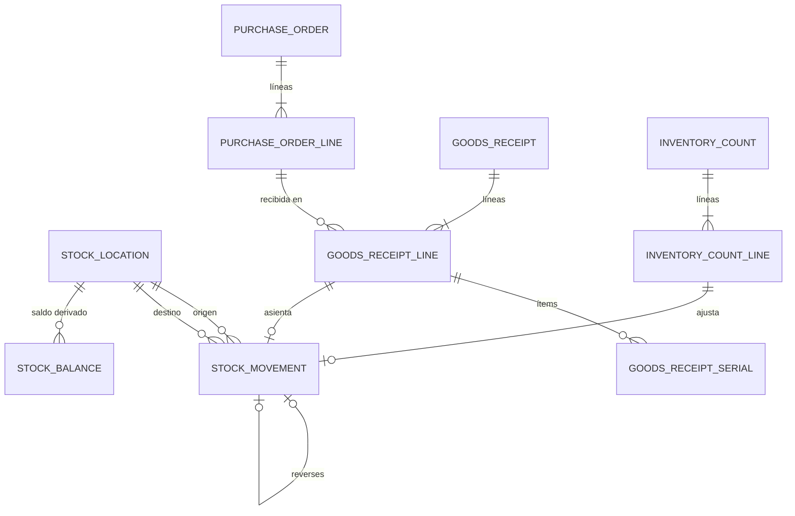

# Dominio · Ledger de stock, compras e inventario físico (Capa 4)

- **Origen:** Manual §7 (Capa 4), §5 (`tracking_mode`), A1 (`StockLocation`, regímenes de undo), A11 (UR1), §4-G (inventario físico)
- **Esquema:** `stock` (transaccional) · **Servicio:** `nexus-operations`
- **Pasos:** 3.1 (ubicaciones base, ledger, saldo), 3.2 (`PurchaseOrder`, `GoodsReceipt`), 3.3 (inventario físico). 4.1 amplía `stock_location` (`logistics.md`)

## §1 Principio

**Ledger append-only.** El stock no se edita: se asienta. Un movimiento erróneo se corrige con otro movimiento (`reverses_movement_id`), nunca con `UPDATE` ni `DELETE`.

Cada movimiento lleva **una cantidad positiva de un origen a un destino**. Origen y destino son siempre `StockLocation`: físicas (almacén; en 4.1 también obra de proyecto y "en tránsito") o virtuales (proveedor, ajuste, apertura, chatarra, consumo). Así cualquier hecho de stock es un único asiento y el saldo de una ubicación es Σ entradas − Σ salidas `[+]`.

**Propiedad y custodia son dimensiones distintas** `[+]`: `owner_legal_entity_id` dice de quién es el material; la `StockLocation` dice quién lo custodia. Un alquiler interno (A1) mueve custodia sin cambiar propiedad.

**UR1:** `qty` está siempre en `AssetType.stock_uom_id` (o en la unidad implícita, P11). La conversión ocurre antes, en el documento de origen.

## §2 Modelo



## §3 DDL

```sql
CREATE SCHEMA stock;

CREATE TABLE stock.number_sequence (scope_key text PRIMARY KEY, next_value bigint NOT NULL DEFAULT 1);
CREATE SEQUENCE stock.movement_no_seq;    -- numeración técnica del ledger (huecos permitidos)

-- ===== Paso 3.1 · ubicaciones. RLS: LE+WH (+PRJ desde 4.1) =====
CREATE TABLE stock.stock_location (
  id               uuid PRIMARY KEY,
  location_type    text NOT NULL CHECK (location_type IN
                     ('WAREHOUSE','SUPPLIER','CUSTOMER','ADJUSTMENT','OPENING','SCRAP','CONSUMPTION')),
                     -- 4.1 añade 'PROJECT_SITE','IN_TRANSIT' (logistics.md §3)
  code             text NOT NULL UNIQUE,              -- 'WH:<warehouse_code>', 'ADJ:<le_code>'…
  legal_entity_id  uuid NOT NULL REFERENCES org.legal_entity(id),   -- custodio
  warehouse_id     uuid NULL REFERENCES org.warehouse(id),
  project_id       uuid NULL,                         -- 4.1
  transfer_id      uuid NULL,                         -- 4.1
  is_physical      boolean GENERATED ALWAYS AS (location_type IN ('WAREHOUSE','PROJECT_SITE','IN_TRANSIT')) STORED,
  is_active        boolean NOT NULL DEFAULT true,
  -- + std
  CHECK ((location_type = 'WAREHOUSE') = (warehouse_id IS NOT NULL))
);
CREATE UNIQUE INDEX uq_sl_warehouse ON stock.stock_location(warehouse_id) WHERE location_type = 'WAREHOUSE';
CREATE UNIQUE INDEX uq_sl_virtual   ON stock.stock_location(legal_entity_id, location_type)
  WHERE location_type IN ('SUPPLIER','CUSTOMER','ADJUSTMENT','OPENING','SCRAP','CONSUMPTION');

-- ===== Paso 3.1 · ledger. Append-only. RLS especial (ver nota) =====
CREATE TABLE stock.stock_movement (
  id                    uuid PRIMARY KEY,
  movement_no           bigint NOT NULL UNIQUE DEFAULT nextval('stock.movement_no_seq'),
  movement_type         text NOT NULL CHECK (movement_type IN
                          ('RECEIPT','RETURN_TO_SUPPLIER','ADJUSTMENT_IN','ADJUSTMENT_OUT',
                           'OPENING_BALANCE','SCRAP','CONSUMPTION')),
                          -- 4.1 añade 'TRANSFER_SHIP','TRANSFER_RECEIVE','TRANSIT_LOSS'
  asset_type_id         uuid NOT NULL REFERENCES catalog.asset_type(id),
  asset_item_id         uuid NULL REFERENCES catalog.asset_item(id),
  batch_id              uuid NULL REFERENCES catalog.asset_batch(id),
  qty                   numeric(18,4) NOT NULL CHECK (qty > 0),        -- en stock_uom (UR1)
  owner_legal_entity_id uuid NOT NULL REFERENCES org.legal_entity(id), -- [+] propiedad
  from_location_id      uuid NOT NULL REFERENCES stock.stock_location(id),
  to_location_id        uuid NOT NULL REFERENCES stock.stock_location(id),
  from_legal_entity_id  uuid NOT NULL,       -- [+] custodio origen (desnormalizado para RLS)
  to_legal_entity_id    uuid NOT NULL,       -- [+] custodio destino
  from_warehouse_id     uuid NULL,           -- [+]
  to_warehouse_id       uuid NULL,           -- [+]
  project_id            uuid NULL,           -- [+] obra de origen o destino (4.1)
  posted_at             timestamptz NOT NULL,  -- [+] instante de negocio
  source_type           text NOT NULL CHECK (source_type IN
                          ('GOODS_RECEIPT_LINE','INVENTORY_COUNT_LINE','MANUAL','OPENING','MIGRATION',
                           'TRANSFER_LINE','LOAD_SESSION','FIELD_RECONCILIATION_LINE')),   -- [+]
  source_id             uuid NULL,
  reverses_movement_id  uuid NULL UNIQUE REFERENCES stock.stock_movement(id),   -- §7: una reversa como máximo
  reason_code           text NULL,           -- [+] motivo de ajuste (catálogo §4 STK-R11)
  note                  text NULL,
  correlation_id        uuid NOT NULL,       -- [+]
  -- + std-append
  CHECK (from_location_id <> to_location_id),
  CHECK (asset_item_id IS NULL OR qty = 1),
  CHECK (NOT (asset_item_id IS NOT NULL AND batch_id IS NOT NULL))
);
CREATE INDEX ix_sm_type_posted   ON stock.stock_movement(asset_type_id, posted_at);
CREATE INDEX ix_sm_from          ON stock.stock_movement(from_location_id, posted_at);
CREATE INDEX ix_sm_to            ON stock.stock_movement(to_location_id, posted_at);
CREATE INDEX ix_sm_item          ON stock.stock_movement(asset_item_id) WHERE asset_item_id IS NOT NULL;
CREATE INDEX ix_sm_source        ON stock.stock_movement(source_type, source_id);

-- ===== Paso 3.1 · saldo derivado (caché transaccional, reconstruible). RLS especial =====
CREATE TABLE stock.stock_balance (
  id                    uuid PRIMARY KEY,
  stock_location_id     uuid NOT NULL REFERENCES stock.stock_location(id),
  asset_type_id         uuid NOT NULL REFERENCES catalog.asset_type(id),
  owner_legal_entity_id uuid NOT NULL REFERENCES org.legal_entity(id),
  batch_id              uuid NULL REFERENCES catalog.asset_batch(id),
  asset_item_id         uuid NULL REFERENCES catalog.asset_item(id),
  qty                   numeric(18,4) NOT NULL CHECK (qty >= 0),
  legal_entity_id       uuid NOT NULL,     -- custodio (de la ubicación)
  warehouse_id          uuid NULL,
  project_id            uuid NULL,
  last_movement_id      uuid NOT NULL,
  updated_at            timestamptz NOT NULL,
  CONSTRAINT uq_balance_key UNIQUE NULLS NOT DISTINCT
    (stock_location_id, asset_type_id, owner_legal_entity_id, batch_id, asset_item_id)
);
CREATE INDEX ix_sb_type ON stock.stock_balance(asset_type_id, warehouse_id);
CREATE UNIQUE INDEX uq_sb_item_once ON stock.stock_balance(asset_item_id) WHERE asset_item_id IS NOT NULL AND qty > 0;

-- ===== Paso 3.2 · compras. RLS: LE+WH+PRJ =====
CREATE TABLE stock.purchase_order (
  id                uuid PRIMARY KEY,
  po_no             text NOT NULL UNIQUE,              -- 'PO-<LE>-<YYYY>-<NNNNN>'
  legal_entity_id   uuid NOT NULL REFERENCES org.legal_entity(id),
  supplier_party_id uuid NOT NULL REFERENCES org.party(id),
  purchase_type     text NOT NULL CHECK (purchase_type IN ('STOCK','CONSUMABLE','SUBHIRE','SERVICE')),  -- [+]
  warehouse_id      uuid NULL REFERENCES org.warehouse(id),   -- entrega (STOCK, CONSUMABLE)
  project_id        uuid NULL,                                -- SUBHIRE, SERVICE, o compra directa a proyecto
  status            text NOT NULL DEFAULT 'DRAFT' CHECK (status IN
                      ('DRAFT','PENDING_APPROVAL','APPROVED','SENT','PARTIALLY_RECEIVED','RECEIVED','CLOSED','CANCELLED')),
  order_date        date NOT NULL,
  expected_date     date NULL,
  currency_code     char(3) NOT NULL REFERENCES org.currency(code),
  supplier_reference text NULL,
  notes             text NULL,
  -- + std
  CHECK (purchase_type NOT IN ('STOCK','CONSUMABLE') OR warehouse_id IS NOT NULL),
  CHECK (purchase_type NOT IN ('SUBHIRE','SERVICE') OR project_id IS NOT NULL)
);

CREATE TABLE stock.purchase_order_line (
  id                      uuid PRIMARY KEY,
  purchase_order_id       uuid NOT NULL REFERENCES stock.purchase_order(id),
  line_no                 integer NOT NULL,
  asset_type_id           uuid NULL REFERENCES catalog.asset_type(id),
  description             text NOT NULL,
  qty                     numeric(18,4) NOT NULL CHECK (qty > 0),
  uom_id                  uuid NULL REFERENCES uom.unit_of_measure(id),
  qty_stock_uom           numeric(18,4) NULL,          -- solo con asset_type_id
  unit_price              numeric(19,4) NOT NULL CHECK (unit_price >= 0),
  discount_pct            numeric(7,4) NOT NULL DEFAULT 0 CHECK (discount_pct BETWEEN 0 AND 1),
  line_net                numeric(19,4) NOT NULL,      -- calculado por el dominio
  rental_from             date NULL,                   -- SUBHIRE
  rental_to               date NULL,
  activity_phase          text NULL CHECK (activity_phase IN ('SETUP','EVENT','TEARDOWN')),   -- [+] mapeo de coste A5
  received_qty_stock_uom  numeric(18,4) NOT NULL DEFAULT 0,   -- [+] caché, actualizada al postear GR
  is_cancelled            boolean NOT NULL DEFAULT false,
  legal_entity_id         uuid NOT NULL,
  -- + std
  UNIQUE (purchase_order_id, line_no),
  CHECK ((asset_type_id IS NULL) = (qty_stock_uom IS NULL)),
  CHECK ((rental_from IS NULL) = (rental_to IS NULL))
);

CREATE TABLE stock.goods_receipt (
  id                uuid PRIMARY KEY,
  gr_no             text NOT NULL UNIQUE,
  legal_entity_id   uuid NOT NULL REFERENCES org.legal_entity(id),
  warehouse_id      uuid NOT NULL REFERENCES org.warehouse(id),
  purchase_order_id uuid NULL REFERENCES stock.purchase_order(id),
  supplier_party_id uuid NOT NULL REFERENCES org.party(id),
  delivery_note_ref text NULL,
  status            text NOT NULL DEFAULT 'DRAFT' CHECK (status IN ('DRAFT','POSTED','CANCELLED','REVERSED')),
  received_at       timestamptz NOT NULL,
  posted_at         timestamptz NULL,
  -- + std
  CHECK ((status IN ('POSTED','REVERSED')) = (posted_at IS NOT NULL))
);

CREATE TABLE stock.goods_receipt_line (
  id                     uuid PRIMARY KEY,
  goods_receipt_id       uuid NOT NULL REFERENCES stock.goods_receipt(id),
  purchase_order_line_id uuid NULL REFERENCES stock.purchase_order_line(id),
  asset_type_id          uuid NOT NULL REFERENCES catalog.asset_type(id),
  qty                    numeric(18,4) NOT NULL CHECK (qty > 0),
  uom_id                 uuid NULL REFERENCES uom.unit_of_measure(id),
  qty_stock_uom          numeric(18,4) NOT NULL CHECK (qty_stock_uom > 0),
  batch_id               uuid NULL REFERENCES catalog.asset_batch(id),
  owner_legal_entity_id  uuid NOT NULL,           -- = legal_entity_id del GR salvo compra para otra LE ⚑
  stock_movement_id      uuid NULL,               -- BULK/BATCH: el movimiento asentado
  legal_entity_id        uuid NOT NULL
  -- + std
);

CREATE TABLE stock.goods_receipt_serial (        -- [+] SERIALIZED: un ítem por fila
  goods_receipt_line_id uuid NOT NULL REFERENCES stock.goods_receipt_line(id),
  asset_item_id         uuid NOT NULL REFERENCES catalog.asset_item(id),
  stock_movement_id     uuid NULL,
  legal_entity_id       uuid NOT NULL,
  PRIMARY KEY (goods_receipt_line_id, asset_item_id)
);

-- ===== Paso 3.3 · inventario físico. RLS: LE+WH =====
CREATE TABLE stock.inventory_count (
  id                uuid PRIMARY KEY,
  count_no          text NOT NULL UNIQUE,
  legal_entity_id   uuid NOT NULL REFERENCES org.legal_entity(id),
  warehouse_id      uuid NOT NULL REFERENCES org.warehouse(id),
  stock_location_id uuid NOT NULL REFERENCES stock.stock_location(id),
  scope_category_id uuid NULL REFERENCES catalog.asset_category(id),   -- NULL = todo el almacén
  is_blind          boolean NOT NULL DEFAULT true,     -- el contador no ve el teórico
  status            text NOT NULL DEFAULT 'DRAFT' CHECK (status IN ('DRAFT','COUNTING','POSTED','CANCELLED')),
  started_at        timestamptz NULL,
  posted_at         timestamptz NULL
  -- + std
);

CREATE TABLE stock.inventory_count_line (
  id                    uuid PRIMARY KEY,
  inventory_count_id    uuid NOT NULL REFERENCES stock.inventory_count(id),
  asset_type_id         uuid NOT NULL REFERENCES catalog.asset_type(id),
  owner_legal_entity_id uuid NOT NULL REFERENCES org.legal_entity(id),
  batch_id              uuid NULL REFERENCES catalog.asset_batch(id),
  asset_item_id         uuid NULL REFERENCES catalog.asset_item(id),
  counted_qty           numeric(18,4) NOT NULL CHECK (counted_qty >= 0),
  book_qty_at_post      numeric(18,4) NULL,      -- teórico en el momento de postear
  difference_qty        numeric(18,4) NULL,      -- counted − book, al postear
  adjustment_movement_id uuid NULL,
  counted_by            uuid NOT NULL,
  counted_at            timestamptz NOT NULL,
  legal_entity_id       uuid NOT NULL,
  warehouse_id          uuid NOT NULL
  -- + std
);
CREATE UNIQUE INDEX uq_icl_key ON stock.inventory_count_line
  (inventory_count_id, asset_type_id, owner_legal_entity_id, batch_id, asset_item_id) NULLS NOT DISTINCT;
```

**RLS especial `[+]`:**

| Tabla | Política (disyunción) |
|---|---|
| `stock_movement` | `owner_legal_entity_id`, `from_legal_entity_id` o `to_legal_entity_id` ∈ LE visibles · `from_warehouse_id` o `to_warehouse_id` ∈ WH visibles · `project_id` ∈ PRJ visibles |
| `stock_balance` | `legal_entity_id` (custodio) u `owner_legal_entity_id` ∈ LE · `warehouse_id` ∈ WH · `project_id` ∈ PRJ |
| `stock_location` | `LE+WH+PRJ` |

Append-only: `stock_movement`. `stock_balance` es caché: solo la escribe el servicio de asiento (§4 STK-R6) y se reconstruye con `make ledger-rebuild` (script en 3.1).

## §4 Reglas

| Id | Regla | Origen |
|---|---|---|
| STK-R1 | `stock_movement` es append-only. Nada de `UPDATE`/`DELETE`, tampoco el propietario | §7 |
| STK-R2 | `qty > 0` y en `stock_uom` del tipo (UR1). Los documentos de origen convierten con `catalog.to_stock_uom` | A11 |
| STK-R3 | Coherencia con `tracking_mode` (CAT-R4): `SERIALIZED` ⇒ `asset_item_id` y `qty = 1`; `BATCH` ⇒ `batch_id`; `BULK` ⇒ ninguno | §5 |
| STK-R4 | Solo se asientan tipos `ACTIVE` o `DISCONTINUED` (CAT-R2, CAT-R6) y, si `SERIALIZED`, ítems en estado `ACTIVE` o `PENDING_RECEIPT` (este último solo en `RECEIPT`) | [+] |
| STK-R5 | Una ubicación física nunca queda con saldo negativo. El servicio bloquea (`SELECT … FOR UPDATE`) las filas de saldo afectadas antes de comprobar | [+] |
| STK-R6 | **Asiento atómico:** en una transacción: bloquear saldos, validar STK-R3…R5, insertar el movimiento, actualizar `stock_balance` de origen y destino si son físicas, añadir el evento al Outbox. Un único servicio de dominio (`LedgerPostingService`) lo hace; nadie más escribe en el ledger ni en el saldo | §7, A7 |
| STK-R7 | Un `SERIALIZED` está en una sola ubicación física a la vez (índice `uq_sb_item_once`) y el origen de su movimiento es esa ubicación | §5 |
| STK-R8 | **Reversa (régimen 2 de A1):** copia tipo, ítem, lote, cantidad y propietario del original, intercambia origen y destino y fija `reverses_movement_id`. Un movimiento se revierte una sola vez y una reversa no se revierte | A1 |
| STK-R9 | Solo se revierten directamente los movimientos `MANUAL` y `OPENING`. Los demás se revierten desde su documento (anular un GR, revertir una transferencia), que genera la reversa | [+] |
| STK-R10 | `owner_legal_entity_id` no cambia en ningún movimiento de esta capa | A1 |
| STK-R11 | Un ajuste manual (`ADJUSTMENT_IN/OUT`, `SCRAP`) exige `reason_code` de la lista `COUNT_DIFFERENCE`, `DAMAGE`, `FOUND`, `LOSS`, `CORRECTION`, `OTHER`, y `note` si es `OTHER` | [+] |
| STK-R12 | Al crearse una `LegalEntity` se crean sus ubicaciones virtuales; al crearse un `Warehouse`, su ubicación `WAREHOUSE`. Por evento, idempotente | [+] |
| STK-R13 | Un PO `SUBHIRE` o `SERVICE` **no** genera recepción en el ledger (es coste, no stock propio) | [+] ⚑ STK-Q1 |
| STK-R14 | Un GR se postea entero: cada línea BULK/BATCH genera un movimiento `RECEIPT` (`SUPPLIER` de la LE → almacén); cada ítem SERIALIZED, uno con `qty = 1` | §7 |
| STK-R15 | Una línea de GR `SERIALIZED` solo admite ítems ya dados de alta en catálogo (`PENDING_RECEIPT` o `ACTIVE` sin saldo). La cantidad = número de ítems | [+] |
| STK-R16 | Σ recibido de una línea de PO puede superar lo pedido como máximo un 10 % (configurable por LE ⚑); el PO pasa a `PARTIALLY_RECEIVED`/`RECEIVED` según `received_qty_stock_uom` | [+] |
| STK-R17 | Anular un GR posteado (`REVERSED`) revierte todos sus movimientos (STK-R8). Si algún ítem o cantidad ya salió del almacén, falla con STK-R5 | A1 |
| STK-R18 | Un PO pasa por aprobación (A8, `PURCHASE_ORDER`) si su LE tiene plantilla activa para ese tipo; si no, `DRAFT → APPROVED` directo | [+] |
| STK-R19 | **Inventario:** al postear, `difference = counted − book` (saldo en ese instante). Diferencias ≠ 0 generan `ADJUSTMENT_IN`/`ADJUSTMENT_OUT` con `reason_code = COUNT_DIFFERENCE`. Un `SERIALIZED` con saldo en la ubicación y no contado genera salida a `ADJUSTMENT` y se propone su paso a `LOST` (evento) | §4-G |
| STK-R20 | Si hubo movimientos en la ubicación entre `started_at` y el posteo, el posteo avisa (no bloquea) y lista los tipos afectados | [+] |
| STK-R21 | `stock_balance` debe coincidir con Σ ledger. Un job nocturno lo compara por ubicación y tipo; una diferencia es incidente crítico (métrica + log), nunca se corrige sola | [+] |

## §5 Estados

**PurchaseOrder:** `DRAFT → PENDING_APPROVAL → APPROVED → SENT → PARTIALLY_RECEIVED → RECEIVED → CLOSED`; `DRAFT|PENDING_APPROVAL|APPROVED → CANCELLED`; `PENDING_APPROVAL → DRAFT` si la aprobación se rechaza o expira y el usuario retira.

**GoodsReceipt:** `DRAFT → POSTED → REVERSED`; `DRAFT → CANCELLED`.

**InventoryCount:** `DRAFT → COUNTING → POSTED`; `DRAFT|COUNTING → CANCELLED`.

## §6 API (`operations.yaml`)

| Método y ruta | Permiso | Paso |
|---|---|---|
| `GET /v1/stock-locations?legalEntityId=&warehouseId=&type=` | `STOCK:READ` | 3.1 |
| `GET /v1/stock-balances?warehouseId=&assetTypeId=&ownerLegalEntityId=&categoryId=&page=` | `STOCK:READ` | 3.1 |
| `GET /v1/stock-balances/by-item/{assetItemId}` (dónde está) | `STOCK:READ` | 3.1 |
| `GET /v1/stock-movements?assetTypeId=&warehouseId=&from=&to=&type=&limit=&cursor=` | `STOCK:READ` | 3.1 |
| `GET /v1/stock-movements/{id}` | `STOCK:READ` | 3.1 |
| `POST /v1/stock-adjustments` (cuerpo: ubicación, tipo, ítem/lote, cantidad, dirección, `reasonCode`, `note`) | `STOCK_ADJUSTMENT:CREATE` (alcance `warehouseId`) | 3.1 |
| `POST /v1/opening-balances` (lote de líneas) | `STOCK_ADJUSTMENT:CREATE` | 3.1 |
| `POST /v1/stock-movements/{id}/reverse` (cuerpo: `note`) | `STOCK_ADJUSTMENT:CREATE` + STK-R9 | 3.1 |
| `GET/POST /v1/purchase-orders`, `GET/PUT /{id}`, líneas en el cuerpo | `PURCHASE_ORDER:READ/CREATE/UPDATE` | 3.2 |
| `POST /v1/purchase-orders/{id}/submit` · `/send` · `/close` · `/cancel` | `PURCHASE_ORDER:UPDATE` | 3.2 |
| `GET/POST /v1/goods-receipts`, `GET/PUT /{id}` | `GOODS_RECEIPT:READ/CREATE/UPDATE` | 3.2 |
| `POST /v1/goods-receipts/from-po/{poId}` (borrador con lo pendiente) | `GOODS_RECEIPT:CREATE` | 3.2 |
| `POST /v1/goods-receipts/{id}/post` · `/cancel` · `/reverse` | `GOODS_RECEIPT:UPDATE` | 3.2 |
| `GET/POST /v1/inventory-counts`, `GET /{id}` | `INVENTORY_COUNT:READ/CREATE` | 3.3 |
| `POST /v1/inventory-counts/{id}/start` · `/post` · `/cancel` | `INVENTORY_COUNT:UPDATE` | 3.3 |
| `PUT /v1/inventory-counts/{id}/lines` (alta o reemplazo de líneas contadas) | `INVENTORY_COUNT:UPDATE` | 3.3 |
| `GET /v1/inventory-counts/{id}/preview` (teórico vs contado; respeta `is_blind` para el contador) | `INVENTORY_COUNT:READ` | 3.3 |

## §7 Eventos

Contexto `stock`.

| Topic | Paso | Payload | Consumidores |
|---|---|---|---|
| `nexus.stock.location.created` | 3.1 | estado completo | proyecciones (`dim_location`), Solver (lee PG) |
| `nexus.stock.movement.posted` | 3.1 | el movimiento completo | proyecciones (ATP, 4.3), field (6.x) |
| `nexus.stock.purchase-order.changed` | 3.2 | cabecera + líneas + estado | proyecciones (entradas previstas, 4.3), billing (réplica para facturas de proveedor, 5.5) |
| `nexus.stock.goods-receipt.posted` / `.reversed` | 3.2 | cabecera + líneas + ítems | catalog (activar ítems), billing |
| `nexus.stock.inventory-count.posted` | 3.3 | diferencias y ítems no encontrados | catalog (propuesta `LOST`, revisión manual) |

**Consumidos:** `nexus.org.legal-entity.created`, `nexus.org.warehouse.created` (STK-R12), consumidor `operations.create-stock-locations`, actúa como SYSTEM. `nexus.platform.approval.*` con `resourceType = PURCHASE_ORDER` (STK-R18).

**Proyecciones (S, 3.1):** `stock_delta` en ClickHouse (dos filas por movimiento: −qty en origen, +qty en destino), base del ATP (4.3) y de la historia de existencias.

## §8 Pantallas (`features/stock`)

| Pantalla | Paso |
|---|---|
| Existencias: por almacén → tipo → propietario/lote/ítem, con filtros y totales; "¿dónde está este ítem?" | 3.1 |
| Movimientos: lista por cursor con filtros; detalle con enlace a documento de origen y a su reversa | 3.1 |
| Ajuste manual y saldo de apertura (formulario con motivo) | 3.1 |
| Pedidos de compra: lista, detalle con líneas, envío a aprobación (`nx-approval-panel`), documentos | 3.2 |
| Recepción: desde PO o libre; líneas con lote (alta rápida en catálogo) e ítems serializados (lector o pegar series) | 3.2 |
| Inventario físico: creación por almacén/categoría, captura de conteo (modo ciego), vista previa de diferencias, posteo | 3.3 |

## §9 Abiertos ⚑

- **STK-Q1:** material de subalquiler (`SUBHIRE`, "Maquinaria" en A5). Propuesta v1: no entra al ledger, solo coste. Si se necesita trazar físicamente material ajeno en obra, haría falta un propietario externo (`owner_party_id`) en el ledger.
- **STK-Q2:** compra para otra LE del grupo (`owner_legal_entity_id ≠ legal_entity_id` del GR). Propuesta: no permitido en v1.
- **STK-Q3:** tolerancia de sobre-recepción (STK-R16). 10 % por defecto.
- **STK-Q4:** ubicaciones internas del almacén (zonas, estanterías). El modelo lo admite añadiendo `parent_location_id`; no está en el manual y no se implementa en v1.
