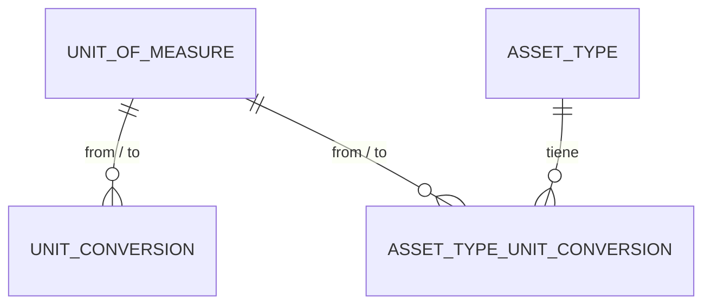

# Dominio · Unidades de medida y conversión (A11)

- **Origen:** A11 (P11), regla UR1
- **Esquema:** `uom` (referencia) · **Servicio:** `nexus-catalog`
- **Pasos:** 1.2 (catálogo y conversión universal), 1.3 (conversión específica por `AssetType` y función de conversión)

## §1 Principio

Dos niveles de conversión:

| Nivel | Tabla | Alcance |
|---|---|---|
| Universal | `uom.unit_conversion` | Conversión física fija dentro de la misma dimensión (M↔CM, KG↔T, L↔M3) |
| Específico de material | `catalog.asset_type_unit_conversion` (`catalog.md`) | Depende del empaquetado de un `AssetType` (1 palé = 1,44 m²). Puede cruzar dimensiones |

**UR1:** `StockMovement.qty` se guarda siempre en `AssetType.stock_uom_id`. La conversión ocurre en el borde (al pasar de una línea de oferta, pedido o Job al ledger), nunca dentro del ledger.

**P11:** si `stock_uom_id` es `NULL`, el tipo se trata como **unidad única implícita** (igual que EasyJob hoy) y no se aplica ninguna conversión. Igual para `sales_uom_id`, `AssetTypeBOM.uom_id` y `QuoteLine.uom_id`.

## §2 Modelo



## §3 DDL (paso 1.2)

```sql
CREATE SCHEMA uom;

-- GLOBAL
CREATE TABLE uom.unit_of_measure (
  id           uuid PRIMARY KEY,
  code         text NOT NULL UNIQUE,                 -- 'PCS', 'M', 'M2', 'KG'…
  caption_i18n jsonb NOT NULL,
  symbol       text NOT NULL,                        -- [+] 'Stk', 'm', 'm²', 'kg'
  dimension    text NOT NULL CHECK (dimension IN ('LENGTH','AREA','VOLUME','WEIGHT','COUNT','TIME')),
  decimals     smallint NOT NULL DEFAULT 0 CHECK (decimals BETWEEN 0 AND 4),   -- [+] precisión de captura y redondeo
  is_system_defined boolean NOT NULL DEFAULT false,  -- [+] sembradas: no editables
  is_active    boolean NOT NULL DEFAULT true
  -- + std
);

-- GLOBAL. Se guarda una sola dirección por par; la inversa se calcula (UOM-R3)
CREATE TABLE uom.unit_conversion (
  id                uuid PRIMARY KEY,                -- [+]
  from_unit_id      uuid NOT NULL REFERENCES uom.unit_of_measure(id),
  to_unit_id        uuid NOT NULL REFERENCES uom.unit_of_measure(id),
  factor            numeric(28,12) NOT NULL CHECK (factor > 0),   -- 1 from = factor × to
  is_system_defined boolean NOT NULL DEFAULT false,
  -- + std
  CHECK (from_unit_id <> to_unit_id)
);
CREATE UNIQUE INDEX uq_uc_pair ON uom.unit_conversion (least(from_unit_id, to_unit_id), greatest(from_unit_id, to_unit_id));
```

`catalog.asset_type_unit_conversion` y las columnas `stock_uom_id`/`sales_uom_id` de `AssetType` están en `catalog.md §3` (paso 1.3).

### Función de conversión (paso 1.3, `R__catalog__convert_quantity.sql`)

Una sola implementación, en SQL, en un esquema de referencia: cualquier servicio la llama dentro de su transacción (operations, commercial, field). Evita reimplementar la conversión en cada servicio `[+]`.

```sql
-- Devuelve p_qty expresado en p_to_uom, redondeado a uom.decimals de destino (half-up).
-- Orden de búsqueda: misma unidad → asset_type_unit_conversion (directa o inversa)
--                   → unit_conversion (directa o inversa, misma dimensión).
-- Sin camino → RAISE 'UOM-R6' (ERRCODE 'P0002').
-- P11: si p_from_uom y p_to_uom son ambos NULL → devuelve p_qty sin tocar.
--      Si solo uno es NULL → RAISE 'UOM-R5'.
CREATE OR REPLACE FUNCTION catalog.convert_quantity(
  p_asset_type_id uuid, p_qty numeric, p_from_uom uuid, p_to_uom uuid)
RETURNS numeric(18,4)
LANGUAGE plpgsql STABLE SECURITY INVOKER SET search_path = catalog, uom, pg_temp AS $$ … $$;

-- Atajo: convierte a la unidad de stock del tipo. Uso típico en el borde (UR1).
CREATE OR REPLACE FUNCTION catalog.to_stock_uom(p_asset_type_id uuid, p_qty numeric, p_from_uom uuid)
RETURNS numeric(18,4) …;
```

`EXECUTE` a todos los `svc_*`. Los errores se traducen en .NET a 422 con el código de regla.

## §4 Reglas

| Id | Regla | Origen |
|---|---|---|
| UOM-R1 | Una `unit_conversion` solo une unidades de la **misma** `dimension` | A11 |
| UOM-R2 | `factor > 0` | [+] |
| UOM-R3 | Un par de unidades tiene como máximo una conversión universal, en cualquier dirección. La inversa es `1 / factor` | [+] |
| UOM-R4 | Las unidades y conversiones con `is_system_defined = true` no se editan ni desactivan | [+] |
| UOM-R5 | **P11:** si el `AssetType` no tiene `stock_uom_id`, las unidades de líneas de oferta, BOM, pedido o Job deben ser `NULL`; y viceversa, un tipo con `stock_uom_id` exige unidad en esas líneas (por defecto, `sales_uom_id` o `stock_uom_id`) | P11 |
| UOM-R6 | Si no hay camino de conversión, la operación falla (422). No se asume factor 1 | A11 |
| UOM-R7 | Una unidad referenciada por algún `AssetType` no se desactiva | [+] |
| UOM-R8 | No se encadenan conversiones (A→B→C). Solo directa o inversa en cada nivel. Si hace falta A→C, se da de alta | [+] |
| UOM-R9 | El resultado se redondea a `decimals` de la unidad destino, *half-up*, y se guarda en `numeric(18,4)` | [+] |

## §5 Estados

No aplica (solo `is_active`).

## §6 API (`catalog.yaml`)

| Método y ruta | Permiso |
|---|---|
| `GET /v1/units-of-measure?dimension=&isActive=` · `GET /v1/units-of-measure/{id}` | `UOM:READ` |
| `POST /v1/units-of-measure` · `PUT /{id}` · `POST /{id}/deactivate` | `UOM:CREATE/UPDATE` |
| `GET /v1/unit-conversions` · `POST` · `PUT /{id}` | `UOM:READ/CREATE/UPDATE` |
| `POST /v1/units-of-measure/convert` | `UOM:READ` |

`convert` (utilidad para la UI): cuerpo `{assetTypeId?, value, fromUomId, toUomId}` → `{value, path: "ASSET_TYPE"|"UNIVERSAL"|"IDENTITY"|"IMPLICIT"}`.

## §7 Eventos

Contexto `catalog`.

| Topic | Cuándo |
|---|---|
| `nexus.catalog.uom.created` / `.updated` / `.deactivated` | Estado completo |
| `nexus.catalog.uom-conversion.created` / `.updated` | Estado completo |

## §8 Pantallas (`features/catalog/uom`)

| Pantalla | Contenido |
|---|---|
| Unidades | Lista agrupada por dimensión; detalle con símbolo, decimales y textos |
| Conversiones universales | Lista "1 `from` = `factor` `to`" con la inversa calculada a la vista; alta con selector filtrado a la misma dimensión |
| Calculadora | Pequeño diálogo (`convert`) accesible desde la lista, útil para verificar |

`nx-quantity` (componente compartido, 1.2): muestra y edita `{value, uomId}` con el símbolo de la unidad y los decimales correctos.

## §9 Abiertos ⚑

Ninguno propio. P11 cierra el comportamiento legado.

### Semilla común (sistema)

| Código | Dimensión | Símbolo | Decimales |
|---|---|---|---|
| `PCS` | COUNT | Stk | 0 |
| `SET` | COUNT | Set | 0 |
| `MM`, `CM`, `M` | LENGTH | mm, cm, m | 0, 1, 2 |
| `M2` | AREA | m² | 2 |
| `L`, `M3` | VOLUME | l, m³ | 1, 3 |
| `KG`, `T` | WEIGHT | kg, t | 1, 3 |
| `H`, `DAY` | TIME | h, Tag | 2, 0 |

Conversiones de sistema: `M→CM 100`, `M→MM 1000`, `CM→MM 10`, `M3→L 1000`, `T→KG 1000`, `DAY→H 24`. `PCS↔SET` **no** tiene conversión universal (depende del material).
