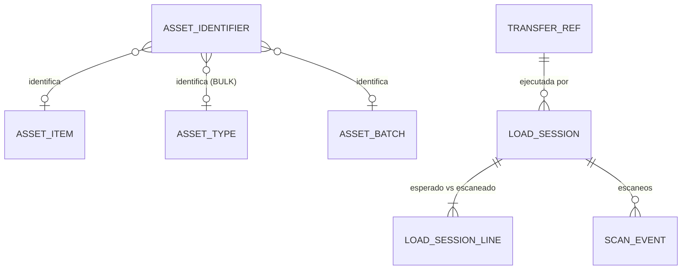
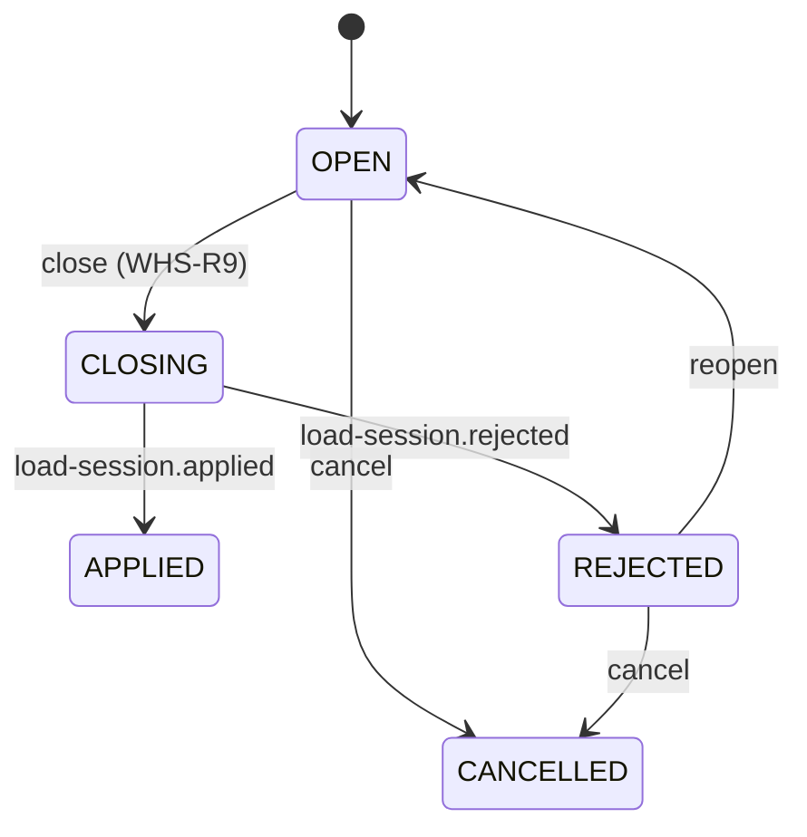

# Dominio · Operaciones de almacén: identificadores, sesiones de carga y escaneo (§10)

- **Origen:** Manual §10 (`AssetIdentifier`, `LoadSession`, `ScanEvent`), A1 (las sesiones ejecutan transferencias), A3 (captura edge), S6 (ledger antes que transversales)
- **Esquema:** `warehouse` (transaccional) · **Servicio:** `nexus-field` (comparte servicio con `commissioning` y `field`)
- **Pasos:** 6.1 (backend y web), 6.4–6.5 (uso desde la app móvil)

## §1 Principio

`AssetIdentifier` **unifica** QR, RFID y código de barras en una sola abstracción: el material se identifica igual venga del lector que venga. Una `LoadSession` agrupa los escaneos de una carga o descarga contra una **transferencia** (A1). `ScanEvent` es **append-only**: un escaneo erróneo se anula con otro escaneo (`action = REMOVE`), no se borra.

`nexus-field` no escribe en el ledger. Al cerrar una sesión publica un evento y `nexus-operations` ejecuta `ship`/`receive` de la transferencia (`source_type = LOAD_SESSION` en `stock_movement`), y devuelve un acuse. Así el ledger tiene un único escritor (STK-R6).

Una sesión puede ser en almacén o en obra (`site_kind`). En almacén recoge `warehouse.scan_event`; en obra recoge `field.field_scan_event` de tipo `UNLOAD_AT_SITE` / `LOAD_FOR_RETURN` (`field.md`). El cierre es el mismo.

## §2 Modelo



## §3 DDL (paso 6.1)

```sql
CREATE SCHEMA warehouse;
CREATE TABLE warehouse.number_sequence (scope_key text PRIMARY KEY, next_value bigint NOT NULL DEFAULT 1);

-- GLOBAL [+]: resolver un identificador no revela nada; el material sigue protegido por RLS donde se mueve
CREATE TABLE warehouse.asset_identifier (
  id               uuid PRIMARY KEY,
  identifier_type  text NOT NULL CHECK (identifier_type IN ('QR','RFID_EPC','BARCODE')),
  value            text NOT NULL,                    -- normalizado (WHS-R1)
  target_type      text NOT NULL CHECK (target_type IN ('ASSET_ITEM','ASSET_TYPE','ASSET_BATCH')),
  asset_item_id    uuid NULL REFERENCES catalog.asset_item(id),
  asset_type_id    uuid NOT NULL REFERENCES catalog.asset_type(id),
  batch_id         uuid NULL REFERENCES catalog.asset_batch(id),
  units_per_scan   numeric(18,4) NOT NULL DEFAULT 1 CHECK (units_per_scan > 0),   -- [+] etiqueta de caja BULK
  status           text NOT NULL DEFAULT 'ACTIVE' CHECK (status IN ('ACTIVE','RETIRED')),
  assigned_at      timestamptz NOT NULL,
  retired_at       timestamptz NULL,
  -- + std
  CHECK ((target_type = 'ASSET_ITEM') = (asset_item_id IS NOT NULL)),
  CHECK ((target_type = 'ASSET_BATCH') = (batch_id IS NOT NULL)),
  CHECK (target_type <> 'ASSET_ITEM' OR units_per_scan = 1),
  CHECK ((status = 'RETIRED') = (retired_at IS NOT NULL))
);
CREATE UNIQUE INDEX uq_ai_active ON warehouse.asset_identifier(identifier_type, value) WHERE status = 'ACTIVE';
CREATE INDEX ix_ai_item ON warehouse.asset_identifier(asset_item_id);

-- [+] Réplica de transferencias (ARC-R3), desde nexus.logistics.transfer.*. RLS especial from/to LE + PRJ
CREATE TABLE warehouse.transfer_ref (
  id                   uuid PRIMARY KEY,
  transfer_no          text NOT NULL,
  transfer_type        text NOT NULL,
  status               text NOT NULL,
  from_location_id     uuid NOT NULL,
  to_location_id       uuid NOT NULL,
  from_legal_entity_id uuid NOT NULL,
  to_legal_entity_id   uuid NOT NULL,
  from_warehouse_id    uuid NULL,
  to_warehouse_id      uuid NULL,
  project_id           uuid NULL,
  job_id               uuid NULL,
  delivery_part_id     uuid NULL,
  planned_ship_at      timestamptz NOT NULL,
  planned_receive_at   timestamptz NOT NULL,
  lines                jsonb NOT NULL,     -- [{id, lineNo, assetTypeId, assetItemId, batchId, ownerLegalEntityId, qtyPlanned, qtyShipped, qtyReceived}]
  aggregate_version    bigint NOT NULL,
  updated_at           timestamptz NOT NULL
);

-- RLS: LE+WH+PRJ
CREATE TABLE warehouse.load_session (
  id                uuid PRIMARY KEY,                  -- generado por el cliente (móvil) o el servidor
  session_no        text NOT NULL UNIQUE,              -- 'LS-<WH|PRJ>-<YYYYMMDD>-<NNNN>'
  session_type      text NOT NULL CHECK (session_type IN ('LOAD','UNLOAD')),   -- LOAD → ship; UNLOAD → receive
  site_kind         text NOT NULL CHECK (site_kind IN ('WAREHOUSE','PROJECT_SITE')),
  warehouse_id      uuid NULL REFERENCES org.warehouse(id),
  project_id        uuid NULL,
  transfer_id       uuid NOT NULL,                     -- transfer_ref.id
  legal_entity_id   uuid NOT NULL REFERENCES org.legal_entity(id),   -- custodio del lugar
  status            text NOT NULL DEFAULT 'OPEN'
                    CHECK (status IN ('OPEN','CLOSING','APPLIED','REJECTED','CANCELLED')),
  opened_by         uuid NOT NULL,
  opened_at         timestamptz NOT NULL,
  closed_by         uuid NULL,
  closed_at         timestamptz NULL,
  close_event_id    uuid NULL UNIQUE,                  -- event_id de load-session.closed
  rejection_code    text NULL,                         -- regla devuelta por operations (p. ej. 'STK-R5')
  rejection_detail  text NULL,
  device_id         uuid NULL,
  -- + std
  CHECK ((site_kind = 'WAREHOUSE') = (warehouse_id IS NOT NULL)),
  CHECK ((site_kind = 'PROJECT_SITE') = (project_id IS NOT NULL)),
  CHECK ((status = 'REJECTED') = (rejection_code IS NOT NULL))
);
-- Una sesión abierta por transferencia y tipo
CREATE UNIQUE INDEX uq_ls_open ON warehouse.load_session(transfer_id, session_type) WHERE status IN ('OPEN','CLOSING');

-- RLS: LE+WH+PRJ. Esperado (de la transferencia) vs escaneado (calculado)
CREATE TABLE warehouse.load_session_line (
  id                uuid PRIMARY KEY,
  load_session_id   uuid NOT NULL REFERENCES warehouse.load_session(id),
  transfer_line_id  uuid NOT NULL,
  asset_type_id     uuid NOT NULL REFERENCES catalog.asset_type(id),
  asset_item_id     uuid NULL REFERENCES catalog.asset_item(id),
  batch_id          uuid NULL REFERENCES catalog.asset_batch(id),
  expected_qty      numeric(18,4) NOT NULL CHECK (expected_qty >= 0),
  scanned_qty       numeric(18,4) NOT NULL DEFAULT 0,   -- Σ ADD − Σ REMOVE aceptados (WHS-R6)
  legal_entity_id   uuid NOT NULL,
  warehouse_id      uuid NULL,
  project_id        uuid NULL,
  -- + std
  UNIQUE (load_session_id, transfer_line_id)
);

-- Append-only. RLS: LE+WH
CREATE TABLE warehouse.scan_event (
  id                   uuid PRIMARY KEY,               -- UUIDv7 del dispositivo (idempotencia, A3)
  load_session_id      uuid NULL REFERENCES warehouse.load_session(id),   -- NULL = escaneo de consulta
  action               text NOT NULL DEFAULT 'ADD' CHECK (action IN ('ADD','REMOVE','LOOKUP')),
  identifier_type      text NOT NULL CHECK (identifier_type IN ('QR','RFID_EPC','BARCODE','MANUAL')),
  raw_value            text NOT NULL,
  asset_identifier_id  uuid NULL REFERENCES warehouse.asset_identifier(id),
  asset_type_id        uuid NULL REFERENCES catalog.asset_type(id),
  asset_item_id        uuid NULL REFERENCES catalog.asset_item(id),
  batch_id             uuid NULL REFERENCES catalog.asset_batch(id),
  qty                  numeric(18,4) NOT NULL CHECK (qty > 0),
  result               text NOT NULL CHECK (result IN
                         ('ACCEPTED','UNKNOWN_IDENTIFIER','NOT_EXPECTED','DUPLICATE','OVER_QTY','SESSION_CLOSED')),
  scanned_at           timestamptz NOT NULL,           -- reloj del dispositivo
  received_at          timestamptz NOT NULL,           -- reloj del servidor
  source               text NOT NULL CHECK (source IN ('WEB','MOBILE','FIXED_READER')),
  device_id            uuid NULL,
  user_id              uuid NOT NULL,
  legal_entity_id      uuid NOT NULL,
  warehouse_id         uuid NOT NULL
  -- + std-append
);
CREATE INDEX ix_se_session ON warehouse.scan_event(load_session_id, received_at);
CREATE INDEX ix_se_item ON warehouse.scan_event(asset_item_id) WHERE asset_item_id IS NOT NULL;
```

## §4 Reglas

| Id | Regla | Origen |
|---|---|---|
| WHS-R1 | Normalización de `value`: QR y BARCODE sin espacios ni caracteres de control; `RFID_EPC` en hexadecimal mayúsculas sin separadores. La resolución compara el valor normalizado | [+] |
| WHS-R2 | Un identificador `ACTIVE` es único por `(identifier_type, value)`. Reasignar = retirar el anterior y crear otro | §10, [+] |
| WHS-R3 | `target_type` coherente con `tracking_mode`: `SERIALIZED` → `ASSET_ITEM`; `BATCH` → `ASSET_BATCH`; `BULK` → `ASSET_TYPE` (con `units_per_scan`) | §5, §10 |
| WHS-R4 | Una sesión se abre solo para una transferencia de la réplica en estado `CONFIRMED` (`LOAD`, en el origen) o `IN_TRANSIT` (`UNLOAD`, en el destino), y el usuario tiene `LOAD_SESSION:CREATE` en ese almacén o proyecto | A1 |
| WHS-R5 | Al abrir, se crean las `load_session_line` desde las líneas de la transferencia: `expected_qty = qty_planned − qty_shipped` (`LOAD`) o `qty_shipped − qty_received − qty_lost` (`UNLOAD`) | [+] |
| WHS-R6 | Resultado de un escaneo `ADD`: identificador desconocido → `UNKNOWN_IDENTIFIER`; tipo/ítem/lote que no está en las líneas → `NOT_EXPECTED`; ítem serializado ya aceptado en la sesión → `DUPLICATE`; supera `expected_qty` → `OVER_QTY`. Solo `ACCEPTED` suma a `scanned_qty` (`qty × units_per_scan`) | §10, [+] |
| WHS-R7 | `REMOVE` resta un `ACCEPTED` previo del mismo ítem o tipo en la sesión; nunca deja `scanned_qty < 0` | [+] |
| WHS-R8 | Idempotencia: un `scan_event.id` ya registrado devuelve el resultado guardado sin volver a procesar (conventions-api §5) | A3 |
| WHS-R9 | **Cierre:** `OPEN → CLOSING` y publica `warehouse.load-session.closed` con, por línea, `transferLineId`, `qty` (= `scanned_qty`) y, para serializados, `assetItemIds[]`. Líneas con `scanned_qty = 0` se omiten. Cerrar sin ningún escaneo aceptado → 422 `WHS-R9` | A1 |
| WHS-R10 | Al consumir `logistics.load-session.applied` → `APPLIED`. Al consumir `.rejected` → `REJECTED` con `rejection_code`; el usuario puede **reabrir** (`REJECTED → OPEN`) y corregir con `REMOVE`/`ADD` | [+] |
| WHS-R11 | Escaneos sobre una sesión que ya no está `OPEN` se registran con `SESSION_CLOSED` (no se pierden: llegan tarde del móvil) | A3 |
| WHS-R12 | `scanned_at` de un dispositivo más de 72 h en el pasado o 5 min en el futuro respecto a `received_at` se acepta pero se marca para revisión (métrica) ⚑ | [+] |

### Contrato con operations (paso 6.1, lado operations)

| Evento | Quién | Efecto |
|---|---|---|
| `nexus.warehouse.load-session.closed` | field → operations (`operations.apply-load-session`, actúa como `closedBy`) | `LOAD` → `ship` de la transferencia con esas cantidades e ítems; `UNLOAD` → `receive`. `source_type = LOAD_SESSION`, `source_id = load_session_id`. Idempotente por `close_event_id` |
| `nexus.logistics.load-session.applied` | operations → field | `APPLIED` |
| `nexus.logistics.load-session.rejected` | operations → field | `REJECTED` + código de regla (`STK-R5`, `LOG-R3`…) y detalle |

## §5 Estados



## §6 API (`field.yaml`)

| Método y ruta | Permiso |
|---|---|
| `GET /v1/identifiers?assetTypeId=&assetItemId=&type=&status=` | `ASSET_IDENTIFIER:READ` |
| `POST /v1/identifiers` · `POST /v1/identifiers/bulk` (lista `{type, value, target}`) · `POST /v1/identifiers/{id}/retire` | `ASSET_IDENTIFIER:CREATE/UPDATE` |
| `GET /v1/identifiers/resolve?type=&value=` → tipo, ítem, lote, `trackingMode` | `ASSET_IDENTIFIER:READ` |
| `POST /v1/identifiers/generate-qr` (cuerpo: ítems o tipos) → crea identificadores QR `NX:<uuid>` y devuelve PDF de etiquetas ⚑ WHS-Q2 | `ASSET_IDENTIFIER:CREATE` |
| `GET /v1/load-sessions?status=&warehouseId=&projectId=&transferId=` | `LOAD_SESSION:READ` |
| `POST /v1/load-sessions` (cuerpo: `id?`, `transferId`, `sessionType`) | `LOAD_SESSION:CREATE` |
| `GET /v1/load-sessions/{id}` (cabecera + líneas + últimos escaneos) | `LOAD_SESSION:READ` |
| `POST /v1/load-sessions/{id}/scans` (uno o lote, con `id` de cliente) → resultado por escaneo | `LOAD_SESSION:UPDATE` |
| `POST /v1/load-sessions/{id}/close` · `/reopen` · `/cancel` | `LOAD_SESSION:UPDATE` |
| `GET /v1/transfers-to-handle?warehouseId=&projectId=&sessionType=` (de la réplica: lo que hay que cargar/descargar hoy) | `LOAD_SESSION:READ` |

## §7 Eventos

| Topic | Payload | Consumidores |
|---|---|---|
| `nexus.warehouse.load-session.closed` | sesión, transferencia, líneas con cantidades e ítems | operations |
| `nexus.warehouse.identifier.changed` | estado completo | proyecciones; app móvil vía sync (no por Kafka) |
| `nexus.warehouse.scan.recorded` `[+]` | escaneo (sin usuario en claro: `userId` es un id) | proyecciones (productividad) |

**Consumidos:** `nexus.logistics.transfer.*` → `transfer_ref` (`field.transfer-replica`); `nexus.logistics.load-session.applied/.rejected` (`field.load-session-ack`).

## §8 Pantallas (`features/warehouse`)

| Pantalla | Contenido |
|---|---|
| Identificadores: búsqueda por valor; pestaña "Identificadores" en el detalle de ítem/tipo/lote; alta masiva; generación de etiquetas QR | |
| Por cargar / por descargar hoy (por almacén) | |
| Sesión de carga (web): esperado vs escaneado por línea con colores, campo de escaneo con foco (lector de teclado USB), lista de escaneos con resultado, cerrar, estado del acuse | |

## §9 Abiertos ⚑

- **WHS-Q1:** codificación EPC de las etiquetas RFID (SGTIN-96, o un EPC propio con el UUID). Depende del proveedor de etiquetas y del parque actual en EasyJob (RFID/STEX).
- **WHS-Q2:** impresión de etiquetas: PDF A4 en v1; impresoras térmicas (ZPL) en paso posterior.
- **WHS-Q3:** lectores fijos (portales RFID) vía Azure Arc (ADR-0011 Q3): fuera de v1; `source = FIXED_READER` queda reservado.
