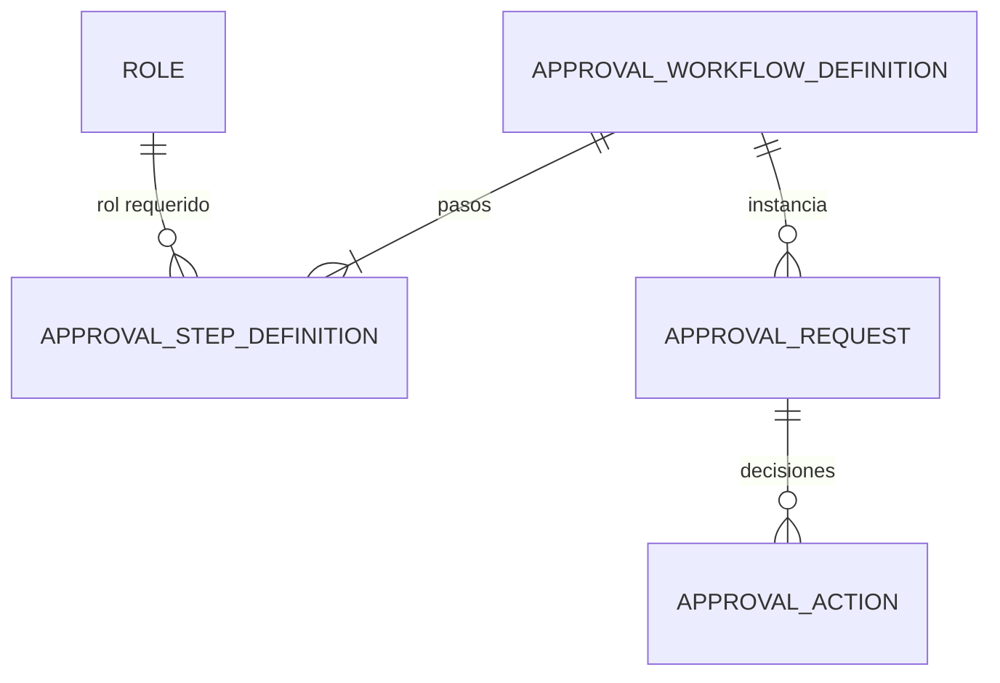
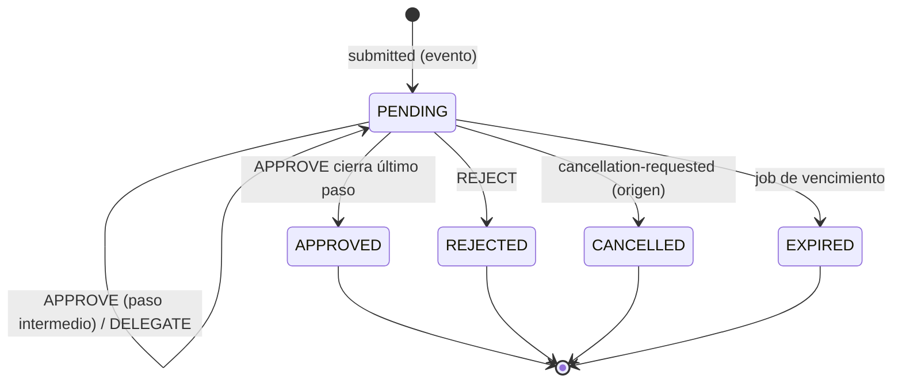

# Dominio · Workflow de aprobaciones

- **Origen:** A8 (P8), A4 (`ContractAmendment`), A5 (`ProjectBudget`), A9 (`requires_approval`), A12 (borrado DSAR)
- **Esquema:** `workflow` (transaccional) · **Servicio:** `nexus-platform`
- **Pasos:** 0.9 (motor completo). Los consumidores por tipo de recurso se añaden en el paso de cada recurso (3.2, 5.2, 5.6, 0.10, 7.1)

## §1 Principio

Un motor **genérico y reutilizable**: ningún recurso implementa su propia lógica de aprobación. Una plantilla (`ApprovalWorkflowDefinition`) define pasos secuenciales; cada paso exige un rol (A6). Una solicitud (`ApprovalRequest`) es la instancia sobre un recurso concreto. Cada decisión es una `ApprovalAction` **append-only**.

El recurso de origen nunca llama al motor de forma síncrona `[+]`:
1. **Alta:** el servicio de origen inserta en su Outbox un evento `nexus.platform.approval-request.submitted` (misma transacción que su cambio de estado a `PENDING_APPROVAL`). `nexus-platform` lo consume y crea la solicitud.
2. **Cierre:** el motor publica `nexus.platform.approval.approved` / `.rejected` / `.expired` / `.cancelled`. El servicio de origen escucha su propio `resource_type` y cambia el estado de su recurso.

Así no hay escritura síncrona entre servicios (`architecture.md §4`) y el alta es atómica con el cambio de estado del recurso.

## §2 Modelo



## §3 DDL (paso 0.9)

```sql
CREATE SCHEMA workflow;

-- Plantilla. GLOBAL (sin RLS): es configuración del grupo.
CREATE TABLE workflow.approval_workflow_definition (
  id            uuid PRIMARY KEY,
  resource_type text NOT NULL CHECK (resource_type ~ '^[A-Z_]{3,40}$'),
  name          text NOT NULL,
  description   text NULL,                                          -- [+]
  is_active     boolean NOT NULL DEFAULT true
  -- + std
);
-- [+] una sola plantilla activa por tipo de recurso
CREATE UNIQUE INDEX uq_awd_active ON workflow.approval_workflow_definition(resource_type) WHERE is_active;

CREATE TABLE workflow.approval_step_definition (
  id                     uuid PRIMARY KEY,
  workflow_definition_id uuid NOT NULL REFERENCES workflow.approval_workflow_definition(id),
  step_order             integer NOT NULL CHECK (step_order >= 1),
  required_role_id       uuid NOT NULL,          -- id de access.role (sin FK: access no es esquema de referencia, mismo servicio)
  approval_type          text NOT NULL CHECK (approval_type IN ('SINGLE','QUORUM')),
  quorum_count           integer NULL CHECK (quorum_count >= 2),          -- P8
  -- + std
  UNIQUE (workflow_definition_id, step_order),
  CONSTRAINT ck_quorum CHECK ((approval_type = 'QUORUM') = (quorum_count IS NOT NULL))   -- P8
);
CREATE INDEX ix_asd_wd ON workflow.approval_step_definition(workflow_definition_id);

-- Instancia. RLS: LE+PRJ
CREATE TABLE workflow.approval_request (
  id                     uuid PRIMARY KEY,
  resource_type          text NOT NULL,
  resource_id            uuid NOT NULL,                        -- polimórfico, sin FK
  resource_label         text NOT NULL,                        -- [+] texto para la bandeja ("Presupuesto P-CH-2026-0042 v3")
  workflow_definition_id uuid NOT NULL REFERENCES workflow.approval_workflow_definition(id),
  status                 text NOT NULL DEFAULT 'PENDING'
                         CHECK (status IN ('PENDING','APPROVED','REJECTED','CANCELLED','EXPIRED')),
  requested_by           uuid NOT NULL,                        -- org.app_user.id
  requested_at           timestamptz NOT NULL,
  current_step_order     integer NOT NULL DEFAULT 1,
  expires_at             timestamptz NULL,                     -- P8: lo fija quien solicita, nunca la plantilla
  legal_entity_id        uuid NOT NULL REFERENCES org.legal_entity(id),   -- [+] alcance para RLS y aprobadores
  business_unit_id       uuid NULL REFERENCES org.business_unit(id),      -- [+]
  warehouse_id           uuid NULL REFERENCES org.warehouse(id),          -- [+]
  project_id             uuid NULL,                                       -- [+] sin FK (esquema transaccional)
  submission_event_id    uuid NOT NULL UNIQUE,                 -- [+] idempotencia del alta (event_id del submitted)
  closed_at              timestamptz NULL,                     -- [+]
  -- + std
  CHECK ((status = 'PENDING') = (closed_at IS NULL))
);
-- [+] como mucho una solicitud viva por recurso
CREATE UNIQUE INDEX uq_ar_pending ON workflow.approval_request(resource_type, resource_id) WHERE status = 'PENDING';
CREATE INDEX ix_ar_status_expires ON workflow.approval_request(status, expires_at) WHERE status = 'PENDING';
CREATE INDEX ix_ar_le ON workflow.approval_request(legal_entity_id);

-- Decisiones. Append-only. RLS: LE (desnormalizado de la solicitud)
CREATE TABLE workflow.approval_action (
  id                   uuid PRIMARY KEY,
  approval_request_id  uuid NOT NULL REFERENCES workflow.approval_request(id),
  step_order           integer NOT NULL,
  actor_user_id        uuid NOT NULL,
  decision             text NOT NULL CHECK (decision IN ('APPROVE','REJECT','DELEGATE')),
  delegated_to_user_id uuid NULL,                              -- P8
  comment              text NULL,
  decided_at           timestamptz NOT NULL,
  legal_entity_id      uuid NOT NULL,                          -- [+] copia de la solicitud, para RLS
  -- + std-append
  CONSTRAINT ck_delegate CHECK ((decision = 'DELEGATE') = (delegated_to_user_id IS NOT NULL)),  -- P8
  CONSTRAINT ck_reject_comment CHECK (decision <> 'REJECT' OR length(trim(comment)) > 0)       -- [+]
);
CREATE INDEX ix_aa_request ON workflow.approval_action(approval_request_id, step_order);
```

Políticas RLS (`R__workflow__rls.sql`): `approval_request` perfil `LE+PRJ`; `approval_action` perfil `LE`. Append-only en `approval_action` (`conventions-database.md §6`).

**Función de aprobadores elegibles** `[+]` (`R__workflow__eligible_approvers.sql`, `STABLE SECURITY DEFINER`, solo `svc_platform`):

```sql
-- Usuarios que pueden decidir el paso actual de una solicitud:
--   (a) tienen el rol requerido vigente con un alcance que cubre la solicitud, o
--   (b) son delegados vigentes de ese paso (DELEGATE en el mismo step_order),
-- menos el solicitante (WF-R6) y menos quien ya decidió en este paso (WF-R4).
CREATE OR REPLACE FUNCTION workflow.eligible_approvers(p_request_id uuid)
RETURNS TABLE (user_id uuid, via text)   -- via: 'ROLE' | 'DELEGATION'
...
```

El cálculo de "alcance que cubre" usa la misma lógica que `access.has_permission` (GLOBAL; GROUP del LE; LE; BU; WAREHOUSE; PROJECT). La implementación reutiliza `access.active_assignments()` parametrizada por usuario: se añade `access.assignments_of(p_user_id uuid)` con el mismo cuerpo, también `SECURITY DEFINER`, solo ejecutable por `svc_platform` `[+]`.

## §4 Reglas

| Id | Regla | Origen |
|---|---|---|
| WF-R1 | `quorum_count` es obligatorio si y solo si `approval_type = QUORUM` | P8 |
| WF-R2 | `SINGLE`: una `APPROVE` válida cierra el paso. `QUORUM`: el paso se cierra cuando hay `quorum_count` `APPROVE` de actores distintos | A8 |
| WF-R3 | Una `REJECT` válida en cualquier paso pasa la solicitud a `REJECTED` (cierra) | [+] |
| WF-R4 | Un mismo usuario decide como máximo una vez por paso | [+] |
| WF-R5 | Solo decide un usuario devuelto por `eligible_approvers` para el paso actual. Si no, 403 `forbidden` | A8, A6 |
| WF-R6 | El solicitante no puede aprobar su propia solicitud (segregación de funciones) | [+] ⚑ confirmar |
| WF-R7 | `DELEGATE`: no avanza `current_step_order`; el delegado pasa a ser elegible en ese paso; el delegante deja de serlo. El delegado no puede volver a delegar en el mismo paso | P8 |
| WF-R8 | Cerrado el último paso con aprobación → `APPROVED`. Si no, `current_step_order + 1` | A8 |
| WF-R9 | `expires_at` es `NULL` salvo que lo pida el servicio de origen. Un job pasa a `EXPIRED` las solicitudes vencidas. **Nunca auto-aprueba ni auto-rechaza** | P8 |
| WF-R10 | Una solicitud cerrada (`APPROVED`, `REJECTED`, `CANCELLED`, `EXPIRED`) no admite más acciones | A8 |
| WF-R11 | Una plantilla con solicitudes (vivas o cerradas) no cambia sus pasos: se desactiva y se crea otra. Las solicitudes vivas siguen con la plantilla con la que nacieron | [+] |
| WF-R12 | Alta idempotente: un `submitted` con un `event_id` ya procesado no crea otra solicitud. Si ya hay una `PENDING` para el recurso, el alta se rechaza con `nexus.platform.approval.rejected` y `reasonCode = ALREADY_PENDING` | [+] |
| WF-R13 | Si no hay plantilla activa para el `resource_type`, el alta se rechaza con `reasonCode = NO_ACTIVE_WORKFLOW`. El recurso de origen vuelve a su estado previo | [+] ⚑ |
| WF-R14 | Solo el servicio de origen cancela: publica `nexus.platform.approval-request.cancellation-requested`. El motor pasa la solicitud a `CANCELLED` | [+] |
| WF-R15 | `ContractAmendment.approved_by` no existe: el aprobador se deriva de la última `APPROVE` de la solicitud | A4/A8 |

## §5 Estados



Un recurso con solicitud `EXPIRED` sigue en su estado `PENDING_APPROVAL`. El responsable decide manualmente: volver a enviar (nueva solicitud) o retirar (`cancellation-requested`). La pantalla de la bandeja lo señala.

## §6 API (`platform.yaml`)

| Método y ruta | Permiso | Notas |
|---|---|---|
| `GET /v1/approval-definitions` · `GET /v1/approval-definitions/{id}` | `APPROVAL_DEFINITION:READ` | Con sus pasos |
| `POST /v1/approval-definitions` | `APPROVAL_DEFINITION:CREATE` | Alta con pasos. Desactiva la anterior activa del mismo tipo en la misma transacción |
| `POST /v1/approval-definitions/{id}/deactivate` | `APPROVAL_DEFINITION:UPDATE` | |
| `GET /v1/approval-requests?status=&resourceType=&mine=assigned\|requested&page=` | `APPROVAL_REQUEST:READ` | `mine=assigned` = donde soy elegible ahora |
| `GET /v1/approval-requests/{id}` | `APPROVAL_REQUEST:READ` | Incluye acciones, paso actual y elegibles |
| `GET /v1/approval-requests/by-resource/{resourceType}/{resourceId}` | `APPROVAL_REQUEST:READ` | Para `nx-approval-panel`: la viva o la última |
| `POST /v1/approval-requests/{id}/approve` · `/reject` · `/delegate` | `APPROVAL_REQUEST:APPROVE` + WF-R5 | Cuerpo: `comment`; `delegateToUserId` en delegate. `If-Match` |

No hay endpoint para crear solicitudes: el alta es solo por evento (§1).

## §7 Eventos

**Consumidos** (por `nexus-platform`, consumidor `platform.approval-intake`, actúa como el `requestedBy` del evento):

| Topic | Payload |
|---|---|
| `nexus.platform.approval-request.submitted` | `resourceType`, `resourceId`, `resourceLabel`, `legalEntityId`, `businessUnitId?`, `warehouseId?`, `projectId?`, `requestedBy`, `expiresAt?` |
| `nexus.platform.approval-request.cancellation-requested` | `resourceType`, `resourceId`, `reason` |

Los publica cualquier servicio a través de `IApprovalClient` de `BuildingBlocks.Application` (escribe en el Outbox del servicio de origen) `[+]`.

**Publicados:**

| Topic | Cuándo | Payload |
|---|---|---|
| `nexus.platform.approval.requested` | Solicitud creada | `approvalRequestId`, `resourceType`, `resourceId`, `legalEntityId`, `currentStepOrder` |
| `nexus.platform.approval.step-advanced` `[+]` | Paso cerrado sin ser el último | + `stepOrder` |
| `nexus.platform.approval.approved` | `APPROVED` | + `approvedBy` (último aprobador), `decidedAt` |
| `nexus.platform.approval.rejected` | `REJECTED`, o alta rechazada (WF-R12, WF-R13) | + `rejectedBy?`, `comment?`, `reasonCode` (`REJECTED_BY_APPROVER`, `ALREADY_PENDING`, `NO_ACTIVE_WORKFLOW`) |
| `nexus.platform.approval.expired` | Job de vencimiento | + `expiredAt` |
| `nexus.platform.approval.cancelled` | `CANCELLED` | + `reason` |

Todos llevan `resourceType` y `resourceId` en el payload. Los consumidores de origen filtran por `resourceType`.

## §8 Pantallas (`features/workflow` y `shared/platform`)

| Pantalla | Contenido |
|---|---|
| Bandeja "Mis aprobaciones" | Pestañas: *Pendientes de mí* (`mine=assigned`), *Solicitadas por mí*, *Historial*. Fila: recurso (enlace a su pantalla), solicitante, fecha, paso actual, vence |
| Detalle de solicitud | Línea de tiempo de acciones; botones Aprobar / Rechazar (comentario obligatorio) / Delegar (selector de usuario) |
| `nx-approval-panel` | Componente compartido para la pestaña "Aprobaciones" de cualquier recurso: estado, paso actual, elegibles, historial, botones si soy elegible |
| Plantillas | Lista por `resource_type`; alta de una nueva versión con editor de pasos (orden, rol, SINGLE/QUORUM, quorum) |

Contador de pendientes en la barra superior (consulta `mine=assigned` con `pageSize=1`).

## §9 Abiertos ⚑

- **WF-Q1:** segregación de funciones (WF-R6). ¿Hay casos en que el solicitante deba poder aprobar (p. ej. un único responsable en una LE pequeña)?
- **WF-Q2:** comportamiento sin plantilla activa (WF-R13). Alternativa: plantilla implícita de un paso con `SYSTEM_ADMIN`.
- **WF-Q3:** notificaciones (email/Teams) a los elegibles. No está en el manual; se propone un paso posterior con un consumidor de `approval.requested`.

### Tipos de recurso previstos

| `resource_type` | Paso que lo conecta | Plantilla semilla `[+]` |
|---|---|---|
| `DOCUMENT` | 0.10 | 1 paso, `SINGLE`, rol `SYSTEM_ADMIN` |
| `PURCHASE_ORDER` | 3.2 | 1 paso, `SINGLE`, rol `PROJECT_MANAGER` |
| `TRANSFER` | 4.1 | 1 paso, `SINGLE`, rol `WAREHOUSE_OPERATOR` |
| `CONTRACT_AMENDMENT` | 5.2 | 1 paso, `SINGLE`, rol `SALES` |
| `PROJECT_BUDGET` | 5.6 | 2 pasos: `PROJECT_MANAGER` `SINGLE` → `CONTROLLER` `SINGLE` |
| `DATA_SUBJECT_ERASURE` | 7.1 | 1 paso, `QUORUM` 2, rol `SYSTEM_ADMIN` |
| `TEST_RESOURCE` | 0.9 | Solo en `db/seed/test`, para probar el motor sin recursos reales |
